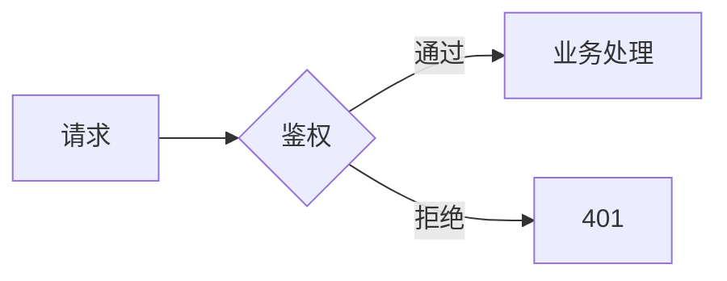

# 整理笔记

把外部内容变成知识库里位置正确、顺序合理、可检索的笔记。核心难点不是"写"，而是**放对位置**和**重新表达**——照抄附件等于把整理工作推给未来的自己。

## 零、开工前必读

1. 读 `01_知识库规范/00_库规与命名规范.md`、`01_目录结构与分类说明.md`、`02_标签体系.md`。规范优先级高于本 skill 中任何措辞。
2. 在动手分析前，**先列出知识库现有笔记**（`find . -name "*.md" -not -path "./00_Inbox/资料/*"` 或 Glob），并读取可能相关的笔记全文。不读现有笔记就判断"该新建还是该合并"是耍流氓——同一知识点在库里已有两篇半截笔记，再加一篇只会让知识库更乱。

## 一、从上下文里抽出知识点

"知识点"是**能被独立讲清楚、有明确适用对象**的一块内容，粒度参考知识库里现有笔记的一节。

- **有笔记文件附件**：逐段浏览，按主题切分，而不是按文件切分。一个附件里混着"Key 的读写"和"航点任务的断点续飞"，就是两个知识点。同时在脑子里排除附件里的装饰性内容（目录页、广告、重复的安装说明）。
- **无附件的纯文字描述**：从描述里拆出 0 个（纯闲聊）到多个知识点。例如"Android 的点击事件"→ 事件分发机制 / 常见的 OnClickListener 写法 / 触摸手势，具体拆几个取决于描述细节；描述很空时，按最核心的那个知识点处理。
- 把每个知识点用一句话记下：`名词 + 它解决什么问题 + 依赖哪个前置知识`。第三项决定后面放哪、按什么顺序。

## 二、决定落点：新建文件 / 合并进已有笔记

对每个知识点，先找出库里最相关的候选笔记（关键词 + 目录归属双重检索），然后打分：

| 情况 | 处理方式 |
|------|---------|
| 已有笔记本身就是讲这个知识点（或已含对应章节） | 合并进已有笔记，找到对应章节改写 |
| 已有笔记是同一专题的兄弟章节（同目录、同前缀编号的系列笔记） | 优先考虑合并，或作为该系列的新兄弟文件 |
| 只有总览/索引里提到过这个名字 | 可能正是"待处理"的坑位，就地展开 |
| 库里完全没有 | 新建文件 |

判断时记住库规："这个内容值得独立成一个文件吗？相关度高就合并"。**倾向合并**——文件数量不是资产，清晰的层次才是。

### 新建文件时

- 目录：按 `01_目录结构与分类说明` 的归属判例走；不够时在合适的一级目录下新建二级目录（`两位序号_名称`，在原目录内留空号）。一级新领域只有用户明确要求时才提议，且需同步更新分类说明表格与 README。
- 文件名：`两位序号_名称.md`；与同目录已有文件保持命名风格一致（例如某系列是"功能名"风格就沿用）。文件名决定图片前缀，起名时一并想好。
- frontmatter 严格照库规：`type` / `status` / `tags`（嵌套，2–4 个，生态标签已存在的沿用，新生态标签需在 `02_标签体系.md` 登记）/ `created` / `updated` / `source`。日期用 `yyyy-MM-dd`。
- 新建文件前必须检查该目录下的 `_说明.md`（若有"已有专题"表格）与 README，把它们一起纳入改动清单。

## 三、改写内容，而不是搬运

生成正文时同时参考三类材料：**本次提供的上下文**、**已有笔记中与之相关的段落**、**库规格式**。然后用自己的话重写：

- 保留事实（API 名、参数、取值范围、单位、版本号、结论），去掉来源的叙述口吻、营销语、重复内容。
- 已有笔记里的表达方式、代码风格、表格习惯要沿用，让新旧内容读起来像同一个人写的。
- 补充已有笔记能提供的衔接：前置概念用 `[[链接]]` 指过去，而不是重复讲一遍。
- 冲突要显式处理：新内容与旧笔记说法不一致时，在方案里标出"冲突：旧笔记说 A，附件说 B"，不要悄悄覆盖。
- 附件里的公式和图表不要原样贴截图，按第四节重写。先判断它原本是什么结构（算式、对照表、流程、坐标示意图），再用对应载体重建——截图看起来像图，实际可能是张表格。
- 写完正文后按第五节过一遍标记：该提醒的地方有没有 callout、类型选对没有、密度是否过高、高亮是否只落在关键词上。

## 四、公式与图表：写成能渲染的代码，不要搬截图

附件里的公式往往是截图，流程图、结构图也是截图。这类内容一律**重写成 Obsidian 能原生渲染的代码**：截图不可检索、不可缩放，改一个数字就得重画，字号和配色也永远和正文对不上。

### 4.1 公式用 LaTeX

行内用 `$...$`；单独成段的公式一律用独立公式块，`$$` 自己占一行，公式内容占一行，收尾的 `$$` 再占一行：

$$
\because 688 \overset{12} \longmapsto {\color{Red} 700} \overset{14} \longmapsto 714
$$

这种三行写法在手机端、阅读模式、导出 PDF 时都最稳，也方便逐行 diff。写成 `$$公式$$` 挤一行虽然多数情况能渲染，但内容一长就容易在窄屏被截断。

**公式不进 callout**——不写 `> [!Note]`，也不写 `> $...$`。推导是正文的一部分，包进引用块就变成"插播提示"，读者的视线要在正文和 callout 之间来回跳；而且 callout 里的 `$` 一旦被缩进层级打断就会渲染失败。

要强调推导里的关键一步，靠公式本身表达：箭头标出每一步的变化量，关键结果标色。上面那个式子就是模板——`\overset{12}` 说明这一步加了 12，`{\color{Red} 700}` 标出中间结果，读者不用自己算。

多步推导拆成几个独立公式块，块与块之间用一句话说明"这一步为什么成立"，不要把整段推导塞进同一个 `$$...$$`。

- 颜色只在真正需要"看这里"时用（结论、被改动的量、异常值），满篇红字等于没标。
- 公式不要放进代码块，也不要用行内 `$` 写整段推导。放进代码块只会显示成纯文本；长推导塞进行内会破坏段落行距。
- `$` 后不要紧跟空格，`$ 688$` 不会被识别成公式。
- 公式里出现中文要包 `\text{}`，否则会渲染成一串斜体字母。
- 公式里别写 `[[`，Obsidian 会当成内链；需要连续下标时用 `{}_{a}{}_{b}`。
- 多行对齐用 `\begin{aligned}...\end{aligned}`，在 `=` 前写 `&`；分段函数用 `\begin{cases}`：

$$
\text{cwnd}_{k+1} =
\begin{cases}
2 \cdot \text{cwnd}_k, & \text{cwnd}_k < \text{ssthresh} \\[4pt]
\text{cwnd}_k + 1, & \text{cwnd}_k \ge \text{ssthresh}
\end{cases}
$$

- 附件里只有公式截图、正文没有对应表达式时，自己把式子写出来；截图不进 `image/`。
- **标题里不写 LaTeX 变量**。`### 25.4 cwnd 随 RTT 的变化` 这种标题在大纲面板、搜索结果、锚点链接里都不会渲染，显示成一串 `$` 和反斜杠。标题用中文名（`拥塞窗口随 RTT 的变化`），变量留给正文。
- **数学变量统一用 LaTeX，不用行内代码。** 正文里的 $cwnd$、$ssthresh$、$seq$、$n$ 都写成公式；行内代码 `` `...` `` 只留给函数名、类名、文件名、配置项这类真正的代码标识符。混用会让读者以为 $cwnd$ 是个 API。

### 4.2 图表按结构复杂度选载体

| 要表达的东西 | 载体 | 理由 |
|---|---|---|
| 两三个维度的对照、参数清单、简单映射 | md 原生表格 | 纯文本、可 diff、窄屏自动横向滚动 |
| 需要合并单元格、跨列分组、单元格内换行或着色 | `<table>` | md 表格没有 rowspan / colspan，硬凑只会出现一串空列 |
| 坐标轴、几何关系、设备剖面、内存布局、需要自己定位置的连线图 | `<svg>` | 布局要精确控制，自动布局反而会把图排乱 |
| 小图标、符号示意（箭头、徽标、状态灯） | 内联 `<svg>` | 不受 emoji 字体差异影响，可跟随主题变色 |
| 流程、时序、状态迁移、类关系、ER、甘特 | Mermaid 代码块 | 改一个节点只改一行文本，布局自动重排 |

拿不准时看这条：**这张图以后会不会改？** 会改的用 Mermaid；不会改、但位置必须精确的用 SVG。

各载体的通用要求：

- HTML 标签和代码块**前后各留一个空行**。紧贴正文时 Markdown 会把 `<table>`、`<svg>` 当成普通文字吞掉，这是最常见的渲染失败原因；`<table>` 内部则不要留空行，空行会让 HTML 块提前结束。
- `<svg>` 用 `viewBox` 定坐标系、宽度写 `100%`，不要写死像素宽，否则手机上横向溢出。颜色优先用 Obsidian 主题变量（`var(--text-normal)`、`var(--background-secondary)`、`var(--interactive-accent)`），深浅色主题下都看得清。
- 图里只放标签和关键数字，解释写在正文。图里塞长句会让图变宽，阅读时反而要横向拖动。
- Mermaid 节点文本含括号、冒号、斜杠、中文标点时用引号包起来：`A["初始化 (init)"]`，否则解析报错。
- 原图是流程图、但实际只是"三步走"这种线性关系时，用有序列表比画图更清楚——不是所有图都值得重画。

### 4.3 骨架示例

下面的代码块只是为了让骨架看得清——**写进笔记时不要套 ``` 围栏**，直接把标签裸放在正文里，前后留空行。

合并单元格、跨列分组用 HTML 表格（表格内部不要留空行，单元格内换行用 `<br>`）：

````html
<table>
  <thead>
    <tr><th rowspan="2">层级</th><th colspan="2">职责</th></tr>
    <tr><th>读</th><th>写</th></tr>
  </thead>
  <tbody>
    <tr><td>L1 缓存</td><td>命中即返回</td><td>写穿到 L2</td></tr>
  </tbody>
</table>
````

需要自己定坐标的示意图用 SVG（`viewBox` + `width="100%"`，文字用主题色）：

````html
<svg viewBox="0 0 320 100" width="100%" role="img" aria-label="请求经网关分发到两个服务">
  <rect x="10" y="30" width="80" height="40" rx="6" fill="var(--background-secondary)" stroke="var(--text-muted)"/>
  <text x="50" y="55" text-anchor="middle" font-size="13" fill="var(--text-normal)">客户端</text>
  <line x1="90" y1="50" x2="150" y2="50" stroke="var(--text-muted)" stroke-width="1.5"/>
  <text x="120" y="42" text-anchor="middle" font-size="12" fill="var(--text-muted)">HTTP</text>
</svg>
````

流程、时序用 Mermaid（节点文本有标点就加引号）：

````markdown

````

## 五、用 callout 和高亮把重点抬出来

笔记是给自己复习用的，读者常常是"翻到这一节，找那个结论"，而不是从头读到尾。callout 把一段内容"框"出来，高亮把一句话里的关键词"点亮"——这两种标记就是为扫读服务的。

但标记的价值来自稀缺。满篇 callout 等于没有重点，满篇高亮等于没有高亮。

### 5.1 五种 callout 的语义分工

Obsidian 的内置类型各自对应一种"读者该怎么对待这段话"：

> [!NOTE]
> 补充说明、背景知识、容易被忽略的细节。跳过不影响理解主线。

> [!TIP]
> 技巧、经验、更省事的做法、推荐配置。照做能少踩坑。

> [!IMPORTANT]
> 关键结论、必须记住的规则、后面章节要反复用到的前提。跳过会看不懂后文。

> [!WARNING]
> 会导致错误但能恢复的坑：参数写反、顺序颠倒、版本不兼容。踩了要花时间排查。

> [!CAUTION]
> 不可逆的后果：数据丢失、安全问题、生产事故、烧硬件。踩了要付出真实代价。

选型时问一句：**"读者忽略这段，会付出什么代价？"** 没代价 → NOTE；浪费点时间 → TIP；看不懂后面 → IMPORTANT；要调试 → WARNING；要赔钱或丢数据 → CAUTION。

用错类型比不用更糟：把"数据丢失"写成 NOTE，读者就真的会跳过。

### 5.2 密度与位置

- 一节（`###`）最多一两个，整篇控制在五六个以内。超出说明你在拿 callout 代替正文组织，该拆小节了。
- callout 放的是旁注，不是主体。一段话删掉后主线就断了，它该是正文，不该在 callout 里。
- 不要连着放两个 callout，等于告诉读者"这两段都可以跳过"。
- 公式不进 callout（见 4.1）；代码块可以放，但缩进要和 `>` 对齐，否则渲染会散。
- 想给 callout 加标题就写 `> [!TIP] 用 rwnd 而不是 cwnd`，比在正文里再解释一遍省字。

### 5.3 高亮标关键词，不标整句

`==...==` 渲染成高亮底色，用途是**让扫读的眼睛落在关键词上**：

- 好：`==SYN 和 FIN 各消耗一个序号==`，纯 ACK 不消耗——一眼看到规则本身。
- 差：`==SYN 和 FIN 各消耗一个序号，纯 ACK 不消耗，这就是握手确认号要加 1 的原因==`——整句高亮，等于没有高亮。

具体约束：

- 一条要点最多一处高亮，一节最多两三处。同一段出现三个以上，读者就不知道该看哪个。
- 高亮只覆盖名词性短语、术语、数值阈值，不跨行、不跨句号。
- 表格单元格里慎用：底色和表格线叠在一起会糊。要强调就调整行序或加一列标记。
- 代码和公式里不要写 `==`。

### 5.4 三种强调手段的分工

正文里同时有加粗、高亮、callout，别让它们打架：

| 手段 | 作用 | 用在哪 |
|---|---|---|
| `**加粗**` | 结构强调 | 判断句、结论句、小节第一句 |
| `==高亮==` | 检索定位 | 长句里的关键词、易混术语、数值阈值 |
| callout | 旁注分级 | 需要读者"换个心态读"的整段内容 |

一句话概括：**加粗管骨架，高亮管眼睛，callout 管心态。**

## 六、按学习顺序安放（最容易做砸的一步）

每个知识点都有"前置—本体—延伸"三段。安放位置要让它出现时，读者已经掌握了前置。

1. 找到它的前置知识在已有笔记里出现的位置，新内容放在那之后。
2. 判断层级：如果它与现有某节是并列的同类知识点 → 同级小节；如果它只是某节的细节 → 收进那节；如果它自成一块且篇幅可观 → 新的一节（必要时在该笔记内升级为 `##` 级）。
3. 放完后通读整篇的标题树，问自己：**"按现在这个顺序学下去，会不会出现'用到还没讲的东西'"**。会，就调整——重排小节、拆分或合并章节、补充过渡句、移动已有段落。结构调整是允许且被期待的，但每次调整都要在方案里写清"动了什么、为什么"。
4. 若内容跨多篇笔记，检查这些笔记之间的系列顺序（同目录的编号），必要时提议新增编号并说明插入位置。
5. 更新 `updated`，必要时更新 `status`（例如内容已完备，`待整理` → `已整理`）。

## 七、图片搬运

仅当上下文里**同时**出现"附件笔记中的图片引用"与"图片文件/图片文件夹"时才处理。

先按第四节做一次分流：公式、流程图、时序图、结构图这类**能用代码重建**的截图，改写成 LaTeX / Mermaid / SVG / 表格，不进 `image/`；只有界面截图、设备照片、地图、手写批注这类无法重建的图才搬运。

1. 建/用知识库根目录的 `image/`（小写，库规未定义时以此为准）。
2. 按每个知识点命中的**目标笔记**分别编号：图片在该笔记正文中出现的顺序 = `1、2、3…`。
3. 重命名为 `<笔记文件名>_<序号>.<原扩展名>`（笔记文件名**带** `NN_` 数字前缀，含中文），例如 `04_云台与相机控制_1.jpg`。
4. 正文引用使用标准 md 相对路径：``，路径深度按目标笔记的层级计算。
5. 正文不直接引用、只是随图进入知识库的图片，不复制（避免 image/ 变垃圾场）。
6. **不要去猜图片：** 附件里的图片引用找不到对应文件时，保留占位说明 `> 图：<原图说明>（原图未提供）`，并在方案里列出缺失清单。

## 八、方案文件（写库的前置条件）

库规要求"AI 提议、人确认"。因此**任何落盘前**，先在 `00_Inbox/方案/` 写方案文件（目录不存在则创建）：

- 文件名：`yyyy-MM-dd <当日序号>-<方案名>.md`，例如 `2026-10-22 1-云台相机内容补齐.md`。当日序号按该目录下同日期文件递增。
- 内容用下面的固定结构，一事一项，让用户扫一眼就能否掉某一条：

```markdown
---
type: 备忘
status: 待整理
tags:
  - 类型/备忘
created: yyyy-MM-dd
updated: yyyy-MM-dd
---

# 方案：<方案名>

## 一、知识点清单
| # | 知识点 | 前置知识 | 是否已在库中存在 |

## 二、落点决定
| 知识点 | 动作（新建/合并/改写） | 目标文件 | 位置（第几节之后） | 理由 |

## 三、结构调整
- 原结构 → 新结构，以及为什么

## 四、公式与图表
| 原内容 | 处理方式（LaTeX / md 表格 / HTML 表格 / SVG / Mermaid / 保留图片） | 位置 | 备注 |

## 五、图片
| 原图 | 目标路径 | 引用位置 |

## 六、需用户拍板的事项
- 冲突、新建目录、跨笔记移动等

## 七、标记（callout 与高亮）

**callout**
| 位置 | 类型 | 内容摘要 |
|------|------|---------|
| 10.2 | IMPORTANT | 为什么必须是三次 |

**高亮**
| 位置 | 所在句子的要点 | 被 `==` 的词 |
|------|--------------|-------------|
| 05 | 序号消耗规则 | SYN 和 FIN 各消耗一个序号 |

## 八、变更清单
- 新增 / 修改 的文件逐个列出
```

方案文件**不自动删除**，无论是否通过都留在 `00_Inbox/方案/` 便于回溯。

向用户展示方案时，正文只给要点（落点表 + 结构调整 + 公式与图表处理 + 待拍板事项），不要让用户去翻文件。用户确认后再执行方案文件末尾「变更清单」列出的动作；用户否决或改口，按新意见修改方案文件后重新确认。

## 九、执行与收尾

- 只做方案里列出的变更，不顺手"优化"无关内容。
- 完成后逐项回读文件，确认：frontmatter 合法、标题层级没有断档（不出现 `####` 直接跟 `##`）、内链指向存在的笔记、图片路径真实可打开。
- 公式与图表单独过一遍：`$$` 是否单独占一行且成对、公式内是否有裸中文或行内代码、`<table>`/`<svg>` 与 Mermaid 代码块前后是否留空行、Mermaid 节点文本是否已加引号、SVG 宽度是否为 `100%`。这些错误在源文件里看不出来，只有渲染时才暴露，而用户往往是在手机上打开笔记。
- **扫描公式里的控制字符**。用脚本或编辑器生成正文时，`\text`、`\neq`、`\rightarrow` 里的反斜杠容易被当成转义符，`\t` 变成制表符、`\n` 变成换行，写进文件后就成了 `$<TAB>ext{MSS}$` 这种渲染失败的残片。搜一遍公式区域有没有制表符或不正常的孤立字母，比肉眼逐行看可靠。
- **扫描标记的密度和配对**。数一遍 `<callout 数量 / 节数>` 与 `==...==` 的出现次数是否超出第五节的上限；`==` 必须成对，且不能落在表格单元格、代码块和公式里（`$` 或围栏内的 `==` 会被当成公式/代码的一部分，渲染成字面量）。callout 与正文之间要留空行，否则类型标识不会被解析。
- 报告给用户：改了什么文件、动了哪些结构、哪些图被改写成了什么载体、图片落了哪些、callout 与高亮用了多少处、方案文件路径。

## 边界

- 附件是二进制大纲（如 pptx）且无法读取内容时，明确告诉用户，不要凭空编造内容。
- 不修改 `00_Inbox/资料/` 下的原始资料。
- 不做 git 提交，除非用户要求。
