# Android 开发入门（Java）

> **这是一篇随课程生长的笔记。** 章节号对应课程模块，跨度 5（01、05、10…），后续补新模块时只占自己的号，已有章节不动。
> 章内小节用「章号.序号」编号（如 `15.3`），新增小节只重排本章编号。
> 正文只写已经整理过的内容；尚未整理的模块只在下面的「课程地图」里标状态，不建空标题。
> 代码约定见 [[30_移动开发/_说明]]：只写 import、类结构、成员变量与相关方法，方法内无关代码用 `// ......` 代替。

## 课程地图

| 章   | 模块              | 对应集数                          | 状态          |
| --- | --------------- | ----------------------------- | ----------- |
| 01  | 环境搭建            | p04–p09                       | 已整理         |
| 05  | 工程结构与构建配置       | p11–p13                       | 已整理         |
| 10  | 界面与逻辑基础         | p14–p15                       | 已整理         |
| 15  | 视图基础            | p17–p22                       | 已整理         |
| 20  | 布局容器            | p23–p26                       | 已整理         |
| 25  | 基础控件与交互         | p27–p33                       | 已整理         |
| 30  | Activity 进阶     | p37–p42                       | 已整理         |
| 35  | 资源与适配           | p43–p50                       | 已整理         |
| 40  | 表单控件与对话框        | p51–p63                       | 已整理         |
| 45  | 列表与分页           | p106–p109、p115–p118           | 待整理         |
| 50  | 数据存储            | p64–p79                       | 已整理         |
| 55  | 系统组件与跨应用数据      | p87–p101                      | 已整理         |
| 60  | 异步与后台           | p124、p129–p130                | 待整理         |
| 65  | 通知与 Material 界面 | p102–p105、p128                | 待整理         |
| 70  | 服务与广播           | p110–p111                     | 待整理         |
| 75  | 设备能力与多媒体        | p112–p114、p122–p123、p126–p127 | 待整理         |
| 80  | Fragment        | p119–p121                     | 待整理         |
| 85  | 综合项目            | p81–p86、p125                  | 待整理         |
| 90  | 设计模式与工程实践       | p92–p94、p131                  | 待整理         |

排序原则：先能跑起来 → 再看懂工程 → 再改界面 → 再管页面 → 再存数据 → 再联网 → 最后做项目。列表控件排在存储之前，因为它是 UI 能力；需要「列表 + 存储」的购物车类案例归到综合项目。

---

## 01 环境搭建

### 1.1 先搞清楚 Android 是什么

- Android 由 Google 主导、开放手持设备联盟维护，是目前装机量最大的移动操作系统。
- 完整系统源码（AOSP）体量数百 GB，入门阶段**不需要**下载或编译系统源码。
- **Android ≠ Linux 发行版**。它使用 Linux 内核，但上面还叠了 HAL、系统服务、==ART 运行时==和应用框架。所以即便在 Ubuntu 上做开发，应用仍然要跑在 AVD 或真机上。
- **AOSP 与厂商定制**：小米 MIUI、华为 EMUI、OPPO ColorOS 都是在 AOSP 上做 UI 重构、功能增删和权限管控的定制系统。模拟器里看到的是原生 AOSP 界面。

> [!CAUTION] 刷机前先确认驱动
> 系统镜像必须搭配原厂驱动，否则黑屏、触控失效、基带不通。所以做 ROM 研究通常选 Google Pixel 系列——官方提供完整驱动和工厂镜像。

### 1.2 技术路线：原生 vs 混合

| 维度 | 原生开发 | 混合开发 |
|------|---------|---------|
| 技术栈 | Java/Kotlin + Android SDK | H5、Flutter、React Native、uni-app |
| 性能 | 最好，直接调用系统能力 | 有桥接开销，复杂交互易掉帧 |
| 更新方式 | 发版，用户重新安装 APK | 可下发资源包热更新 |
| 跨平台 | 只覆盖 Android | 一套代码多端 |
| 适合 | 系统级能力、大型应用核心模块 | 运营活动页、频繁迭代的轻量功能 |

实际项目几乎都是**混合架构**：核心链路用原生保性能，活动页、内容页用混合提迭代速度。

### 1.3 开发语言与 UI 技术

- **Java → Kotlin 的顺序不能反**。原因有三：
  1. Android Framework 层大量代码是 Java，读源码绕不开；
  2. 两者同属 JVM 语言，Java 扎实的人学 Kotlin 通常几小时就能上手；
  3. 企业存量项目仍是 Java 为主，只会 Kotlin 难以接手维护。
- 同一工程里 Java 与 Kotlin 可以互相调用，新建工程时选哪个当主语言都不影响后续混写。
- **C/C++ 与 NDK**：用于音视频编解码、图像处理、CPU 密集型运算。执行效率高，但没有 GC，需要手动管理内存，容易泄漏或越界。初中级开发非必需，是高级阶段做性能优化的工具。
- **UI 描述方式**：XML 是标记语言（不是编程语言），通过嵌套标签描述界面；==Jetpack Compose== 是基于 Kotlin 的声明式 UI 工具包。当前主流仍是 XML，新项目在往 Compose 迁移。学 XML 是为了读懂存量项目，学 Compose 是为了跟上新项目。

### 1.4 数据存储先知道有哪几种

移动端不用 MySQL 这类服务端重型数据库，原因很简单：设备资源有限，且要能离线。

| 方案 | 形态 | 适合存什么 |
|------|------|-----------|
| SharedPreferences | XML 键值对文件 | 用户偏好、登录态、轻量配置 |
| SQLite | 嵌入式关系库，`.db` 文件 | 结构化数据、需要查询和事务的业务数据 |
| 文件 | 沙盒目录下的普通文件 | 图片、缓存、导出文件 |

细节在 「50 数据存储」 展开，这里只建立印象。

### 1.5 安装 Android Studio 与 SDK

**下载与安装**

- 官方渠道是 Google 开发者中文站，国内可直连；安装包约 ==800 MB==。
- 安装向导里**必须勾选 `Android Virtual Device`**，这是创建模拟器的组件，约占 2.7 GB。
- 安装路径与 SDK 路径都改到==非系统盘==（如 `D:\android_sdk`），C 盘空间被吃掉后 Gradle 缓存和模拟器镜像会一起出问题。

**JDK 前置**

Android Studio 基于 IntelliJ IDEA，本身是 Java 程序，必须有 JDK 才能启动。教程录制时要求 JDK 1.8+，**现在的新版本 Android Studio 自带 JBR（JetBrains Runtime，JDK 17 及以上）**，一般不需要单独装 JDK；只有需要指定其他 JDK 版本时才在 `Settings → Build Tools → Gradle` 里改。

**SDK 是什么**

SDK（Software Development Kit）负责把源码编译、打包成可安装的 APK，内部包含 `adb`（调试桥）、`aapt`（资源编译）等工具。它和 Java 开发里的 JDK 是同一层定位。

- 默认安装 `SDK Platform 32`（API 32，Android 12L）。
- 缺其他版本时用 SDK Manager 勾选下载，不必重装 IDE。
- 安装时要接受两个协议：`SDK License` 与 `SDK Preview License`，全部 Accept 后 Finish 才可点。

### 1.6 创建工程与模拟器

**创建工程**

1. `New Project` → 模板选 `Empty Activity`。
2. 语言选 `Java`。
3. `Minimum SDK` 决定 APK 能装到哪些设备上。示例设为 ==API 28==（Android 9）。设得越低覆盖面越广，但可用的新 API 越少。
4. Finish 后自动生成两个核心文件：`activity_main.xml`（界面）与 `MainActivity.java`（逻辑）。

**创建 AVD**

1. `Device Manager` → `Create Device`。
2. 选机型与分辨率（示例为 5.0 英寸 Pixel 2）。
3. 选系统镜像，示例用 API 30（Android 11）。列表里没有就先 `Download`。
4. 设启动方向（Portrait / Landscape），命名（默认 `Pixel_2_API_30`），Finish。
5. 点播放按钮启动。首次启动要加载内核和系统服务，会等较久，之后启动快很多。

### 1.7 运行第一个 App

点运行按钮后，IDE 依次做：Gradle 编译 → 打包 APK → 安装到目标设备 → 拉起应用。正常情况十几秒，界面显示 `Hello World!` 就说明环境通了。

如果左侧文件树和教程不一样，是视图模式不同，在项目面板顶部切到 `Project` 视图即可。

### 1.8 真机调试

**打开调试开关**

1. 设置 → 关于手机 → 连续点「版本号」==7 次==，提示已进入开发者模式。
2. 返回设置 → 系统 → 开发者选项 → 打开「USB 调试」。
3. 小米的路径是：设置 → 我的设备 → 全部参数 → 点「MIUI 版本」。

**连接**

- 数据线连电脑后，手机弹窗选「传输文件」（MTP），**不能选「仅充电」**，否则 IDE 读不到设备。
- 首次连接会弹授权框，勾选「始终允许使用这台计算机进行调试」，省得每次重复确认。
- 在 Android Studio 顶部的运行配置下拉框里**手动切到真机**，否则代码仍然装到模拟器上。

**模拟器 vs 真机**

|            | 模拟器                 | 真机                    |
| ---------- | ------------------- | --------------------- |
| 多版本测试      | 一键建多台，成本极低          | 要有多台设备                |
| 硬件相关功能     | 相机、传感器、GPS、NFC 模拟不准 | 必须用真机                 |
| 厂商 ROM 兼容性 | 只能测原生系统             | 才能测 MIUI/EMUI/ColorOS |
| 性能         | 依赖电脑，偏慢             | 真实表现                  |

日常开发约九成场景用模拟器，涉及硬件 API、厂商适配、上线前验收时换真机。另有云真机平台可作为折中方案。

### 1.9 日志与 Logcat

```java
import android.os.Bundle;
import android.util.Log;
import androidx.appcompat.app.AppCompatActivity;

public class MainActivity extends AppCompatActivity {

    private static final String TAG = "MainActivity";

    @Override
    protected void onCreate(Bundle savedInstanceState) {
        super.onCreate(savedInstanceState);
        // ......
        Log.d(TAG, "onCreate: 应用启动");
    }
}
```

**五个等级**（从详细到严重）：

| 级别 | 常量 | 用途 |
|------|------|------|
| Verbose | `Log.v` | 最啰嗦的调试信息，一般不开 |
| Debug | `Log.d` | 开发期调试，最常用 |
| Info | `Log.i` | 关键流程节点 |
| Warn | `Log.w` | 可恢复的异常 |
| Error | `Log.e` | 出错，必须处理 |

**过滤规则**：Logcat 里选某个等级，会显示**该等级及以上**的所有日志。选 `D` 能看到 D、I、W、E；选 `E` 只剩错误。日常用 `D` 或 `I` 足够，开 `V` 会被系统日志淹没。

**自定义过滤器**：点 Logcat 左侧的过滤器配置 → New Filter Configuration → 填 Tag 与 Level → 保存。之后只看自己模块的日志。

### 1.10 ADB

ADB（Android Debug Bridge）是 PC 与设备之间的通信桥，负责下发指令、抓日志、传文件。位置在 SDK 目录的 `platform-tools/` 下（Windows 是 `adb.exe`）。

常见问题：手机助手类软件（360 手机助手、各类助手）在装驱动时会占用端口或直接杀掉 ==ADB 进程==，导致设备列表为空、Logcat 无输出。**驱动装完、设备识别成功后立刻卸载它**；如果驱动正常但 IDE 仍不识别，先重启系统，只重启 IDE 通常无效。

### 1.11 环境常见问题

**模拟器起不来：CPU 虚拟化没开**

1. 开机按品牌对应键进 BIOS（F2 / F12 / DEL）。
2. `Security` → `Virtualization` → `Enable`。
3. 保存重启。
4. 验证：任务管理器 → 性能 → 右下角 `虚拟化：已启用`。

部分笔记本（如小米、红米）出厂已开，能跑模拟器就不用管。

**Windows 硬件加速（HAXM）**

- 现象：创建或启动 AVD 直接报错。
- 前提：先在「启用或关闭 Windows 功能」里**取消勾选 Hyper-V**，否则冲突。
- 安装：运行 `SDK/extras/intel/Hardware_Accelerated_Execution_Manager` 下的安装程序。
- macOS 用同页面对应平台的安装包，Windows 的 `.exe` 不能直接用。

---

## 05 工程结构与构建配置

### 5.1 Project 与 Module

- **Project** 是顶层容器，相当于整个解决方案。
- **Module** 是真正承载代码和资源的单元，默认叫 `app`，也是最终打包成 APK 的实体。
- 编译、运行都是针对 Module，不是整个 Project。一个 Project 可以有多个 Module（比如按功能拆分，或一个 app 加一个 library）。
- 在 `Project` 视图下，工程分两块：`app` 与 `Gradle Scripts`。

### 5.2 app 模块目录

| 目录 | 内容 | 说明 |
|------|------|------|
| `manifests` | `AndroidManifest.xml` | 应用运行的基础配置：组件、权限、元数据 |
| `java` | Java/Kotlin 源码 | 默认分主代码包与测试包（`androidTest`、`test`） |
| `res` | 静态资源 | 图片、布局、字符串、颜色、主题 |

`res` 下常见子目录：

- `mipmap-*`：启动图标。`-v24` 后缀表示该资源专供 Android 7.0（API 24）及以上使用。
- `layout`：页面布局 XML。
- `values`：`strings.xml`、`colors.xml`、`themes.xml`，可分别定义浅色与深色主题。

**矢量图 vs 位图**：矢量图用数学描述图形，渲染时由 GPU 实时绘制，任意放大不失真；位图是固定像素矩阵，放大会糊。图标优先用矢量。

### 5.3 Gradle 与 build.gradle

**Gradle 是什么**

Android 官方的自动化构建系统。把源码、资源、依赖库当原料，经过编译、依赖解析、打包、签名，产出 APK。定位对标 Java 服务端的 Maven。脚本用 **Groovy** 写（运行在 JVM 上，语法接近 Java 的简化版）。

**两个 build.gradle**

| 文件 | 位置 | 管什么 |
|------|------|--------|
| 项目级 | 工程根目录 | 插件及版本、全局配置、自定义 Task（如 `clean`） |
| 模块级 | `app/build.gradle` | 该模块的编译版本、应用标识、依赖 |

模块级是日常改得最多的，关键参数：

| 参数 | 含义 | 注意 |
|------|------|------|
| `compileSdkVersion` | 用哪个 SDK 编译 | 决定能调用哪些 API |
| `buildToolsVersion` | 编译工具链版本 | 前两位要与 `compileSdkVersion` 一致 |
| `applicationId` | 应用唯一标识 | 必须与清单文件包名一致 |
| `minSdkVersion` | 最低支持版本 | 决定能装到哪些设备 |
| `targetSdkVersion` | 目标适配版本 | 决定系统按哪个版本的行为约束你 |
| `versionCode` | 内部版本号 | 整数，递增，应用商店据此判断更新 |
| `versionName` | 展示版本号 | 字符串，如 `1.0.0` |

`dependencies` 块里用 `implementation` 声明依赖，同步后 Gradle 从远程仓库下载并挂到编译路径。`androidx.appcompat:appcompat` 是官方兼容库，`AppCompatActivity` 就来自这里——它封装了各版本系统之间的 API 差异。

**其余配置文件**

| 文件 | 作用 |
|------|------|
| `proguard-rules.pro` | 混淆规则。APK 解压后能拿到 `.class`，反编译几乎能还原源码，混淆把类名方法名换成 `a`、`b` 这类无意义字符。配错会误删被反射调用的类，导致运行时崩溃 |
| `gradle.properties` | Gradle 引擎自身参数，如 `org.gradle.jvmargs` 堆内存 |
| `settings.gradle` | 声明参与构建的 Module，配置仓库地址（`google()`、`mavenCentral()`） |
| `local.properties` | 本机 SDK 路径（`sdk.dir=D:\\android_sdk`），自动生成，不要提交到 Git |

**版本对齐**：Android Studio、Gradle、AGP（Android Gradle Plugin）三者版本==强绑定==。用旧 IDE 打开新工程常出现依赖解析失败、构建中断，而且报错信息通常指向依赖本身、不指向版本。学习阶段与教程保持同一套版本，不要单独升降级其中一个。

### 5.4 AndroidManifest.xml

位置 `app/src/main/AndroidManifest.xml`，文件名大小写敏感，**每个应用有且只有一个**。系统靠它加载代码、初始化资源、识别组件和权限。

**package**

根节点的 `package` 属性是应用标识，必须与 `build.gradle` 的 `applicationId` 完全一致，否则会出现签名冲突或安装失败。

**`<application>` 常用属性**

| 属性 | 作用 |
|------|------|
| `android:allowBackup` | 是否允许系统备份应用数据（刷机后可恢复） |
| `android:icon` | 桌面图标 |
| `android:label` | 桌面显示名称 |
| `android:roundIcon` | 圆角图标，未配置时回退到 `icon` |
| `android:supportsRtl` | 是否支持从右到左布局（阿拉伯语、希伯来语） |
| `android:theme` | 应用主题，通常指向 `values/themes.xml` 里定义的 Material 主题 |

**`<activity>` 与启动入口**

`Activity` 是四大组件之一，代表一个页面容器。页面切换本质上是销毁或暂停当前 Activity、启动新的 Activity。

```xml
<activity
    android:name=".MainActivity"
    android:exported="true">
    <intent-filter>
        <action android:name="android.intent.action.MAIN" />
        <category android:name="android.intent.category.LAUNCHER" />
    </intent-filter>
</activity>
```

- `MAIN` + `LAUNCHER` 共同决定点击桌面图标时先打开哪个页面。

> [!WARNING] `android:exported` 是必填项
> ==API 31==（Android 12）及以上，带 `intent-filter` 的组件必须显式声明 `android:exported`，漏写直接安装失败。教程录制于 2022 年，未强调这一点，实际开发要写。

---

## 10 界面与逻辑基础

### 10.1 UI 与逻辑分离

Android 的界面按「结构」和「行为」拆开：

| 层 | 载体 | 职责 |
|----|------|------|
| 界面 | XML | 控件结构、位置、外观 |
| 逻辑 | Java | 事件响应、数据处理、状态变更 |

类比 Web：XML 像 HTML + CSS，Java 像 JavaScript。

这样做的好处：

- **可预览**：XML 在 IDE 里实时渲染，不用编译运行就能看效果。
- **可复用**：多个页面结构相同可以共用一份布局；逻辑相同可以抽成公共方法。
- **好维护**：改样式不动逻辑，改逻辑不动样式。

### 10.2 写一个布局

```xml
<?xml version="1.0" encoding="utf-8"?>
<LinearLayout xmlns:android="http://schemas.android.com/apk/res/android"
    android:layout_width="match_parent"
    android:layout_height="match_parent"
    android:orientation="vertical">

    <TextView
        android:id="@+id/tv_hello"
        android:layout_width="wrap_content"
        android:layout_height="wrap_content"
        android:text="Hello World"
        android:gravity="center" />

</LinearLayout>
```

几个必须理解的属性：

- `xmlns:android`：命名空间声明，告诉 IDE 哪些属性是合法的。漏了会一片报红，代码提示也会失效。
- `layout_width` / `layout_height`：`match_parent` 撑满父容器，`wrap_content` 包裹内容。
- `orientation`：`vertical`（默认）或 `horizontal`，子控件沿该方向依次排列。
- `id`：`@+id/xxx` 生成==唯一资源 ID==，供 Java 层查找。
- `gravity`：控制**内容**在控件内部的对齐；`layout_gravity` 才是控件在父容器里的对齐。

XML 必须有且只有一个根节点，标签成对闭合（叶子节点可自闭合）。`Ctrl + Shift + F` 可以格式化排版。

### 10.3 在 Java 里操作布局

```java
import android.os.Bundle;
import android.widget.TextView;
import androidx.appcompat.app.AppCompatActivity;

public class MainActivity extends AppCompatActivity {

    private TextView tvHello;

    @Override
    protected void onCreate(Bundle savedInstanceState) {
        super.onCreate(savedInstanceState);
        // 绑定布局
        setContentView(R.layout.activity_main);
        // 按 ID 找控件
        tvHello = findViewById(R.id.tv_hello);
        // 改属性
        tvHello.setText("你好世界");
    }
}
```

**执行链路**：启动 → `onCreate` → `setContentView` 解析 XML → `findViewById` 按 ID 查找实例 → 调 setter 改属性 → 通知 UI 线程重绘。


**R 类**：构建时由 aapt 扫描所有资源自动生成，把资源名映射成整型 ID。`R.layout.activity_main`、`R.id.tv_hello`、`R.string.app_name` 都是它的成员。它不在源码里，但一定存在——反编译 APK 能看到。

常用快捷键：

| 操作 | 快捷键 |
|------|--------|
| 自动导入 | `Alt + Enter` |
| 清理无用 import | `Ctrl + Shift + O` |
| 格式化 | `Ctrl + Shift + F` |
| 复制当前行 | `Ctrl + D` |

### 10.4 创建 Activity 的三步

1. **建布局**：在 `res/layout` 下新建 `activity_main2.xml`。
2. **建类**：新建 `MainActivity2`，继承 `AppCompatActivity`，重写 `onCreate`。
3. **注册**：在 `AndroidManifest.xml` 的 `<application>` 里加 `<activity android:name=".MainActivity2" />`。

```java
import android.os.Bundle;
import androidx.appcompat.app.AppCompatActivity;

public class MainActivity2 extends AppCompatActivity {

    @Override
    protected void onCreate(Bundle savedInstanceState) {
        super.onCreate(savedInstanceState);
        // ......
        setContentView(R.layout.activity_main2);
    }
}
```

几个易错点：

- `onCreate` 有单参数 `(Bundle)` 和双参数 `(Bundle, PersistableBundle)` 两个重载，**初学者必须重写单参数版本**，选错会导致生命周期回调链异常。
- 继承 `AppCompatActivity` 而不是 `Activity`，前者自带跨版本兼容处理（如 Material 主题、AppCompat 控件替换）。
- 普通页面**不需要** `intent-filter`，只有==启动页==需要。
- 页面里的字符串应放到 `strings.xml`，不要硬编码。

IDE 也能一键生成：右键包名 → `New` → `Activity` → `Empty Activity`，布局、类、清单注册三样自动完成。

### 10.5 用 Intent 跳转页面

先在 `activity_main.xml` 里加一个按钮，再在 Java 里绑点击事件：

```java
import android.content.Intent;
import android.os.Bundle;
import android.widget.Button;
import androidx.appcompat.app.AppCompatActivity;

public class MainActivity extends AppCompatActivity {

    private Button btnJump;

    @Override
    protected void onCreate(Bundle savedInstanceState) {
        super.onCreate(savedInstanceState);
        setContentView(R.layout.activity_main);
        // ......
        btnJump = findViewById(R.id.btn_jump);
        btnJump.setOnClickListener(v -> {
            Intent intent = new Intent();
            // 显式 Intent：直接指定目标组件
            intent.setClass(MainActivity.this, MainActivity2.class);
            startActivity(intent);
        });
    }
}
```

- **显式 Intent** 指定目标类，用于应用内部跳转。
- **隐式 Intent** 只声明 action / category / data，由系统匹配能处理的组件，用于跨应用调用（打开网页、拨号、分享）。
- 需要目标页回传数据时用 `startActivityForResult` / `registerForActivityResult`，属 「30 Activity 进阶」 内容。

### 10.6 Context 是什么

`Context` 是组件运行的环境句柄，通过它能拿资源（`getString`、`getResources`）、启动组件（`startActivity`、`startService`）、访问数据库和文件目录。

- `Activity`、`Service`、`Application` 都直接或间接继承 `Context`。
- 所以 `setClass(MainActivity.this, MainActivity2.class)` 里的 `MainActivity.this` 就是传了一个 Context。
- 注意生命周期：Activity 作为 Context 传给长生命周期对象（单例、静态变量）会导致内存泄漏，这类场景应改用 `getApplicationContext()`。

> [!IMPORTANT] Activity 不能当长生命周期的 Context
> Activity 的生命周期由系统管理，页面销毁后如果还有单例或静态变量持有它，整个 Activity 连同它的视图树都释放不掉，这就是==内存泄漏==。凡是把 Context 传给单例、静态字段、长驻线程的地方，一律换成 `getApplicationContext()`。

---

## 15 视图基础

### 15.1 所有控件都是 View

界面上看得见的东西——文本、按钮、图片、列表——全都是 `View` 的子类。

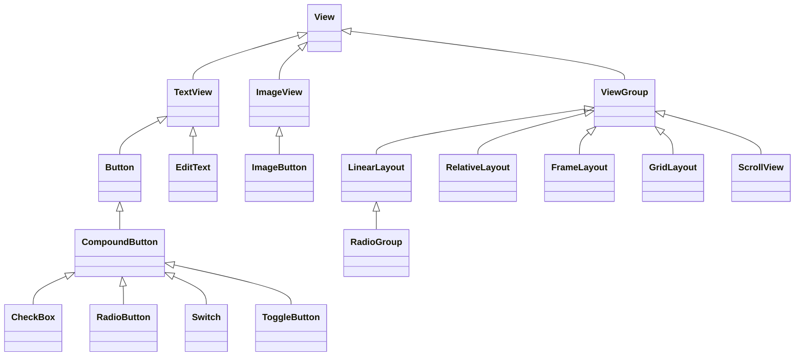

这张图里有两处值得单独记：`EditText` 直接继承 `TextView`（不是 `Button`）；`RadioGroup` 继承 `LinearLayout`（所以它才有 `orientation`）。`CompoundButton` 那一族共享 `checked` 属性与 `OnCheckedChangeListener`，见 [[#40.1 三种选择控件与 CompoundButton]]。

`ViewGroup` 既是 `View` 的子类，又是别的控件的容器——这是理解布局嵌套的关键。

理解这一点，后面所有「设置宽高、间距、背景、点击事件」的知识都只学一遍——它们定义在 `View` 上，所有控件通用。

### 15.2 尺寸单位：px / dpi / dp / sp

| 单位 | 全称 | 含义 | 用在哪 |
|------|------|------|--------|
| `px` | Pixel | 屏幕物理像素点 | 几乎不用（代码里 LayoutParams 默认单位是它） |
| `dpi` | Dots Per Inch | 每英寸的像素数 | 描述屏幕密度 |
| `dp` / `dip` | Density-independent Pixel | 密度无关像素 | 布局尺寸、间距 |
| `sp` | Scale-independent Pixel | 缩放无关像素 | 字号 |

**换算关系**

设屏幕横向像素数为 $w$、纵向为 $h$、对角线英寸数为 $d$，则：

$$
\text{dpi} = \frac{\sqrt{w^2 + h^2}}{d}
$$

$$
\text{density} = \frac{\text{dpi}}{160}
$$

$$
\text{px} = \text{dp} \times \text{density} = \text{dp} \times \frac{\text{dpi}}{160}
$$

Android 以 ==160 dpi== 为基准，此时 $1\,\text{dp} = 1\,\text{px}$。

**两个结论**

1. 分辨率相同、屏幕尺寸不同 → 屏幕越大 dpi 越小，同样的 $100\,\text{dp}$ 占比越小。
2. 屏幕尺寸相同、分辨率不同 → dpi 等比变化，$100\,\text{dp}$ 的占比不变。

这正是 `dp` 的价值：**同一物理尺寸的屏幕上，不同分辨率的设备显示比例一致**。跨尺寸（手机与平板）仍需单独适配。

**`sp` 与 `dp` 的差别**：换算逻辑一样，但 `sp` 会跟随==系统字体缩放设置==。用户把系统字体调大，`sp` 文本等比放大，`dp` 不变。这就是无障碍适配的基本要求。

**规范**：布局尺寸与间距用 `dp`，字号用 `sp`。

### 15.3 设置文本内容与 strings.xml

```xml
<!-- res/values/strings.xml -->
<resources>
    <string name="app_name">MyApp</string>
    <string name="hello">你好世界</string>
</resources>
```

```xml
<!-- 布局里引用 -->
<TextView
    android:layout_width="wrap_content"
    android:layout_height="wrap_content"
    android:text="@string/hello" />
```

```java
// Java 里引用
tvHello.setText(getString(R.string.hello));
```

**为什么不直接写字符串**：IDE 会报 `Hardcoded string` 警告。硬编码的问题有两层——同一文案散落在多个文件里，改一处要全局搜；以及无法接多语言资源包。抽到 `strings.xml` 后，`values-en/strings.xml` 放英文即可自动切换。

### 15.4 设置文字大小

```xml
<TextView
    android:layout_width="wrap_content"
    android:layout_height="wrap_content"
    android:textSize="30sp" />
```

- XML 里**必须带单位**，只写 `30` 会编译报错：`dimension value 30 must specify a unit`。
- Java 里 `setTextSize(30)` 默认单位就是 `sp`，不需要手动换算。

### 15.5 设置文本与背景颜色

**颜色值的结构**

颜色是一个 32 位整数，按 `0xAARRGGBB` 排列：高 8 位是 Alpha 透明度，低 24 位依次是红、绿、蓝。

<svg viewBox="0 0 420 130" width="100%" role="img" aria-label="0xAARRGGBB 的位段结构">
  <rect x="30" y="20" width="90" height="40" rx="4" fill="var(--background-secondary)" stroke="var(--text-muted)"/>
  <rect x="120" y="20" width="90" height="40" rx="4" fill="var(--background-secondary)" stroke="var(--text-muted)"/>
  <rect x="210" y="20" width="90" height="40" rx="4" fill="var(--background-secondary)" stroke="var(--text-muted)"/>
  <rect x="300" y="20" width="90" height="40" rx="4" fill="var(--background-secondary)" stroke="var(--text-muted)"/>
  <text x="75" y="46" text-anchor="middle" font-size="14" fill="var(--text-normal)">AA</text>
  <text x="165" y="46" text-anchor="middle" font-size="14" fill="var(--text-normal)">RR</text>
  <text x="255" y="46" text-anchor="middle" font-size="14" fill="var(--text-normal)">GG</text>
  <text x="345" y="46" text-anchor="middle" font-size="14" fill="var(--text-normal)">BB</text>
  <text x="75" y="80" text-anchor="middle" font-size="12" fill="var(--text-muted)">Alpha 透明度</text>
  <text x="165" y="80" text-anchor="middle" font-size="12" fill="var(--text-muted)">红 Red</text>
  <text x="255" y="80" text-anchor="middle" font-size="12" fill="var(--text-muted)">绿 Green</text>
  <text x="345" y="80" text-anchor="middle" font-size="12" fill="var(--text-muted)">蓝 Blue</text>
  <text x="30" y="108" font-size="12" fill="var(--text-muted)">每段 8 位：00 为最暗/全透明，FF 为最亮/不透明</text>
</svg>

**XML 与 Java 的默认透明度不同**

| 写法 | 默认 Alpha | 结果 |
|------|-----------|------|
| XML `android:textColor="#00FF00"` | `FF` | 绿色，正常显示 |
| Java `setTextColor(0x00FF00)` | `00` | 完全透明，文字消失 |

Java 里必须写八位：`0xFF00FF00`（纯绿）。

> [!WARNING] 同一个颜色值，XML 和 Java 结果不同
> XML 里省略 Alpha 时按 `FF`（不透明）补齐，Java 里省略时高位是 ==00==（全透明）。同一句 `#00FF00`，XML 正常显示绿色，Java 侧文字直接消失——不报错，只是看不见。Java 里一律写满八位：`0xFF00FF00`。

**代码写法**

```java
import android.graphics.Color;
import android.os.Bundle;
import android.widget.TextView;
import androidx.appcompat.app.AppCompatActivity;
import androidx.core.content.ContextCompat;

public class ColorActivity extends AppCompatActivity {

    private TextView tvText;
    private TextView tvBackground;

    @Override
    protected void onCreate(Bundle savedInstanceState) {
        super.onCreate(savedInstanceState);
        setContentView(R.layout.activity_color);
        // ......
        tvText = findViewById(R.id.tv_text);
        tvBackground = findViewById(R.id.tv_background);

        // 系统预设颜色
        tvText.setTextColor(Color.GREEN);
        // 引用 colors.xml 里的资源
        tvText.setTextColor(ContextCompat.getColor(this, R.color.my_green));
        // 背景色
        tvBackground.setBackgroundColor(ContextCompat.getColor(this, R.color.my_green));
        tvBackground.setBackgroundResource(R.color.my_green);
    }
}
```

> [!WARNING] `R.color.xxx` 不是颜色值
> `setTextColor(R.color.my_green)` 是**错的**。`R.color.xxx` 是==资源 ID==（一个整型编号），直接传进去会把编号当颜色值，显示出的颜色完全不对。必须用 `ContextCompat.getColor(context, id)` 取出真正的颜色值。

**颜色资源化**

```xml
<!-- res/values/colors.xml -->
<resources>
    <color name="my_green">#00FF00</color>
</resources>
```

XML 用 `@color/my_green`，Java 用 `ContextCompat.getColor(this, R.color.my_green)`。这样换主题、改配色只动一个文件。

### 15.6 设置视图宽高

**XML 三种取值**

| 取值 | 含义 | 说明 |
|------|------|------|
| `match_parent` | 与父容器等宽/等高 | 旧版叫 `fill_parent`，高版本已废弃该名 |
| `wrap_content` | 包裹内容，自适应 | 内容超出父容器时换行或裁剪 |
| 固定值 | 如 `300dp` | 不同分辨率下视觉比例一致 |

```xml
<TextView
    android:layout_width="wrap_content"
    android:layout_height="wrap_content"
    android:layout_marginTop="5dp"
    android:background="#FFCC00"
    android:text="wrap_content 示例"
    android:textColor="#000000"
    android:textSize="17sp" />
```

**代码动态修改：三步法**

```java
import android.os.Bundle;
import android.view.ViewGroup;
import android.widget.TextView;
import androidx.appcompat.app.AppCompatActivity;

public class SizeActivity extends AppCompatActivity {

    private TextView tvCode;

    @Override
    protected void onCreate(Bundle savedInstanceState) {
        super.onCreate(savedInstanceState);
        setContentView(R.layout.activity_size);
        // ......
        tvCode = findViewById(R.id.tv_code);

        // 1. 取当前布局参数
        ViewGroup.LayoutParams params = tvCode.getLayoutParams();
        // 2. 改宽高（单位是 px）
        params.width = dipToPx(300);
        // 3. 应用回去，触发重新布局
        tvCode.setLayoutParams(params);
    }

    /** dp 转 px */
    private int dipToPx(float dpValue) {
        float density = getResources().getDisplayMetrics().density;
        return (int) (dpValue * density + 0.5f);   // +0.5f 实现四舍五入
    }
}
```

要点：

- 代码里 `params.width/height` 的单位是 **px**，赋值前要把设计稿的 dp 换算成 px（`dp × density`）。
- 只改 `params` 不调 `setLayoutParams` 不会生效。
- 如果之后要操作 margin，需要强转成 `ViewGroup.MarginLayoutParams`，`LayoutParams` 本身没有 margin 字段。

> [!WARNING] 改宽高的两个坑
> **单位**：`params.width/height` 收的是==原始像素==，直接写 `300` 会得到 300 px 而不是 300 dp，在 3 倍屏上只有设计稿的三分之一大。赋值前先 `dp × density` 换算，代码里的 `dipToPx()` 就是干这个的。
>
> **顺序**：改完 `params` 必须调 `setLayoutParams(params)` 才会重新测量布局，只改对象不写回等于没改。

### 15.7 设置视图间距

两组属性，方向相反：

| 属性族 | 控制什么 | 生效位置 |
|--------|---------|---------|
| `layout_margin*` | 当前视图与**外部**（兄弟视图、父容器边界）的距离 | 视图之外 |
| `padding*` | 当前视图**内部**内容与自身边界的缓冲 | 视图之内 |

**XML 写法**

```xml
<!-- 外边距 -->
android:layout_margin="20dp"        <!-- 四边统一 -->
android:layout_marginTop="5dp"
android:layout_marginLeft="5dp"
android:layout_marginRight="5dp"
android:layout_marginBottom="5dp"

<!-- 内边距 -->
android:padding="60dp"              <!-- 四边统一 -->
android:paddingTop="10dp"
android:paddingLeft="10dp"
android:paddingRight="10dp"
android:paddingBottom="10dp"
```

代码侧对应 `View.setPadding(int, int, int, int)`，单位是 px，四个参数顺序为左、上、右、下。`ViewGroup.MarginLayoutParams` 才有 `setMargins()`，`LayoutParams` 没有。

**一个能看出差别的实验**：三层嵌套，外层蓝、中层黄、内层红。

| 层 | 配置 | 现象 |
|----|------|------|
| 外层 `LinearLayout` | 背景 `#f0aaff`，高 `300dp`，宽 `match_parent` | 蓝色只在边缘露出 |
| 中层 `LinearLayout` | 背景 `#ffff99`，宽高 `match_parent`，`layout_margin="20dp"` | 被推离父容器边界 20dp |
| 内层 `View` | 背景 `#ff0000`，宽高 `match_parent`，父级设 `padding="60dp"` | **没有撑满黄色区域** |

第三行是这一节的核心：内层写了 `match_parent`，但父容器的 `padding` 已经先占掉四周各 60dp，子控件能拿到的测量宽度只剩 `父宽 − 120dp`。==`padding` 优先于子控件的 `match_parent`==。

> [!WARNING] 子控件撑不满不是 bug
> `match_parent` 的意思是「填满父容器的**内容区**」，不是「填满父容器的物理边界」。父容器一旦设了 `padding`，内容区就比边界小一圈。排查「为什么子视图没铺满」时，先看父级的 `padding`，再看子级的 `margin`。

**这两组属性的通用性**：`margin` 与 `padding` 都定义在 `View` 上（`margin` 由 `ViewGroup.MarginLayoutParams` 承载），所以布局容器和普通控件都能用。区别只在语义——给 `LinearLayout` 设 `padding` 是给它的子控件留白，给 `Button` 设 `padding` 是给按钮文字留白。

**RTL 场景**：`layout_marginLeft/Right`、`paddingLeft/Right` 在阿拉伯语等从右到左的语言下不会自动镜像。新项目用 `layout_marginStart/End`、`paddingStart/End`，它们会跟随布局方向翻转。

### 15.8 设置视图对齐

两个属性名字很像，作用方向正好相反：

| 属性 | 谁相对谁 | 记忆方式 |
|------|---------|---------|
| `layout_gravity` | 当前视图相对**父容器** | 子控父 |
| `gravity` | 当前容器的**子视图**相对自己 | 父控子 |

**取值**：`top`、`bottom`、`left`、`right`、`center`、`center_vertical`、`center_horizontal`，多个值用 `|` 连接。

```xml
android:layout_gravity="bottom"                 <!-- 自己贴父容器底部 -->
android:gravity="center_vertical|right"         <!-- 子视图垂直居中、靠右 -->
```

**验证布局**：外层水平 `LinearLayout`，高 `300dp`；里面两个 `LinearLayout` 各 `width="0dp"` + `layout_weight="1"`，高 `200dp`，背景红色；每个红块里再放一个 `100dp × 100dp` 的青色 `View`。

| 配置 | 效果 |
|------|------|
| 左侧红块 `layout_gravity="bottom"` | 红块贴父容器底部 |
| 右侧红块 `layout_gravity="top"` | 红块贴父容器顶部 |
| 左侧红块内 `gravity="left"` | 青块贴红块左边 |
| 右侧红块内 `gravity="right"` | 青块贴红块右边 |

> [!WARNING] `layout_gravity` 在排列方向上无效
> `LinearLayout` 已经把子视图沿 `orientation` 方向排满了，该方向上的 `layout_gravity` 自然不起作用。==垂直 `LinearLayout` 里写 `layout_gravity="top"`、水平 `LinearLayout` 里写 `layout_gravity="left"` 都是白写==。想调这个方向的位置，用 `gravity` 控制容器内内容，或者换 `RelativeLayout` / `ConstraintLayout`。

---

## 20 布局容器

### 20.1 LinearLayout 与权重

`LinearLayout` 是最基础的容器：子视图沿一个方向依次排开。

```xml
<LinearLayout
    android:layout_width="match_parent"
    android:layout_height="match_parent"
    android:orientation="vertical">
    <!-- 子视图从上到下 -->
</LinearLayout>
```

- `orientation`：`horizontal`（从左到右）、`vertical`（从上到下）。==不写时默认 `horizontal`==。
- `tools:context=".MainActivity"` 只在 IDE 预览里绑定布局所属的 Activity，运行时不读取。它属于设计器辅助属性，删掉不影响运行。

**嵌套**：外层 `vertical` 里可以放「一行两个 TextView」的 `horizontal` 子组，再放「上下两个 TextView」的 `vertical` 子组。层级越深，测量次数越多，能用扁平布局解决就别嵌套。

**权重 `layout_weight`**

它分配的是**剩余空间**，不是全部空间。设第 $i$ 个子视图的权重为 $w_i$，权重总和为 $\sum_j w_j$，则它在剩余空间里的占比为：

$$
r_i = \frac{w_i}{\sum_{j} w_j}
$$

两个子视图权重 `1` 与 `2`，总份数 $1+2=3$，分别占 $\frac{1}{3}$ 与 $\frac{2}{3}$；权重 `2` 与 `3` 则占 $\frac{2}{5}$ 与 $\frac{3}{5}$。

三条规则必须同时满足才有效：

1. `layout_weight` 写在**直接子视图**上，写在父 `LinearLayout` 上无效。
2. 该子视图在分配方向上的尺寸必须是 `0dp`。
3. 方向由置零的那个属性决定：`layout_width="0dp"` 分配水平空间，`layout_height="0dp"` 分配垂直空间。

```xml
<LinearLayout
    android:layout_width="match_parent"
    android:layout_height="wrap_content"
    android:orientation="horizontal">

    <Button
        android:layout_width="0dp"
        android:layout_height="wrap_content"
        android:layout_weight="1"
        android:text="左" />

    <Button
        android:layout_width="0dp"
        android:layout_height="wrap_content"
        android:layout_weight="1"
        android:text="右" />
</LinearLayout>
```

> [!CAUTION] `match_parent` + `layout_weight` 会算出负数
> 权重分配的前提是「先量完固定尺寸，再把剩下的分掉」。如果写成 `layout_width="match_parent"` 又加 `layout_weight`，两个子视图各自先要了整行宽度，剩余空间变成负值，再按权重分这个负值，结果就是子视图被压扁甚至消失。==要按比例分，就必须写 `0dp`==。

### 20.2 RelativeLayout 定位

子视图的位置由**其他视图**或**父容器**决定，而不是排列顺序。不设任何定位属性时，子视图默认堆在父容器左上角。

**相对父容器**

| 属性 | 效果 |
|------|------|
| `layout_centerInParent="true"` | 水平、垂直同时居中 |
| `layout_centerHorizontal="true"` | 仅水平居中 |
| `layout_centerVertical="true"` | 仅垂直居中 |
| `layout_alignParentLeft="true"` | 左边缘贴父容器左边 |
| `layout_alignParentRight="true"` | 右边缘贴父容器右边 |
| `layout_alignParentTop="true"` | 上边缘贴父容器上边 |
| `layout_alignParentBottom="true"` | 下边缘贴父容器下边 |

多个 `alignParent*` 同时为 `true` 时，视图会被**拉伸**到同时满足这些边（左右都贴，宽度就等于父容器宽度）。常规做法是只用一个主对齐属性，位置微调交给 `layout_margin`。

**相对兄弟视图**

前提是目标视图有 `android:id`，引用时写 `@id/xxx`（==不带 `+`==，`+` 只在首次声明 ID 时用）。

| 属性 | 效果 |
|------|------|
| `layout_toLeftOf="@id/target"` | 放在目标左侧 |
| `layout_toRightOf="@id/target"` | 放在目标右侧 |
| `layout_above="@id/target"` | 放在目标上方 |
| `layout_below="@id/target"` | 放在目标下方 |
| `layout_alignTop="@id/target"` | 上边缘与目标上边缘对齐 |
| `layout_alignBottom="@id/target"` | 下边缘与目标下边缘对齐 |
| `layout_alignLeft="@id/target"` | 左边缘与目标左边缘对齐 |
| `layout_alignRight="@id/target"` | 右边缘与目标右边缘对齐 |

方位属性负责「在哪一侧」，对齐属性负责「另一条轴怎么对」。以中心视图 `tv_center` 为基准：

| 目标位置 | 属性组合 |
|---------|---------|
| 左侧 | `layout_toLeftOf="@id/tv_center"` + `layout_alignTop="@id/tv_center"` |
| 右侧 | `layout_toRightOf="@id/tv_center"` + `layout_alignBottom="@id/tv_center"` |
| 上方 | `layout_above="@id/tv_center"` + `layout_alignLeft="@id/tv_center"` |
| 下方 | `layout_below="@id/tv_center"` + `layout_alignRight="@id/tv_center"` |

**代价**：`RelativeLayout` 每加一层嵌套就多一轮测量。深层嵌套的相对布局在滚动列表里会明显掉帧，现代项目改用 `ConstraintLayout`——它把「相对谁、偏多少」写成约束，一层就能表达原来三四层的意思。

### 20.3 GridLayout 网格

`LinearLayout` 只能排成一行或一列，多行多列要用 `GridLayout`。子视图按==从左到右、从上到下==的顺序填格子，填满一行自动换行。

```xml
<GridLayout
    android:layout_width="match_parent"
    android:layout_height="match_parent"
    android:columnCount="2"
    android:rowCount="2">

    <TextView
        android:layout_width="0dp"
        android:layout_height="0dp"
        android:layout_columnWeight="1"
        android:layout_rowWeight="1"
        android:gravity="center"
        android:text="1" />
    <!-- 其余三个 -->
</GridLayout>
```

- `columnCount`：列数，决定每行最多放几个。
- `rowCount`：行数，决定每列最多放几个。
- `gravity="center"` 让单元格**内部文字**居中，不是让控件在格子里居中（后者用 `layout_gravity`）。

**固定尺寸的坑**：子视图写 `layout_width="180dp"`、父容器是 `match_parent`，两个 180dp 撑不满屏宽，两侧留白。改成自适应均分：宽高都改 `0dp`，再加 `layout_columnWeight="1"` 与 `layout_rowWeight="1"`。

> [!NOTE] GridLayout 的权重名和 LinearLayout 不同
> `LinearLayout` 只有 `layout_weight` 一个属性，方向跟着 `orientation` 走；`GridLayout` 拆成 `layout_columnWeight` 与 `layout_rowWeight`，行列各管一维。写错属性名不会报错，只是不生效。

### 20.4 ScrollView 滚动容器

屏幕高度固定，内容超出可视区就要滚动。两个容器分工明确：

| 容器 | 滚动方向 |
|------|---------|
| `ScrollView` | 垂直（上下） |
| `HorizontalScrollView` | 水平（左右） |

**触发滚动的关键在尺寸设置**：

| 容器 | 宽 | 高 |
|------|----|----|
| `ScrollView` | `match_parent` | **`wrap_content`** |
| `HorizontalScrollView` | **`wrap_content`** | `match_parent` |

滚动的前提是内容在滚动方向上溢出。`ScrollView` 的高度如果写成 `match_parent`，它和屏幕一样高，内部内容被压缩在可视区内，永远滚不动。写成 `wrap_content` 才会按内容真实高度撑开，超出屏幕后系统才接管滑动。

```xml
<!-- 垂直滚动 -->
<ScrollView
    android:layout_width="match_parent"
    android:layout_height="wrap_content">

    <LinearLayout
        android:layout_width="match_parent"
        android:layout_height="wrap_content"
        android:orientation="vertical">

        <View
            android:layout_width="match_parent"
            android:layout_height="400dp"
            android:background="#00FF00" />

        <View
            android:layout_width="match_parent"
            android:layout_height="400dp"
            android:background="#FFAA00" />
    </LinearLayout>
</ScrollView>
```

```xml
<!-- 水平滚动 -->
<HorizontalScrollView
    android:layout_width="wrap_content"
    android:layout_height="200dp">

    <LinearLayout
        android:layout_width="wrap_content"
        android:layout_height="match_parent"
        android:orientation="horizontal">

        <View
            android:layout_width="300dp"
            android:layout_height="match_parent"
            android:background="#FF0000" />

        <View
            android:layout_width="300dp"
            android:layout_height="match_parent"
            android:background="#0000FF" />
    </LinearLayout>
</HorizontalScrollView>
```

> [!WARNING] 滚动容器只能有一个直接子视图
> `ScrollView` 与 `HorizontalScrollView` 都只接受**一个**直接子 `View`。要塞多个控件，就先套一层 `LinearLayout` 再往里放。直接写两个子控件会在运行时抛 `IllegalStateException`，编译期不报错。

**选型**：内容量固定、几十个控件以内的长页面用 `ScrollView`；上百条数据要用 `RecyclerView`——`ScrollView` 会把所有子视图一次性创建并测量，条目多了直接卡死。

---

## 25 基础控件与交互

### 25.1 Button 与 TextView 的差异

`Button` 继承自 `TextView`（继承链：`Button → TextView → View`），所以 `text`、`textSize`、`textColor` 这些属性它全都有。默认样式却有三处不同：

| 维度 | `Button` | `TextView` |
|------|---------|-----------|
| 背景 | 系统圆角灰底 | 无 |
| 文本对齐 | 居中 | 靠左（需手动 `gravity="center"`） |
| 英文大小写 | 自动转全大写 | 保持原样 |

第三条由 `android:textAllCaps` 控制，默认 `true`：

```xml
<Button
    android:layout_width="wrap_content"
    android:layout_height="wrap_content"
    android:textAllCaps="false"
    android:text="Click Me" />
```

`textAllCaps` 只影响英文。中文没有大小写，所以中文按钮上看不出差别——这也是很多人第一次遇到全大写时找不到原因。

**为什么按钮默认居中**：`Button` 的默认 style 里设了 `gravity="center"`，同时把 `minHeight`、`minWidth` 撑到可点击尺寸。`TextView` 没有任何默认 style，所以既无背景也不居中。

### 25.2 点击事件监听

**三种写法**

```java
// ① Lambda（最常用）
btn.setOnClickListener(v -> tvResult.setText("点击了按钮"));

// ② 匿名内部类
btn.setOnClickListener(new View.OnClickListener() {
    @Override
    public void onClick(View v) {
        tvResult.setText("点击了按钮");
    }
});

// ③ Activity 实现接口
public class ClickActivity extends AppCompatActivity implements View.OnClickListener {
    @Override
    public void onClick(View v) {
        if (v.getId() == R.id.btn_click) { /* ...... */ }
    }
}
```

Lambda 要求 `compileOptions` 里 `sourceCompatibility` 与 `targetCompatibility` 都到 `JavaVersion.VERSION_1_8`（Android Studio 4.0 之后的新工程默认如此）。

**多个按钮共用一个监听**：让 Activity 实现 `View.OnClickListener`，所有按钮都 `setOnClickListener(this)`，回调里按 ID 分流。

```java
@Override
public void onClick(View v) {
    switch (v.getId()) {
        case R.id.btn_one:
            // ......
            break;
        case R.id.btn_two:
            // ......
            break;
        default:
            break;
    }
}
```

按钮超过三个时，这比给每个按钮单独写匿名类省得多。代价是逻辑全挤在一个方法里，超过十个分支就该拆。

> [!WARNING] 非静态内部类监听器会泄漏 Activity
> 匿名内部类与普通内部类都隐式持有外部 `Activity` 的引用。这个监听器一旦被生命周期更长的对象持有（静态字段、单例、长驻线程），Activity 销毁后也回收不掉，整棵视图树跟着泄漏。==需要复用的监听器要声明为 `static` 内部类，并用构造方法把控件传进去==：
>
> ```java
> private static class MyClickListener implements View.OnClickListener {
>     private final TextView tv;
>     MyClickListener(TextView tv) { this.tv = tv; }
>     @Override public void onClick(View v) { /* ...... */ }
> }
> ```
>
> Lambda 捕获外部变量时同样持有引用，只是编译器做了优化，风险低于匿名类；原则不变——别让它活过 Activity。

**为什么不用 `android:onClick`**：XML 里写 `android:onClick="doClick"` 仍能跑，但它把布局绑死在某个方法名上，改方法名要同步改 XML，IDE 也没法重构。该属性在 API 24 起已废弃。

### 25.3 长按事件

同一个控件可以同时挂点击与长按两个监听，系统按按压时长分发：

| 时长 | 触发 |
|------|------|
| 不足 500 ms | `onClick` |
| 超过 500 ms | `onLongClick` |

500 ms 来自 `ViewConfiguration.getLongPressTimeout()` 的默认值，不是硬编码常量，个别系统或 `ViewConfiguration` 实现会调整。

```java
btn.setOnLongClickListener(new View.OnLongClickListener() {
    @Override
    public boolean onLongClick(View v) {
        tvResult.setText("长按时间：" + new Date().toString());
        return true;
    }
});
```

**返回值决定事件是否继续传递**

| 返回 | 后果 |
|------|------|
| `true` | 消耗事件，本次手势到此结束，不再传给父容器 |
| `false` | 不消耗，事件向上冒泡；父容器若也注册了长按监听，会被依次触发 |

还有个容易忽略的细节：返回 `false` 时，手指抬起仍会走 `performClick()`，也就是==同一次按压会先触发长按、再触发点击==。要避免重复响应，长按回调必须返回 `true`。

**双击**：Android 没有 `onDoubleClick` 回调，得在 `OnTouchListener` 里自己判。两次 `MotionEvent.ACTION_DOWN` 的时间戳间隔小于 500 ms 即视为双击。

```java
btn.setOnTouchListener(new View.OnTouchListener() {
    private long lastDownTime = 0;

    @Override
    public boolean onTouch(View v, MotionEvent event) {
        if (event.getAction() == MotionEvent.ACTION_DOWN) {
            long now = System.currentTimeMillis();
            if (now - lastDownTime < 500) {
                // 双击
            }
            lastDownTime = now;
        }
        return false;
    }
});
```

**同族的其他监听器**：`setOnEditorActionListener`（软键盘动作键）、`setOnFocusChangeListener`（焦点变化）、`setOnHoverListener`（鼠标悬停）、`setOnKeyListener`（物理按键）、`setOnTouchListener`（底层触摸事件）。它们都定义在 `View` 上，所有控件通用。

### 25.4 启用与禁用控件

`View.setEnabled(boolean)` 定义在 `View` 上，所有控件都能用。设为 `false` 后控件不再响应点击，`onClick` 不触发，但仍占位、仍可见。

```java
btnTest.setEnabled(true);
btnTest.setTextColor(Color.BLACK);

btnTest.setEnabled(false);
btnTest.setTextColor(Color.GRAY);
```

**典型场景**：短信验证码按钮。点击后立刻 `setEnabled(false)`，起 60 秒倒计时，结束再 `setEnabled(true)`，防止连点重复发送。

**XML 侧**用 `android:enabled="false"` 设初始状态。

> [!NOTE] 禁用后文字变灰是主题给的，不是 `setEnabled` 给的
> Material 主题的 `Button` style 里有一个 `textColor` 的 `ColorStateList`，其中 `state_enabled="false"` 对应灰色。正常写法不需要手动改颜色，禁用后自动变灰。
>
> 但代码里一调 `setTextColor(int)`，就把整个 `ColorStateList` 覆盖成单一颜色，==状态联动消失，禁用后文字仍是黑的==。要保留联动，改用 `ColorStateList`，或者干脆不碰颜色、交给主题。

### 25.5 ImageView 与缩放类型

**加载图片两条路**

```xml
<ImageView
    android:id="@+id/iv_scale"
    android:layout_width="match_parent"
    android:layout_height="220dp"
    android:layout_marginTop="5dp"
    android:src="@drawable/apple" />
```

```java
ImageView ivScale = findViewById(R.id.iv_scale);
ivScale.setImageResource(R.drawable.apple);
```

`src` 是内容图，`background` 是背景图，两者可同时存在、叠加绘制。`src` 用 `setImageResource` / `setImageDrawable`，`background` 用 `setBackgroundResource`。

**`scaleType` 七种取值**

| 值 | 是否等比 | 允许放大 | 允许缩小 | 结果 |
|----|---------|---------|---------|------|
| `fitXY` | 否 | 是 | 是 | 强制填满视图，**会变形** |
| `fitStart` | 是 | 是 | 是 | 等比缩放到完整显示，靠左上 |
| `fitCenter` | 是 | 是 | 是 | 等比缩放到完整显示，居中（**默认值**） |
| `fitEnd` | 是 | 是 | 是 | 等比缩放到完整显示，靠右下 |
| `center` | — | 否 | 否 | 原始尺寸居中，超出部分裁掉 |
| `centerCrop` | 是 | 是 | 是 | 等比放大到**完全覆盖**视图，超出裁掉 |
| `centerInside` | 是 | **否** | 是 | 等比缩放到完整显示，居中，**只缩不放** |

`fitCenter` 与 `centerInside` 都保证图片完整可见、都居中，差别只在「图片比视图小时怎么办」：

- 图片 > 视图：两者都缩小，渲染结果一样。
- 图片 < 视图：`fitCenter` 会放大填满，`centerInside` 保持原尺寸。

`center` 与 `centerInside` 在图片小于视图时也一致，因为都不放大。

> [!IMPORTANT] 三者只差在「允不允许放大」
> 判断方法：先看图片比视图大还是小。比视图大，`fitCenter` / `centerInside` / `centerCrop` 都要缩小，前两个结果相同；比视图小，只有 `fitCenter` 会放大。==`centerCrop` 永远保证覆盖，`fitCenter` 永远保证完整，这两条互斥==。

**代码动态设置**

```java
imageView.setScaleType(ImageView.ScaleType.CENTER);
```

参数是 `ImageView.ScaleType` 枚举：`CENTER`、`CENTER_CROP`、`CENTER_INSIDE`、`FIT_XY`、`FIT_START`、`FIT_CENTER`、`FIT_END`、`MATRIX`。`MATRIX` 不自动缩放，完全交给 `setImageMatrix()` 自定义变换。

**选型**：强制填满且不在乎变形 → `fitXY`；常规内容 → `fitCenter`；头像、封面、全屏背景 → `centerCrop`；小图标不想被拉伸糊掉 → `centerInside`。

### 25.6 ImageButton

`ImageButton` 继承 `ImageView`，**不是**继承 `Button`。它有 `ImageView` 的全部图片能力，另外加了可点击性。

| 维度 | `Button` | `ImageButton` |
|------|---------|--------------|
| 文本 | 支持文字 + 图标 | 只能显示图片，无文本能力 |
| 图片方式 | 通常用 `background`，不按比例缩放 | 用 `src`，支持 `scaleType` 等比缩放 |
| 默认背景 | 系统灰色圆角 | 无，透明 |
| 默认 `scaleType` | 不适用（背景绘制） | **`center`** |

对照上一节：`ImageView` 默认 `fitCenter`，`ImageButton` 默认 `center`。所以把一张大图塞进 `ImageButton`、不设 `scaleType`，结果是裁切而不是缩小。

```xml
<ImageButton
    android:layout_width="match_parent"
    android:layout_height="80dp"
    android:src="@drawable/ic_symbol"
    android:scaleType="fitCenter"
    android:background="@drawable/bg_layer"
    android:foreground="@drawable/fg_layer" />
```

`foreground` 与 `background` 可以同时设，形成两层叠加（前景在上）。

> [!WARNING] `android:foreground` 在普通 View 上要 API 23+
> 这个属性最初只属于 `FrameLayout`，==API 23（Android 6.0）才提到 `View` 基类==。低版本上给 `ImageButton` 写 `foreground` 会被忽略，不报错也不生效。要在低版本做叠加，外面套一层 `FrameLayout`，或用 `LayerDrawable` 拼成一张图交给 `src`。

**场景**：键盘打不出的符号（`√`、`±`、`∞`）适合做成图片按钮，计算器项目的运算符按钮就是 `ImageButton`。

**无障碍**：`ImageButton` 没有文字，屏幕阅读器读不出它是什么。必须补 `android:contentDescription="平方根"`，否则 TalkBack 只会念「按钮」。

### 25.7 图文混排

按钮要同时有图标和文字，两条路：

| 方案 | 做法 | 代价 |
|------|------|------|
| 组合布局 | `ImageView` + `TextView` 塞进容器 | 多一层嵌套，但两者可分别点击、分别做动画 |
| 内置 drawable | 给 `Button` 设 `drawableLeft` 等 | 零嵌套，代码最简；图标与文字是一个整体，无法分开交互 |

**内置 drawable 的四个方位属性**

```xml
<Button
    android:layout_width="wrap_content"
    android:layout_height="wrap_content"
    android:drawableLeft="@drawable/ic_icon"
    android:drawablePadding="5dp"
    android:text="按钮文字"
    android:textColor="#000000"
    android:background="#FFFFFF" />
```

| 属性 | 图标位置 |
|------|---------|
| `android:drawableLeft` | 文字左侧 |
| `android:drawableTop` | 文字上方 |
| `android:drawableRight` | 文字右侧 |
| `android:drawableBottom` | 文字下方 |

`android:drawablePadding` 控制图标与文字的间距，四边通用。

`drawableLeft` / `drawableRight` 自 API 17 起废弃，改用 `drawableStart` / `drawableEnd`——后者会跟随布局方向翻转，阿拉伯语环境下不会左右错位。

> [!WARNING] Material 主题下 `background` 不生效，因为被 `backgroundTint` 盖住了
> 项目主题继承 `Theme.MaterialComponents.*` 时，`Button` 的 style 会给背景加一层 `backgroundTint`，把 `android:background` 设的颜色统一染成主题色。你写 `#FFFFFF`，屏幕上仍是紫色。
>
> 两种解法：设 `app:backgroundTint="@null"` 解除着色；或把主题换成 `Theme.AppCompat.Light.NoActionBar`，Material 那套 style 就不会套上来。改主题影响全局，只想改一个按钮就用前一种。

**选型**：图标与文字需要分别响应点击、或各自做动画，用组合布局；只是展示，用内置 drawable。

---

## 30 Activity 进阶

### 30.1 启动与结束 Activity

**启动**

```java
startActivity(new Intent(CurrentActivity.this, TargetActivity.class));
```

`Intent` 的两个必填参数：源 `Context`（当前 Activity 实例）、目标 `Class`。没有 Intent 就没法告诉系统「要去哪」，所以 `startActivity` 只有一个重载接收 Intent。

**结束**

`finish()` 销毁当前前台 Activity，把它从任务栈弹出，控制权回到栈内上一个 Activity。系统返回键的默认行为等效于调用 `finish()`。

```java
@Override
public void onClick(View v) {
    if (v.getId() == R.id.iv_back || v.getId() == R.id.btn_finish) {
        finish();
    }
}
```

一个 `ImageView` 做的返回箭头和一个「完成」按钮可以共用一个监听，靠 ID 判断，省掉一份重复代码。

**必须注册**：新 Activity 要在 `AndroidManifest.xml` 里加 `<activity android:name=".TargetActivity" />`，漏了会在跳转时抛 `ActivityNotFoundException` 崩溃。只有启动页需要 `intent-filter` 里的 `MAIN` + `LAUNCHER`。

### 30.2 生命周期

七个回调，按调用顺序排：

| 方法 | 状态 | 该做什么 |
|------|------|---------|
| `onCreate()` | 创建，布局已载入内存 | `setContentView()`、`findViewById()`、变量初始化 |
| `onStart()` | 可见，但未获焦点 | 一般不用重写 |
| `onResume()` | 活跃，可交互 | 开动画、注册监听、开轮询 |
| `onPause()` | 暂停，不可完全交互 | 停动画、存关键数据、停非核心任务 |
| `onStop()` | 不可见，退到后台 | 一般不用重写 |
| `onDestroy()` | 销毁 | 关网络连接、释放对象、取消监听与回调 |
| `onRestart()` | 从 `onStop` 回到 `onStart` 之间 | 重新加载数据 |

**三条流转路径**

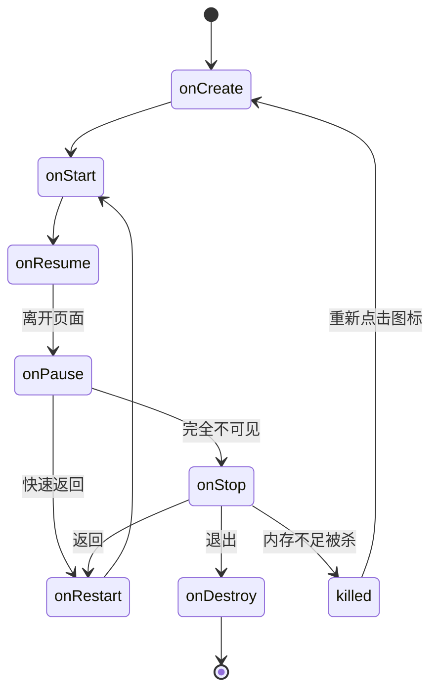

三条路径各自的完整序列：

| 场景 | 序列 |
|------|------|
| 完整走完 | `onCreate → onStart → onResume → onPause → onStop → onRestart → onStart → onResume → onPause → onStop → onDestroy` |
| 快速返回（跳过 `onStop`） | `onCreate → onStart → onResume → onPause → onRestart → onStart → onResume` |
| 后台被系统杀死 | `... → onPause → onStop → process is killed → onCreate → onStart → onResume` |

第二条路径跳过 `onStop` 的原因：界面还没完全消失，系统仍认为它在前台。第三条路径说明进程被杀后内存数据全没了，重开时走的是完整创建流程，不是 `onRestart`。

> [!IMPORTANT] `onRestart` 在 `onStart` 之前，不是之后
> 从后台回到前台时，调用顺序是 `onStop → onRestart → onStart → onResume`。`onRestart` 是「即将重新开始」的信号，不是「已经开始完了」。把它当成数据刷新点没问题，但别指望它拿到的是已经恢复好的界面状态。

**两个易混概念**：

- 可见（`onStart` 之后）≠ 可交互（`onResume` 之后）。被对话框遮挡时界面仍可见，但拿不到焦点。
- `onPause` 与 `onStop` 都可能被跳过——系统在极端内存压力下可以只走 `onPause` 就直接杀进程。

**`onNewIntent()`**：启动模式为 `singleTop` / `singleTask` / `singleInstance` 时，重复启动不会创建新实例，而是复用已有实例并回调这个方法。它不会自动更新 `getIntent()` 的返回值，要拿新 Intent 得在回调里显式 `setIntent(intent)`。

### 30.3 启动模式与任务栈

Activity 实例启动后压入任务栈（task stack），遵循后进先出：后进来的先退出。

**四种启动模式**（`android:launchMode`）

| 模式 | 行为 | 适合 |
|------|------|------|
| `standard` | 默认。每次启动都新建实例压栈 | 大多数页面 |
| `singleTop` | 目标已在栈顶则复用（回调 `onNewIntent`），否则新建 | 高频入口页、支付页、通知点击页 |
| `singleTask` | 栈内任意位置存在即复用，并把其上方所有 Activity 全部弹出销毁 | 主界面（栈底，返回直接退出）、高耗资源页（视频播放器） |
| `singleInstance` | 独占一个全新任务栈，栈内只有它一个实例 | 系统级独占页（拨号盘） |

`singleInstance` 的返回逻辑最特殊：先把当前前台栈的 Activity 全部弹完，再把后台那个独占栈切到前台，最后才退出应用。

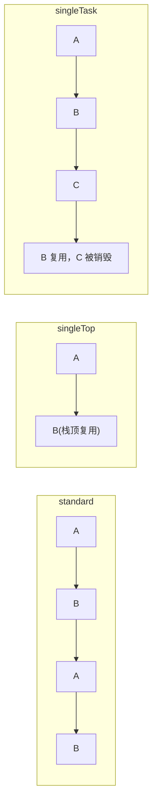

**Intent Flags**（可用 `|` 叠加，优先级高于清单里的 `launchMode`）

| Flag | 作用 |
|------|------|
| `FLAG_ACTIVITY_CLEAR_TOP` | 目标已在栈内则清除其上方所有 Activity |
| `FLAG_ACTIVITY_CLEAR_TASK` | 清空当前任务栈全部实例 |
| `FLAG_ACTIVITY_NEW_TASK` | 在新任务栈中启动 |
| `FLAG_ACTIVITY_SINGLE_TOP` | 目标在栈顶则复用，等价于 `singleTop` |

**两个高频场景**

1. A ↔ B 反复跳转：默认模式下栈无限堆积（A→B→A→B…），返回键要按很多次。加 `FLAG_ACTIVITY_CLEAR_TOP` 后栈里最多留一个目标实例。
2. 登录成功后进首页：`FLAG_ACTIVITY_CLEAR_TASK | FLAG_ACTIVITY_NEW_TASK`，登录页与中间页全部销毁，返回键直接退出 App，退不回登录流程。

> [!CAUTION] `CLEAR_TASK` 必须配 `NEW_TASK`，否则登录页残留
> `FLAG_ACTIVITY_CLEAR_TASK` 单独使用不生效——它只作用于「当前任务栈」，而当前栈的语义由 `NEW_TASK` 决定。只写 `CLEAR_TASK` 的典型症状是：登录成功后能进首页，但按返回键又退回了登录页，等于把用户放回了已经失效的会话里。==两个 Flag 必须一起写==。

### 30.4 显式与隐式 Intent

`Intent` 是组件之间的通信载体，字段有：`component`（目标组件）、`action`（动作）、`data`（Uri）、`category`（类别）、`type`（MIME 类型）、`extras`（`Bundle`）、`flags`（栈行为）。

**显式 Intent：直接点名目标**

```java
// ① 构造直传
new Intent(CurrentActivity.this, TargetActivity.class);

// ② setClass
intent.setClass(CurrentActivity.this, TargetActivity.class);

// ③ setComponent
intent.setComponent(new ComponentName(CurrentActivity.this, TargetActivity.class));
```

第三种还能传「包名字符串 + 类名字符串」，用于启动别的应用或系统组件——拿不到对方的 `.class`，只能用名字。

```java
intent.setComponent(new ComponentName(
        "com.tencent.mm",
        "com.tencent.mm.ui.LauncherUI"));
```

**隐式 Intent：只说要做什么**

不指定目标，靠 `action` / `category` / `data` 与已注册的 `IntentFilter` 匹配。多个应用声明同一个 action 时，系统弹出选择器。

| 常用 Action | 用途 |
|------------|------|
| `Intent.ACTION_VIEW` | 查看数据（打开网页、图片、视频） |
| `Intent.ACTION_DIAL` | 打开拨号盘（号码预填，不直接拨出） |
| `Intent.ACTION_SENDTO` | 发送短信/邮件 |
| `Intent.ACTION_WEB_SEARCH` | 网页搜索 |

```java
// 拨号
Intent intent = new Intent(Intent.ACTION_DIAL);
intent.setData(Uri.parse("tel:12345"));
startActivity(intent);

// 短信
Intent sms = new Intent(Intent.ACTION_SENDTO);
sms.setData(Uri.parse("smsto:12345"));
startActivity(sms);
```

`ACTION_DIAL` 只是打开拨号界面并预填号码，用户仍需按拨出键；要直接拨出得用 `ACTION_CALL` 并申请 `CALL_PHONE` 权限——一般不这么干。

**跨应用自定义 Action**

被调用方清单：

```xml
<activity
    android:name=".CalculateActivity"
    android:exported="true">
    <intent-filter>
        <action android:name="com.example.CUSTOM_ACTION" />
        <category android:name="android.intent.category.DEFAULT" />
    </intent-filter>
</activity>
```

调用方：

```java
Intent intent = new Intent("com.example.CUSTOM_ACTION");
startActivity(intent);
```

被调用方清单里的 `android.intent.category.DEFAULT` 是**必需**的：`startActivity()` 会自动给隐式 Intent 补上 `CATEGORY_DEFAULT`，过滤器里没声明这个类别就匹配不上。调用方代码里不需要手动 `addCategory`。

`android:exported="true"` 也是必需的——不带 `intent-filter` 时默认 `false`，外部应用根本启动不了它。

**找不到目标会崩**：隐式 Intent 没有匹配组件时，`startActivity` 直接抛 `ActivityNotFoundException`。稳妥写法是先判断：

```java
if (intent.resolveActivity(getPackageManager()) != null) {
    startActivity(intent);
}
```

### 30.5 向下一个 Activity 传数据

数据挂在 `Intent` 的 extras 上，两种打包方式：

```java
// 方式一：Bundle 集中打包
Intent intent = new Intent(this, ReceiveActivity.class);
Bundle bundle = new Bundle();
bundle.putString("request_time", DateUtil.getTime());
bundle.putString("request_content", tvS.getText().toString());
intent.putExtras(bundle);
startActivity(intent);

// 方式二：逐条 putExtra
intent.putExtra("request_time", DateUtil.getTime());
intent.putExtra("request_content", tvS.getText().toString());
```

接收方：

```java
Intent intent = getIntent();
Bundle bundle = intent.getExtras();
if (bundle != null) {
    String requestTime = bundle.getString("request_time");
    String requestContent = bundle.getString("request_content");
    tvReceive.setText(String.format("请求时间：%s\n请求内容：%s", requestTime, requestContent));
}
```

`Bundle` 支持 `String`、`int`、`boolean`、`float`、`Parcelable`、`Serializable` 等类型。传自定义对象要么实现 `Parcelable`（快，但要写样板代码），要么 `Serializable`（简单，但反射开销大）。

> [!WARNING] 键名拼错不会报错，只会拿到 `null`
> `putExtra("request_time", ...)` 与 `getString("request_time")` 的字符串是两个独立的字面量，编译器不会校验它们一致。拼错一个字母，`getString` 返回 `null`，后面一拼字符串就 NPE。==Key 抽成 `public static final String` 常量==，两边引用同一个，是最省事的防错手段。

### 30.6 从下一个 Activity 取回数据

链路：A 打包请求 → 跳转 → B 处理 → `setResult` 打包应答 → A 的回调里解析。

`startActivityForResult` 已废弃，现在用 `registerForActivityResult`。

```java
public class RequestActivity extends AppCompatActivity {

    private ActivityResultLauncher<Intent> launcher;
    private TextView tvResponse;

    @Override
    protected void onCreate(Bundle savedInstanceState) {
        super.onCreate(savedInstanceState);
        setContentView(R.layout.activity_request);
        // ......
        launcher = registerForActivityResult(
                new ActivityResultContracts.StartActivityForResult(),
                result -> {
                    if (result.getData() != null
                            && result.getResultCode() == Activity.RESULT_OK) {
                        Bundle extras = result.getData().getExtras();
                        tvResponse.setText(extras.getString("response_content"));
                    }
                });
    }

    private void sendRequest() {
        Intent intent = new Intent(this, ResponseActivity.class);
        Bundle bundle = new Bundle();
        bundle.putString("request_data", "请求内容");
        intent.putExtras(bundle);
        launcher.launch(intent);
    }
}
```

响应方：

```java
public class ResponseActivity extends AppCompatActivity {

    @Override
    protected void onCreate(Bundle savedInstanceState) {
        super.onCreate(savedInstanceState);
        // ......
        String request = getIntent().getExtras().getString("request_data");
    }

    private void sendBack() {
        Intent intent = new Intent();
        Bundle bundle = new Bundle();
        bundle.putString("response_time", String.valueOf(System.currentTimeMillis()));
        bundle.putString("response_content", "应答内容");
        intent.putExtras(bundle);
        setResult(Activity.RESULT_OK, intent);
        finish();
    }
}
```

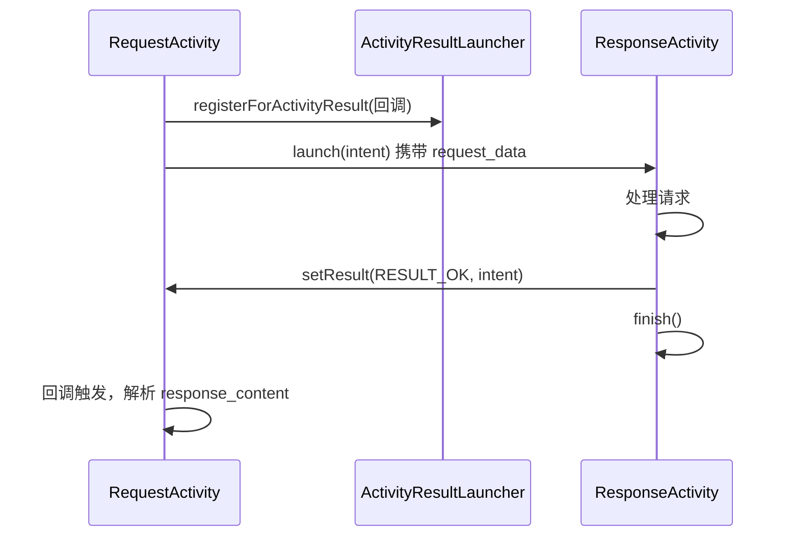

**状态码**：`Activity.RESULT_OK` 值为 `-1`，`RESULT_CANCELED` 为 `0`，也可以自定义业务码区分不同结果。

> [!TIP] 注册必须在 `onCreate` 里，且要在 `STARTED` 之前
> `registerForActivityResult` 只能在 Activity 尚未进入 `STARTED` 状态时调用。写在字段初始化或 `onCreate()` 开头都行，写在按钮回调里会抛 `IllegalStateException`。注册一次、反复 `launch()` 是正确用法，不要在每次发起请求时重新注册。

**易错点**：`setResult()` 必须在 `finish()` 之前调用——`finish()` 一执行，页面就开始销毁，之后的 `setResult` 不再生效。另外 `getExtras()` 可能为 `null`（对方没放任何数据），取值前要判空。

---

## 35 资源与适配

### 35.1 字符串资源

15.3 讲过 `strings.xml` 的读写，这里补三件事：为什么必须用它、资源编译链路、以及格式化的写法。

**文件位置**：`res/values/strings.xml`

```xml
<resources>
    <string name="app_name">MyApp</string>
    <string name="weather_string">晴天</string>
    <string name="welcome">欢迎，%1$s！你有 %2$d 条新消息</string>
</resources>
```

**读取**

```java
// XML 里
android:text="@string/weather_string"

// Java 里
tvResource.setText(getString(R.string.weather_string));
tvWelcome.setText(getString(R.string.welcome, userName, count));
```

`getString(int)` 定义在 `Context` 上，`Activity` 继承自 `Context`，直接调用即可。

**为什么不能在代码里硬编码**：Java 源码要编译成 `.class` 再打进 APK，改一个文案就得重新 Rebuild → Package → Deploy 走一遍。`strings.xml` 是声明式资源，由 aapt2 编译成二进制资源表 `resources.arsc`，运行时由 `AssetManager` 按当前语言与配置动态加载。文案改动不触碰业务代码，也才能接多语言：

```
res/values/strings.xml      默认（中文）
res/values-en/strings.xml   英文
res/values-zh-rTW/strings.xml  繁体（台湾）
```

系统按设备的 `Locale` 选目录，没有匹配就回退到 `values/`。

**占位符语法**：`%1$s` 表示第 1 个参数、类型为字符串；`%2$d` 是第 2 个参数、整型。美元符号前面是参数序号，后面是类型符。带占位符的字符串必须用 `getString(resId, args...)` 传参，不要自己拼 `+`——不同语言里参数的顺序可能不同，`%1$s` 在日文里可能放到句末，硬拼就错了。

### 35.2 元数据 meta-data

静态配置除了 `strings.xml`，还能写在 `AndroidManifest.xml` 的 `<meta-data>` 节点里。第三方 SDK（高德地图、友盟统计、微信/QQ 登录、推送）都靠它接收 `app_key` / `token`，在初始化时读取校验。

**清单配置**

```xml
<application>
    <activity android:name=".MetaDataActivity">
        <meta-data
            android:name="weather"
            android:value="sunny" />
        <meta-data
            android:name="config_value"
            android:value="@string/config_value" />
    </activity>
</application>
```

`android:value` 可以直接写字面量，也可以引用 `@string/` 资源。若写 `android:resource="@xml/xxx"`，读的时候要用 `getInt()` 拿资源 ID，不是 `getString()`。

**读取三步**

```java
public class MetaDataActivity extends AppCompatActivity {

    @Override
    protected void onCreate(Bundle savedInstanceState) {
        super.onCreate(savedInstanceState);
        setContentView(R.layout.activity_meta_data);
        // ......
        PackageManager pm = getPackageManager();
        try {
            // 1. 拿到本 Activity 的 ComponentName
            ComponentName componentName = getComponentName();
            // 2. 查询 ActivityInfo，必须带 GET_META_DATA 标志
            ActivityInfo info = pm.getActivityInfo(
                    componentName, PackageManager.GET_META_DATA);
            // 3. 从 Bundle 里取值
            Bundle metaData = info.metaData;
            if (metaData != null) {
                String weather = metaData.getString("weather");
                tvMetadata.setText(weather);
            }
        } catch (PackageManager.NameNotFoundException e) {
            e.printStackTrace();
        }
    }
}
```

三个关键点：

- `getComponentName()` 返回当前 Activity 的标识，等价于 `new ComponentName(this, MetaDataActivity.class)`。查错组件会得到 `null` 或别人的元数据。
- `PackageManager.GET_META_DATA` 标志必须带上。==不带的话 `info.metaData` 是 `null`==，不报错，只是取不到。
- `getActivityInfo` 抛 `NameNotFoundException`，是受检异常，必须 try-catch。

**相关类**：`PackageManager` 是系统级服务，管安装、卸载、权限、组件查询，能拿到包名和所有 Activity/Service 列表。`ComponentName` 是四大组件的唯一标识，由包名 + 类名组成。

> [!WARNING] `metaData` 可能为 `null`
> 清单里没写任何 `<meta-data>` 时，`info.metaData` 返回 `null`。直接 `info.metaData.getString("weather")` 会 NPE。取之前先判空，这也是上面代码里那个 `if` 的来历。

### 35.3 桌面快捷方式

长按应用图标弹出的快捷菜单（App Shortcuts）。静态快捷方式自 ==API 25（Android 7.1）== 起支持，7.0 只能动态注册。

**三步实现**

1. 建 `res/xml/shortcuts.xml`
2. 在清单的目标 `<activity>` 里声明元数据
3. 在 `shortcuts.xml` 里逐个定义 `<shortcut>`

```xml
<!-- res/xml/shortcuts.xml -->
<shortcuts xmlns:android="http://schemas.android.com/apk/res/android">

    <shortcut
        android:shortcutId="first"
        android:shortcutShortLabel="@string/short_label_first"
        android:shortcutLongLabel="@string/long_label_first"
        android:shortcutEnabled="true"
        android:icon="@mipmap/ic_launcher">

        <intent
            android:action="android.intent.action.VIEW"
            android:targetPackage="com.example.myapp"
            android:targetClass="com.example.myapp.MainActivity" />
    </shortcut>

    <shortcut
        android:shortcutId="second"
        android:shortcutShortLabel="@string/short_label_second"
        android:shortcutLongLabel="@string/long_label_second"
        android:shortcutEnabled="true"
        android:icon="@mipmap/ic_launcher">

        <intent
            android:action="android.intent.action.VIEW"
            android:targetPackage="com.example.myapp"
            android:targetClass="com.example.myapp.SecondActivity" />
    </shortcut>
</shortcuts>
```

```xml
<!-- AndroidManifest.xml，写在启动 Activity 里 -->
<activity android:name=".MainActivity" android:exported="true">
    <intent-filter>
        <action android:name="android.intent.action.MAIN" />
        <category android:name="android.intent.category.LAUNCHER" />
    </intent-filter>
    <meta-data
        android:name="android.app.shortcuts"
        android:resource="@xml/shortcuts" />
</activity>
```

> [!WARNING] 属性名是 `shortcutId` / `shortcutShortLabel`，不是 `id` / `shortLabel`
> 这组属性全都带 `shortcut` 前缀：`android:shortcutId`、`android:shortcutShortLabel`、`android:shortcutLongLabel`、`android:shortcutEnabled`、`android:shortcutDisabledMessage`。写成 `android:id` 或 `android:shortLabel` 不会报编译错误，只是快捷方式不出现——排查时很难想到是属性名的问题。
>
> 另外 `action` / `targetPackage` / `targetClass` 不是 `<shortcut>` 的属性，而是嵌套 `<intent>` 子元素的属性。

**两条硬性要求**：

- `shortLabel` / `longLabel` 不能硬编码，必须 `@string/xxx` 引用，否则系统拒绝加载。
- 快捷方式指向非启动页时，目标 Activity 必须 `android:exported="true"`——桌面 Launcher 是外部组件，没导出就点不动，且不给任何提示。

**数量与长度**：一个 Activity 最多 5 个静态快捷方式；`shortLabel` 建议不超过 10 个字符，`longLabel` 不超过 25 个字符，超出会被系统截断。

### 35.4 Drawable 与密度目录

`Drawable` 是所有可绘制图形的抽象基类，资源统一放 `res/drawable`。常见实现子类：

| 子类 | 形态 |
|------|------|
| `ColorDrawable` | 纯色块 |
| `BitmapDrawable` | 位图 |
| `VectorDrawable` | XML 矢量图 |
| `ShapeDrawable` | XML 形状 |
| `StateListDrawable` | 状态列表（`<selector>`） |
| `LayerDrawable` | 图层叠加（`<layer-list>`） |
| `NinePatchDrawable` | 点九图 |
| `GradientDrawable` | 渐变（`<shape>` 里的 `<gradient>`） |

`Paint` 不属于这个家族——它是 `android.graphics` 下的画笔类，负责在 `Canvas` 上画东西，与 `Drawable` 没有继承关系。

**密度目录**

| 目录 | 参考分辨率 | 密度 |
|------|-----------|------|
| `drawable-ldpi` | ~240×320 | 120 dpi |
| `drawable-mdpi` | ~320×480 | 160 dpi |
| `drawable-hdpi` | ~480×800 | 240 dpi |
| `drawable-xhdpi` | ~720×1280 | 320 dpi |
| `drawable-xxhdpi` | ~1080×1920 | 480 dpi |
| `drawable-xxxhdpi` | ~1440×2560 | 640 dpi |

同名资源放在多个密度目录时，系统按设备当前密度挑最接近的一份。只有 `hdpi` 有图、设备是 `xhdpi`，系统会把 480×800 的图线性放大到 720×1280——放大是插值，结果就是边缘发虚、锯齿明显。

==判断该放哪个目录看的是像素密度（dpi），不是屏幕英寸数==。同样 5 英寸的手机，有的 1080p 有的 720p，英寸数一样但密度差一倍。

**引用语法**：`@drawable/资源名`，==必须省略扩展名==。`@drawable/ic_back` 对，`@drawable/ic_back.png` 错。

**矢量图优先**：同一张图标，矢量图只存一份 XML，任意密度下都清晰；位图要准备 5 份，APK 体积翻好几倍。图标、简单图形一律用 `VectorDrawable`，只有照片类位图才分密度目录。

### 35.5 形状图形 shape

用 XML 描述几何图形，替代图片做控件背景。好处是体积几乎为零、颜色可运行时改、圆角随尺寸自适应。

**根节点**

```xml
<shape xmlns:android="http://schemas.android.com/apk/res/android"
    android:shape="rectangle">
    <!-- 子节点 -->
</shape>
```

| `android:shape` 取值 | 说明 |
|---------------------|------|
| `rectangle` | 矩形（默认） |
| `oval` | 椭圆/正圆 |
| `line` | 单条线，**必须配 `<stroke>`**，否则解析报错 |
| `ring` | 环形 |

**子节点**

```xml
<shape xmlns:android="http://schemas.android.com/apk/res/android"
    android:shape="rectangle">

    <!-- 实心填充 -->
    <solid android:color="#FFD700" />

    <!-- 描边 -->
    <stroke
        android:width="1dp"
        android:color="#AAAAAA"
        android:dashWidth="4dp"
        android:dashGap="2dp" />

    <!-- 圆角，仅 rectangle 生效 -->
    <corners
        android:radius="10dp"
        android:topLeftRadius="10dp"
        android:topRightRadius="10dp"
        android:bottomLeftRadius="0dp"
        android:bottomRightRadius="0dp" />

    <!-- 固定尺寸，不写则拉伸到宿主 View 大小 -->
    <size android:width="100dp" android:height="50dp" />

    <!-- 内容内边距 -->
    <padding
        android:left="10dp"
        android:top="10dp"
        android:right="10dp"
        android:bottom="10dp" />
</shape>
```

**`<stroke>` 的虚线**：`dashWidth` 与 `dashGap` 都非 0 才是虚线，段长与间隙长各自由它们控制。任一为 0 就是实线。

**`<corners>` 只在 `rectangle` 下有效**。`oval` 没有「角」这个概念，写了也不生效，不会报错。

**`<gradient>`**

```xml
<gradient
    android:type="linear"
    android:startColor="#FF0000"
    android:centerColor="#00FF00"
    android:endColor="#0000FF"
    android:angle="45" />
```

| 属性 | 说明 |
|------|------|
| `android:type` | `linear`（线性）、`radial`（放射）、`sweep`（扫描） |
| `android:startColor` / `centerColor` / `endColor` | 起点 / 中点 / 终点颜色 |
| `android:angle` | 仅 `linear`。`0` 表示从左到右，逆时针递增，必须是 45 的倍数 |
| `android:cx` / `cy` / `gradientRadius` | 仅 `radial`，光源中心坐标与扩散半径 |

`angle` 的方向常被记错：`0` 是从左到右，`90` 是从下到上，`180` 是从右到左，`270` 是从上到下。

**代码切换**

```java
viewContent.setBackgroundResource(R.drawable.shape_rectangle_gold);
```

`setBackgroundResource(int)` 接资源 ID，`setBackground(Drawable)` 接已解析的对象，`setBackgroundColor(int)` 接颜色值。三者别混用。

> [!NOTE] `<solid>` 与 `<gradient>` 不能同时用
> 两者都是「填充」语义，同时写时只有一个生效（实际以 `<gradient>` 为准）。要渐变就别写 `<solid>`。

### 35.6 点九图 9-patch

普通图片当背景，控件一变尺寸就整体拉伸，圆角被拉成椭圆、边框被拉粗。点九图解决这个问题：只拉伸指定区域的像素，边框厚度与圆角弧度保持不变。

**文件**：后缀 `.9.png`，在 Android Studio 里右键普通 PNG → `Create 9-patch file` 生成。

**四条黑线**

<svg viewBox="0 0 340 200" width="100%" role="img" aria-label="9-patch 四条黑线的作用">
  <rect x="70" y="40" width="180" height="120" rx="10" fill="var(--background-secondary)" stroke="var(--text-muted)" stroke-width="2"/>
  <line x1="120" y1="40" x2="200" y2="40" stroke="var(--interactive-accent)" stroke-width="4"/>
  <line x1="70" y1="80" x2="70" y2="130" stroke="var(--interactive-accent)" stroke-width="4"/>
  <line x1="130" y1="160" x2="190" y2="160" stroke="var(--text-warning)" stroke-width="4"/>
  <line x1="250" y1="90" x2="250" y2="120" stroke="var(--text-warning)" stroke-width="4"/>
  <text x="160" y="30" text-anchor="middle" font-size="12" fill="var(--text-normal)">上：水平拉伸区</text>
  <text x="30" y="110" text-anchor="middle" font-size="12" fill="var(--text-normal)">左：垂直拉伸</text>
  <text x="160" y="180" text-anchor="middle" font-size="12" fill="var(--text-normal)">下：内容水平边界</text>
  <text x="285" y="110" text-anchor="middle" font-size="12" fill="var(--text-normal)">右：内容垂直边界</text>
</svg>

| 边 | 作用 |
|----|------|
| 上 | 水平拉伸区。黑线**正下方**的像素列随控件宽度横向拉伸，线外区域不动 |
| 左 | 垂直拉伸区。黑线**右侧**的像素行随控件高度纵向拉伸，线外区域不动 |
| 下 | 内容水平安全区，隐式设定 `paddingLeft` / `paddingRight` |
| 右 | 内容垂直安全区，隐式设定 `paddingTop` / `paddingBottom` |

记忆方式：==上、左管拉伸，下、右管内容==。

**内容边界与 padding 的关系**：下、右两条黑线一旦画上，就等于给图片定死了内边距。XML 或代码里再设 `padding` 只能在这个基础上**增大**，不能缩小。

> [!WARNING] 9-patch 画了内容边界，`padding` 就只能加不能减
> 想让代码完全掌控内边距，就把下、右黑线画得极窄（只占 1 像素）或紧贴文字区域。否则会出现「明明设了 `padding="5dp"`，文字离边框还是很远」的情况，且找不到原因。

**引用**：`android:background="@drawable/normal"`——==`.9.png` 后缀整体省略==，写 `@drawable/normal.9` 会找不到资源。

**验证差异**：系统默认主题会给 `Button` 套一层背景，把点九图的效果盖掉。对比时要先把主题换成 `Bridge` 或系统原生主题，再给两个按钮分别设普通图和点九图，并把按钮拉大（加 `padding` 和 `layout_margin`）才能看出区别。

### 35.7 状态列表 selector

同一个控件在不同交互状态下显示不同背景（按下变深、选中变亮、禁用变灰）。XML 根节点 `<selector>`，放 `res/drawable`。

```xml
<!-- res/drawable/btn_selector.xml -->
<selector xmlns:android="http://schemas.android.com/apk/res/android">
    <item android:state_pressed="true" android:drawable="@drawable/btn_pressed" />
    <item android:state_focused="true" android:drawable="@drawable/btn_focused" />
    <item android:state_enabled="false" android:drawable="@drawable/btn_disabled" />
    <item android:drawable="@drawable/btn_normal" />
</selector>
```

```xml
<Button
    android:layout_width="match_parent"
    android:layout_height="wrap_content"
    android:background="@drawable/btn_selector" />
```

**常用状态属性**

| 属性 | 触发条件 | 典型控件 |
|------|---------|---------|
| `android:state_pressed="true"` | 按下 | 所有可点击控件 |
| `android:state_checked="true"` | 勾选 | `CheckBox`、`RadioButton`、`Switch` |
| `android:state_focused="true"` | 获得焦点 | `EditText` |
| `android:state_selected="true"` | 选中 | Tab、菜单项 |
| `android:state_enabled="false"` | 禁用 | 所有控件 |

**匹配规则是「从上到下第一个命中」**

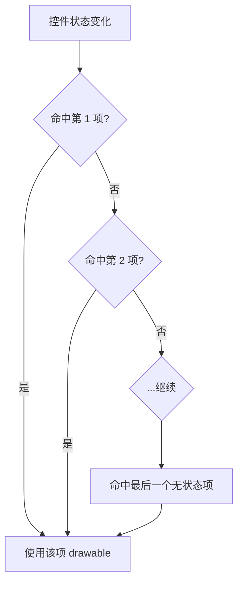

不写任何 `state_*` 的 `<item>` 是**默认项**，它匹配一切状态。所以它必须放最后——放最前面的话，所有状态都会命中它，后面的专项状态永远轮不到。

**组合状态**：一个 `<item>` 可以同时写多个 `state_*`，表示「全部满足」才命中。例如 `state_pressed="true"` 加 `state_enabled="false"` 表示「禁用状态下被按下」——这种组合一般不会发生，实际用不上，但写 `state_focused="true"` + `state_enabled="true"` 是常见做法，用来排除「禁用时也显示聚焦样式」。

**运行时切换**：`selector` 由系统按状态自动选，不需要代码干预。只有一种情况要手动设：`setBackgroundResource(R.drawable.xxx)` 换一整套背景。

---

## 40 表单控件与对话框

### 40.1 三种选择控件与 CompoundButton

`CheckBox`、`RadioButton`、`Switch` 外观完全不同，但底层是同一个父类：

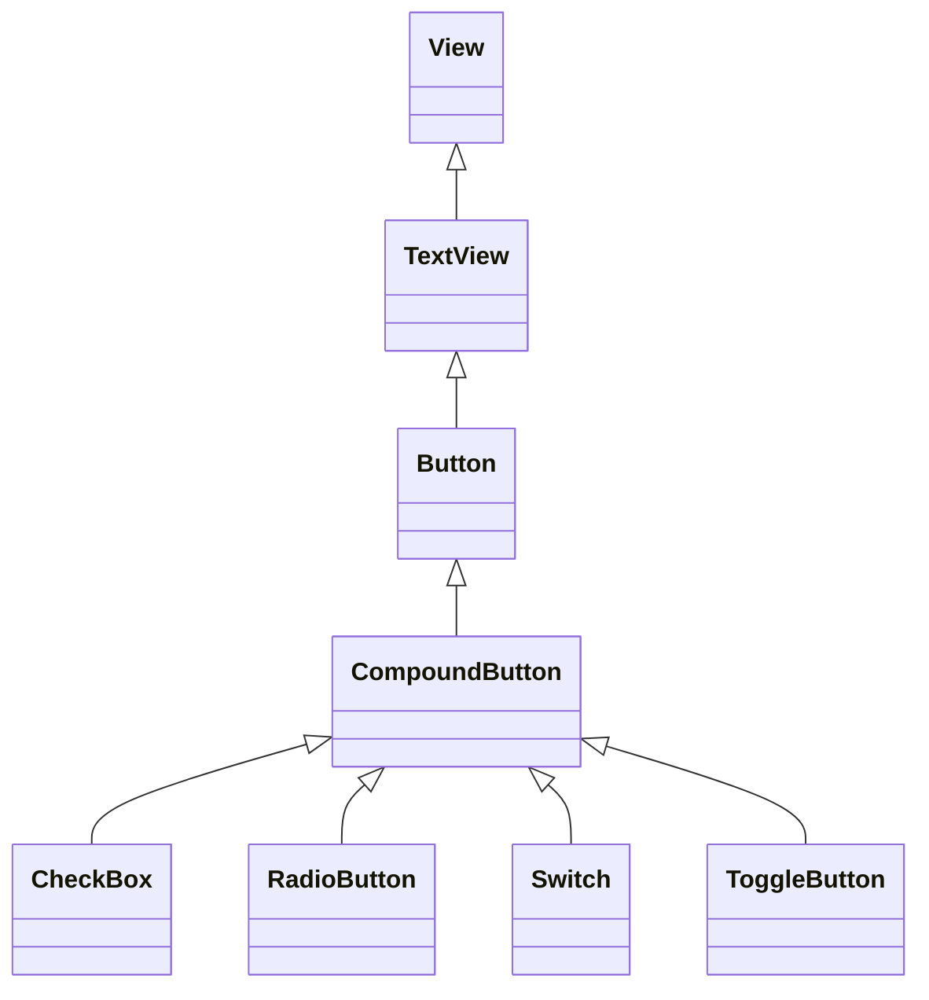

继承 `CompoundButton` 意味着三者共享同一套属性与 API：

| 成员 | 作用 |
|------|------|
| `android:checked` | XML 里的初始选中状态 |
| `android:button` | 左侧指示图标（`CheckBox` / `RadioButton` 用） |
| `isChecked()` | 读当前状态 |
| `setChecked(boolean)` | 改状态 |
| `setOnCheckedChangeListener(...)` | 状态变化监听 |
| `setButtonDrawable(Drawable)` / `setButtonDrawable(int)` | 动态换图标 |

监听回调的签名也统一：

```java
cbSystem.setOnCheckedChangeListener(new CompoundButton.OnCheckedChangeListener() {
    @Override
    public void onCheckedChanged(CompoundButton buttonView, boolean isChecked) {
        String desc = String.format("您%s了这个 CheckBox", isChecked ? "勾选" : "取消勾选");
        cbSystem.setText(desc);
    }
});
```

`buttonView` 声明类型是 `CompoundButton`，实际传入的是 `CheckBox` 实例；`isChecked` 是变化**之后**的状态。

> [!NOTE] 三者共享父类，但语义不同
> `CheckBox` 是多选（各选项互不影响），`RadioButton` 必须放进 `RadioGroup` 才有互斥，`Switch` 是二态开关。它们的区别不在 API，在于容器与使用场景——**不要因为监听器能通用就把三者混用**。

### 40.2 CheckBox 与自定义勾选图标

```xml
<CheckBox
    android:id="@+id/cb_system"
    android:layout_width="match_parent"
    android:layout_height="wrap_content"
    android:padding="5dp"
    android:checked="false"
    android:text="系统的 CheckBox" />
```

默认未选中。`android:checked="true"` 设初始选中。

**换掉左侧方框**：`android:button` 指向一个 selector，按 `state_checked` 切换两张图。

```xml
<!-- res/drawable/checkbox_selector.xml -->
<selector xmlns:android="http://schemas.android.com/apk/res/android">
    <item android:state_checked="true" android:drawable="@drawable/ic_checked" />
    <item android:drawable="@drawable/ic_unchecked" />
</selector>
```

```xml
<CheckBox
    android:id="@+id/cb_custom"
    android:layout_width="match_parent"
    android:layout_height="wrap_content"
    android:button="@drawable/checkbox_selector"
    android:text="自定义 CheckBox" />
```

### 40.3 Switch 与仿 iOS 开关

**原生 `Switch`** 是左右滑动的开关，典型布局是「左边说明文字 + 右边开关」。

```xml
<LinearLayout
    android:layout_width="match_parent"
    android:layout_height="wrap_content"
    android:orientation="horizontal">

    <TextView
        android:layout_width="0dp"
        android:layout_height="wrap_content"
        android:layout_weight="1"
        android:layout_gravity="start"
        android:text="Switch 开关" />

    <Switch
        android:id="@+id/sw_status"
        android:layout_width="80dp"
        android:layout_height="30dp"
        android:layout_gravity="end" />
</LinearLayout>

<TextView
    android:id="@+id/tv_result"
    android:layout_width="match_parent"
    android:layout_height="wrap_content"
    android:layout_marginTop="10dp"
    android:gravity="start" />
```

宽度分配的顺序值得记一下：`LinearLayout` 先测量宽度固定的 `Switch`（80dp），剩下的空间全给 `layout_weight="1"` 的 `TextView`。所以文字控件不用写具体宽度，也不会被挤出去。

用 `start` / `end` 而不是 `left` / `right`，从右到左的语言下会自动镜像。

```java
swStatus.setOnCheckedChangeListener((buttonView, isChecked) -> {
    tvResult.setText(String.format("按钮的状态是 %s", isChecked ? "开" : "关"));
});
```

**仿 iOS 开关**：原生 `Switch` 的外观受主题控制，改不动。要自定义就换 `CheckBox`：

```xml
<CheckBox
    android:id="@+id/cb_ios"
    android:layout_width="60dp"
    android:layout_height="30dp"
    android:button="@null"
    android:background="@drawable/switch_selector" />
```

```xml
<!-- res/drawable/switch_selector.xml -->
<selector xmlns:android="http://schemas.android.com/apk/res/android">
    <item android:state_checked="true" android:drawable="@drawable/switch_on" />
    <item android:state_checked="false" android:drawable="@drawable/switch_off" />
</selector>
```

三处关键：`android:button="@null"` 去掉原生方框；尺寸按开关图片的宽高比设（60×30 即 2:1）；监听仍然用 `setOnCheckedChangeListener`，签名与 `Switch` 完全一致。

定制 Toggle 时优先选 `CheckBox` + selector：UI 自由度更高、能加过渡动画、不受各版本 `Switch` 样式差异影响。

### 40.4 RadioButton 与 RadioGroup

`RadioButton` 自己不知道「同组互斥」这回事，必须包在 `RadioGroup` 里。`RadioGroup` 继承 `LinearLayout`，所以它有 `orientation`，也支持 `layout_weight`。

```xml
<RadioGroup
    android:id="@+id/rg_gender"
    android:layout_width="match_parent"
    android:layout_height="wrap_content"
    android:orientation="horizontal">

    <RadioButton
        android:id="@+id/rb_male"
        android:layout_width="0dp"
        android:layout_height="wrap_content"
        android:layout_weight="1"
        android:text="男" />

    <RadioButton
        android:id="@+id/rb_female"
        android:layout_width="0dp"
        android:layout_height="wrap_content"
        android:layout_weight="1"
        android:text="女" />
</RadioGroup>
```

**监听绑在 `RadioGroup` 上，不是单个 `RadioButton`**：

```java
radioGroup.setOnCheckedChangeListener(new RadioGroup.OnCheckedChangeListener() {
    @Override
    public void onCheckedChanged(RadioGroup group, int checkedId) {
        if (checkedId == R.id.rb_male) {
            // ......
        } else if (checkedId == R.id.rb_female) {
            // ......
        }
    }
});
```

绑单个按钮的话，只能知道「这一项被选中了」，不知道「哪一项被取消了」，切选项时要处理两次回调。

**API**

| 方法 | 作用 |
|------|------|
| `check(int id)` | 代码选中指定项 |
| `getCheckedRadioButtonId()` | 返回当前选中项的 ID，全部未选中时返回 **`-1`** |
| `clearCheck()` | 清空选中状态 |
| `setOnCheckedChangeListener(...)` | 状态变化监听 |

**`RadioGroup` 与 `LinearLayout` 的两点差异**：前者内置互斥管理并提供 `OnCheckedChangeListener`；默认方向也不同——`RadioGroup` 默认 `vertical`，`LinearLayout` 默认 `horizontal`。

初始状态默认无选中项，要默认选中就在 XML 里给某个按钮写 `android:checked="true"`。

### 40.5 EditText

`EditText` 继承 `TextView`，多出来的能力是「接收输入」。

| 属性 | 作用 |
|------|------|
| `android:hint` | 提示文字，为空且未聚焦时显示 |
| `android:textColorHint` | 提示文字颜色 |
| `android:maxLength` | 最大字符数，超出直接拒绝输入 |
| `android:inputType` | 输入类型，同时决定软键盘布局与显示方式 |

**`inputType` 常用取值**

| 值 | 行为 |
|----|------|
| `text` | 普通文本 |
| `textPassword` | 密码，显示为圆点 |
| `number` | 仅整数 |
| `numberSigned` | 允许负号 |
| `numberDecimal` | 允许小数点 |
| `numberPassword` | 仅数字的密码（验证码、PIN） |
| `datetime` / `date` / `time` | 日期时间格式 |

`inputType` 不只是「显示成圆点」，它还换了软键盘的按键布局。设成 `number` 后用户根本打不出字母，从源头减少校验压力。验证码场景用 `numberPassword` 而不是 `textPassword`：既掩码，键盘又只有数字。

**自定义圆角 + 焦点变色**：分三步。

```xml
<!-- ① 清掉系统默认下划线 -->
<EditText
    android:id="@+id/et_name"
    android:layout_width="match_parent"
    android:layout_height="wrap_content"
    android:background="@drawable/edit_text_selector"
    android:hint="请输入用户名"
    android:inputType="text"
    android:maxLength="11" />
```

```xml
<!-- ② 按焦点状态选背景 -->
<!-- res/drawable/edit_text_selector.xml -->
<selector xmlns:android="http://schemas.android.com/apk/res/android">
    <item android:state_focused="true" android:state_enabled="true"
        android:drawable="@drawable/shape_edit_focus" />
    <item android:state_focused="false" android:state_enabled="true"
        android:drawable="@drawable/shape_edit_normal" />
    <item android:drawable="@drawable/shape_edit_normal" />
</selector>
```

```xml
<!-- ③ 两张形状图 -->
<!-- res/drawable/shape_edit_focus.xml -->
<shape xmlns:android="http://schemas.android.com/apk/res/android"
    android:shape="rectangle">
    <solid android:color="#FFFFFF" />
    <stroke android:width="1dp" android:color="#0000FF" />
    <corners android:radius="5dp" />
    <padding android:left="10dp" android:top="10dp" android:right="10dp" android:bottom="10dp" />
</shape>
```

`shape_edit_normal.xml` 结构相同，只把 `stroke` 的颜色改成 `#AAAAAA`。

> [!WARNING] `EditText.setText(int)` 会把整数当资源 ID
> `etAge.setText(age)` 里的 `age` 是 `int` 时，编译器会匹配到 `setText(int resId)` 这个重载，把数字当成 `R.string.xxx` 去查资源。结果要么显示成别的文案，要么直接 `Resources$NotFoundException` 崩溃。==必须先转成字符串==：`setText(String.valueOf(age))` 或 `setText(age + "")`。

### 40.6 焦点变更监听

**场景**：手机号输入框有 11 位，用户点到密码框时立刻校验，不合格就把焦点抢回来。

```java
etPassword.setOnFocusChangeListener(new View.OnFocusChangeListener() {
    @Override
    public void onFocusChange(View v, boolean hasFocus) {
        if (hasFocus) {
            String phoneText = etPhone.getText().toString();
            if (TextUtils.isEmpty(phoneText) || phoneText.length() < 11) {
                etPhone.requestFocus();
                Toast.makeText(FocusActivity.this, "请输入11位手机号码", Toast.LENGTH_SHORT).show();
            }
        }
    }
});
```

要点：

- 监听绑在**目标控件**（密码框）上，判断的是「它获得焦点时，上一个字段是否合格」。
- `getText()` 返回 `Editable`，要当 `String` 用必须 `.toString()`。
- `requestFocus()` 把焦点抢回来，系统会顺带收起已经弹出的软键盘。
- `Toast.LENGTH_SHORT` 约 2 秒，`Toast.LENGTH_LONG` 约 3.5 秒。

**为什么不用 `OnClickListener`**：`EditText` 第一次点击只负责「获取焦点」，第二次点击才触发 `onClick`。绑点击监听的话，用户点两下才校验一次，体验很怪。

**两种校验时机的取舍**

| 时机 | 优点 | 缺点 |
|------|------|------|
| 点提交按钮统一校验 | 一处集中处理 | 错误一次性抛出，用户不知道先改哪个 |
| 焦点切换时实时校验 | 逐一验证、即时反馈 | 每个字段都要写一份监听 |

字段多、表单长时用实时校验；只有两三个字段的表单，提交时统一校验更省事。

### 40.7 文本变化监听

**场景**：手机号输满 11 位、密码输满 6 位时自动收起软键盘，避免挡住下方按钮。

`TextWatcher` 有三个回调，按触发顺序：

| 回调 | 时机 | 参数含义 |
|------|------|---------|
| `beforeTextChanged(s, start, count, after)` | 改变**之前** | `start` 起点、`count` 将被替换的字符数、`after` 将插入的字符数 |
| `onTextChanged(s, start, before, count)` | 改变**过程中** | `before` 被替换掉的字符数、`count` 新插入的字符数 |
| `afterTextChanged(s)` | 改变**完成之后** | 只有最终文本 |

业务逻辑写在 `afterTextChanged`——此时文本已经完整，可以直接读长度。

```java
public class MyTextWatcher implements TextWatcher {

    private final EditText editView;
    private final int maxLength;

    public MyTextWatcher(EditText editView, int maxLength) {
        this.editView = editView;
        this.maxLength = maxLength;
    }

    @Override
    public void afterTextChanged(Editable s) {
        if (s.length() == maxLength) {
            ViewUtil.hideInputMethod(editView);
        }
    }

    @Override public void beforeTextChanged(CharSequence s, int start, int count, int after) { }
    @Override public void onTextChanged(CharSequence s, int start, int before, int count) { }
}
```

```java
etPhone.addTextChangedListener(new MyTextWatcher(etPhone, 11));
etPassword.addTextChangedListener(new MyTextWatcher(etPassword, 6));
```

**每个输入框用独立的 watcher 实例**，共用一个会让两个框的状态互相干扰。

**隐藏软键盘的工具方法**

```java
public static void hideInputMethod(View view) {
    InputMethodManager imm = (InputMethodManager)
            view.getContext().getSystemService(Context.INPUT_METHOD_SERVICE);
    imm.hideSoftInputFromWindow(view.getWindowToken(), 0);
}
```

> [!TIP] `hideSoftInputFromWindow` 靠 WindowToken 找窗口
> 每个窗口（Activity、Dialog、PopupWindow）显示时都会向系统的 ActivityManagerService 注册，拿到一个唯一的 `WindowToken`。隐藏软键盘时必须传对 token，系统才知道要关「哪个窗口的」输入法。==传 `null` 或别的窗口的 token 会静默失败==——不报错，键盘就是不收。所以工具方法收 `View` 参数、内部取 `view.getWindowToken()`，而不是直接传 Activity。

**用等号还是大于等于**：判等只在刚好输满的那一刻触发一次，符合需求；但如果用户粘贴了超长文本、或者从中间删除后再补，判等可能永远命中不了。稳妥写法是用大于等于比较长度，配合 `android:maxLength` 限制上限，效果等价且更抗异常输入。

### 40.8 AlertDialog

二次确认的标准组件。结构固定：标题、内容、肯定按钮、否定按钮，最多再加一个中性按钮。

```java
AlertDialog.Builder builder = new AlertDialog.Builder(this);
builder.setTitle("尊敬的用户");
builder.setMessage("你真的要卸载我吗？");
builder.setPositiveButton("残忍卸载", (dialog, which) -> {
    tvAlert.setText("你选择了卸载");
});
builder.setNegativeButton("我再想想", (dialog, which) -> {
    tvAlert.setText("你选择了取消");
});
builder.setNeutralButton("稍后再说", (dialog, which) -> {
    tvAlert.setText("你选择了稍后");
});
AlertDialog dialog = builder.create();
dialog.show();
```

| 方法 | 作用 |
|------|------|
| `setTitle(CharSequence)` | 标题 |
| `setMessage(CharSequence)` | 内容 |
| `setIcon(int)` / `setIcon(Drawable)` | 标题左侧图标 |
| `setPositiveButton(text, listener)` | 肯定按钮（确定、删除、同意） |
| `setNegativeButton(text, listener)` | 否定按钮（取消、再想想） |
| `setNeutralButton(text, listener)` | 中性按钮（稍后、忽略） |
| `create()` | 构建实例，此时还没显示 |
| `show()` | 显示 |

**最多三个按钮**，这是 `AlertDialog` 的硬限制，不是风格建议。需要更多选项就用 `BottomSheetDialog` 或自定义 `Dialog`。

回调参数 `which` 是被点击按钮的标识（`BUTTON_POSITIVE` / `BUTTON_NEGATIVE` / `BUTTON_NEUTRAL`）。用 `setPositiveButton` 这种写法时通常不需要判断 `which`，因为每个按钮有自己的回调。

**Builder 模式**：属性设置与实例化分离，可以链式调用。`AlertDialog.Builder` 是 Android 里最典型的 Builder 实践，各监听器则是观察者模式。

**`create()` 与 `show()` 的关系**：`create()` 只构建不显示，方便在 `show()` 之前再改几项属性；`builder.show()` 是 `create()` + `show()` 的简写。

### 40.9 DatePickerDialog

两个组件：`DatePicker` 是嵌在页面里的日历，`DatePickerDialog` 是弹窗形式。

**DatePicker 的样式属性**

```xml
<DatePicker
    android:id="@+id/dpd"
    android:layout_width="match_parent"
    android:layout_height="wrap_content"
    android:datePickerMode="spinner"
    android:calendarViewShown="false" />
```

| 属性 | 作用 |
|------|------|
| `android:datePickerMode="spinner"` | 滚轮样式（年 / 月 / 日三列滚动） |
| `android:datePickerMode="calendar"` | 日历网格样式（默认） |
| `android:calendarViewShown="false"` | 隐藏右侧的日历切换按钮 |

`android:calendarViewShown` 自 API 26 起废弃，功能被 `datePickerMode` 取代。新代码只用 `datePickerMode`。

**取值**

```java
String ds = String.format("%d年%d月%d日",
        dpd.getYear(), dpd.getMonth() + 1, dpd.getDayOfMonth());
```

> [!CAUTION] `getMonth()` 从 0 开始，忘了 +1 整月偏移
> `DatePicker.getMonth()`、`Calendar.get(Calendar.MONTH)` 返回的都是 ==0–11==，0 代表一月。少加 1 的话，选「3 月」显示成「2 月」，而且不报错、不崩溃，只有用户能发现。这是日期处理里最高频的坑。

**DatePickerDialog**

```java
public class DateActivity extends AppCompatActivity
        implements DatePickerDialog.OnDateSetListener {

    @Override
    public void onCreate(Bundle savedInstanceState) {
        super.onCreate(savedInstanceState);
        // ......
        Calendar calendar = Calendar.getInstance();
        int year = calendar.get(Calendar.YEAR);
        int month = calendar.get(Calendar.MONTH);          // 本身就是 0 基，直接传
        int day = calendar.get(Calendar.DAY_OF_MONTH);

        DatePickerDialog dialog = new DatePickerDialog(this, this, year, month, day);
        dialog.show();
    }

    @Override
    public void onDateSet(DatePicker view, int year, int month, int dayOfMonth) {
        tvDate.setText(String.format("%d年%d月%d日", year, month + 1, dayOfMonth));
    }
}
```

构造签名：`DatePickerDialog(Context context, OnDateSetListener listener, int year, int monthOfYear, int dayOfMonth)`。另有带 `int themeResId` 的重载。

注意 `month` 参数本身就是 0 基的，从 `Calendar` 取值时**不要**先加 1 再传进去——只有格式化输出时才需要 +1。

**其他注意**

- 必须传 Activity 的 `Context`，用 `Application` 的会崩（弹窗需要窗口 token）。
- 日期文字、星期缩写、月份名跟随系统 `Locale`，英文环境下显示成 `May 3, 2026`。要固定格式就用 `SimpleDateFormat` 二次转换。
- `spinner` 模式适合紧凑布局，`calendar` 网格适合大屏、需要快速跨月跳转的场景。

### 40.10 TimePickerDialog

`TimePicker` 默认渲染成时钟表盘（Clock 模式），可切换成下拉（Spinner 模式）。

**取值 API 的版本差异**

| 旧方法 | 新方法 | 说明 |
|--------|--------|------|
| `getCurrentHour()` | `getHour()` | 旧方法 API 23 起废弃 |
| `getCurrentMinute()` | `getMinute()` | 同上 |

**12/24 小时制**：`tp.setIs24HourView(true)` 强制 24 小时制。默认跟随系统设置（`DateFormat.is24HourFormat(context)`），不是固定 12 小时制。

**TimePickerDialog**

```java
public class TimeActivity extends AppCompatActivity
        implements TimePickerDialog.OnTimeSetListener {

    @Override
    public void onTimeSet(TimePicker view, int hourOfDay, int minute) {
        tvTime.setText(String.format("%02d:%02d", hourOfDay, minute));
    }

    private void showDialog() {
        Calendar calendar = Calendar.getInstance();
        int hour = calendar.get(Calendar.HOUR_OF_DAY);   // 24 小时制，0–23
        int minute = calendar.get(Calendar.MINUTE);      // 0–59

        TimePickerDialog dialog = new TimePickerDialog(this, this, hour, minute, true);
        dialog.show();
    }
}
```

构造签名：`TimePickerDialog(Context context, OnTimeSetListener listener, int hourOfDay, int minute, boolean is24HourView)`。

注意 `Calendar.HOUR_OF_DAY`（0–23）与 `Calendar.HOUR`（0–11，配合 `AM_PM` 使用）的区别，传错了会得到差 12 小时的时间。

**强制对话框用 Spinner 样式**：`TimePickerDialog` 默认总是时钟表盘，即使父页面的 `TimePicker` 设成了 Spinner。要改只能靠主题：

```java
new TimePickerDialog(this,
        android.R.style.Theme_Holo_Light_Dialog,   // 主题参数
        this, hour, minute, true).show();
```

签名：`TimePickerDialog(Context, int themeResId, OnTimeSetListener, int hourOfDay, int minute, boolean is24HourView)`。

**取消与确定的区分**：`OnTimeSetListener` 只在用户点「确定」时回调，点「取消」不触发。所以不需要额外判断，不会误把取消当成提交。

---

## 50 数据存储

### 50.1 五种存储方式怎么选

Android 的数据持久化有五条路，各有明确的适用边界：

| 方案 | 形态 | 适合存什么 | 规模上限 |
|------|------|-----------|---------|
| `SharedPreferences` | 私有目录下的 XML 键值对 | 用户偏好、登录态、开关状态 | 几十 KB |
| SQLite | 嵌入式关系库，`.db` 文件 | 结构化数据、需要查询与事务 | 数百 MB |
| 文件 | 沙盒目录下的普通文件 | 图片、音视频、导出文档 | 受磁盘限制 |
| `Application` 内存变量 | 进程内存 | 跨页面共享的临时状态 | 几 MB（Heap 限制） |
| Room | SQLite 之上的 ORM 层 | 同 SQLite，但代码量少得多 | 同 SQLite |

前四种的「家」不同，Room 只是 SQLite 的封装。下面按「简单 → 复杂」的顺序展开。

### 50.2 SharedPreferences 的定位

轻量级键值对存储，数据结构就是 `Map<String, ?>`。底层是一个 XML 纯文本文件：

```xml
<?xml version='1.0' encoding='utf-8' standalone='yes' ?>
<map>
    <string name="name">Rose</string>
    <int name="age" value="18" />
    <float name="height" value="185.0" />
    <boolean name="married" value="true" />
</map>
```

根节点 `<map>`，每个键值对是一个带 `name` 属性的标签，类型由标签名区分。注意 `int`、`float`、`boolean` 的值存在 `value` 属性里，只有 `string` 是文本节点。

**存储路径**：`/data/data/<包名>/shared_prefs/<文件名>.xml`。目录名是 `shared_prefs`（==不是 `shared_preferences`==），在 Device File Explorer 里能直接看到。

**沙盒隔离**：每个 App 有独立的私有目录，其他应用看不到。

**与 SQLite 的选型**

| 维度 | SharedPreferences | SQLite |
|------|------------------|--------|
| 定位 | 轻量，杀鸡的刀 | 重量级，杀牛的刀 |
| 结构 | 简单键值对 | 表结构、外键、多表关联 |
| 规模 | 数据量小 | 数据量大、需高效检索 |
| 原则 | 结构简单、相互独立、非频繁读写 | 结构复杂、有引用关系、需事务 |

**三个适用条件，同时满足才用它**：

1. **数据简单且孤立**。对象之间有引用链（A 引用 B、B 引用 C）就不算孤立，该上 SQLite。
2. **文本形式**。二进制大文件（图片、音视频、压缩包）不进 SP，直接写文件系统。
3. **需要持久化**。数据落盘而非只在内存，进程被杀后仍存在。

**典型场景**：账号记忆、记住密码、字体缩放、深色模式、推送开关、功能开关（关闭朋友圈）、表单草稿、支付中间态、阅读进度（防闪退）。

### 50.3 SharedPreferences 读写

**取实例**

```java
SharedPreferences preferences =
        getSharedPreferences("configure", Context.MODE_PRIVATE);
```

| 参数 | 含义 |
|------|------|
| `name` | 文件名，**不带 `.xml` 后缀** |
| `mode` | `MODE_PRIVATE`（仅本应用可读写）、`MODE_APPEND` 等 |

`MODE_WORLD_READABLE` / `MODE_WORLD_WRITEABLE` 自 API 17 起废弃，targetSdk ≥ 24 上调用直接抛 `SecurityException`。只用 `MODE_PRIVATE`。

**写入**

```java
SharedPreferences.Editor editor = preferences.edit();
editor.putString("name", name);
editor.putInt("age", age);
editor.putFloat("height", height);
editor.putBoolean("married", isMarried);
editor.commit();
```

**读取**（每个 get 都必须带默认值）

```java
String name = preferences.getString("name", "");
int age = preferences.getInt("age", 0);
float height = preferences.getFloat("height", 0f);
boolean married = preferences.getBoolean("married", false);
```

默认值的作用：Key 不存在时返回它，而不是抛异常或返回 `null`。这保证了首次启动时读到的是一组安全值。

**`commit()` 与 `apply()`**

| 方法 | 行为 | 返回 |
|------|------|------|
| `commit()` | 同步写入磁盘，阻塞调用线程 | `boolean`，成功与否 |
| `apply()` | 先改内存，异步落盘 | `void`，无法得知结果 |

主线程上优先 `apply()`。但注意 `apply()` 的异步写入在 `Activity` 停止时可能仍被等待（`QueuedWork` 机制），不是「完全不阻塞」。

> [!CAUTION] 密码明文存在 XML 里
> SP 的 XML 是普通文本文件。root 过的设备、或者用 `adb backup` 备份出来的数据，密码一览无余。==生产环境存凭证必须加密==——用 AES 加密后再存，密钥放 `Android Keystore`（由系统硬件保护，应用自己也读不出原始密钥）。教程里的明文存储只适合教学演示。

**验证落盘**：Android Studio 右侧 `Device File Explorer` → `/data/data/<包名>/shared_prefs/`。文件列表为空时点顶部 `Sync` 刷新缓存，右键 `Save As` 可导出查看。

### 50.4 记住密码（SP 版）

流程：登录成功 → 判断复选框 → 勾选则存手机号与密码 → 下次启动读回来填上。

```java
public class LoginActivity extends AppCompatActivity {

    private static final String SP_NAME = "config";
    private static final String KEY_PHONE = "phone";
    private static final String KEY_PASSWORD = "password";
    private static final String KEY_REMEMBER = "is_remember";

    private EditText etPhone;
    private EditText etPassword;
    private CheckBox cbRemember;

    @Override
    protected void onCreate(Bundle savedInstanceState) {
        super.onCreate(savedInstanceState);
        setContentView(R.layout.activity_login);
        // ......
        reload();
    }

    private void save() {
        SharedPreferences preferences =
                getSharedPreferences(SP_NAME, Context.MODE_PRIVATE);
        SharedPreferences.Editor editor = preferences.edit();
        editor.putBoolean(KEY_REMEMBER, cbRemember.isChecked());
        if (cbRemember.isChecked()) {
            editor.putString(KEY_PHONE, etPhone.getText().toString());
            editor.putString(KEY_PASSWORD, etPassword.getText().toString());
        }
        editor.apply();
    }

    private void reload() {
        SharedPreferences preferences =
                getSharedPreferences(SP_NAME, Context.MODE_PRIVATE);
        boolean isRemember = preferences.getBoolean(KEY_REMEMBER, false);
        if (isRemember) {
            etPhone.setText(preferences.getString(KEY_PHONE, ""));
            etPassword.setText(preferences.getString(KEY_PASSWORD, ""));
            cbRemember.setChecked(true);
        }
    }
}
```

> [!WARNING] 只写 phone/password 而不写标记位，回显永远不生效
> 读取端靠 `getBoolean("is_remember", false)` 判断要不要回填。如果保存时只 `putString` 了手机号和密码、没 `putBoolean` 这个标记，读取时拿到的永远是默认值 `false`，回填逻辑一次都不会执行——现象是「明明存了，重启后还是空的」，且没有任何报错。==保存与读取的 Key 必须成对出现==，最好都抽成常量。

### 50.5 SQL 基本语法

SQL 全称 Structured Query Language，是数据库的操作语言，不是通用编程语言。SQLite 是嵌入式轻量库，语法与 MySQL / Oracle 有差异。

**SQLite 的类型**

SQLite 采用**类型亲和性**，只有五种存储类：`INTEGER`、`TEXT`、`REAL`、`BLOB`、`NUMERIC`。声明 `VARCHAR`、`FLOAT`、`INT` 只是给列一个类型名，实际按亲和性归并存储，不保证宽度与精度。

**没有原生布尔类型**。`true` / `false` 存进去变成 `1` / `0`，读出来要自己转回布尔。

**建表**

```sql
CREATE TABLE IF NOT EXISTS userinfo (
    id INTEGER PRIMARY KEY AUTOINCREMENT,
    name TEXT,
    age INTEGER,
    married INTEGER,
    height FLOAT
);
```

`IF NOT EXISTS` 是防重复建表的保险：表存在就跳过，不抛异常。主键建议命名 `id` 或 `_id`（`_id` 是 Android 适配器的约定名），配合 `PRIMARY KEY AUTOINCREMENT` 自增。

**删表**

```sql
DROP TABLE IF EXISTS userinfo;
```

**改表**

```sql
ALTER TABLE userinfo ADD COLUMN phone VARCHAR;
```

SQLite 的 `ALTER TABLE` 只支持 `ADD COLUMN`，而且==一次只能加一列==，加三列要执行三次。

> [!NOTE] 旧版本 SQLite 不能删列，新版本可以
> 「SQLite 不支持删改字段」这个说法只对老版本成立。SQLite 3.35.0+ 已支持 `DROP COLUMN`，3.25.0+ 支持 `RENAME COLUMN`。但 Android 各版本内置的 SQLite 版本差异很大，写迁移代码时按最低版本假设更稳妥——也就是「加列可以，删列靠重建表」。

**增删改查**

```sql
-- 增
INSERT INTO userinfo (name, age, married, height) VALUES ('张三', 20, 0, 170);

-- 删
DELETE FROM userinfo WHERE name = '张三';
DELETE FROM userinfo WHERE name = '张三' AND age = 18;   -- 交集
DELETE FROM userinfo WHERE name = '张三' OR age = 18;    -- 并集

-- 改
UPDATE userinfo SET married = 1 WHERE name = '张三';

-- 查
SELECT name FROM userinfo WHERE name = '张三';           -- 指定列
SELECT * FROM userinfo WHERE name = '张三';              -- 全部列
SELECT * FROM userinfo ORDER BY age ASC;                 -- 升序（默认）
SELECT * FROM userinfo ORDER BY age DESC;                -- 降序
```

**大小写**：SQL 关键字、表名、列名都不区分大小写。要「区分大小写」的不是靠引号，而是查询时加 `COLLATE NOCASE` 或 `BINARY`——单引号包裹的只是字符串字面量，跟标识符无关。

### 50.6 SQLiteDatabase

`SQLiteDatabase` 是数据库管理器，代码里的 SQL 只是字符串，得通过它执行。API 分三块：管理（创建、打开、删除）、事务、数据处理（CRUD）。

**创建或打开**

```java
SQLiteDatabase db = openOrCreateDatabase("test.db", Context.MODE_PRIVATE, null);
```

| 参数 | 含义 |
|------|------|
| `name` | 数据库文件名，不是完整路径 |
| `mode` | `MODE_PRIVATE` |
| `factory` | `CursorFactory`，基础阶段传 `null` |

返回非 `null` 表示就绪：文件存在就打开，不存在就新建。

**落盘位置**：`/data/data/<包名>/databases/test.db`。注意是 `databases/` 目录，不是 `files/`。`getDatabasePath("test.db")` 可以拿到完整路径。

**删除**

```java
boolean deleted = deleteDatabase("test.db");
```

返回 `true` 表示物理文件已删除。

**日志文件**：数据库写入期间同目录会出现 `test.db-journal`，这是 SQLite 的回滚日志，用于崩溃恢复与事务回滚。它==只在写事务期间存在==，事务正常结束后会被删掉；如果它长期存在，通常意味着有事务没正常结束。系统全权管理，不要手动改或删。

**为什么还要 `SQLiteOpenHelper`**：`openOrCreateDatabase` 只管「打开」，不管版本升级、不管建表时机、不管连接复用。这些都要自己写，写多了就是一堆 if-else。`SQLiteOpenHelper` 把这些封装成了回调。

### 50.7 SQLiteOpenHelper

抽象类，由系统统一管理数据库的创建、升级、连接生命周期。

```java
public class UserDBHelper extends SQLiteOpenHelper {

    private static final String DB_NAME = "user.db";
    private static final String TABLE_NAME = "user_info";
    private static final int DB_VERSION = 1;

    private static UserDBHelper instance;

    private UserDBHelper(Context context) {
        super(context, DB_NAME, null, DB_VERSION);
    }

    public static synchronized UserDBHelper getInstance(Context context) {
        if (instance == null) {
            instance = new UserDBHelper(context.getApplicationContext());
        }
        return instance;
    }

    @Override
    public void onCreate(SQLiteDatabase db) {
        String sql = "CREATE TABLE IF NOT EXISTS " + TABLE_NAME + " ("
                + "_id INTEGER PRIMARY KEY AUTOINCREMENT, "
                + "name TEXT, age INTEGER, height LONG, weight FLOAT, married INTEGER)";
        db.execSQL(sql);
    }

    @Override
    public void onUpgrade(SQLiteDatabase db, int oldVersion, int newVersion) {
        // 版本升级逻辑，见 50.10
    }
}
```

**构造参数**：`(Context, name, CursorFactory, version)`。`factory` 传 `null` 即可；`version` 从 `1` 开始。

**两个回调**

| 回调 | 触发时机 |
|------|---------|
| `onCreate(SQLiteDatabase)` | 数据库文件**首次创建**时，只调用一次 |
| `onUpgrade(SQLiteDatabase, int, int)` | 传入的 `version` 大于磁盘上已有版本时 |

**单例的正确写法**：加 `synchronized`，并且用 `context.getApplicationContext()` 而不是传入的 `Activity`。

> [!WARNING] 单例持有 Activity 的 Context 会泄漏
> `SQLiteOpenHelper` 是长期存活的对象，如果构造时传进去的是 `Activity`，这个 Activity 就永远回收不掉——数据库不关，引用不断。==单例里一律用 `getApplicationContext()`==。上面代码里 `getInstance` 内部做了转换，所以外部传 `this` 也不会出问题。

**连接管理**

```java
private SQLiteDatabase mRdb;
private SQLiteDatabase mWdb;

public void openReadLink() {
    if (mRdb == null || !mRdb.isOpen()) {
        mRdb = getReadableDatabase();
    }
}

public void openWriteLink() {
    if (mWdb == null || !mWdb.isOpen()) {
        mWdb = getWritableDatabase();
    }
}

public void closeLink() {
    if (mRdb != null && mRdb.isOpen()) {
        mRdb.close();
        mRdb = null;
    }
    if (mWdb != null && mWdb.isOpen()) {
        mWdb.close();
        mWdb = null;
    }
}
```

> [!NOTE] `getReadableDatabase()` 拿到的通常也是可写库
> 只有在磁盘满这类极端情况下，它才会返回真正的只读实例。所以「读写分离」在 Android 上并不是靠两个不同的连接实现性能隔离——同一个 `SQLiteOpenHelper` 拿到的两个引用底层共享同一个连接池，并发由 SQLite 的文件锁协调。分成两个字段只是代码习惯。

**插入**

```java
public long insert(User user) {
    ContentValues cv = new ContentValues();
    cv.put("name", user.name);
    cv.put("age", user.age);
    cv.put("height", user.height);
    cv.put("weight", user.weight);
    cv.put("married", user.married ? 1 : 0);   // boolean 转 int
    return mWdb.insert(TABLE_NAME, null, cv);
}
```

返回新行的 `_id`，失败返回 `-1`。

`ContentValues` 本质是 `HashMap<String, Object>`，`put(key, value)` 按列名存值。布尔要手动转 `1` / `0`，SQLite 没有布尔类型。

**`nullColumnHack` 参数**：`insert(table, nullColumnHack, values)` 的第二个参数。SQLite 不允许 `INSERT INTO t VALUES ()` 这种空插入，当 `values` 为空时，传入一个列名，系统会生成 `INSERT INTO t (col) VALUES (NULL)` 来规避语法错误。本案例数据完整，传 `null` 即可。

**生命周期绑定**

```java
@Override
protected void onStart() {
    super.onStart();
    mHelper = UserDBHelper.getInstance(this);
    mHelper.openReadLink();
    mHelper.openWriteLink();
}

@Override
protected void onStop() {
    super.onStop();
    mHelper.closeLink();
}
```

### 50.8 增删改查

**删除**

```java
int rows = mWdb.delete(TABLE_NAME, "name = ?", new String[]{"jack"});
// 清空整表
int rows = mWdb.delete(TABLE_NAME, "1=1", null);
```

签名：`delete(String table, String whereClause, String[] whereArgs)`。返回受影响行数，`0` 表示没有匹配到记录。

`whereClause` 里用 `?` 占位，实际值放 `whereArgs`。==禁止字符串拼接 SQL==——用户输入里带个单引号就能构造出注入语句。占位符方式由系统负责转义，从根上堵住。

清空整表用 `"1=1"`：条件恒为真，逐行匹配。

**修改**

```java
ContentValues cv = new ContentValues();
cv.put("age", 20);
cv.put("married", 1);
int rows = mWdb.update(TABLE_NAME, cv, "name = ?", new String[]{"tommy"});
```

签名：`update(String table, ContentValues values, String whereClause, String[] whereArgs)`。`values` 里放所有要改的列，没放进去的列保持不变。返回受影响行数，支持批量（`whereClause` 写 `age > 15` 就一次改多行）。

**查询**

```java
Cursor cursor = mWdb.query(
        TABLE_NAME,          // 表名
        null,                // 列名数组，null 表示全部列
        "name = ?",          // selection
        new String[]{"jack"},// selectionArgs
        null,                // groupBy
        null,                // having
        "age DESC");         // orderBy

try {
    while (cursor.moveToNext()) {
        User u = new User();
        u.id = cursor.getInt(cursor.getColumnIndexOrThrow("_id"));
        u.name = cursor.getString(cursor.getColumnIndexOrThrow("name"));
        u.age = cursor.getInt(cursor.getColumnIndexOrThrow("age"));
        u.height = cursor.getLong(cursor.getColumnIndexOrThrow("height"));
        u.weight = cursor.getFloat(cursor.getColumnIndexOrThrow("weight"));
        u.married = cursor.getInt(cursor.getColumnIndexOrThrow("married")) != 0;
    }
} finally {
    cursor.close();
}
```

`Cursor` 不是把所有结果一次性读进内存，而是一个指向结果集的游标，`moveToNext()` 逐行移动。==必须 `close()`==，它持有 native 层的资源，不关会泄漏，查得多了直接 OOM。

> [!WARNING] 类型必须三方对齐
> Java 实体字段的类型、建表 SQL 里声明的类型、`Cursor.getXxx()` 调用的方法，三者必须一致。`height` 建表写成 `LONG`，读的时候就得 `getLong()`；用 `getInt()` 会截断精度，用 `getString()` 拿到的是字符串化的数字。这类错误不抛异常，只是数据悄悄错了。

**列索引**：`cursor.getColumnIndex("name")` 按列名取索引，比硬编码 `getString(1)` 安全——表的列顺序一变，硬编码就错位了。`getColumnIndexOrThrow` 在列不存在时直接抛异常，比返回 `-1` 更早暴露问题。

### 50.9 事务管理

事务把一组操作打包成不可分割的单元：要么全部成功，要么全部撤销。经典例子是转账——A 扣款与 B 入账不能只成一半。

**三个方法**

| 方法 | 作用 |
|------|------|
| `beginTransaction()` | 开启事务 |
| `setTransactionSuccessful()` | 设置成功标志，必须显式调用 |
| `endTransaction()` | 结束事务：有成功标志则提交，无则回滚 |

```java
mWdb.beginTransaction();
try {
    mWdb.insert(TABLE_NAME, null, cv1);
    mWdb.insert(TABLE_NAME, null, cv2);
    mWdb.setTransactionSuccessful();
} catch (Exception e) {
    e.printStackTrace();
} finally {
    mWdb.endTransaction();
}
```

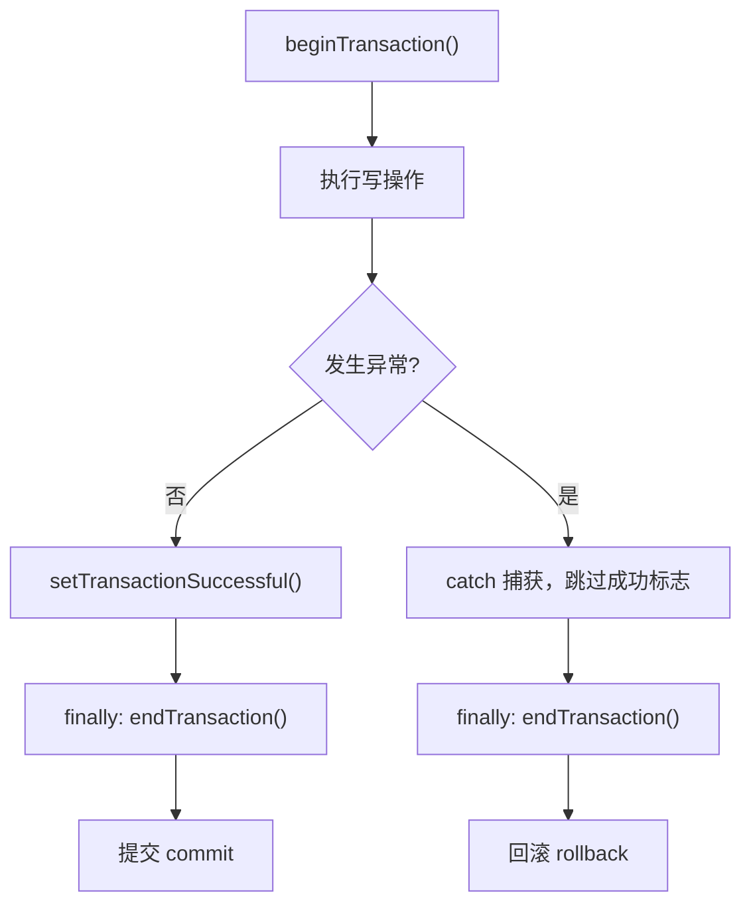

关键在 `finally`：`endTransaction()` 必须无条件执行，否则事务一直挂着，连接不释放，后续操作全部卡住。

**验证方法**：在两次插入之间塞一句 `int i = 10 / 0;`，运行后查表——两条都没进去。把这句话删掉再跑，两条都进去了。这就是回滚与提交的区别。

> [!WARNING] 漏写 `setTransactionSuccessful` 会静默回滚
> 事务结束时不检查成功标志，没有标志就走回滚。所以只写 `beginTransaction()` + 操作 + `endTransaction()` 的话，代码一行不报错、Toast 还提示「保存成功」，但数据一条都没进库。==`setTransactionSuccessful()` 不是可选项==，它是「允许提交」的开关。

**性能收益**：批量插入 1000 条时，不开事务是 1000 次独立磁盘写入（每次都要 fsync），开事务是一次。差距在两个数量级。批量操作必须包事务。

### 50.10 数据库版本升级

`onUpgrade(db, oldVersion, newVersion)` 的触发条件：代码里 `SQLiteOpenHelper` 构造参数传的版本号，**大于**磁盘上数据库记录的版本号。

```java
private static final int DB_VERSION = 2;   // 从 1 改成 2

@Override
public void onUpgrade(SQLiteDatabase db, int oldVersion, int newVersion) {
    if (oldVersion < 2) {
        db.execSQL("ALTER TABLE user_info ADD COLUMN color TEXT");
        db.execSQL("ALTER TABLE user_info ADD COLUMN phone TEXT");
    }
}
```

**`if (oldVersion < N)` 的判断不能省**。用户可能从版本 1 直接跳到版本 3，`onUpgrade` 只会被调用一次（`oldVersion=1, newVersion=3`），不会依次走 1→2、2→3。所以每个版本的迁移脚本都要包在自己的 `if` 里，靠条件累积执行。

**限制**：`ALTER TABLE ... ADD COLUMN` 一次只能加一列，多列要多次 `execSQL`。

**新增列的默认值**：老数据在新列上的值是 `NULL`。要给默认值就得补一条 `UPDATE`：

```sql
UPDATE user_info SET color = 'default' WHERE color IS NULL;
```

**降级**走 `onDowngrade()`，默认实现直接抛 `SQLiteException`。测试时如果把版本号改小了，会直接崩——先把应用数据清掉再装。

**验证**：Android Studio 的 `App Inspection` → `Database Inspector` 可以连上运行中的 App，实时看表结构与数据。

### 50.11 多账号记住密码（SQLite 版）

SP 版只能记住最后一个账号。要支持多账号、按手机号自动回填，就得用数据库。

**实体**

```java
public class LoginInfo {
    public int id;
    public String phone;
    public String password;
    public boolean remember;   // 默认 false
    // 无参构造、全参构造、toString()
}
```

**表结构**：`login_info(id, phone, password, remember)`

**三个查询方法**

```java
// 取最后一条「记住」的记录
public LoginInfo queryTop() {
    String sql = "SELECT id, phone, password, remember FROM login_info "
            + "WHERE remember = 1 ORDER BY id DESC LIMIT 1";
    Cursor cursor = mRdb.rawQuery(sql, null);
    LoginInfo info = null;
    if (cursor.moveToFirst()) {           // LIMIT 1，最多一条，用 if
        info = new LoginInfo();
        info.id = cursor.getInt(0);
        info.phone = cursor.getString(1);
        info.password = cursor.getString(2);
        info.remember = cursor.getInt(3) == 1;
    }
    cursor.close();
    return info;
}

// 按手机号查「记住」的记录
public LoginInfo queryByPhone(String phone) {
    Cursor cursor = mRdb.query("login_info", null,
            "phone = ? AND remember = 1", new String[]{phone}, null, null, null);
    LoginInfo info = null;
    if (cursor.moveToFirst()) {
        info = new LoginInfo();
        // ......
    }
    cursor.close();
    return info;
}

// 按手机号删除
public int deleteByPhone(String phone) {
    return mWdb.delete("login_info", "phone = ?", new String[]{phone});
}
```

`rawQuery(sql, selectionArgs)` 直接执行 SQL 字符串；`query(...)` 是参数化写法。两者都返回 `Cursor`。

**保存策略：先删后增 + 事务**

```java
public void save(LoginInfo info) {
    mWdb.beginTransaction();
    try {
        deleteByPhone(info.phone);   // 删掉该手机号的旧记录
        insert(info);                // 插入新记录，自增 id
        mWdb.setTransactionSuccessful();
    } finally {
        mWdb.endTransaction();
    }
}
```

为什么不直接 `UPDATE`：用户可能从「记住」改成「不记住」，或者密码改了。先删后增把两种情况统一成一种写法，配合自增 `id` 与 `ORDER BY id DESC LIMIT 1`，天然定位到「最后一次有效登录」。

**登录成功时**：无论勾没勾选都入库，`remember` 如实记录。==存储与「是否自动加载」是两件事==，混在一起会导致「取消勾选后账号信息就丢了」。

**焦点监听自动回填**

```java
etPassword.setOnFocusChangeListener((v, hasFocus) -> {
    if (v.getId() == R.id.et_password && hasFocus) {
        String phone = etPhone.getText().toString();
        LoginInfo info = mHelper.queryByPhone(phone);
        if (info != null) {
            etPassword.setText(info.password);
            cbRemember.setChecked(true);
        } else {
            etPassword.setText("");
            cbRemember.setChecked(false);
        }
    }
});
```

**隐私边界**：所有查询都强制附加 `remember = 1`。用户没勾「记住密码」的账号，即使手机号对上了也不会自动填——这是「记住」这个词的实际含义。

密码仍然是明文，生产环境必须加密。

### 50.12 内部存储与外部存储

**三个位置**

| 位置 | 路径 | 卸载后 | 其他应用 |
|------|------|--------|---------|
| 内部存储 | `/data/data/<包名>/` | 删除 | 不可见 |
| 外部私有 | `/storage/emulated/0/Android/data/<包名>/files/` | 删除 | 不可见 |
| 外部公共 | `/storage/emulated/0/`（`Download/`、`Pictures/` 等） | **保留** | 可见（需权限） |

`/sdcard` 是 `/storage/emulated/0` 的软链接，两个路径指向同一处。

**取目录的 API**

```java
// 内部存储
File internal = getFilesDir();                       // /data/data/<包名>/files
File cache = getCacheDir();                          // /data/data/<包名>/cache

// 外部私有
File extPrivate = getExternalFilesDir(Environment.DIRECTORY_DOWNLOADS);
// → /storage/emulated/0/Android/data/<包名>/files/Download

// 外部公共
File extPublic = Environment.getExternalStoragePublicDirectory(
        Environment.DIRECTORY_DOWNLOADS);
// → /storage/emulated/0/Download
```

**路径拼接必须用 `File.separator`**：

```java
String fileName = System.currentTimeMillis() + ".txt";
String fullPath = dirPath + File.separator + fileName;
```

少了分隔符，目录名和文件名粘成一串，写文件时抛 `FileNotFoundException`，而错误信息只会说「找不到路径」，不会告诉你是拼错了。

**权限**

```xml
<uses-permission android:name="android.permission.WRITE_EXTERNAL_STORAGE" />
<uses-permission android:name="android.permission.READ_EXTERNAL_STORAGE" />
```

> [!WARNING] 外部私有目录不需要存储权限
> `getExternalFilesDir()` 返回的是应用专属目录，写它==不需要任何权限==——这个目录在分区存储模型里被视为应用自己的空间。很多人看到「外部存储」就去申请 `WRITE_EXTERNAL_STORAGE`，其实多余。
>
> 需要权限的只有外部**公共**目录。而这块在 Android 10（API 29）引入分区存储后基本被禁：`Environment.getExternalStoragePublicDirectory()` 自 API 29 起废弃，Android 11（API 30）起 targetSdk ≥ 30 的应用无法直接读写公共目录。要往相册写图用 `MediaStore`，要让用户选文件用 `ACTION_OPEN_DOCUMENT`。

**运行时权限**：Android 6.0（API 23）起，危险权限除了清单声明，还要在代码里动态申请。见 [[#55.5 运行时权限]]。

**读写文本的工具类**

```java
public static void saveText(String path, String text) {
    BufferedWriter writer = null;
    try {
        writer = new BufferedWriter(new FileWriter(path));
        writer.write(text);
    } catch (IOException e) {
        e.printStackTrace();
    } finally {
        if (writer != null) {
            try { writer.close(); } catch (IOException e) { e.printStackTrace(); }
        }
    }
}

public static String openText(String path) {
    BufferedReader reader = null;
    StringBuilder sb = new StringBuilder();
    try {
        reader = new BufferedReader(new FileReader(path));
        String line;
        while ((line = reader.readLine()) != null) {
            sb.append(line);
        }
    } catch (IOException e) {
        e.printStackTrace();
    } finally {
        if (reader != null) {
            try { reader.close(); } catch (IOException e) { e.printStackTrace(); }
        }
    }
    return sb.toString();
}
```

流必须在 `finally` 里关。`BufferedReader.readLine()` 返回 `null` 表示读完，不是空行——空行返回的是空字符串 `""`。

**选型**

| 需求 | 用哪个 |
|------|--------|
| 配置、登录态、小缓存 | 内部存储 |
| 专属下载、大文件且不想污染公共目录 | 外部私有 |
| 用户可见的媒体文件、要跨应用共享的文档 | 外部公共（走 `MediaStore`） |

### 50.13 读写图片文件

**保存 Bitmap 到文件**

```java
Bitmap bitmap = BitmapFactory.decodeResource(getResources(), R.drawable.apple);
String dir = getExternalFilesDir(Environment.DIRECTORY_DOWNLOADS).toString();
String path = dir + File.separator + System.currentTimeMillis() + ".jpg";

FileOutputStream fos = null;
try {
    fos = new FileOutputStream(path);
    bitmap.compress(Bitmap.CompressFormat.JPEG, 100, fos);
} catch (IOException e) {
    e.printStackTrace();
} finally {
    if (fos != null) {
        try { fos.close(); } catch (IOException e) { e.printStackTrace(); }
    }
}
```

`compress(CompressFormat format, int quality, OutputStream stream)`：

| 参数 | 说明 |
|------|------|
| `format` | `JPEG`、`PNG`、`WEBP` |
| `quality` | `0`–`100`，对 JPEG / WebP 有效，PNG 忽略 |
| `stream` | 输出流 |

`quality = 100` 只是「最高质量的 JPEG」，仍然是==有损压缩==。要真正无损用 `PNG`，或 API 30+ 的 `WEBP_LOSSLESS`。

**从文件读 Bitmap**

```java
// 方式一：流式（需要自己关流）
public Bitmap openImage(String path) {
    FileInputStream fis = null;
    Bitmap bitmap = null;
    try {
        fis = new FileInputStream(path);
        bitmap = BitmapFactory.decodeStream(fis);
    } catch (IOException e) {
        e.printStackTrace();
    } finally {
        if (fis != null) {
            try { fis.close(); } catch (IOException e) { e.printStackTrace(); }
        }
    }
    return bitmap;
}

// 方式二：一行（内部自动开关流，推荐）
Bitmap bitmap = BitmapFactory.decodeFile(path);

imageView.setImageBitmap(bitmap);
```

**路径转 Uri**：`Uri uri = Uri.parse(path)` 只适合给本应用内部用。跨应用共享必须用 `FileProvider`，见 [[#55.13 FileProvider]]。

> [!WARNING] 直接解码大图会 OOM
> `decodeFile` / `decodeStream` 会把整张图按原始尺寸解到内存。一张 4000×3000 的照片按 `ARGB_8888` 算就是 48 MB，超过多数设备的单次分配上限，直接崩。==加载前先用 `BitmapFactory.Options` 读图片尺寸，按需设置 `inSampleSize` 降采样==，或者直接用 Glide / Coil 这类库——它们默认就做了这件事。

**调试路径问题**：`Log.d("Path", path)` 打印完整路径，再对照 `Device Explorer` 看文件到底落在哪。路径拼接错误是这类问题的头号原因。

### 50.14 Application 生命周期

`Application` 是应用级的全局对象，每个进程有且只有一个。它不落盘，只是内存里的一块共享空间。

**自定义**

```java
public class MyApplication extends Application {

    @Override
    public void onCreate() {
        super.onCreate();
        // 全局初始化：SDK 注册、缓存池、崩溃收集
    }
}
```

```xml
<application android:name=".MyApplication" ...>
```

不声明 `android:name` 时，系统用的是内置的默认 `Application` 实例。

**三个回调**

| 回调 | 时机 | 用途 |
|------|------|------|
| `onCreate()` | 进程启动，**早于任何 Activity 的 `onCreate`** | SDK 初始化、全局环境 |
| `onConfigurationChanged(Configuration)` | 屏幕旋转、语言切换、键盘可用性变化 | 手动处理配置变更 |
| `onTerminate()` | 应用退出 | **真机上永不调用** |

`onTerminate()` 只在早期模拟器或定制调试环境里有效，正式设备上被系统移除了。所以任何资源释放逻辑都不能放在这里。

**验证顺序**：Logcat 里先出现 `MyApplication onCreate`，再出现 `MainActivity onCreate`。这个顺序是确定的——Application 必须先初始化完，Activity 才能跑起来。

**配置变更的代价**：屏幕旋转时 Activity 默认会被销毁重建，`onCreate` 再执行一次，界面上的临时数据全丢。现代做法是用 `ViewModel` 存数据——它在配置变更期间存活，Activity 重建后重新观察即可恢复。

**其他回调**：`onLowMemory()` 与 `onTrimMemory(int level)` 用于内存回收，`level` 越高的含义是「越应该释放非必要资源」。长驻缓存的应用要重写它。

### 50.15 Application 全局变量

把数据挂在 `Application` 上，是最简单的跨页面共享方式。

```java
public class MyApplication extends Application {

    private static MyApplication instance;
    private final HashMap<String, String> infoMap = new HashMap<>();

    @Override
    public void onCreate() {
        super.onCreate();
        instance = this;
    }

    public static MyApplication getInstance() {
        return instance;
    }

    public HashMap<String, String> getInfoMap() {
        return infoMap;
    }
}
```

```java
// 写入
MyApplication app = MyApplication.getInstance();
app.getInfoMap().put("name", etName.getText().toString().trim());
app.getInfoMap().put("married", cbMarried.isChecked() ? "true" : "false");

// 读取（先判空）
String name = app.getInfoMap().get("name");
if (name == null) {
    return;    // 首次启动，还没有任何数据
}
etName.setText(name);
cbMarried.setChecked("true".equals(app.getInfoMap().get("married")));
```

`"true".equals(...)` 而不是 `...equals("true")`：后者在值为 `null` 时 NPE，前者安全。

**行为特征**：

- 进程存活期间跨 Activity 共享、可覆盖更新。
- 进程被杀后==全部丢失==，它不是持久化存储。
- 首次启动时 Map 是空的，所有 `get` 都返回 `null`。

**内存边界**：每个进程的 Java Heap 有上限，随设备与系统版本差异很大（早期设备 16–48 MB，现代设备常见 128–512 MB）。往里塞大图或海量对象会 OOM，触发系统杀进程或直接闪退。只放轻量、高频、非持久化的状态。

**为什么不用 `static` 变量**：生命周期同样跟进程走，但没有作用域约束、隐式耦合、容易造成内存泄漏（静态字段持有 Activity 引用就回收不掉）。这是 Android 早期最常见的反模式。用 `Application`、依赖注入或 `ViewModel` 替代。

**典型用途**：登录态标识、主题开关、全局请求头、无法通过 `Intent` 传递的复杂对象、Feature Flags。

> [!NOTE] 多进程下 Application 不共享
> 如果应用在清单里声明了 `android:process=":remote"` 这类独立进程，每个进程都会创建自己的 `Application` 实例。主进程里写进 Map 的数据，远程进程读不到——它们在不同的内存空间里。跨进程共享数据要用 `ContentProvider`、`AIDL` 或文件。

### 50.16 Jetpack Room

Room 是 Google 官方的 ORM 层，底层仍是 SQLite，数据库文件位置不变。它的价值在于：用注解声明表结构和查询，编译期由注解处理器生成实现代码，把 `ContentValues`、`Cursor` 那些样板代码全免了。

**依赖**

```gradle
dependencies {
    implementation "androidx.room:room-runtime:2.6.1"
    annotationProcessor "androidx.room:room-compiler:2.6.1"
}
```

Kotlin 项目用 `kapt` 或 `ksp` 替代 `annotationProcessor`。

**三层结构**

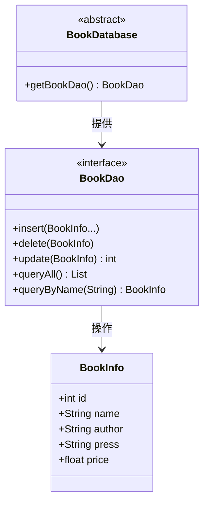

**① 实体**

```java
@Entity(tableName = "book_info")
public class BookInfo {

    @PrimaryKey(autoGenerate = true)
    public int id;

    @ColumnInfo(name = "name")
    public String name;

    public String author;
    public String press;
    public float price;

    // getter / setter / toString
}
```

`@Entity(tableName = "book_info")` 里的表名必须写——不写时表名默认等于**类名** `BookInfo`，而 SQL 里写的是 `book_info`，两者对不上会报 `no such table`。

`@PrimaryKey(autoGenerate = true)` 替代手写 `AUTOINCREMENT`。

**② DAO（必须是 interface）**

```java
@Dao
public interface BookDao {

    @Insert
    void insert(BookInfo... books);

    @Delete
    void delete(BookInfo book);

    @Update
    int update(BookInfo book);

    @Query("SELECT * FROM book_info")
    List<BookInfo> queryAll();

    @Query("SELECT * FROM book_info WHERE name = :name ORDER BY id DESC LIMIT 1")
    BookInfo queryByName(String name);

    @Query("DELETE FROM book_info")
    void deleteAll();
}
```

- `@Insert` 支持可变参数，一次插多条；返回 `long` 可拿到新行主键。
- `@Update` 返回 `int` 是受影响行数。
- `@Query` 里的 `:name` 是命名占位符，与方法参数同名即绑定，Room 会自动生成 `selectionArgs`——天然防注入。

**③ 数据库类（必须 abstract）**

```java
@Database(entities = {BookInfo.class}, version = 1, exportSchema = true)
public abstract class BookDatabase extends RoomDatabase {

    private static volatile BookDatabase instance;

    public abstract BookDao getBookDao();

    public static BookDatabase getInstance(Context context) {
        if (instance == null) {
            synchronized (BookDatabase.class) {
                if (instance == null) {
                    instance = Room.databaseBuilder(
                                    context.getApplicationContext(),
                                    BookDatabase.class,
                                    "book.db")
                            .addMigrations(MIGRATION_1_2)
                            .build();
                }
            }
        }
        return instance;
    }
}
```

`Room.databaseBuilder(context, klass, name)` 三个参数：上下文、数据库类、文件名。

> [!WARNING] 改 `version` 不配 Migration，Room 直接删表重建
> `version` 从 1 改成 2 却没提供 `Migration` 时，Room 的默认行为是 `fallbackToDestructiveMigration` 之外的路径——它会抛异常，或者在你显式开启降级销毁时把旧库清空。两种情况的结果都是数据丢失。==升级版本必须同时写 `Migration`==：
>
> ```java
> static final Migration MIGRATION_1_2 = new Migration(1, 2) {
>     @Override
>     public void migrate(SupportSQLiteDatabase database) {
>         database.execSQL("ALTER TABLE book_info ADD COLUMN isbn TEXT");
>     }
> };
> ```
>
> 调试期嫌麻烦可以加 `.fallbackToDestructiveMigration()` 让 Room 直接重建，但那等于每次改版本都清库，只能用于开发环境。

**`allowMainThreadQueries()`**：Room 默认禁止在主线程做数据库操作（会抛异常）。加上这个方法可以解除限制，但只适合教学演示——主线程做磁盘 I/O 会卡 UI，严重时 ANR。生产环境用协程、`Executor` 或 `LiveData` / `Flow`。

**Schema 导出**

```gradle
room {
    schemaLocation = "$projectDir/schemas"
}
```

配合 `exportSchema = true`，编译时会把每个版本的表结构导出成 JSON。升级失败时拿它对比，能直接看出哪一列对不上。不配 `schemaLocation` 时 Gradle 会给警告。

### 50.17 Room 增删改查

**`@Delete` 与 `@Update` 都靠主键定位**

传入的实体对象必须带有效的 `id`。`@Delete` 只读 `id`，其他字段填什么都无所谓；`@Update` 按 `id` 覆盖整行，没赋值的字段会被写成默认值（`null` / `0`）。

```java
// 删除：先按业务条件查到完整对象，再删
BookInfo book = bookDao.queryByName("hhjj");
if (book != null) {
    bookDao.delete(book);
}

// 更新：先查，再改字段，再写回
BookInfo target = bookDao.queryByName("hhjj");
if (target != null) {
    target.author = "新作者";
    target.press = "新出版社";
    target.price = 600;
    bookDao.update(target);
}
```

> [!WARNING] 别硬编码 `id` 删数据
> `book.id = 1; bookDao.delete(book);` 这种写法假设库里恰好有 `id=1` 的记录。换个环境、换个用户，删掉的就是别人的数据。==先按业务条件查询拿到对象（自带正确 `id`），再删/改==，是唯一安全的范式。

**`@Update` 返回 0 不代表出错**：主键在库里不存在时，`update` 返回 0，不抛异常。所以判成功要看返回值，不能只看「没崩」。

**为什么还要懂 `SQLiteOpenHelper`**：Room 屏蔽了底层，但崩溃日志里出现的仍然是 SQL 错误、`Cursor` 相关的异常、`SQLiteException`。不懂 `Cursor` 怎么遍历、`ContentValues` 怎么组织，出问题时只能干瞪眼。老项目与第三方库也大量使用原生 API。

---

## 55 系统组件与跨应用数据

### 55.1 内容提供者是什么

`ContentProvider` 是 Android 四大组件之一，作用是**把应用内部的数据开放给其他应用**，并控制开放哪些字段。

**为什么需要它**：Android 给每个应用分配独立进程，进程间内存天然隔离。应用 A 的数据在 A 的进程里，B 根本摸不到。要共享，必须有系统级的通道——`ContentProvider` 就是这个通道的标准化方案，属于 IPC（跨进程通信）机制。

**角色模型**（注意不是网络上的服务端/客户端）：

| 角色 | 职责 |
|------|------|
| Server App | 持有数据源（数据库、文件、XML、纯文本），用 `ContentProvider` 暴露接口 |
| Client App | 通过 `ContentResolver` 发起增删改查 |

调用链：

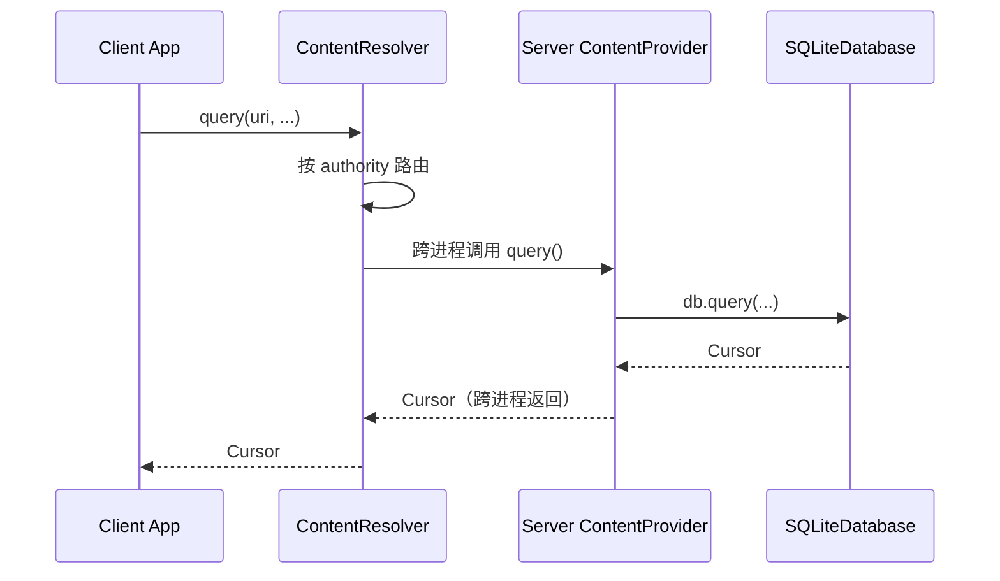

`ContentResolver` 是客户端侧的代理，由系统提供。客户端不 `new` Provider，也拿不到 Provider 的实例——它只认 `Uri`，由系统负责把请求送到正确的进程。

**安全机制**：Provider 不暴露底层存储，只暴露声明过的方法与字段。敏感字段（银行卡号、支付密码）不写进 Provider 的映射里，外部应用就查不到。读与写的权限还可以分开声明（`android:readPermission` / `android:writePermission`）。

> [!IMPORTANT] 这里的「Server / Client」不是网络服务
> 两个角色都在同一台设备上，只是两个 App。Provider 解决的是**进程间**数据共享，不涉及 HTTP、不涉及远程服务器。跨设备的数据同步是另一套东西。

**典型场景**：

- 自动读取短信验证码（读系统短信 Provider）
- 通讯录好友匹配（读系统联系人 Provider，生成「可能认识的人」）
- 把自己的数据开放给合作方应用

### 55.2 Provider 的 Server 端

**清单注册**

```xml
<provider
    android:name=".provide.UserInfoProvider"
    android:authorities="com.example.chapter_07_server.UserInfoProvider"
    android:exported="true"
    android:grantUriPermissions="true" />
```

| 属性 | 说明 |
|------|------|
| `android:name` | Provider 类的全限定名 |
| `android:authorities` | 全局唯一标识，客户端靠它找到你 |
| `android:exported` | 必须 `true`，否则其他应用访问不到 |
| `android:grantUriPermissions` | 允许临时授权单个 Uri |

`authorities` 只要全局唯一即可，惯例写「包名 + 类名」或「包名.provider」。==必须与客户端代码里的字符串完全一致，区分大小写==。

**生命周期**

`ContentProvider` 依附宿主进程。系统首次需要访问它时，进程被拉起、Provider 被实例化、`onCreate()` 被调用。

```java
public class UserInfoProvider extends ContentProvider {

    private UserDBHelper helper;
    private static final String TABLE_NAME = "user_info";

    @Override
    public boolean onCreate() {
        helper = UserDBHelper.getInstance(getContext());
        Log.d("Provider", "UserInfoProvider onCreate");
        return true;   // 返回 false 表示初始化失败
    }
}
```

返回值 `true` 表示初始化成功、可以接受请求。这个时机比任何 Activity 都早——所以有些 SDK（LeakCanary、Bugly 之类）会借 Provider 的 `onCreate()` 做启动钩子，抢在 `Application.onCreate` 之前执行。

**insert**

```java
@Override
public Uri insert(Uri uri, ContentValues values) {
    SQLiteDatabase db = helper.getWritableDatabase();
    long rowId = db.insert(TABLE_NAME, null, values);
    if (rowId > 0) {
        Uri newUri = ContentUris.withAppendedId(uri, rowId);
        getContext().getContentResolver().notifyChange(newUri, null);
        return newUri;
    }
    return null;
}
```

`ContentUris.withAppendedId(uri, rowId)` 把新行的 ID 拼到 Uri 末尾，返回给客户端。这一步不是可选的——客户端要靠它知道新记录的地址。

`notifyChange()` 通知所有注册了观察者的组件「数据变了」。漏了这行，外部用 `ContentObserver` 监听的一方永远收不到通知（见 55.9）。

**query**

```java
@Override
public Cursor query(Uri uri, String[] projection, String selection,
                    String[] selectionArgs, String sortOrder) {
    SQLiteDatabase db = helper.getReadableDatabase();
    return db.query(TABLE_NAME, projection, selection, selectionArgs,
            null, null, sortOrder);
}
```

五个参数直接透传给 `SQLiteDatabase.query`。`projection` 是列名数组，`null` 表示全部列。

**Uri 的结构**

```
content://com.example.chapter_07_server.UserInfoProvider/user_info/3
└──┬───┘ └──────────────────┬──────────────────────┘└───┬───┘ └┬┘
 scheme              authority                    data_path   id
```

| 段 | 含义 |
|----|------|
| `content` | 固定协议头，标识这是内容 Uri，不可改 |
| `authority` | 与清单里的 `android:authorities` 完全一致 |
| `data_path` | 数据集合路径，通常就是表名 |
| `id` | 单条记录的标识，可省略（表示整个集合） |

**精简 Helper**：Provider 场景下 `UserDBHelper` 可以去掉 `onUpgrade`、版本常量等用不上的部分，只保留 `getWritableDatabase()` 与 `getReadableDatabase()`。但==两个都要留==——`query` 用只读，`insert` / `delete` 用可写。

### 55.3 Provider 的 Client 端

**契约类**：把 Uri 与列名抽成常量，两端共用一份定义，避免字符串拼错。

```java
public class UserForContent {

    public static final String AUTHORITY =
            "com.example.chapter_07_server.UserInfoProvider";
    public static final Uri CONTENT_URI =
            Uri.parse("content://" + AUTHORITY + "/user_info");

    public static final String USER_NAME = "name";
    public static final String AGE = "age";
    public static final String HEIGHT = "height";
    public static final String WEIGHT = "weight";
    public static final String MARRIED = "married";
}
```

**写入**

```java
ContentResolver resolver = getContentResolver();
ContentValues cv = new ContentValues();
cv.put(UserForContent.USER_NAME, name);
cv.put(UserForContent.AGE, Integer.parseInt(age));
cv.put(UserForContent.HEIGHT, Integer.parseInt(height));
cv.put(UserForContent.WEIGHT, Float.parseFloat(weight));
cv.put(UserForContent.MARRIED, cbMarried.isChecked());   // boolean 会被转成 1/0

Uri newUri = resolver.insert(UserForContent.CONTENT_URI, cv);
```

`ContentValues.put(String, Boolean)` 会把布尔转成整数存进 SQLite——这一点比自己写 SQL 省事，但读取时仍要按整数处理。

**查询**

```java
Cursor cursor = resolver.query(UserForContent.CONTENT_URI, null, null, null, null);
if (cursor != null) {
    try {
        while (cursor.moveToNext()) {
            String name = cursor.getString(cursor.getColumnIndexOrThrow("name"));
            int age = cursor.getInt(cursor.getColumnIndexOrThrow("age"));
            boolean married = cursor.getInt(cursor.getColumnIndexOrThrow("married")) == 1;
            // ......
        }
    } finally {
        cursor.close();
    }
}
```

`getColumnIndex("name")` 按列名取索引，不硬编码列号。主键用 `BaseColumns._ID`（值为 `"_id"`）。

**Android 11+ 的包可见性**

```xml
<queries>
    <provider android:authorities="com.example.chapter_07_server.UserInfoProvider" />
</queries>
```

> [!WARNING] 漏了 `<queries>` 声明，跨进程调用静默失败
> Android 11（API 30）起引入包可见性限制：应用默认看不到其他应用的组件。访问别人的 Provider 时，如果清单里没声明 `<queries>`，`resolver.insert()` / `query()` ==不抛异常、返回 `null`==，日志里也没有任何提示。排查时很容易误判成「Provider 写错了」。
>
> 声明 `<provider android:authorities="...">` 比 `<package android:name="...">` 更精确——后者只声明「能看见这个包」，前者才明确「能访问这个 Provider」。

**部署顺序**：先装 Server、启动一次（触发 Provider 初始化），再装 Client。反过来的话 Client 第一次请求会失败。

### 55.4 UriMatcher 与数据删除

同一个 Provider 要处理两种请求：「删整个集合」和「删某一条」。靠 `UriMatcher` 区分。

```java
private static final int USER = 1;
private static final int USER_ID = 2;

private static final UriMatcher uriMatcher = new UriMatcher(UriMatcher.NO_MATCH);

static {
    uriMatcher.addURI(AUTHORITY, "user_info", USER);        // content://auth/user_info
    uriMatcher.addURI(AUTHORITY, "user_info/#", USER_ID);   // content://auth/user_info/3
}
```

| 通配符 | 匹配 |
|--------|------|
| `#` | 任意数字（通常用作 ID） |
| `*` | 任意字符串 |

`addURI` 的第一个参数是 authority（不带 `content://`），第二个是路径模板。

**delete 的分发**

```java
@Override
public int delete(Uri uri, String selection, String[] selectionArgs) {
    int count = 0;
    switch (uriMatcher.match(uri)) {
        case USER:
            count = db.delete(TABLE_NAME, selection, selectionArgs);
            break;
        case USER_ID:
            String id = uri.getLastPathSegment();
            count = db.delete(TABLE_NAME, "_id = ?", new String[]{id});
            break;
        default:
            throw new IllegalArgumentException("Invalid URI: " + uri);
    }
    return count;
}
```

`uri.getLastPathSegment()` 取路径最后一段，也就是那个 ID。`_id = ?` 用占位符而不是拼接，防止 `id` 里塞进 SQL 片段。

**客户端**

```java
// 按条件批量删
int count = resolver.delete(UserForContent.CONTENT_URI, "name = ?", new String[]{"jack"});

// 按 ID 删单条
Uri singleUri = Uri.withAppendedPath(UserForContent.CONTENT_URI, String.valueOf(id));
int count2 = resolver.delete(singleUri, null, null);
```

> [!IMPORTANT] 每个 CRUD 入口都要校验 URI
> `insert` / `query` / `update` / `delete` 四个方法开头都应该先 `uriMatcher.match(uri)`，匹配不上就抛 `IllegalArgumentException`。不校验的话，一个拼错的 Uri 进来，`selection` 可能是 `null`——而 `delete(table, null, null)` 等于==清空整张表==。这类事故不报错，只是数据没了。

### 55.5 运行时权限

**版本分界**

| 版本 | 机制 |
|------|------|
| < Android 6.0（API 23） | 清单声明即生效，安装时一次性授权 |
| ≥ Android 6.0 | 清单声明是前提，还需运行时弹窗，用户拒绝则无权限 |

**三步流程**

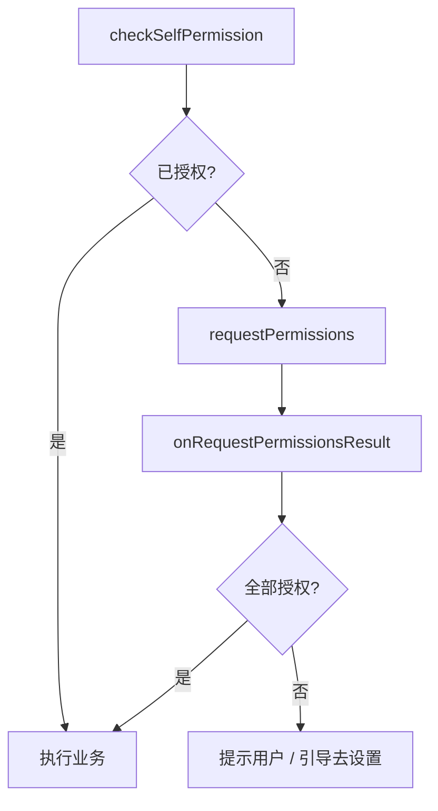

**权限工具类**

```java
public class PermissionUtil {

    public static final int REQUEST_CODE_CONTACTS = 100;
    public static final int REQUEST_CODE_SMS = 101;

    public static final String[] PERMISSION_CONTACTS = {
            Manifest.permission.READ_CONTACTS,
            Manifest.permission.WRITE_CONTACTS
    };

    public static final String[] PERMISSION_SMS = {
            Manifest.permission.RECEIVE_SMS,
            Manifest.permission.SEND_SMS
    };

    /** 检查并申请。返回 true 表示已全部授权；false 表示有未授权的，且已发起申请 */
    public static boolean checkPermission(Activity act, String[] permissions, int requestCode) {
        if (Build.VERSION.SDK_INT >= Build.VERSION_CODES.M) {
            for (String permission : permissions) {
                if (ContextCompat.checkSelfPermission(act, permission)
                        != PackageManager.PERMISSION_GRANTED) {
                    ActivityCompat.requestPermissions(act, permissions, requestCode);
                    return false;
                }
            }
        }
        return true;
    }

    /** 判断申请结果是否全部通过 */
    public static boolean checkGrant(int[] grantResults) {
        for (int result : grantResults) {
            if (result != PackageManager.PERMISSION_GRANTED) {
                return false;
            }
        }
        return true;
    }
}
```

`PackageManager.PERMISSION_GRANTED` 值为 `0`，`PERMISSION_DENIED` 值为 `-1`。

**回调**

```java
@Override
public void onRequestPermissionsResult(int requestCode,
                                       @NonNull String[] permissions,
                                       @NonNull int[] grantResults) {
    super.onRequestPermissionsResult(requestCode, permissions, grantResults);
    switch (requestCode) {
        case PermissionUtil.REQUEST_CODE_CONTACTS:
            if (PermissionUtil.checkGrant(grantResults)) {
                // 执行业务
            } else {
                ToastUtil.show(this, "通讯录权限被拒绝");
            }
            break;
        default:
            break;
    }
}
```

`permissions[]` 与 `grantResults[]` 下标一一对应。

**两种申请时机**

| 模式 | 时机 | 适合 |
|------|------|------|
| Lazy（懒汉） | 用户触发某个功能时才申请 | 非核心功能、敏感权限 |
| Hungry（饿汉） | `onCreate` 里一次性申请全部 | 核心功能强依赖的主流程 |

这两个词是社区叫法，官方没有。Hungry 模式的问题是一次弹好几个框，用户容易直接全拒。

> [!CAUTION] 连续拒绝两次后系统不再弹窗
> Android 6.0 起有个策略：用户在同一个权限上点「拒绝」两次（或勾了「不再询问」），之后 `requestPermissions` ==不再弹任何东西，直接回调 `onRequestPermissionsResult` 并返回拒绝==。此时唯一的出路是引导用户去系统设置页手动打开：
>
> ```java
> Intent intent = new Intent(Settings.ACTION_APPLICATION_DETAILS_SETTINGS);
> intent.setData(Uri.fromParts("package", getPackageName(), null));
> startActivity(intent);
> ```
>
> 判断是否处于「永久拒绝」状态要用 `ActivityCompat.shouldShowRequestPermissionRationale(activity, permission)`：返回 `false` 且权限未授予，就说明系统不会再弹了。

**测试注意**：权限选择被系统持久化，改测试逻辑后必须卸载重装（或清除应用数据），否则一直沿用上次的选择。

**已授权时不会回调**：`checkPermission` 返回 `true` 时根本不发起申请，自然也就没有回调。业务代码要按「返回 `true` 就直接干」的方式写，不能依赖回调。

### 55.6 添加联系人

系统通讯录用两张表存一个人：

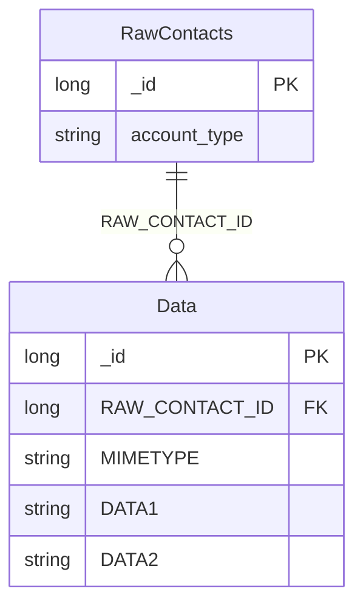

| 表 | 内容 |
|----|------|
| `ContactsContract.RawContacts` | 联系人主表，每行一个人，主键 `_id` |
| `ContactsContract.Data` | 明细表，`RAW_CONTACT_ID` 外键指向主表；`MIMETYPE` 标识这条明细是什么 |

一个人有姓名、电话、邮箱三条 `Data` 记录，靠 `MIMETYPE` 区分类型。

**插入分两步**

```java
ContentResolver resolver = getContentResolver();

// 第一步：向主表插一条空记录，拿到 _id
ContentValues rawValues = new ContentValues();
Uri rawUri = resolver.insert(ContactsContract.RawContacts.CONTENT_URI, rawValues);
long rawContactId = ContentUris.parseId(rawUri);

// 第二步：以这个 id 为外键，往明细表插三条
// 姓名
ContentValues nameValues = new ContentValues();
nameValues.put(ContactsContract.Data.RAW_CONTACT_ID, rawContactId);
nameValues.put(ContactsContract.Data.MIMETYPE,
        ContactsContract.CommonDataKinds.StructuredName.CONTENT_ITEM_TYPE);
nameValues.put(ContactsContract.CommonDataKinds.StructuredName.GIVEN_NAME, name);
resolver.insert(ContactsContract.Data.CONTENT_URI, nameValues);

// 电话
ContentValues phoneValues = new ContentValues();
phoneValues.put(ContactsContract.Data.RAW_CONTACT_ID, rawContactId);
phoneValues.put(ContactsContract.Data.MIMETYPE,
        ContactsContract.CommonDataKinds.Phone.CONTENT_ITEM_TYPE);
phoneValues.put(ContactsContract.CommonDataKinds.Phone.NUMBER, phone);
phoneValues.put(ContactsContract.CommonDataKinds.Phone.TYPE,
        ContactsContract.CommonDataKinds.Phone.TYPE_MOBILE);
resolver.insert(ContactsContract.Data.CONTENT_URI, phoneValues);

// 邮箱
ContentValues emailValues = new ContentValues();
emailValues.put(ContactsContract.Data.RAW_CONTACT_ID, rawContactId);
emailValues.put(ContactsContract.Data.MIMETYPE,
        ContactsContract.CommonDataKinds.Email.CONTENT_ITEM_TYPE);
emailValues.put(ContactsContract.CommonDataKinds.Email.ADDRESS, email);
emailValues.put(ContactsContract.CommonDataKinds.Email.TYPE,
        ContactsContract.CommonDataKinds.Email.TYPE_WORK);
resolver.insert(ContactsContract.Data.CONTENT_URI, emailValues);
```

**`ContentUris.parseId(uri)`** 从返回的 Uri 末段解析出 `long` 型 ID，比自己截字符串可靠。

> [!WARNING] 漏 `RAW_CONTACT_ID` 直接抛异常
> `Data` 表的每一行都必须有 `RAW_CONTACT_ID`。漏了（或者键名写错、值为 `null`）会抛 `java.lang.IllegalArgumentException: The RAW_CONTACT_ID is required`。这个异常信息很明确，见到它先回去检查这一行 `put` 有没有执行。

**字段映射**：`Data` 表用通用的 `DATA1`–`DATA5` 存各种类型的值，具体哪个字段对应哪个语义由 `MIMETYPE` 决定。

| MIMETYPE | 值写在 |
|----------|--------|
| `StructuredName.CONTENT_ITEM_TYPE` | 全名在 `DATA1`，名在 `DATA2` |
| `Phone.CONTENT_ITEM_TYPE` | 号码在 `DATA1` |
| `Email.CONTENT_ITEM_TYPE` | 地址在 `DATA1` |

用 `CommonDataKinds.StructuredName.GIVEN_NAME` 这类常量时不用关心底层是 `DATA1` 还是 `DATA2`，常量会映射正确。

**权限**：`READ_CONTACTS` + `WRITE_CONTACTS`，两个都要。

### 55.7 批处理与事务

上面四次 `insert` 是四次独立的跨进程调用。中间任何一步失败，前面的已经写进去了——库里会留下「有主记录没有姓名」这种脏数据。

`ContentProviderOperation` + `applyBatch()` 把它们打包成一个事务：

```java
ArrayList<ContentProviderOperation> operations = new ArrayList<>();

// op0：主表插空记录
operations.add(ContentProviderOperation
        .newInsert(ContactsContract.RawContacts.CONTENT_URI)
        .withValue(ContactsContract.RawContacts.ACCOUNT_TYPE, null)
        .withValue(ContactsContract.RawContacts.ACCOUNT_NAME, null)
        .build());

// op1：姓名，RAW_CONTACT_ID 引用第 0 个操作的返回值
operations.add(ContentProviderOperation
        .newInsert(ContactsContract.Data.CONTENT_URI)
        .withValueBackReference(ContactsContract.Data.RAW_CONTACT_ID, 0)
        .withValue(ContactsContract.Data.MIMETYPE,
                ContactsContract.CommonDataKinds.StructuredName.CONTENT_ITEM_TYPE)
        .withValue(ContactsContract.CommonDataKinds.StructuredName.GIVEN_NAME, "Rose")
        .build());

// op2：电话
operations.add(ContentProviderOperation
        .newInsert(ContactsContract.Data.CONTENT_URI)
        .withValueBackReference(ContactsContract.Data.RAW_CONTACT_ID, 0)
        .withValue(ContactsContract.Data.MIMETYPE,
                ContactsContract.CommonDataKinds.Phone.CONTENT_ITEM_TYPE)
        .withValue(ContactsContract.CommonDataKinds.Phone.NUMBER, "13812381234")
        .withValue(ContactsContract.CommonDataKinds.Phone.TYPE,
                ContactsContract.CommonDataKinds.Phone.TYPE_MOBILE)
        .build());

// op3：邮箱
operations.add(ContentProviderOperation
        .newInsert(ContactsContract.Data.CONTENT_URI)
        .withValueBackReference(ContactsContract.Data.RAW_CONTACT_ID, 0)
        .withValue(ContactsContract.Data.MIMETYPE,
                ContactsContract.CommonDataKinds.Email.CONTENT_ITEM_TYPE)
        .withValue(ContactsContract.CommonDataKinds.Email.ADDRESS, "1234@9.com")
        .withValue(ContactsContract.CommonDataKinds.Email.TYPE,
                ContactsContract.CommonDataKinds.Email.TYPE_WORK)
        .build());

resolver.applyBatch(ContactsContract.AUTHORITY, operations);
```

**`withValueBackReference(key, index)`** 是关键 API：`index` 是批次中某个操作的下标，执行时系统会用那个操作返回的 ID 替换这里的占位。上例中 `0` 指 op0，也就是主表插完拿到的 `_id`。

**顺序不能乱**。`index` 是按下标引用的，插一个操作到中间，后面所有引用都会错位。

**authority 用顶层常量**：这批操作跨了 `RawContacts` 和 `Data` 两个 Uri，所以 `applyBatch` 的第一个参数必须传 `ContactsContract.AUTHORITY`（值为 `"com.android.contacts"`），不能传单个表的 Uri。

> [!TIP] op0 必须至少有一个 `withValue`，否则崩溃
> 主表插入不需要任何业务字段，但完全空的 `ContentValues` 会让底层抛 `Key set on a null object reference`。补一对 `ACCOUNT_TYPE` / `ACCOUNT_NAME` 为 `null` 的占位值即可——本地账户本来就是这两个字段为空。

### 55.8 查询联系人

查一个人要两次查询：先从主表拿 ID 列表，再按 ID 逐个查明细。

```java
ContentResolver resolver = getContentResolver();

// 第一次：主表，只要 _id
Cursor cursor = resolver.query(
        ContactsContract.RawContacts.CONTENT_URI,
        new String[]{ContactsContract.RawContacts._ID},
        null, null, null);

if (cursor != null) {
    try {
        while (cursor.moveToNext()) {
            long rawContactId = cursor.getLong(0);

            // 第二次：按 ID 查明细
            Cursor dataCursor = resolver.query(
                    ContactsContract.Data.CONTENT_URI,
                    new String[]{
                            ContactsContract.Data.MIMETYPE,
                            ContactsContract.Data.DATA1,
                            ContactsContract.Data.DATA2
                    },
                    ContactsContract.Data.RAW_CONTACT_ID + " = ?",
                    new String[]{String.valueOf(rawContactId)},
                    null);

            Contact contact = new Contact();
            if (dataCursor != null) {
                try {
                    while (dataCursor.moveToNext()) {
                        String mimeType = dataCursor.getString(0);
                        String data1 = dataCursor.getString(1);
                        if (ContactsContract.CommonDataKinds.StructuredName.CONTENT_ITEM_TYPE
                                .equals(mimeType)) {
                            contact.name = data1;
                        } else if (ContactsContract.CommonDataKinds.Phone.CONTENT_ITEM_TYPE
                                .equals(mimeType)) {
                            contact.phone = data1;
                        } else if (ContactsContract.CommonDataKinds.Email.CONTENT_ITEM_TYPE
                                .equals(mimeType)) {
                            contact.email = data1;
                        }
                    }
                } finally {
                    dataCursor.close();
                }
            }
            // ......
        }
    } finally {
        cursor.close();
    }
}
```

**资源释放**：内层 `dataCursor` 每轮循环都要关，外层 `cursor` 循环结束后关。谁开的谁关，嵌套的游标最容易漏。

**健壮性**：主表有记录但明细表为空时（数据被别的应用清过），内层循环一次都不执行，`contact` 的所有字段都是 `null`。输出前要判空。

**查询效率**：上面是「1 + N」次查询。联系人多的设备上会明显卡。更快的做法是一次查完 `Data` 表，在内存里按 `RAW_CONTACT_ID` 分组——少一次循环，但返回的数据量大。两种方式各有取舍，联系人上千时应该放到后台线程。

**已删除的联系人**：`RawContacts` 里保留着 `deleted = 1` 的墓碑记录。查询时加 `selection = "deleted = 0"` 才能排除它们。

### 55.9 ContentObserver 监听短信

**为什么不用广播**：短信到达广播 `SMS_RECEIVED_ACTION` 需要 `RECEIVE_SMS` 权限，且被系统严格管控。而「监听数据库变化」用 `ContentObserver` 更轻——不需要额外权限，事件驱动，不轮询。

```java
public class SmsObserver extends ContentObserver {

    private final ContentResolver resolver;
    private final Handler handler;

    public SmsObserver(Handler handler, ContentResolver resolver) {
        super(handler);
        this.handler = handler;
        this.resolver = resolver;
    }

    @Override
    public void onChange(boolean selfChange, Uri uri) {
        super.onChange(selfChange, uri);
        if (uri == null) {
            return;
        }
        // 只处理收件箱的具体记录
        if (!uri.toString().startsWith("content://sms/inbox")) {
            return;
        }
        readSms(uri);
    }

    private void readSms(Uri uri) {
        Cursor cursor = resolver.query(uri,
                new String[]{"address", "body", "date"},
                null, null, "date DESC");
        if (cursor != null) {
            try {
                if (cursor.moveToFirst()) {
                    String address = cursor.getString(
                            cursor.getColumnIndexOrThrow("address"));
                    String body = cursor.getString(
                            cursor.getColumnIndexOrThrow("body"));
                    // ......
                }
            } finally {
                cursor.close();
            }
        }
    }
}
```

**注册与注销**

```java
@Override
protected void onCreate(Bundle savedInstanceState) {
    super.onCreate(savedInstanceState);
    // ......
    smsObserver = new SmsObserver(new Handler(Looper.getMainLooper()), getContentResolver());
    getContentResolver().registerContentObserver(
            Uri.parse("content://sms/"),
            true,          // notifyForDescendants
            smsObserver);
}

@Override
protected void onDestroy() {
    super.onDestroy();
    if (smsObserver != null) {
        getContentResolver().unregisterContentObserver(smsObserver);
    }
}
```

`registerContentObserver(uri, notifyForDescendants, observer)`：

| 参数 | 说明 |
|------|------|
| `uri` | 要监听的 Uri |
| `notifyForDescendants` | `true` 时连子 Uri 的变化也通知；`false` 只精确匹配 |
| `observer` | 观察者实例 |

监听的粒度用 `content://sms/` 加 `true`，才能覆盖 `content://sms/inbox/xxx` 这类子路径。

> [!WARNING] 一条短信会触发 2–3 次 `onChange`
> 新短信到达时，系统会分别通知几个不同的 Uri：`content://mms-sms/conversations?simple=true`、`content://sms/raw?id=xxx`、`content://sms/inbox?id=xxx`。Android 7.0 之后「标记已读」还会再触发一次。
>
> 不过滤的话，同一条短信会被处理三四遍——验证码被填四次、Toast 弹四次。==按 Uri 特征过滤，只处理 `content://sms/inbox` 带 `id` 的那一次==。

**自定义 Provider 要主动通知**：外部观察者能不能收到，取决于 Provider 有没有在数据变化后调 `notifyChange(uri, null)`。自己写的 Provider 漏了这行，别人监听一辈子也收不到。

**权限**：`READ_SMS`。自 API 19 起它就是危险权限，6.0 之后还要运行时申请。另外 Google Play 对短信权限有严格的政策限制，上架需要申报用途。

**测试**：模拟器的 `Extended Controls` → `Phone` 面板可以模拟收短信。部分高版本模拟器（API 28/29/31）的短信面板有渲染问题，可以降级镜像或上真机。

### 55.10 相册选图

```java
public class SmsActivity extends AppCompatActivity {

    private ImageView ivPicture;
    private Uri picUri;
    private ActivityResultLauncher<Intent> pickImageLauncher;

    @Override
    protected void onCreate(Bundle savedInstanceState) {
        super.onCreate(savedInstanceState);
        setContentView(R.layout.activity_sms);
        // ......
        ivPicture = findViewById(R.id.iv_picture);

        pickImageLauncher = registerForActivityResult(
                new ActivityResultContracts.StartActivityForResult(),
                result -> {
                    if (result.getResultCode() == Activity.RESULT_OK
                            && result.getData() != null) {
                        picUri = result.getData().getData();
                        if (picUri != null) {
                            ivPicture.setImageURI(picUri);
                            Log.d("SmsActivity", "选中的图片：" + picUri);
                        }
                    }
                });

        ivPicture.setOnClickListener(v -> {
            Intent intent = new Intent(Intent.ACTION_GET_CONTENT);
            intent.setType("image/*");
            pickImageLauncher.launch(intent);
        });
    }
}
```

`ACTION_GET_CONTENT` + `setType("image/*")` 会拉起系统的文件选择器（通常是相册），只显示图片。

`setImageURI(Uri)` 直接把 Uri 交给 `ImageView` 解码显示，不需要先转 Bitmap。

> [!NOTE] `ACTION_GET_CONTENT` 的授权是临时的
> 返回的 Uri 只在这个 Activity 实例活着时有效。想长期持有（比如存进数据库、下次启动还要显示），要么立刻把图片复制到自己的目录，要么改用 `ACTION_OPEN_DOCUMENT` 并调用 `takePersistableUriPermission()` 申请持久授权。==直接把 Uri 存起来，下次打开就是空白图==。

**模拟器准备**：空模拟器的相册里没有图。可以用 `adb push` 把图片推到 `/sdcard/Pictures/`，再触发媒体扫描（见 55.12）。

### 55.11 发送彩信

```java
private void sendMms(String phone, String title, String message) {
    Intent intent = new Intent(Intent.ACTION_SEND);
    intent.addFlags(Intent.FLAG_ACTIVITY_NEW_TASK);
    intent.addFlags(Intent.FLAG_GRANT_READ_URI_PERMISSION);
    intent.putExtra("address", phone);
    intent.putExtra("subject", title);
    intent.putExtra(Intent.EXTRA_TEXT, message);
    intent.putExtra(Intent.EXTRA_STREAM, picUri);
    intent.setType("image/*");
    startActivity(Intent.createChooser(intent, "选择发送方式"));
}
```

| Extra / Flag | 作用 |
|--------------|------|
| `"address"` | 收件人号码（非标准 extra，部分短信应用识别） |
| `"subject"` | 主题 |
| `Intent.EXTRA_TEXT` | 正文 |
| `Intent.EXTRA_STREAM` | 附件 Uri |
| `setType("image/*")` | MIME 类型，决定哪些应用能接收 |
| `FLAG_GRANT_READ_URI_PERMISSION` | 临时授予接收方读取该 Uri 的权限 |
| `FLAG_ACTIVITY_NEW_TASK` | 从非 Activity 上下文启动时必需 |

> [!WARNING] 漏 `FLAG_GRANT_READ_URI_PERMISSION`，附件发不出去
> `EXTRA_STREAM` 传的是 `content://` Uri，接收方应用（短信、邮件、IM）在另一个进程里。没有这个 Flag，它没有读取权限，附件加载失败——现象是正文发出去了、图片是空的，或者直接报错。==凡是跨应用传 Uri，这个 Flag 都要加==。

**必须显式设 Action**：`new Intent()` 不带 action 的隐式 Intent 找不到任何匹配组件，`startActivity` 直接抛 `ActivityNotFoundException`。上面代码用的是 `ACTION_SEND`。

**多应用匹配**：手机上装了短信、微信、邮件时，系统会弹出选择器。想自定义标题就用 `Intent.createChooser(intent, "选择发送方式")`。

**注意**：模拟器通常没有运营商配置，彩信发不出去，要用真机验证。彩信按条计费，测试时注意成本。

### 55.12 MediaStore 查询图片

系统维护一个媒体库索引，记录了所有图片、视频、音频的元数据。查它比自己遍历目录快得多。

**实体**

```java
public class ImageInfo {
    public long id;
    public String title;
    public long size;
    public String path;
}
```

**查询**

```java
ContentResolver resolver = getContentResolver();
List<ImageInfo> imageList = new ArrayList<>();

Cursor cursor = resolver.query(
        MediaStore.Images.Media.EXTERNAL_CONTENT_URI,
        new String[]{
                MediaStore.Images.Media._ID,
                MediaStore.Images.Media.DISPLAY_NAME,
                MediaStore.Images.Media.SIZE,
                MediaStore.Images.Media.DATA
        },
        MediaStore.Images.Media.SIZE + " <= ?",
        new String[]{String.valueOf(300 * 1024)},
        MediaStore.Images.Media.SIZE + " DESC");

if (cursor != null) {
    try {
        while (cursor.moveToNext() && imageList.size() < 6) {
            ImageInfo info = new ImageInfo();
            info.id = cursor.getLong(cursor.getColumnIndexOrThrow("_ID"));
            info.title = cursor.getString(cursor.getColumnIndexOrThrow("DISPLAY_NAME"));
            info.size = cursor.getLong(cursor.getColumnIndexOrThrow("SIZE"));
            info.path = cursor.getString(cursor.getColumnIndexOrThrow("DATA"));
            imageList.add(info);
        }
    } finally {
        cursor.close();
    }
}
```

`300 * 1024` 是 300 KB 换算成字节。`ORDER BY SIZE DESC` 按大小降序，配合「最多取 6 条」，得到的是最大的 6 张小图。

**渲染成网格**

```java
private void showImageGrid(List<ImageInfo> imageList) {
    gridLayout.removeAllViews();
    for (ImageInfo info : imageList) {
        ImageView iv = new ImageView(this);
        Bitmap bitmap = BitmapFactory.decodeFile(info.path);
        iv.setImageBitmap(bitmap);
        iv.setScaleType(ImageView.ScaleType.FIT_CENTER);
        int size = dp2px(110);
        iv.setLayoutParams(new ViewGroup.LayoutParams(size, size));
        iv.setPadding(dp2px(5), dp2px(5), dp2px(5), dp2px(5));
        iv.setOnClickListener(v -> {
            picUri = Uri.parse(info.path);
            // ......
        });
        gridLayout.addView(iv);
    }
}
```

**MediaStore 查不到新文件**：往 `/Download` 或 `/Pictures` 里写了一个文件，MediaStore 索引里没有它，查询结果里也就没有。要让系统重新扫描：

```java
MediaScannerConnection.scanFile(
        context,
        new String[]{filePath},
        new String[]{"image/jpeg"},
        (path, uri) -> Log.d("Scan", "扫描完成：" + uri));
```

> [!WARNING] `DATA` 列在 Android 10 起不可靠
> `MediaStore.Images.Media.DATA` 返回的是文件绝对路径。分区存储（API 29）之后，这个路径对第三方应用可能不可读，`BitmapFactory.decodeFile()` 会失败。==正确做法是用 `_ID` 拼出 content Uri，再用 `resolver.openInputStream(uri)` 读流==：
>
> ```java
> Uri uri = ContentUris.withAppendedId(
>         MediaStore.Images.Media.EXTERNAL_CONTENT_URI, info.id);
> InputStream is = resolver.openInputStream(uri);
> Bitmap bitmap = BitmapFactory.decodeStream(is);
> ```

**权限**：`READ_EXTERNAL_STORAGE`（API 32 及以下），Android 13（API 33）起改用 `READ_MEDIA_IMAGES`。

**生产建议**：`BitmapFactory.decodeFile()` 在列表里逐张解码很慢，还容易 OOM。用 Glide / Coil 这类图片库，它们自带采样、缓存、生命周期管理。

### 55.13 FileProvider

Android 7.0（API 24）起禁止跨应用传 `file://` Uri——直接传会抛 `FileUriExposedException`。原因是 `file://` 一旦给出去，对方就能顺着路径读整个目录，权限过宽。

`FileProvider` 是系统内置的 `ContentProvider` 子类，按白名单把指定目录下的文件转成 `content://` Uri，并精确授权单个文件。

**清单注册**

```xml
<provider
    android:name="androidx.core.content.FileProvider"
    android:authorities="${applicationId}.fileprovider"
    android:exported="false"
    android:grantUriPermissions="true">

    <meta-data
        android:name="android.support.FILE_PROVIDER_PATHS"
        android:resource="@xml/file_paths" />
</provider>
```

| 属性 | 说明 |
|------|------|
| `android:name` | 固定为 `androidx.core.content.FileProvider`，不用自己写类 |
| `android:authorities` | 惯例 `包名.fileprovider`，全局唯一 |
| `android:exported` | 必须是 `false` |
| `android:grantUriPermissions` | 必须是 `true`，否则启动即崩 |

**路径白名单**

```xml
<!-- res/xml/file_paths.xml -->
<paths>
    <files-path name="internal_files" path="." />
    <cache-path name="internal_cache" path="." />
    <external-files-path name="external_files" path="." />
    <external-path name="download" path="Download/" />
</paths>
```

| 标签 | 对应目录 |
|------|---------|
| `<files-path>` | `getFilesDir()` |
| `<cache-path>` | `getCacheDir()` |
| `<external-files-path>` | `getExternalFilesDir(null)` |
| `<external-cache-path>` | `getExternalCacheDir()` |
| `<external-path>` | `Environment.getExternalStorageDirectory()` |

`name` 是 Uri 里显示的子路径名，随便起；`path` 是实际目录，`.` 表示该目录本身。

**转换**

```java
public static Uri getUriForFile(Context context, File file) {
    if (Build.VERSION.SDK_INT >= Build.VERSION_CODES.N) {
        return FileProvider.getUriForFile(
                context,
                context.getPackageName() + ".fileprovider",
                file);
    } else {
        return Uri.fromFile(file);
    }
}
```

> [!CAUTION] `meta-data` 的 name 必须是 `android.support.FILE_PROVIDER_PATHS`
> 这串字符串看着像旧版支持库的名字，但在 androidx 版本里==依然照用==。写成 `androidx.core.content.FileProvider` 或别的名字，Provider 找不到路径配置，取文件时直接崩溃。这是从 support 库迁移到 androidx 时留下的历史包袱，只能记。

**文件不在白名单里会抛异常**：`getUriForFile` 遇到不匹配任何 `<path>` 的文件，抛 `IllegalArgumentException`。所以调用前要校验：

```java
public static boolean isValidFile(Context context, File file) {
    if (file == null || !file.exists() || !file.isFile() || file.length() <= 0) {
        return false;
    }
    try {
        FileProvider.getUriForFile(context,
                context.getPackageName() + ".fileprovider", file);
        return true;
    } catch (Exception e) {
        return false;
    }
}
```

### 55.14 安装 APK

流程：定位 APK 文件 → `FileProvider` 转成 `content://` Uri → `ACTION_VIEW` 拉起系统安装器。

```java
public void installApk(Context context, File apkFile) {
    // 1. 完整性校验
    PackageManager pm = context.getPackageManager();
    PackageInfo info = pm.getPackageArchiveInfo(
            apkFile.getAbsolutePath(), PackageManager.GET_ACTIVITIES);
    if (info == null) {
        ToastUtil.show(context, "安装文件已经损坏");
        return;
    }

    // 2. 转 Uri
    Uri uri = getUriForFile(context, apkFile);

    // 3. 拉起安装器
    Intent intent = new Intent(Intent.ACTION_VIEW);
    intent.addFlags(Intent.FLAG_ACTIVITY_NEW_TASK);
    intent.addFlags(Intent.FLAG_GRANT_READ_URI_PERMISSION);
    intent.setDataAndType(uri, "application/vnd.android.package-archive");
    context.startActivity(intent);
}
```

`getPackageArchiveInfo(path, flags)` 解析 APK 的清单。返回 `null` 说明文件不是合法的 APK（下载不完整、或者根本不是安装包）。

`application/vnd.android.package-archive` 是 APK 的 MIME 类型，系统靠它找到安装器。

**权限按版本分流**

| 版本 | 需要什么 |
|------|---------|
| < Android 8.0（API 26） | `READ_EXTERNAL_STORAGE`（若 APK 在外部存储） |
| Android 8.0 – 10 | `REQUEST_INSTALL_PACKAGES` + 用户手动开启「允许安装未知应用」 |
| Android 11+ | 同样需要 `REQUEST_INSTALL_PACKAGES` |

```xml
<uses-permission android:name="android.permission.REQUEST_INSTALL_PACKAGES" />
```

> [!WARNING] `REQUEST_INSTALL_PACKAGES` 不是运行时权限
> 它不在危险权限列表里，`requestPermissions` 申请不到它。用户在系统设置里为你的应用打开「允许安装未知应用」开关，才真正生效。代码里可以用 `canRequestPackageInstalls()` 检查当前状态：
>
> ```java
> if (Build.VERSION.SDK_INT >= Build.VERSION_CODES.O
>         && !pm.canRequestPackageInstalls()) {
>     Intent intent = new Intent(Settings.ACTION_MANAGE_UNKNOWN_APP_SOURCES);
>     intent.setData(Uri.parse("package:" + context.getPackageName()));
>     context.startActivity(intent);
>     return;
> }
> ```

**签名冲突**：同一个包名、不同签名的 APK 无法覆盖安装。debug 与 release 用的是两套签名，测试前必须先卸载旧版，否则报 `INSTALL_FAILED_UPDATE_INCOMPATIBLE`。

> [!NOTE] 安装 APK 不需要 `MANAGE_EXTERNAL_STORAGE`
> 把 APK 放在应用的私有目录（`getExternalFilesDir()` 或 `cacheDir`），用 `FileProvider` 暴露出去就够。`MANAGE_EXTERNAL_STORAGE`（所有文件访问权限）是给文件管理器那类应用用的，普通应用申请它在 Google Play 上架时会被拒。

**`getPackageArchiveInfo` 在 API 33+ 废弃**：新写法用 `PackageManager.PackageInfoFlags`：

```java
PackageInfo info = pm.getPackageArchiveInfo(
        apkFile.getAbsolutePath(),
        PackageManager.PackageInfoFlags.of(PackageManager.GET_ACTIVITIES));
```

---

## 附录

### A. API Level 与版本代号

| API | 版本 | 代号 |
|-----|------|------|
| 28 | Android 9 | Pie |
| 29 | Android 10 | Q |
| 30 | Android 11 | R |
| 31 | Android 12 | S |
| 32 | Android 12L | — |
| 33 | Android 13 | Tiramisu |
| 34 | Android 14 | Upside Down Cake |

三句话记住三个 SDK 参数：

- `compileSdk`：我能调用哪些 API。
- `targetSdk`：系统按哪个版本的行为来约束我。
- `minSdk`：我能装到哪些设备上。

### B. 数据存储速查

| 场景 | 关键 API |
|------|---------|
| 存一个开关 | `getSharedPreferences(name, MODE_PRIVATE).edit().putBoolean(k, v).apply()` |
| 存结构化数据 | `SQLiteOpenHelper` + `ContentValues` + `db.insert()` |
| 批量写 | `beginTransaction()` → 写 → `setTransactionSuccessful()` → `endTransaction()` |
| 查数据 | `db.query(...)` → `while (cursor.moveToNext())` → `cursor.close()` |
| 加字段 | 版本号 +1，`onUpgrade` 里 `ALTER TABLE ... ADD COLUMN` |
| 减少样板代码 | Room：`@Entity` / `@Dao` / `@Database` |
| 跨页面共享临时数据 | `Application` 里的 `HashMap`（进程死即丢） |
| 存大文件 | `getExternalFilesDir()` + `File.separator` + 流 |

### C. 跨应用速查

| 场景 | 关键 API |
|------|---------|
| 开放自己的数据 | 继承 `ContentProvider` + 清单 `<provider>` 声明 authority |
| 读别人的数据 | `getContentResolver().query(uri, ...)` |
| 区分集合与单条 | `UriMatcher` + `#` 通配符 |
| 批量写跨进程数据 | `ContentProviderOperation` + `applyBatch()` |
| 申请权限 | `ContextCompat.checkSelfPermission` → `requestPermissions` → `onRequestPermissionsResult` |
| 写联系人 | `RawContacts` 插空记录拿 ID → `Data` 表插三条明细 |
| 监听数据变化 | `registerContentObserver(uri, true, observer)` |
| 选相册图片 | `ACTION_GET_CONTENT` + `setType("image/*")` |
| 发附件 | `EXTRA_STREAM` + `FLAG_GRANT_READ_URI_PERMISSION` |
| 查系统图片 | `MediaStore.Images.Media.EXTERNAL_CONTENT_URI` |
| 跨应用传文件 | `FileProvider.getUriForFile()` + `file_paths.xml` 白名单 |
| 装 APK | `ACTION_VIEW` + `application/vnd.android.package-archive` |
