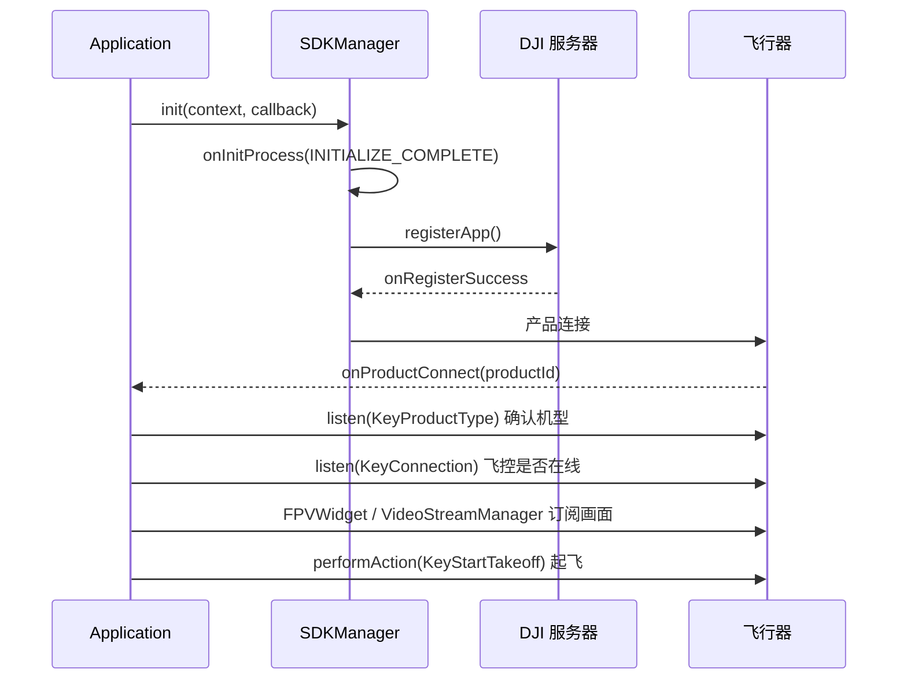

# MSDK 开发总览

> 本系列笔记以「功能」为线索组织，不逐条罗列 API。每个功能都给出**相关 API** 与**可直接抄用的 Java 最简实现**。
> 官方示例是 Kotlin，本系列全部改写成 Java。

## 一、先建立心智模型

MSDK V5 与 V4 最大的区别：**V4 是「对象 + 方法」**（`aircraft.getFlightController().startTakeoff()`），**V5 是「==键值 + 管理器==」**。

V5 只有三类东西：

| 范式 | 代表类 | 用来做什么 | 特点 |
|------|--------|-----------|------|
| 键值（Key-Value） | `KeyManager` + `KeyTools` + `FlightControllerKey` 等 | 读状态、设参数、执行动作 | 一切飞行器/云台/相机数据都是 Key；有缓存，可监听变化 |
| 管理器（Manager） | `MediaDataCenter`、`WaypointMissionManager`、`RTKCenter`… | 任务型、有状态的复杂功能 | 单例，自带监听器注册/注销 |
| 现成 UI（uxsdk） | `FPVWidget`、`CameraControlsWidget`… | 直接搭出「Pilot 风格」界面 | 可选模块，Widget 内部替你调 MSDK |

日常开发 ==90%== 的时间在跟 Key 打交道。记住四个动作：

```java
KeyManager.getInstance().getValue(key);                 // 同步读缓存
KeyManager.getInstance().getValue(key, callback);       // 异步读硬件
KeyManager.getInstance().setValue(key, value, callback); // 写参数
KeyManager.getInstance().performAction(key, callback);   // 执行动作（起飞、拍照…）
KeyManager.getInstance().listen(key, holder, listener);  // 监听变化
```

## 二、功能地图（对应本系列笔记）

| 笔记 | 覆盖功能 | 核心入口 |
|------|---------|---------|
| [[01_环境搭建与SDK初始化]] | Gradle 依赖、API Key、签名、`init`/`registerApp`、产品连接 | `SDKManager` |
| [[02_Key值体系与状态监听]] | Key 的创建、读/写/监听、遥测数据（姿态、位置、电量、信号） | `KeyManager`、`KeyTools` |
| [[03_飞行控制与虚拟摇杆]] | 起飞、降落、返航、限高限远、电机、虚拟摇杆 | `FlightControllerKey`、`VirtualStickManager` |
| [[04_云台与相机控制]] | 云台角度/速度/回中，拍照、录像、变焦、对焦、曝光、红外 | `GimbalKey`、`CameraKey` |
| [[05_图传画面显示]] | 把相机画面显示到 `SurfaceView`/`TextureView`，多路画面切换 | `MediaDataCenter`、`IVideoStreamManager`、`FPVWidget` |
| [[06_媒体文件与直播推流]] | 相册列表、缩略图、原图下载、回放，RTMP/GB28181 直播 | `IMediaManager`、`ILiveStreamManager` |
| [[07_航点任务与智能飞行]] | KMZ 航线上传/执行/断点续飞，智能跟随、POI、FlyTo、探照灯 | `WaypointMissionManager`、`IntelligentFlightManager` |
| [[08_RTK与飞行安全]] | 机载 RTK、网络 RTK、基站，限飞区、飞行警告 | `RTKCenter`、`FlyZoneManager` |
| [[09_设备维护与负载扩展]] | 固件升级、模拟器、避障感知、喊话器、日志 | `UpgradeManager`、`PerceptionManager`、`MegaphoneManager` |
| [[10_uxsdk界面搭建]] | 用现成 Widget 快速拼出完整飞行界面 | `FPVWidget`、`CameraControlsWidget`、`MapWidget` |
| [[11_第三方负载开发]] | 第三方负载的基础信息、Widget 控件、透传、管道、负载相机、妙算 | `PayloadCenter`、`IPayloadManager`、`PipelineManager` |

## 三、典型调用链（写代码前先想清楚顺序）

以「起飞并显示画面」为例：



> [!IMPORTANT] 顺序不能颠倒
> ==注册成功前==所有 Key 都拿不到值；产品未连接前 `getValue` 只会返回默认值。这不是报错，是静默返回——排查时容易误判成 Key 名字写错。

## 四、版本与依赖

示例工程使用的版本（`dependencies.gradle`）：

```groovy
deps.aircraft = "com.dji:dji-sdk-v5-aircraft:5.18.0"            // 实现包
deps.aircraftProvided = "com.dji:dji-sdk-v5-aircraft-provided:5.18.0" // 编译期 API
deps.networkImp = "com.dji:dji-sdk-v5-networkImp:5.18.0"        // 网络实现（注册/RTK/直播等）
deps.wpmzSdk = 'com.dji:wpmzsdk:1.0.5.1'                        // KMZ 航线文件解析
```

文档里每个接口都标注了「MSDK x.y.z 开始支持」，升级 SDK 时优先查这个标注。

## 五、机型差异是最大的坑

同一套 API 在不同机型上能力不同，V5 的做法是==运行时查询==而不是文档列表：

| 能力 | 查询方式 |
|------|---------|
| 相机支持哪些镜头 | `CameraKey.KeyCameraVideoStreamSourceRange` |
| 智能飞行支持哪些任务 | `IntelligentFlightInfo.getSupportedMissions()` |
| 限高/限远的合法范围 | `FlightControllerKey.KeyHeightLimitRange` / `KeyDistanceLimitRange`（`IntValueConfig`） |
| 云台可转角度 | 文档建议手动转到极限后读 `KeyGimbalAttitude` |

写业务代码时**先查范围再设置**，不要==硬编码==数值。

> [!IMPORTANT] 先查范围，再设置
> 同一个 Key 在不同机型上的合法范围不同，硬编码 `120` 米这类值在新机型上可能直接被拒绝，或者被静默截断成上限。正确做法是先读 `XxxRange` 拿到 `IntValueConfig`，用它给出的上下界做钳制。

## 六、文档没写、但 SDK 里确实存在的接口

官方 HTML 文档不全，下面这些是从 `dji-sdk-v5-aircraft-provided-5.18.0.jar` 反编译核对出来的（用 `javap` 看签名即可）：

| 接口 | 文档情况 | 实际 |
|------|---------|------|
| `SDKManager.destroy()` | 未列出 | 存在，退出时释放 SDK |
| `VirtualStickManager.setSpeedLevel(double)` | 未列出 | 存在，示例用它设速度档位 |
| `IMediaManager.playVideoToSurface(...)` | 有，但参数说明不全 | 6 个参数，见 [[06_媒体文件与直播推流]] |
| `FlyZoneInformation` 等数据类 | 未写包名 | 实际在 `dji.v5.manager.aircraft.flysafe.info` |
| `PerceptionDirection` / `ObstacleAvoidanceType` | 未写包名 | 实际在 `dji.v5.manager.aircraft.perception.data` |
| `StreamInfo` | 未写包名 | 实际在 `dji.v5.manager.datacenter.camera` |
| `WPMZManager` | 只在 wpmz 模块 | 实际在 `com.dji.wpmzsdk.manager`，需单独依赖 `com.dji:wpmzsdk:1.0.5.1` |
| `ProductType` | 未写包名 | 实际在 `dji.sdk.keyvalue.value.product` |

> [!TIP] 文档里找不到的 API 怎么查
> 直接在 Gradle 缓存里找 `dji-sdk-v5-aircraft-provided-5.18.0.jar`，用 ==javap== 看真实签名：`javap -classpath <jar> <全限定类名>`，比翻文档快。

## 七、参考源码位置

- 官方示例：`00_Inbox/资料/大疆无人机开发示例代码项目/SampleCode-V5/`
  - `android-sdk-v5-sample`：每个功能一个 `models/*VM.kt` + `pages/*Fragment.kt`，是最直接的用法索引
  - `android-sdk-v5-uxsdk`：现成 Widget，大量 Java 代码，可当作「Java 调用 MSDK 的范例库」
- 官方 API 文档：`00_Inbox/资料/大疆无人机开发文档/`（HTML，按 Manager 分目录）
