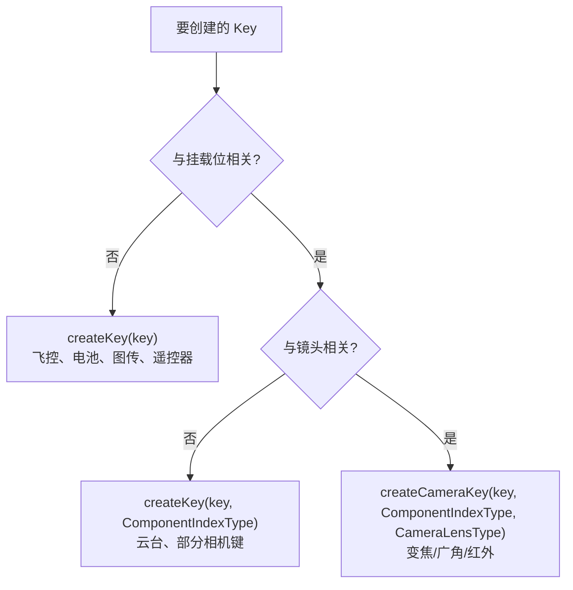
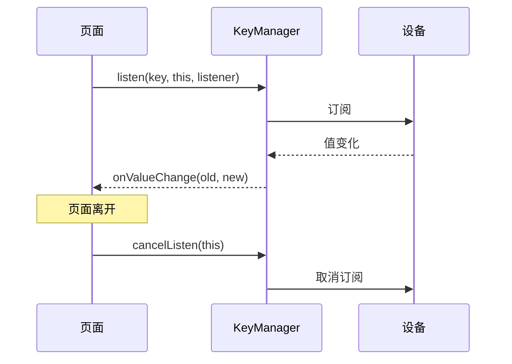

# Key 值体系与状态监听

## 一、功能说明

MSDK V5 把飞行器、云台、相机、电池、遥控器、图传的所有参数都抽象成 ==Key==。读状态、设参数、执行动作、监听变化，全部通过 `KeyManager` 完成。这一章是所有后续功能的地基。

## 二、三个概念

| 概念 | 类 | 说明 |
|------|-----|------|
| Key 定义 | `DJIKeyInfo<T>` / `DJIActionKeyInfo<P,R>` | SDK 里预先定义好的静态常量，如 `FlightControllerKey.KeyAircraftAttitude` |
| Key 实例 | `DJIKey<T>` / `DJIKey.ActionKey<P,R>` | 由 `KeyTools` 创建，带上「哪个挂载位/哪个镜头」的上下文 |
| Key 管理器 | `dji.v5.manager.KeyManager` | 单例，提供 get / set / listen / performAction |

一个 Key 定义自带==能力标记==（文档里每个 Key 都标了）：`canGet`、`canSet`、`canListen`、`canPerformAction`。
例如 `KeyAircraftAttitude` 是 `canGet(true).canListen(true)`，==只能读不能写==；`KeyStartTakeoff` 是 `canPerformAction(true)`，只能用 `performAction`。

## 三、相关 API

| 方法 | 签名 | 用途 |
|------|------|------|
| 同步读缓存 | `<R> R getValue(DJIKey<R> key)` | 立即返回，读不到为 `null` |
| 同步读带默认值 | `<R> R getValue(DJIKey<R> key, R defaultValue)` | 读不到返回默认值 |
| 异步读硬件 | `<R> void getValue(DJIKey<R> key, CompletionCallbackWithParam<R> cb)` | 向设备要一次真实值 |
| 写参数 | `<P> void setValue(DJIKey<P> key, P param, CompletionCallback cb)` | 设置可写 Key |
| 执行动作（无参） | `<R> void performAction(DJIKey.ActionKey<?,R> key, CompletionCallbackWithParam<R> cb)` | 起飞、降落、拍照… |
| 执行动作（带参） | `<P,R> void performAction(DJIKey.ActionKey<P,R> key, P param, CompletionCallbackWithParam<R> cb)` | 云台旋转、格式化存储… |
| 监听 | `<R> void listen(DJIKey<R> key, Object listenHolder, KeyListener<R> cb)` | 值变化时回调 |
| 监听并立即取一次 | `<R> void listen(DJIKey<R> key, Object holder, boolean getOnce, KeyListener<R> cb)` | 进入页面时常用 |
| 取消监听 | `cancelListen(DJIKey<?>, Object)` / `cancelListen(Object)` | 按 Key 或按 holder 批量取消 |

`KeyListener` 只有一个方法：`void onValueChange(@Nullable T oldValue, @Nullable T newValue)`，**新值可能是 ==null==**，务必判空。

> [!WARNING] 新值可能是 null
> 监听回调的 `newValue` 声明为 `@Nullable`，设备断连、数据源切换时都可能给 `null`。不判空直接调 `newValue.getPitch()` 就是一次 NPE——而且只在真机特定场景复现，模拟器上很难撞到。

## 四、KeyTools：三种创建方式

三种 `createKey` 的选择取决于这个 Key 需不需要上下文：不带挂载位、带挂载位、带挂载位和镜头。



```java
import dji.sdk.keyvalue.key.KeyTools;
import dji.sdk.keyvalue.value.common.CameraLensType;
import dji.sdk.keyvalue.value.common.ComponentIndexType;

// ① 与挂载位/镜头无关（飞控、电池、图传、遥控器）
DJIKey<Attitude> attitudeKey =
        KeyTools.createKey(FlightControllerKey.KeyAircraftAttitude);

// ② 与云台挂载位相关（云台、部分相机键）
DJIKey<Attitude> gimbalKey =
        KeyTools.createKey(GimbalKey.KeyGimbalAttitude, ComponentIndexType.LEFT_OR_MAIN);

// ③ 与相机镜头相关（变焦/广角/红外镜头参数不同）
DJIKey<Double> zoomKey = KeyTools.createCameraKey(
        CameraKey.KeyCameraZoomRatios,
        ComponentIndexType.LEFT_OR_MAIN,
        CameraLensType.CAMERA_LENS_ZOOM);
```

`ComponentIndexType` 常用值：==LEFT_OR_MAIN==（左/主）、`RIGHT`、`UP`、`FPV`、`PORT_1`~`PORT_8`、`UNKNOWN`。

`CameraKey` 继承 `DJICameraKey`、`FlightControllerKey` 继承 `DJIFlightControllerKey`、`GimbalKey` 继承 `DJIGimbalKey`。文档里分两页列出的 Key，代码里都可以直接 `CameraKey.KeyCameraMode` / `FlightControllerKey.KeyHeightLimit` 这样写，不用关心它定义在父类还是子类。

## 五、最简实现

### 1. 读一次（同步 / 异步）

```java
import androidx.annotation.NonNull;

import dji.sdk.keyvalue.key.FlightControllerKey;
import dji.sdk.keyvalue.key.KeyTools;
import dji.sdk.keyvalue.value.common.LocationCoordinate3D;
import dji.v5.common.callback.CommonCallbacks;
import dji.v5.common.error.IDJIError;
import dji.v5.manager.KeyManager;

// 同步：读 MSDK 缓存，页面刷新用
LocationCoordinate3D loc = KeyManager.getInstance().getValue(
        KeyTools.createKey(FlightControllerKey.KeyAircraftLocation3D));

// 异步：直接向飞控要，首屏或对时效敏感时用
KeyManager.getInstance().getValue(
        KeyTools.createKey(FlightControllerKey.KeyAircraftLocation3D),
        new CommonCallbacks.CompletionCallbackWithParam<LocationCoordinate3D>() {
            @Override
            public void onSuccess(LocationCoordinate3D value) {
                // value 可能为 null
            }

            @Override
            public void onFailure(@NonNull IDJIError error) {
                // error.errorCode() / error.description()
            }
        });
```

### 2. 写参数

```java
// 设置最大飞行高度 120 米
KeyManager.getInstance().setValue(
        KeyTools.createKey(FlightControllerKey.KeyHeightLimit), 120,
        new CommonCallbacks.CompletionCallback() {
            @Override
            public void onSuccess() { }

            @Override
            public void onFailure(@NonNull IDJIError error) { }
        });
```

### 3. 监听（页面级标准写法）

监听的成对关系是页面生命周期里最容易漏的一环：进入页面挂上，离开页面必须按 holder 一次性取消。



```java
public class TelemetryMonitor {

    private final CommonCallbacks.KeyListener<Attitude> attitudeListener =
            new CommonCallbacks.KeyListener<Attitude>() {
                @Override
                public void onValueChange(@Nullable Attitude oldValue,
                                          @Nullable Attitude newValue) {
                    if (newValue == null) return;
                    // 回调线程不保证是主线程，更新 UI 请切主线程
                    double pitch = newValue.getPitch() == null ? 0 : newValue.getPitch();
                    double yaw   = newValue.getYaw()   == null ? 0 : newValue.getYaw();
                    double roll  = newValue.getRoll()  == null ? 0 : newValue.getRoll();
                    // 这里刷新 UI
                }
            };

    /** 进入页面时挂监听，holder 用 this，方便统一取消 */
    public void start() {
        KeyManager.getInstance().listen(
                KeyTools.createKey(FlightControllerKey.KeyAircraftAttitude),
                this, attitudeListener);

        // 其余监听写法完全同构：new 一个 KeyListener<T>，再 listen(key, this, listener)
        // KeyTools.createKey(FlightControllerKey.KeyAircraftLocation3D)  → LocationCoordinate3D
        // KeyTools.createKey(BatteryKey.KeyChargeRemainingInPercent)     → Integer
    }

    /** 离开页面时按 holder 一次性取消，避免泄漏与空回调 */
    public void stop() {
        KeyManager.getInstance().cancelListen(this);
    }
}
```

> [!WARNING] 回调线程不保证是主线程
> 官方文档没有承诺 `onValueChange` 在哪个线程回调。示例里统一把结果 `postValue` 到主线程再刷 UI；直接在回调里 `setText` 会抛 `CalledFromWrongThreadException`，而且只在真机上偶发。

### 4. 常用遥测 Key 速查

| 数据 | Key | 类型 |
|------|-----|------|
| 飞控连接 | `FlightControllerKey.KeyConnection` | `Boolean` |
| 是否在飞 | `KeyIsFlying` | `Boolean` |
| 电机是否起转 | `KeyAreMotorsOn` | `Boolean` |
| 飞行模式 | `KeyFlightMode` | `FlightMode`（`GPS_NORMAL`/`GPS_SPORT`/`ATTI`/`GO_HOME`/`AUTO_LANDING`…） |
| 姿态 | `KeyAircraftAttitude` | `Attitude`（pitch/yaw/roll，度） |
| 位置 | `KeyAircraftLocation3D` | `LocationCoordinate3D`（经纬度 + 相对起飞点高度） |
| 速度 | `KeyAircraftVelocity` | `Velocity3D`（x/y/z，m/s） |
| GPS 星数 / 等级 | `KeyGPSSatelliteCount` / `KeyGPSSignalLevel` | `Integer` / `GPSSignalLevel`（`LEVEL_0`~`LEVEL_5`，`LEVEL_10` 表示融合 RTK） |
| 返航点 | `KeyHomeLocation` / `KeyIsHomeLocationSet` | `LocationCoordinate2D` / `Boolean` |
| 返航高度 | `KeyGoHomeHeight` | `Integer`（米） |
| 返航状态 | `KeyGoHomeStatus` | `GoHomeState`（`IDLE`/`RETURNING_TO_HOME`/`LANDING`/`COMPLETED`） |
| 电量百分比 | `BatteryKey.KeyChargeRemainingInPercent` | `Integer`（%） |
| 电池电压/温度 | `BatteryKey.KeyVoltage` / `KeyBatteryTemperature` | `Integer` / `Double` |
| 图传信号质量 | `AirLinkKey.KeySignalQuality` | `Integer` |
| 图传码率 | `AirLinkKey.KeyVideoDataRate` | `Double` |
| 遥控器摇杆 | `RemoteControllerKey.KeyStickLeftVertical` 等 | `Integer` |

## 六、注意事项

1. **`listen` 的 ==holder== 很重要**：同一个 Key 可以挂多个监听，取消时必须传对 holder；`cancelListen(Object holder)` 会取消该 holder 的全部监听，页面 `onDestroy` 里调一次最省事。
2. **不要用 `getValue` 做轮询**：需要持续数据就 `listen`，同步 `getValue` 读的是==缓存==，可能滞后。
3. **`getValue` 在未连接时返回 `null`**：带默认值的重载更安全。
4. **Key 能力是固定的**：`canSet(false)` 的 Key 用 `setValue` 一定失败；执行动作必须用 `performAction`。
5. **不同镜头要不同的 Key 实例**：相机相关 Key 若报「不支持」，先检查是否漏了 `CameraLensType`（红外必须 `CAMERA_LENS_THERMAL`）。
6. **回调线程**：官方文档未承诺线程，示例统一把结果 `postValue` 到主线程，照做即可。

> [!IMPORTANT] Key 能力是固定的
> `canSet(false)` 的 Key 用 `setValue` 一定失败，`canPerformAction` 为 false 的 Key 用 `performAction` 也一样。错误信息通常只说「不支持」，不告诉你是能力不对还是参数不对——所以写之前先看文档给这个 Key 标了哪几个能力。

> [!WARNING] holder 传错，监听就取消不掉
> `cancelListen(holder)` 按对象匹配。挂监听时传 `this`、取消时传了别的对象（或者反过来传了 Key），监听会一直活着：页面销毁后仍在回调里刷 UI，既泄漏又可能崩。
>
> 最省事的约定是**全页面统一用一个 holder**（通常就是 `this`），`onDestroy` 里 `cancelListen(this)` 一次收干净。
