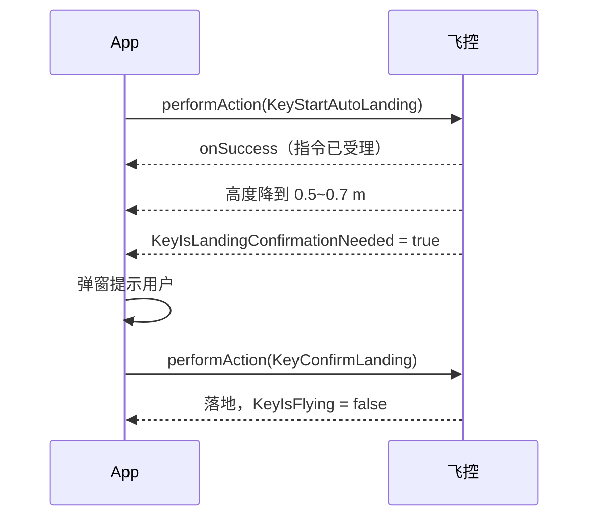
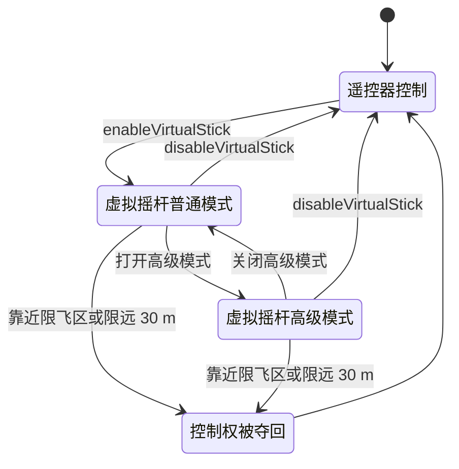

# 飞行控制与虚拟摇杆

## 一、功能说明

起飞、降落、返航、限高限远这类「飞控动作」，V5 全部走 `FlightControllerKey` 的 Action Key；连续控制（像推摇杆一样飞）走 `VirtualStickManager`。

两类接口的差别：

- **==Action Key==**：一次调用一个动作，有明确的成功/失败回调（起飞、降落、返航、确认降落）。
- **==VirtualStickManager==**：进入「虚拟摇杆模式」后，以固定频率持续写入摇杆量或姿态/速度参数，适合航线之外的精细控制、跟随算法、手柄映射。

## 二、相关 API

### 1. 飞控动作（`dji.sdk.keyvalue.key.FlightControllerKey`）

| Key | 参数类型 | 说明 |
|-----|---------|------|
| `KeyStartTakeoff` / `KeyStopTakeoff` | 无 | 自主起飞（升到 1.2 m 完成）/ 取消起飞 |
| `KeyStartAutoLanding` / `KeyStopAutoLanding` | 无 | 自主降落 / 停止降落并悬停 |
| `KeyConfirmLanding` | 无 | 确认继续降落（离地 < 0.7 m 时可能要求确认） |
| `KeyStartGoHome` / `KeyStopGoHome` | 无 | 智能返航 / 取消返航 |
| `KeyHomeLocationUsingCurrentAircraftLocation` | 无 | 把当前位置设为返航点 |
| `KeyGoHomeConfirm` | `Boolean` | 返航确认（`KeyGoHomeInfo` 返回 `NORMAL` 时需要） |
| `KeyLookAt` | `LookAtInfo` | 让机头/云台看向指定坐标（5.9.0） |
| `KeyStartCompassCalibration` / `KeyStartIMUCalibration` | 无 | 指南针 / IMU 校准 |
| `KeyRebootDevice` | 无 | 重启核心设备（电机未起转时才能用） |

### 2. 可读写的飞控参数

| Key | 类型 | 说明 |
|-----|------|------|
| `KeyHeightLimit` / `KeyHeightLimitRange` | `Integer` / `IntValueConfig` | 限高（米）/ 合法范围 |
| `KeyDistanceLimitEnabled` / `KeyDistanceLimit` / `KeyDistanceLimitRange` | `Boolean` / `Integer` / `IntValueConfig` | 限远开关 / 距离 / 范围 |
| `KeyGoHomeHeight` / `KeyGoHomeHeightRange` | `Integer` / `IntValueConfig` | 返航高度 / 范围 |
| `KeyHomeLocation` | `LocationCoordinate2D` | 返航点 |
| `KeyLowBatteryWarningThreshold` / `KeySeriousLowBatteryWarningThreshold` | `Integer` | 低电量阈值（%） |
| `KeyLockMotors` | `Boolean` | 锁电机 |
| `KeyLEDsSettings` | `LEDsSettings` | 前臂灯 / 导航灯 / 状态灯 |

### 3. 虚拟摇杆（`dji.v5.manager.aircraft.virtualstick.VirtualStickManager`）

| 方法 | 说明 |
|------|------|
| `enableVirtualStick(callback)` / `disableVirtualStick(callback)` | 进入 / 退出虚拟摇杆模式 |
| `getLeftStick()` / `getRightStick()` | 左摇杆（偏航 + 油门）、右摇杆（俯仰 + 横滚） |
| `IStick.setHorizontalPosition(int)` / `setVerticalPosition(int)` | 摇杆量，范围 $[-660, 660]$ |
| `setVirtualStickAdvancedModeEnabled(boolean)` | 打开高级模式（摇杆量失效，改用参数） |
| `sendVirtualStickAdvancedParam(param)` | 高级控制参数，建议 5–25 Hz 发送 |
| `setSpeedLevel(double)` | 速度档位（示例使用，文档未列出） |
| `setVirtualStickStateListener(listener)` | 监听控制权状态与变更原因 |

高级参数 `VirtualStickFlightControlParam` 的四个控制模式：

| 方法 | 取值 |
|------|------|
| `setRollPitchControlMode` | `ANGLE`（角度，±30°）/ `VELOCITY`（速度，±23 m/s） |
| `setRollPitchCoordinateSystem` | `GROUND`（大地）/ `BODY`（机体） |
| `setYawControlMode` | `ANGLE`（±180°）/ `ANGULAR_VELOCITY`（±100 °/s） |
| `setVerticalControlMode` | `VELOCITY`（±6 m/s）/ `POSITION`（0–5000 m） |

## 三、最简实现

### 1. 起飞

> [!CAUTION] 起飞前必须确认三件事
> 飞控连接、GPS 等级、限飞区，缺一个都可能出问题：
>
> - GPS 低于 ==LEVEL_3== 时悬停会漂移，低于 ==LEVEL_4== 记录不了返航点，返航会飞向错误位置。
> - 限飞区内起飞会被直接拒绝，或起飞后被强制降落。
>
> 下面代码里的 `takeOff()` 只检查了连接状态，GPS 与限飞区要业务层自己查。

```java
import androidx.annotation.NonNull;

import dji.sdk.keyvalue.key.FlightControllerKey;
import dji.sdk.keyvalue.key.KeyTools;
import dji.sdk.keyvalue.value.common.EmptyMsg;
import dji.sdk.keyvalue.value.common.IntValueConfig;
import dji.v5.common.callback.CommonCallbacks;
import dji.v5.common.error.IDJIError;
import dji.v5.manager.KeyManager;

/** 起飞：成功后飞行器自动升到约 1.2 m 悬停 */
public void takeOff() {
    // 前置检查：飞控在线、GPS 等级足够、电机未起转
    Boolean connected = KeyManager.getInstance().getValue(
            KeyTools.createKey(FlightControllerKey.KeyConnection), false);
    if (!connected) {
        return; // 未连接直接返回
    }

    KeyManager.getInstance().performAction(
            KeyTools.createKey(FlightControllerKey.KeyStartTakeoff),
            new CommonCallbacks.CompletionCallbackWithParam<EmptyMsg>() {
                @Override
                public void onSuccess(EmptyMsg result) {
                    // 起飞指令已执行，真正的「离地」请监听 KeyIsFlying
                }

                @Override
                public void onFailure(@NonNull IDJIError error) {
                    // 常见：电量低、GPS 差、指南针异常、限飞区
                }
            });
}
```

> [!IMPORTANT] 回调成功 ≠ 已经起飞
> `onSuccess` 只说明==指令被接受==，不代表飞行器已经离地。真正的离地要监听 `KeyIsFlying`，返航进度看 `KeyGoHomeStatus`，降落完成看高度归零。
>
> 写成"起飞成功就执行下一步"，会在风大、GPS 差、地面不平的场合直接走到未定义的状态。

### 2. 降落（含二次确认）

降落分两段：先发自动降落，降到接近地面时可能暂停等确认，再发确认。中间那一段是靠监听驱动的，不是靠 sleep。



```java
public void land() {
    KeyManager.getInstance().performAction(
            KeyTools.createKey(FlightControllerKey.KeyStartAutoLanding),
            new CommonCallbacks.CompletionCallbackWithParam<EmptyMsg>() {
                @Override public void onSuccess(EmptyMsg result) { }
                @Override public void onFailure(@NonNull IDJIError error) { }
            });
}

/**
 * 部分机型降到离地 0.5~0.7 m 会暂停等待确认。
 * 进入页面前监听 KeyIsLandingConfirmationNeeded，为 true 时弹窗让用户确认。
 */
public void confirmLanding() {
    KeyManager.getInstance().performAction(
            KeyTools.createKey(FlightControllerKey.KeyConfirmLanding),
            new CommonCallbacks.CompletionCallbackWithParam<EmptyMsg>() {
                @Override public void onSuccess(EmptyMsg result) { }
                @Override public void onFailure(@NonNull IDJIError error) { }
            });
}
```

> [!WARNING] 降落可能停在半空等你确认
> 部分机型降到离地 $0.5 \sim 0.7\ \text{m}$ 会暂停，等一个确认信号。不监听 `KeyIsLandingConfirmationNeeded` 的话，现象就是"降落卡住了"，很容易误判成 SDK 故障。进入页面前就挂上这个监听，为 `true` 时弹窗让用户确认。

### 3. 一键返航 / 取消返航 / 设置返航高度

```java
public void goHome() {
    KeyManager.getInstance().performAction(
            KeyTools.createKey(FlightControllerKey.KeyStartGoHome),
            new CommonCallbacks.CompletionCallbackWithParam<EmptyMsg>() {
                @Override public void onSuccess(EmptyMsg result) { }
                @Override public void onFailure(@NonNull IDJIError error) { }
            });
}

public void cancelGoHome() {
    KeyManager.getInstance().performAction(
            KeyTools.createKey(FlightControllerKey.KeyStopGoHome),
            new CommonCallbacks.CompletionCallbackWithParam<EmptyMsg>() {
                @Override public void onSuccess(EmptyMsg result) { }
                @Override public void onFailure(@NonNull IDJIError error) { }
            });
}

/** 返航高度：先查范围再设置，不要硬编码 */
public void setGoHomeHeight(int meters) {
    IntValueConfig range = KeyManager.getInstance().getValue(
            KeyTools.createKey(FlightControllerKey.KeyGoHomeHeightRange));
    if (range != null && range.getMin() != null && range.getMax() != null) {
        meters = Math.max(range.getMin(), Math.min(range.getMax(), meters));
    }
    KeyManager.getInstance().setValue(
            KeyTools.createKey(FlightControllerKey.KeyGoHomeHeight), meters,
            new CommonCallbacks.CompletionCallback() {
                @Override public void onSuccess() { }
                @Override public void onFailure(@NonNull IDJIError error) { }
            });
}
```

上面那句 `Math.max(range.getMin(), Math.min(range.getMax(), meters))` 就是把输入夹进合法区间的标准写法：

$$
h = \min\bigl(\max(h_{\text{target}},\ h_{\min}),\ h_{\max}\bigr)
$$

先夹下界再夹上界，两个方向都覆盖；顺序反过来在极端值下会得到区间外的结果。

### 4. 限高 / 限远

```java
public void setHeightAndDistanceLimit(int heightMeters, int distanceMeters) {
    KeyManager.getInstance().setValue(
            KeyTools.createKey(FlightControllerKey.KeyHeightLimit), heightMeters, null);

    // 限远必须先打开开关，再设距离
    KeyManager.getInstance().setValue(
            KeyTools.createKey(FlightControllerKey.KeyDistanceLimitEnabled), true, null);
    KeyManager.getInstance().setValue(
            KeyTools.createKey(FlightControllerKey.KeyDistanceLimit), distanceMeters, null);
}
```

> [!WARNING] 限远：先开开关，再设距离
> 顺序反了，`setValue(KeyDistanceLimit)` 会返回成功但距离不生效——开关还关着，这个值只是被存下来，不起作用。排查时会以为是距离超范围，实际是顺序问题。

### 5. 虚拟摇杆 · 普通模式

进入虚拟摇杆模式意味着==控制权交接==：从这一刻起，遥控器的摇杆不再控制飞行器，所有动作都由你的代码决定。



```java
import dji.v5.manager.aircraft.virtualstick.VirtualStickManager;

/** 进入虚拟摇杆模式后，遥控器摇杆不再控制飞行器 */
public void enterVirtualStick() {
    VirtualStickManager.getInstance().enableVirtualStick(
            new CommonCallbacks.CompletionCallback() {
                @Override public void onSuccess() {
                    // 起飞后、有 GPS 时才建议开始推杆
                }
                @Override public void onFailure(@NonNull IDJIError error) { }
            });
}

/** 左摇杆：horizontal=偏航（负=逆时针），vertical=油门（正=上升） */
public void pushLeftStick(int yaw, int throttle) {
    VirtualStickManager.getInstance().getLeftStick().setHorizontalPosition(yaw);
    VirtualStickManager.getInstance().getLeftStick().setVerticalPosition(throttle);
}

/** 右摇杆：horizontal=横滚，vertical=俯仰（正=前进） */
public void pushRightStick(int roll, int pitch) {
    VirtualStickManager.getInstance().getRightStick().setHorizontalPosition(roll);
    VirtualStickManager.getInstance().getRightStick().setVerticalPosition(pitch);
}

public void exitVirtualStick() {
    // 退出前先把摇杆回中，避免残留量
    pushLeftStick(0, 0);
    pushRightStick(0, 0);
    VirtualStickManager.getInstance().disableVirtualStick(
            new CommonCallbacks.CompletionCallback() {
                @Override public void onSuccess() { }
                @Override public void onFailure(@NonNull IDJIError error) { }
            });
}
```

> [!IMPORTANT] 进入虚拟摇杆模式后，遥控器摇杆失效
> 这是控制权的转移，不是叠加：`enableVirtualStick` 成功后，操作员推遥控器摇杆不会有任何反应，全部动作由代码里的摇杆量决定。界面上必须给出明确提示，否则操作员会以为遥控器坏了。
>
> 反过来，靠近限飞区或限远边界时遥控器会自动==夺回控制权==，此时虚拟摇杆失效。用 `setVirtualStickStateListener` 监听 `FlightControlAuthority` 变化，才能知道什么时候被接管了。

### 6. 虚拟摇杆 · 高级模式（速度控制）

```java
import dji.sdk.keyvalue.value.flightcontroller.FlightCoordinateSystem;
import dji.sdk.keyvalue.value.flightcontroller.RollPitchControlMode;
import dji.sdk.keyvalue.value.flightcontroller.VerticalControlMode;
import dji.sdk.keyvalue.value.flightcontroller.VirtualStickFlightControlParam;
import dji.sdk.keyvalue.value.flightcontroller.YawControlMode;

private final VirtualStickFlightControlParam param = new VirtualStickFlightControlParam();

public void enterAdvancedMode() {
    // 1) 先打开高级模式
    VirtualStickManager.getInstance().setVirtualStickAdvancedModeEnabled(true);

    // 2) 固定控制模式（飞行中不要随意改）
    param.setRollPitchControlMode(RollPitchControlMode.VELOCITY);      // 水平用速度
    param.setRollPitchCoordinateSystem(FlightCoordinateSystem.BODY);   // 机体系：正前=俯仰
    param.setYawControlMode(YawControlMode.ANGULAR_VELOCITY);          // 偏航用角速度
    param.setVerticalControlMode(VerticalControlMode.VELOCITY);        // 垂直用速度
}

/** 以 10 Hz 左右持续调用；停止控制时发送全 0 */
public void flyVelocity(double forward, double right, double up, double yawRate) {
    param.setPitch(forward);          // m/s，-23 ~ 23
    param.setRoll(right);             // m/s
    param.setVerticalThrottle(up);    // m/s，-6 ~ 6
    param.setYaw(yawRate);            // °/s，-100 ~ 100
    VirtualStickManager.getInstance().sendVirtualStickAdvancedParam(param);
}
```

> [!CAUTION] 停发参数不等于停住飞机
> 高级模式是"持续下发才持续运动"：以 5–25 Hz 的节奏调用 `sendVirtualStickAdvancedParam`，飞行器按最近一次的值飞。**想停下来必须显式发全 0**——直接停止发送，飞机会保持上一帧的速度继续飞，而且不会报任何错。
>
> 发送周期 $T = 1/f$，$f \in [5, 25]\ \text{Hz}$ 对应 $T \in [40, 200]\ \text{ms}$。频率太低动作会一顿一顿，太高浪费带宽。

## 四、注意事项

1. **起飞前检查三件事**：飞控连接、GPS 等级（==LEVEL_3== 以上才能稳定悬停，==LEVEL_4== 才能记录返航点）、限飞区提示。
2. **`performAction` 成功 ≠ 动作完成**：起飞成功只代表指令被接受，是否离地要看 `KeyIsFlying`；返航进度看 `KeyGoHomeStatus`。
3. **降落可能被「卡住」**：机型会降到 0.5 m 停下等确认，要监听 `KeyIsLandingConfirmationNeeded` 再发 `KeyConfirmLanding`。
4. **虚拟摇杆会抢控制权**：靠近限飞区/限远 ==30 m== 时遥控器会自动夺回控制权，此时虚拟摇杆失效（文档明确）。用 `setVirtualStickStateListener` 监听 `FlightControlAuthority` 变化。
5. **高级模式下的避障**：只有「垂直=速度 + 偏航=角速度 + 横滚/俯仰=速度」这一组合才支持避障，且仅 ==M300/M350/M30/M3E/M3M== 支持。
6. **发送频率**：高级参数建议 5–25 Hz；普通摇杆量可以只在变化时写。
7. **退出前摇杆回中**，否则重新进入时可能瞬间给出一个旧的控制量。
