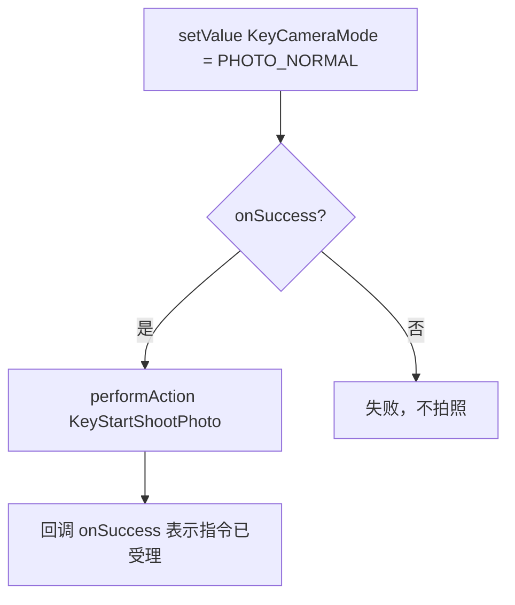
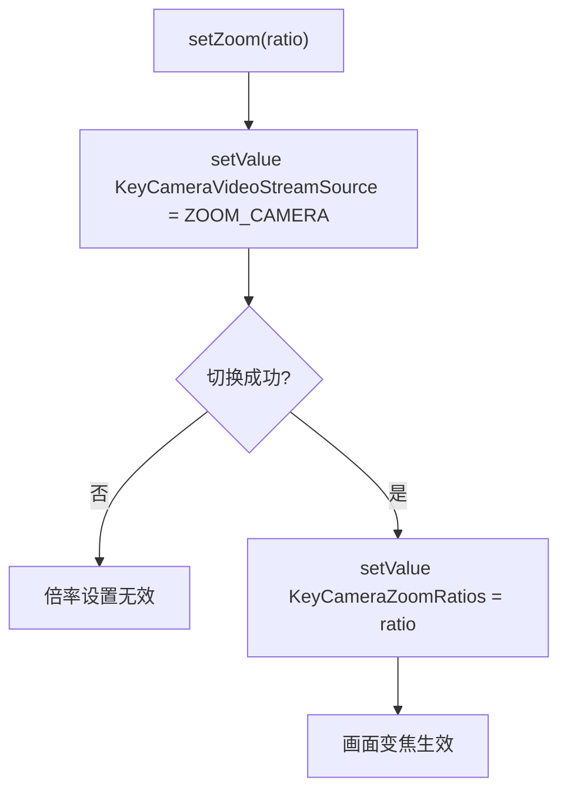

# 云台与相机控制

## 一、功能说明

- **云台**：控制镜头朝向。==角度模式==（转到指定角度）、==速度模式==（按住持续转）、回中/朝下、微调、校准。
- **相机**：拍照、录像、变焦、对焦、曝光三要素、分辨率帧率、存储卡管理，以及红外镜头的伪彩/显示模式。

所有操作都是 Key，唯一要记住的规则：**相机相关 Key 必须带对 `ComponentIndexType`（挂载位）和 `CameraLensType`（镜头）**。

> [!IMPORTANT] 相机 Key 必须带对两个维度
> 云台挂载位（`ComponentIndexType`）和镜头（`CameraLensType`）是相机类 Key 的==定位坐标==，两者都传对才能命中真正的硬件。
>
> 挂载位决定"哪台相机"，镜头决定"哪颗镜头"。多负载机型上挂载位写错，操作会落到另一台设备；单镜头机型上镜头写错，则直接==静默失败==——不报错，参数就是不生效。所以这一章每个示例都显式写出这两个参数，照抄时不要省略。

## 二、相关 API

### 1. 云台（`dji.sdk.keyvalue.key.GimbalKey`）

| Key | 类型 | 能力 | 说明 |
|-----|------|------|------|
| `KeyGimbalAttitude` | `Attitude` | 读/听 | 云台姿态（yaw 为北东地坐标） |
| `KeyGimbalMode` | `GimbalMode` | 读/写/听 | `FREE` 自由 / `YAW_FOLLOW` 偏航跟随 / `FPV` |
| `KeyRotateByAngle` | `GimbalAngleRotation` | 动作 | 角度旋转（相对/绝对） |
| `KeyRotateBySpeed` | `GimbalSpeedRotation` | 动作 | 速度旋转，单位 0.1°/s，范围 ±359.9 |
| `KeyGimbalReset` | `GimbalResetType` | 动作 | 回中/朝下（`PITCH_YAW`、`ONLY_PITCH`…） |
| `KeyFineTunePitchInDegrees` | `Double` | 动作 | 俯仰微调，单次 ±2°，累计 ±10° |
| `KeyGimbalCalibrate` | 无 | 动作 | 云台校准 |
| `KeyPitchRangeExtensionEnabled` | `Boolean` | 读/写 | 俯仰限位扩展 |

`GimbalAngleRotation` 的字段：`mode`（`RELATIVE_ANGLE` / `ABSOLUTE_ANGLE`）、`pitch`、`yaw`、`roll`、`duration`（秒）。

### 2. 相机（`dji.sdk.keyvalue.key.CameraKey`）

| 功能 | Key | 类型 |
|------|-----|------|
| 相机模式 | `KeyCameraMode` / `KeyCameraModeRange` | `CameraMode` / `List<CameraMode>` |
| 拍照 | `KeyStartShootPhoto` / `KeyStopShootPhoto` | 动作 |
| 录像 | `KeyStartRecord` / `KeyStopRecord` | 动作 |
| 是否在拍/录 | `KeyIsShootingPhoto` / `KeyIsRecording` | `Boolean` |
| 视频源（镜头） | `KeyCameraVideoStreamSource` / `...Range` | `CameraVideoStreamSourceType` |
| 变焦 | `KeyCameraZoomRatios` / `KeyCameraZoomRatiosRange` | `Double` / `ZoomRatiosRange` |
| 对焦模式 | `KeyCameraFocusMode` | `CameraFocusMode`（`MANUAL`/`AF`/`AFC`） |
| 对焦目标 | `KeyCameraFocusTarget` | `DoublePoint2D`（0~1 归一化） |
| 曝光模式 | `KeyExposureMode` / `KeyExposureModeRange` | `CameraExposureMode` |
| 曝光补偿 | `KeyExposureCompensation` | `CameraExposureCompensation` |
| ISO / 快门 | `KeyISO` / `KeyShutterSpeed`（含 `Range`） | `CameraISO` / `CameraShutterSpeed` |
| 分辨率帧率 | `KeyVideoResolutionFrameRate` / `...Range` | `VideoResolutionFrameRate` |
| 照片比例 | `KeyPhotoRatio` / `KeyPhotoRatioRange` | `PhotoRatio` |
| 存储信息 | `KeyCameraStorageInfos` | `CameraStorageInfos` |
| 格式化 | `KeyFormatStorage` | 动作，参数 `CameraStorageLocation` |
| 红外伪彩 | `KeyThermalPalette` / `...Range` | `CameraThermalPalette`（需红外镜头） |
| 红外显示模式 | `KeyThermalDisplayMode` | `ThermalDisplayMode`（`VISUAL_ONLY` 仅可见光 / `THERMAL_ONLY` 仅红外 / `PIP` 画中画 / `MSX` 融合） |
| 测温模式 | `KeyThermalTemperatureMeasureMode` | `ThermalTemperatureMeasureMode` |

`CameraMode` 常用值：`PHOTO_NORMAL`、`VIDEO_NORMAL`、`PHOTO_AEB`、`PHOTO_BURST`、`PHOTO_INTERVAL`、`PHOTO_PANORAMA`、`PHOTO_HIGH_RESOLUTION`、`PHOTO_SUPER_RESOLUTION`。

## 三、最简实现

### 1. 云台转到指定角度（绝对角度）

俯仰 ==-90°== 就是垂直向下，这是"让镜头朝下看"最常用的值。

```java
import dji.sdk.keyvalue.key.GimbalKey;
import dji.sdk.keyvalue.key.KeyTools;
import dji.sdk.keyvalue.value.common.ComponentIndexType;
import dji.sdk.keyvalue.value.common.EmptyMsg;
import dji.sdk.keyvalue.value.gimbal.GimbalAngleRotation;
import dji.sdk.keyvalue.value.gimbal.GimbalAngleRotationMode;
import dji.v5.common.callback.CommonCallbacks;
import dji.v5.manager.KeyManager;

public void lookDown() {
    GimbalAngleRotation rotation = new GimbalAngleRotation();
    rotation.setMode(GimbalAngleRotationMode.ABSOLUTE_ANGLE); // 绝对角度：0° 为飞行器当前姿态
    rotation.setPitch(-90.0);   // 俯仰，负值向下
    rotation.setYaw(0.0);       // 偏航
    rotation.setRoll(0.0);      // 横滚
    rotation.setDuration(1.0);  // 转动耗时（秒）

    KeyManager.getInstance().performAction(
            KeyTools.createKey(GimbalKey.KeyRotateByAngle, ComponentIndexType.LEFT_OR_MAIN),
            rotation,
            new CommonCallbacks.CompletionCallbackWithParam<EmptyMsg>() {
                @Override public void onSuccess(EmptyMsg result) { }
                @Override public void onFailure(@NonNull IDJIError error) { }
            });
}
```

### 2. 云台回中 / 速度转动 / 微调

```java
/** 回中：俯仰+偏航回正 */
public void resetGimbal() {
    KeyManager.getInstance().performAction(
            KeyTools.createKey(GimbalKey.KeyGimbalReset, ComponentIndexType.LEFT_OR_MAIN),
            GimbalResetType.PITCH_YAW,
            new CommonCallbacks.CompletionCallbackWithParam<EmptyMsg>() {
                @Override public void onSuccess(EmptyMsg result) { }
                @Override public void onFailure(@NonNull IDJIError error) { }
            });
}

/** 速度转动：适合「按住按钮持续转」，单位 0.1°/s */
public void rotateBySpeed(double pitchSpeed, double yawSpeed) {
    GimbalSpeedRotation speed = new GimbalSpeedRotation();
    speed.setPitch(pitchSpeed); // 例如 100 = 10°/s
    speed.setYaw(yawSpeed);
    KeyManager.getInstance().performAction(
            KeyTools.createKey(GimbalKey.KeyRotateBySpeed, ComponentIndexType.LEFT_OR_MAIN),
            speed,
            new CommonCallbacks.CompletionCallbackWithParam<EmptyMsg>() {
                @Override public void onSuccess(EmptyMsg result) { }
                @Override public void onFailure(@NonNull IDJIError error) { }
            });
}

/** 俯仰微调：回中后仍有小偏差时调平，单次 ±2° */
public void fineTunePitch(double degree) {
    KeyManager.getInstance().performAction(
            KeyTools.createKey(GimbalKey.KeyFineTunePitchInDegrees, ComponentIndexType.LEFT_OR_MAIN),
            degree,
            new CommonCallbacks.CompletionCallbackWithParam<EmptyMsg>() {
                @Override public void onSuccess(EmptyMsg result) { }
                @Override public void onFailure(@NonNull IDJIError error) { }
            });
}
```

微调有累计上限，连续调多次会到达边界后失效：

$$
\left|\sum_{i} \Delta\theta_i\right| \le 10^{\circ}, \qquad \left|\Delta\theta\right| \le 2^{\circ}
$$

所以"连点十次每次 2°"不会得到 20° 的偏移，第 5 次之后就不再变化。回中（`KeyGimbalReset`）会清零这个累计量。

速度旋转的参数是"每秒转多少度"的十倍。传入值 $v$ 与实际角速度 $\omega$ 的关系：

$$
\omega = \frac{v}{10}\ \left(^{\circ}/\text{s}\right), \qquad v \in [-3599,\ 3599]
$$

所以 `100` 是 10°/s，`3599` 约 360°/s。角度模式（`KeyRotateByAngle`）用的是度数，两者相差十倍——混用会让云台转得比预期慢十倍或快十倍。

> [!WARNING] 云台两种模式的角度单位差 10 倍
> `KeyRotateByAngle` 传的是==度数==（`-90` 就是向下 90°）；`KeyRotateBySpeed` 传的是==0.1 度/秒==（`100` 才是 10°/s）。两个 API 的参数类型都是 `double`，写错了不会报错，只会转得不对。

### 3. 切相机模式 + 拍照

拍照要分两步：先切到拍照模式，等 `onSuccess` 之后再发拍照动作。顺序靠嵌套回调保证，不是靠两行相邻的代码。



```java
import dji.sdk.keyvalue.key.CameraKey;
import dji.sdk.keyvalue.value.camera.CameraMode;

private final ComponentIndexType camera = ComponentIndexType.LEFT_OR_MAIN;

/** 切到单拍模式，然后拍一张 */
public void shootPhoto() {
    KeyManager.getInstance().setValue(
            KeyTools.createKey(CameraKey.KeyCameraMode, camera),
            CameraMode.PHOTO_NORMAL,
            new CommonCallbacks.CompletionCallback() {
                @Override
                public void onSuccess() {
                    KeyManager.getInstance().performAction(
                            KeyTools.createKey(CameraKey.KeyStartShootPhoto, camera),
                            new CommonCallbacks.CompletionCallbackWithParam<EmptyMsg>() {
                                @Override public void onSuccess(EmptyMsg result) { }
                                @Override public void onFailure(@NonNull IDJIError error) { }
                            });
                }

                @Override public void onFailure(@NonNull IDJIError error) { }
            });
}
```

### 4. 录像

```java
public void startRecording() {
    KeyManager.getInstance().setValue(
            KeyTools.createKey(CameraKey.KeyCameraMode, camera),
            CameraMode.VIDEO_NORMAL,
            new CommonCallbacks.CompletionCallback() {
                @Override
                public void onSuccess() {
                    KeyManager.getInstance().performAction(
                            KeyTools.createKey(CameraKey.KeyStartRecord, camera),
                            new CommonCallbacks.CompletionCallbackWithParam<EmptyMsg>() {
                                @Override public void onSuccess(EmptyMsg result) { }
                                @Override public void onFailure(@NonNull IDJIError error) { }
                            });
                }

                @Override public void onFailure(@NonNull IDJIError error) { }
            });
}

public void stopRecording() {
    KeyManager.getInstance().performAction(
            KeyTools.createKey(CameraKey.KeyStopRecord, camera),
            new CommonCallbacks.CompletionCallbackWithParam<EmptyMsg>() {
                @Override public void onSuccess(EmptyMsg result) { }
                @Override public void onFailure(@NonNull IDJIError error) { }
            });
}
```

### 5. 变焦（必须先切到变焦镜头）

变焦是两步：先把视频源切到变焦镜头，再设倍率。顺序反了，倍率设置会失败。



```java
import dji.sdk.keyvalue.value.camera.CameraVideoStreamSourceType;
import dji.sdk.keyvalue.value.common.CameraLensType;

/**
 * ratio：1.0 为 1 倍。
 * 范围用 KeyCameraZoomRatiosRange 查，返回 ZoomRatiosRange：
 * isContinuous() 为 true 表示可连续变焦，否则用 getGears() 里的离散档位。
 */
public void setZoom(double ratio) {
    // 变焦前把视频源切成 ZOOM_CAMERA，否则设置会失败
    KeyManager.getInstance().setValue(
            KeyTools.createKey(CameraKey.KeyCameraVideoStreamSource, camera),
            CameraVideoStreamSourceType.ZOOM_CAMERA, null);

    KeyManager.getInstance().setValue(
            KeyTools.createCameraKey(CameraKey.KeyCameraZoomRatios, camera,
                    CameraLensType.CAMERA_LENS_ZOOM),
            ratio,
            new CommonCallbacks.CompletionCallback() {
                @Override public void onSuccess() { }
                @Override public void onFailure(@NonNull IDJIError error) { }
            });
}
```

> [!WARNING] 变焦前必须先切视频源
> 曝光、ISO、快门、变焦、对焦这几类参数都只对==当前视频源镜头==生效。视频源还在广角或红外时设变焦倍率，会返回成功但不生效——不报错，画面不变。
>
> 上面代码里的 `setValue(KeyCameraVideoStreamSource, ZOOM_CAMERA, null)` 回调传了 `null`，意味着没有等待切换完成就设了倍率。机型响应慢时这是一个真实的竞态；要稳妥就把它改成带回调的写法，在 `onSuccess` 里再设倍率。

### 6. 对焦（AF + 点击对焦）

```java
import dji.sdk.keyvalue.value.camera.CameraFocusMode;
import dji.sdk.keyvalue.value.common.DoublePoint2D;

public void setAutoFocus() {
    KeyManager.getInstance().setValue(
            KeyTools.createCameraKey(CameraKey.KeyCameraFocusMode, camera,
                    CameraLensType.CAMERA_LENS_ZOOM),
            CameraFocusMode.AF, null);
}

/** 归一化坐标：左上 (0,0)，右下 (1,1)；AF 模式下设置即触发一次对焦 */
public void focusAt(double x, double y) {
    DoublePoint2D point = new DoublePoint2D();
    point.setX(x);
    point.setY(y);
    KeyManager.getInstance().setValue(
            KeyTools.createCameraKey(CameraKey.KeyCameraFocusTarget, camera,
                    CameraLensType.CAMERA_LENS_ZOOM),
            point, null);
}
```

对焦坐标是归一化的，所以要把触摸点的像素坐标按画面尺寸折算：

$$
x = \frac{X_{px}}{W}, \qquad y = \frac{Y_{px}}{H}
$$

其中 $W$、$H$ 是当前预览画面的宽高（`surfaceChanged` 里拿到的真实值），不是屏幕尺寸。用屏幕尺寸算，点击对焦会偏移。

### 7. 曝光三要素（自动 / 手动）

```java
import dji.sdk.keyvalue.value.camera.CameraExposureMode;
import dji.sdk.keyvalue.value.camera.CameraISO;
import dji.sdk.keyvalue.value.camera.CameraShutterSpeed;

public void setManualExposure(CameraISO iso, CameraShutterSpeed shutter) {
    CameraLensType lens = CameraLensType.CAMERA_LENS_ZOOM; // 必须与当前视频源一致

    // 先切手动曝光
    KeyManager.getInstance().setValue(
            KeyTools.createCameraKey(CameraKey.KeyExposureMode, camera, lens),
            CameraExposureMode.MANUAL, null);

    // 再设 ISO 和快门
    KeyManager.getInstance().setValue(
            KeyTools.createCameraKey(CameraKey.KeyISO, camera, lens), iso, null);
    KeyManager.getInstance().setValue(
            KeyTools.createCameraKey(CameraKey.KeyShutterSpeed, camera, lens), shutter, null);
}
```

### 8. 查存储卡 / 格式化

```java
import dji.sdk.keyvalue.value.camera.CameraStorageInfos;
import dji.sdk.keyvalue.value.camera.CameraStorageLocation;

public void checkStorage() {
    KeyManager.getInstance().getValue(
            KeyTools.createKey(CameraKey.KeyCameraStorageInfos, camera),
            new CommonCallbacks.CompletionCallbackWithParam<CameraStorageInfos>() {
                @Override
                public void onSuccess(CameraStorageInfos infos) {
                    if (infos == null || infos.getCameraStorageInfoList() == null) return;
                    // 每张卡：getStorageCapacity / getStorageLeftCapacity /
                    //        getAvailablePhotoCount / getAvailableVideoDuration
                }

                @Override public void onFailure(@NonNull IDJIError error) { }
            });
}

public void formatSdCard() {
    KeyManager.getInstance().performAction(
            KeyTools.createKey(CameraKey.KeyFormatStorage, camera),
            CameraStorageLocation.SDCARD,
            new CommonCallbacks.CompletionCallbackWithParam<EmptyMsg>() {
                @Override public void onSuccess(EmptyMsg result) { }
                @Override public void onFailure(@NonNull IDJIError error) { }
            });
}
```

> [!CAUTION] 格式化会清空存储卡
> `KeyFormatStorage` 不是"删除选定文件"，是把整张卡抹掉——所有照片、视频、航线素材全部不可恢复，而且没有回收站。
>
> 这是全篇唯一不可逆的操作。UI 上必须二次确认，并且把卡里的素材数量、剩余空间一并显示出来，让用户知道自己在删什么。飞行任务进行中更不要格式化。

### 9. 红外：切伪彩 / 显示模式

```java
import dji.sdk.keyvalue.value.camera.CameraThermalPalette;
import dji.sdk.keyvalue.value.camera.ThermalDisplayMode;

public void setThermalPalette(CameraThermalPalette palette) {
    KeyManager.getInstance().setValue(
            KeyTools.createCameraKey(CameraKey.KeyThermalPalette, camera,
                    CameraLensType.CAMERA_LENS_THERMAL),
            palette, null);
}

public void setThermalDisplayMode(ThermalDisplayMode mode) {
    KeyManager.getInstance().setValue(
            KeyTools.createCameraKey(CameraKey.KeyThermalDisplayMode, camera,
                    CameraLensType.CAMERA_LENS_THERMAL),
            mode, null);
}
```

> [!WARNING] 红外 Key 切源后要重新 listen
> 红外相关 Key 只有在视频源切到 `INFRARED_CAMERA` 之后才有值。切源之前挂的监听不会自动跟过去——不重新 `listen` 一次，回调永远是空的或旧值，看起来像"红外没数据"。
>
> 官方示例（`DroneViewVM`）就是切源成功后重挂监听。另外 `CAMERA_LENS_THERMAL` 也要跟着换，红外参数用可见光镜头是静默失败。

## 四、注意事项

1. **镜头类型写错 = ==静默失败==**：变焦参数用 `CAMERA_LENS_ZOOM`，红外参数用 `CAMERA_LENS_THERMAL`，单镜头相机用 `CAMERA_LENS_DEFAULT`。
2. **先切视频源再设参数**：曝光、ISO、快门、变焦、对焦都只对「当前视频源镜头」生效（文档明确要求）。
3. **设置前先查 Range**：`KeyCameraModeRange`、`KeyExposureModeRange`、`KeyISORange`、`KeyVideoResolutionFrameRateRange` 都是 `List<T>`，不同机型差别很大。
4. **拍照模式有前提**：全景必须起飞后；定时拍照要 `KeyPhotoIntervalShootSettings` 且间隔 ==≥ 2 s==；超清矩阵用 `KeySuperResolutionInfo` 看进度。
5. **红外相关 Key 的订阅时机**：只有视频源是 `INFRARED_CAMERA` 时才有值，切到红外后要**重新 listen**（示例 `DroneViewVM` 就是切源后重挂监听）。
6. **录像前检查存储**：`KeyCameraStorageInfos` 的剩余容量/可录时长，避免录到一半失败。
7. **云台角度单位是度**，速度旋转单位是 **0.1 度/秒**，两者差 10 倍，别混。
