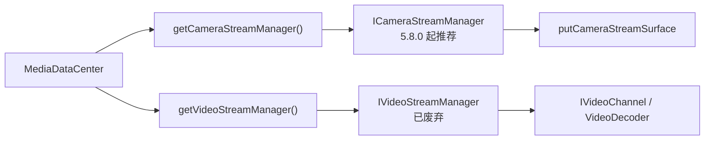
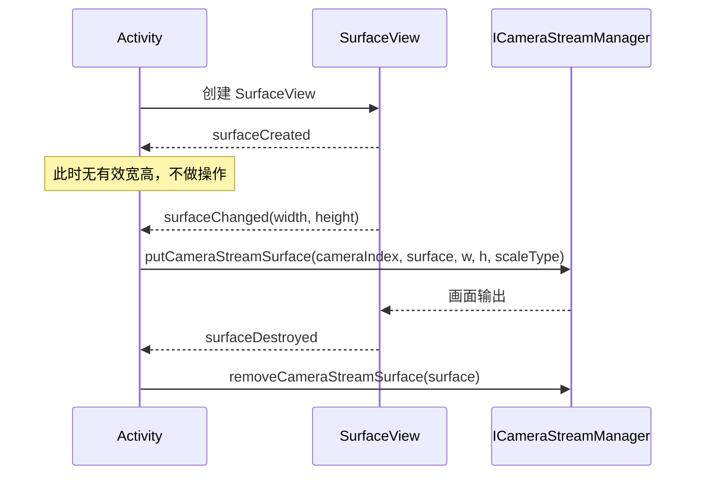

# 图传画面显示

## 一、功能说明

把无人机相机的实时画面显示到 Android 的 `SurfaceView` / `TextureView` 上。有两种做法：

| 做法 | 适用 | 入口 |
|------|------|------|
| **自己贴 Surface**（推荐） | 自绘界面、单路/双路画面、需要叠加 UI | `ICameraStreamManager.putCameraStreamSurface(...)` |
| **用 uxsdk 的 FPVWidget** | 想直接得到「Pilot 风格」的画面控件 | `FPVWidget.updateVideoSource(...)` |

> [!WARNING] 5.8.0 是版本分水岭
> `IVideoStreamManager` + `IVideoChannel` + `VideoDecoder` 这条老链路自 ==MSDK 5.8.0== 起整体 ==@Deprecated==。新代码一律用 `==ICameraStreamManager==`；照老教程写会拿到一条随时可能被移除的链路。

两条链路的入口不同，别混着用：



## 二、相关 API

### 1. `dji.v5.manager.datacenter.MediaDataCenter`

| 方法 | 返回 | 说明 |
|------|------|------|
| `getCameraStreamManager()` | `ICameraStreamManager` | **5.8.0 起推荐**，画面显示走这里 |
| `getVideoStreamManager()` | `IVideoStreamManager` | 已废弃，仅老代码兼容 |
| `getMediaManager()` | `IMediaManager` | 相册/下载，见 [[06_媒体文件与直播推流]] |
| `getLiveStreamManager()` | `ILiveStreamManager` | 直播推流 |

### 2. `ICameraStreamManager`

| 方法 | 说明 |
|------|------|
| `addAvailableCameraUpdatedListener(l)` | 回调当前可用的相机列表 `List<ComponentIndexType>` |
| `putCameraStreamSurface(cameraIndex, surface, width, height, scaleType)` | 把指定相机的画面贴到 Surface |
| `removeCameraStreamSurface(surface)` | **必须调用**，否则内存泄漏 |
| `addReceiveStreamListener(cameraIndex, l)` | 拿编码后的码流（H.264/H.265），用于自解码/转推 |
| `addFrameListener(cameraIndex, format, l)` | 拿解码后的帧（YUV/RGBA），用于 AI 识别 |
| `setKeepAliveDecoding(boolean)` | 无消费者时是否保持解码（默认 false，省电但首帧慢） |
| `setStreamEncoderBitrate` / `setStreamPriority` / `enableStream` | 码率、优先级、开关（5.12/5.15） |

码率直接决定带宽占用和存储消耗。设编码码率为 $R$（bit/s）、录制时长 $t$（秒），文件体积约为：

$$
S = \frac{R \cdot t}{8}
$$

链路带宽要留余量，一般按 $B_{\text{req}} \ge 1.2R$ 估算。$R = 2\ \text{Mbps}$、录 10 分钟约 150 MB。

`ScaleType`：`CENTER_INSIDE`、==CENTER_CROP==、`FIX_XY`。

三种缩放模式的差别可以用缩放系数写清楚。设视口宽高为 $W_v$、$H_v$，画面原始宽高为 $W_s$、$H_s$：

$$
s_{\text{inside}} = \min\left(\frac{W_v}{W_s}, \frac{H_v}{H_s}\right), \qquad
s_{\text{crop}} = \max\left(\frac{W_v}{W_s}, \frac{H_v}{H_s}\right)
$$

`CENTER_INSIDE` 取小值，整幅画面都能看见，可能留黑边；`CENTER_CROP` 取大值，铺满视口但会裁掉一部分；`FIX_XY` 横纵分别拉伸，画面会变形。

### 3. 老链路（了解即可）

`IVideoStreamManager.getAvailableStreamSources()` → `getAvailableVideoChannel(VideoChannelType.PRIMARY_STREAM_CHANNEL)` → `channel.startChannel(source, cb)` → `channel.addStreamDataListener(...)` 或交给 `VideoDecoder` 解码。

这条链路已被 `ICameraStreamManager` 取代，只在维护老代码时需要读懂。注意 `getAvailableStreamSources()` 只存在于这里，新链路对应的是 `addAvailableCameraUpdatedListener`。

## 三、最简实现

### 1. 单路画面：把相机贴到 SurfaceView（推荐）

Surface 的生命周期是三步：创建时还没有尺寸，`surfaceChanged` 里才有真实宽高，销毁时必须解绑。顺序和配对关系直接决定画面能不能出来、会不会泄漏。



```java
import android.os.Bundle;
import android.view.SurfaceHolder;
import android.view.SurfaceView;

import androidx.appcompat.app.AppCompatActivity;

import dji.sdk.keyvalue.value.common.ComponentIndexType;
import dji.v5.manager.datacenter.MediaDataCenter;
import dji.v5.manager.interfaces.ICameraStreamManager;

public class VideoPreviewActivity extends AppCompatActivity {

    private SurfaceView surfaceView;
    private ICameraStreamManager cameraStreamManager;
    // 主相机：吊舱挂在左/主挂载位（可被第 2 节的监听动态改写，所以不能是 final）
    private ComponentIndexType cameraIndex = ComponentIndexType.LEFT_OR_MAIN;

    @Override
    protected void onCreate(Bundle savedInstanceState) {
        super.onCreate(savedInstanceState);

        surfaceView = new SurfaceView(this);
        setContentView(surfaceView);

        // 1) 拿到画面管理器（全局单例，不用手动释放）
        cameraStreamManager = MediaDataCenter.getInstance().getCameraStreamManager();

        // 2) Surface 生命周期：创建→拿到尺寸→贴图；销毁→解绑
        surfaceView.getHolder().addCallback(new SurfaceHolder.Callback() {
            @Override
            public void surfaceCreated(SurfaceHolder holder) {
                // 这里还没有有效宽高，先不做
            }

            @Override
            public void surfaceChanged(SurfaceHolder holder, int format, int width, int height) {
                // 宽高必须真实，传 0 会导致不显示
                cameraStreamManager.putCameraStreamSurface(
                        cameraIndex,
                        holder.getSurface(),
                        width,
                        height,
                        ICameraStreamManager.ScaleType.CENTER_INSIDE);
            }

            @Override
            public void surfaceDestroyed(SurfaceHolder holder) {
                // 3) 必须解绑，否则内存泄漏
                cameraStreamManager.removeCameraStreamSurface(holder.getSurface());
            }
        });
    }
}
```

> [!WARNING] 不解绑会泄漏，而且下次进页面黑屏
> `removeCameraStreamSurface` 漏掉的话，SDK 内部一直持有这个 Surface。表现是页面来回切几次后画面出不来——黑屏，但日志里没有任何错误。
>
> 反过来，`surfaceChanged` 里传的宽高也必须是真实值。传 0 或传固定常量，同样是不显示、不报错。

### 2. 枚举可用相机（多负载 / 多镜头）

```java
import androidx.annotation.NonNull;

import java.util.List;
import java.util.Map;

import dji.v5.manager.interfaces.ICameraStreamManager.AvailableCameraUpdatedListener;

// 回调可用的相机挂载位；插拔负载时会重新回调
cameraStreamManager.addAvailableCameraUpdatedListener(
        new AvailableCameraUpdatedListener() {
            @Override
            public void onAvailableCameraUpdated(@NonNull List<ComponentIndexType> availableCameraList) {
                // 例如取第一个非 UNKNOWN 的作为主画面
                for (ComponentIndexType index : availableCameraList) {
                    if (index != ComponentIndexType.UNKNOWN) {
                        cameraIndex = index;
                        break;
                    }
                }
            }

            @Override
            public void onCameraStreamEnableUpdate(@NonNull Map<ComponentIndexType, Boolean> map) {
                // 某路画面被开启/关闭
            }
        });
```

### 3. 切换画面源（可见光 ↔ 红外 ↔ 变焦）

切镜头只改 Key，不要重建 Surface——Surface 是"显示通道"，镜头是"画面来源"，两者解耦。

```java
import java.util.List;

import dji.sdk.keyvalue.key.CameraKey;
import dji.sdk.keyvalue.key.KeyTools;
import dji.sdk.keyvalue.value.camera.CameraVideoStreamSourceType;
import dji.v5.manager.KeyManager;

/** 切镜头：改 Key 即可，不要重新 putCameraStreamSurface */
public void switchToThermal() {
    KeyManager.getInstance().setValue(
            KeyTools.createKey(CameraKey.KeyCameraVideoStreamSource, cameraIndex),
            CameraVideoStreamSourceType.INFRARED_CAMERA,
            null);
}

/** 查当前相机支持哪些镜头（不同机型差异很大） */
public void querySupportedSources() {
    List<CameraVideoStreamSourceType> range = KeyManager.getInstance().getValue(
            KeyTools.createKey(CameraKey.KeyCameraVideoStreamSourceRange, cameraIndex));
}
```

### 4. 拿码流自己解码（给 AI / 转推流用）

```java
import dji.v5.manager.interfaces.ICameraStreamManager.ReceiveStreamListener;
import dji.v5.manager.datacenter.camera.StreamInfo;

private final ReceiveStreamListener streamListener = new ReceiveStreamListener() {
    @Override
    public void onReceiveStream(byte[] data, int offset, int length, @NonNull StreamInfo info) {
        // info.getMimeType()  编码格式（H264/H265）
        // info.getWidth()/getHeight()/getFrameRate()/isKeyFrame()
        // data 是编码后的裸流，可喂给 MediaCodec 或第三方播放器
    }
};

public void startRawStream() {
    // 注意：回调不在主线程，写文件/解码请自行切线程
    cameraStreamManager.addReceiveStreamListener(cameraIndex, streamListener);
}

public void stopRawStream() {
    cameraStreamManager.removeReceiveStreamListener(streamListener);
}
```

> [!WARNING] 回调不在主线程
> `ReceiveStreamListener` 和 `FrameListener` 的回调线程由 SDK 决定，不在主线程。在这两个回调里直接写文件、解码、或者更新 UI，轻则卡顿、重则崩。落盘和编码都放到自己的线程，UI 更新走 `postValue`。

### 5. 用 uxsdk 的 FPVWidget（最省事）

```java
import dji.sdk.keyvalue.value.common.ComponentIndexType;
import dji.v5.ux.core.widget.fpv.FPVWidget;

// 布局里：<dji.v5.ux.core.widget.fpv.FPVWidget android:id="@+id/fpv" ... />
FPVWidget fpvWidget = findViewById(R.id.fpv);

// 指定显示哪一路相机
fpvWidget.updateVideoSource(ComponentIndexType.LEFT_OR_MAIN);

// 读取当前显示的是哪一路（画中画互换时用）
ComponentIndexType current = fpvWidget.getWidgetModel().getCameraIndex();

// 画面源变化回调（例如相机自动切换镜头）
fpvWidget.setOnFPVStreamSourceListener((devicePosition, lensType) -> {
    // devicePosition: ComponentIndexType，lensType: CameraLensType
});
```

`FPVWidget` 内部已经处理了 Surface 生命周期与 `putCameraStreamSurface`/`removeCameraStreamSurface`，缩放固定为 `CENTER_INSIDE`。画中画需要 `setSurfaceViewZOrderOnTop(true)` + `setSurfaceViewZOrderMediaOverlay(true)`。整套 uxsdk 界面见 [[10_uxsdk界面搭建]]。

> [!TIP] 画中画要置顶，否则被主画面盖住
> 两个 `FPVWidget` 叠在一起时，默认层级由添加顺序决定。小窗要显示在主画面之上，必须显式调 `setSurfaceViewZOrderOnTop(true)` 与 `setSurfaceViewZOrderMediaOverlay(true)`——少一句的现象就是"小窗不显示"，很容易怀疑是 `updateVideoSource` 没生效。

## 四、注意事项

1. **Surface 类型限制**：支持 `SurfaceView`、`TextureView`、`MediaCodec` 的 Surface；**不支持 ==GLSurfaceView== 以及任何与 OpenGL 绑定的 Surface**（文档明确）。
2. **一个 Surface 只能显示一路相机**：重复调用 `putCameraStreamSurface` 是「更新参数」，不是叠加。
3. **必须解绑**：`removeCameraStreamSurface` 不调用会内存泄漏，且下次进入页面可能黑屏。
4. **宽高要用真实值**：`surfaceChanged` 里的 width/height 才是有效值；==传 0 不显示==。
5. **切换镜头用 Key**：`KeyCameraVideoStreamSource`，不要重建 Surface。
6. **回调线程**：`ReceiveStreamListener` / `FrameListener` 不在主线程，落盘或解码要自己切线程。
7. **`getAvailableStreamSources` 只适用于老链路**，新链路用 `addAvailableCameraUpdatedListener`。

> [!WARNING] 选错 Surface 类型，画面永远出不来
> SDK 只接受 `SurfaceView`、`TextureView`、`MediaCodec` 的 Surface，==不支持 GLSurfaceView== 以及任何与 OpenGL 绑定的 Surface。
>
> 这一条最容易踩，因为 GLSurfaceView 在游戏、视频渲染里很常见。用错了不会有异常，就是黑屏，日志里也找不到线索。
