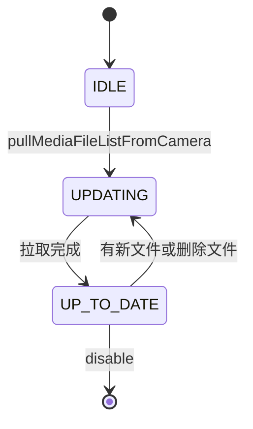
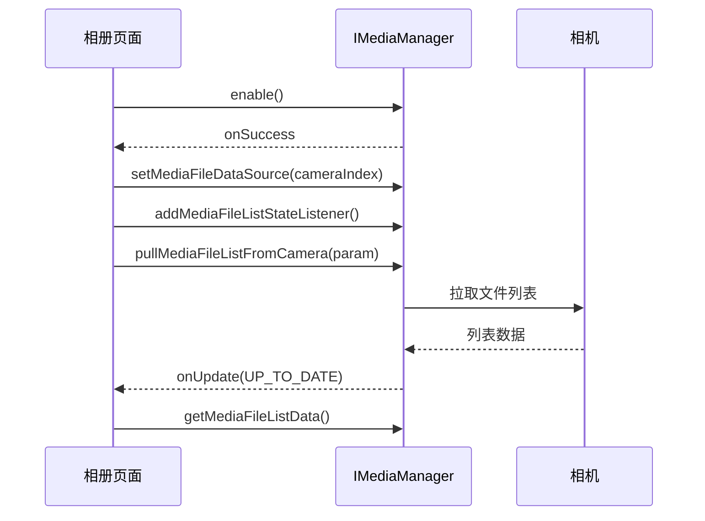
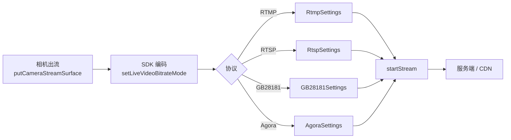

# 媒体文件与直播推流

## 一、功能说明

两块相对独立的能力：

- **媒体文件**：读取相机 SD 卡里的照片/视频列表，取缩略图、下载原文件、回放视频。
- **直播推流**：把相机画面推到 RTMP / RTSP / GB28181 / Agora。

## 二、相关 API

### 1. 媒体

入口是 `MediaDataCenter.getInstance().getMediaManager()`，返回 `IMediaManager`。

| 方法 | 说明 |
|------|------|
| `enable(cb)` / `disable(cb)` | 进入 / 退出「媒体模式」（**进入后相机不能拍照录像，图传也会停**） |
| `setMediaFileDataSource(source)` | 指定数据源：相机挂载位或存储位置 |
| `addMediaFileListStateListener(l)` | 列表状态：`IDLE` / `UPDATING` / `UP_TO_DATE` |
| `pullMediaFileListFromCamera(param, cb)` | 拉取文件列表（可全量或分页） |
| `getMediaFileListData()` | 拿到 `List<MediaFile>` |
| `deleteMediaFiles(files, cb)` | 删除 |
| `playVideoToSurface(file, surface, w, h, scaleType, listener)` | 回放视频（5.8.0 起替代 `playVideo`） |
| `seekVideo(sec, cb)` / `pauseVideo` / `resumeVideo` / `stopVideo` | 回放控制 |
| `release()` | 释放资源 |

`MediaFile` 常用方法：`getFileName()`、`getFileType()`、`getFileSize()`、`getDuration()`、`getDate()`、`getThumbNail()`、`pullThumbnailFromCamera(cb)`、`pullOriginalMediaFileFromCamera(offset, listener)`。

`MediaFileDownloadListener` 的五个回调：`onStart()`、`onProgress(total, current)`、`onRealtimeDataUpdate(byte[] data, long position)`、`onFinish()`、`onFailure(error)`。

列表不是一个可以直接读的数组，而是一个三态的状态机。只有走到 `UP_TO_DATE` 才能取数据：



删除文件后会先回到 `UPDATING` 再回 `UP_TO_DATE`，所以"删完立刻读列表"读到的是旧数据。

### 2. 直播

入口是 `MediaDataCenter.getInstance().getLiveStreamManager()`，返回 `ILiveStreamManager`。

| 方法 | 说明 |
|------|------|
| `setLiveStreamSettings(settings)` | 设置推流参数（协议 + 地址） |
| `setCameraIndex(index)` | 推哪一路画面（5.8.0 起替代 `setVideoChannelType`） |
| `setLiveStreamQuality(quality)` | `SD` / `HD` / `FULL_HD` |
| `setLiveVideoBitrateMode(mode)` | `AUTO` / `MANUAL`（默认 MANUAL，2 Mbps） |
| `setLiveVideoBitrate(int)` | 手动码率，bit/s |
| `startStream(cb)` / `stopStream(cb)` | 开始 / 停止 |
| `isStreaming()` | 是否在推流 |
| `addLiveStreamStatusListener(l)` | 帧率、码率、丢包、RTT |

## 三、最简实现

### 1. 拉取媒体列表

拉列表是一条固定顺序的链路：进入媒体模式 → 设数据源 → 挂状态监听 → 拉取。顺序错一步就拿不到数据。



```java
import androidx.annotation.NonNull;

import java.util.List;

import dji.sdk.keyvalue.value.common.ComponentIndexType;
import dji.v5.common.callback.CommonCallbacks;
import dji.v5.common.error.IDJIError;
import dji.v5.manager.datacenter.MediaDataCenter;
import dji.v5.manager.datacenter.media.MediaFile;
import dji.v5.manager.datacenter.media.MediaFileListData;
import dji.v5.manager.datacenter.media.MediaFileListDataSource;
import dji.v5.manager.datacenter.media.MediaFileListState;
import dji.v5.manager.datacenter.media.MediaFileListStateListener;
import dji.v5.manager.datacenter.media.PullMediaFileListParam;
import dji.v5.manager.interfaces.IMediaManager;

public class MediaBrowser {

    private final IMediaManager mediaManager =
            MediaDataCenter.getInstance().getMediaManager();

    /** 1) 进入媒体模式 → 2) 设数据源 → 3) 监听状态 → 4) 拉列表 */
    public void open(ComponentIndexType cameraIndex) {
        // 进入媒体模式：此时相机无法拍照录像，图传也会停，只在相册页面调用
        mediaManager.enable(new CommonCallbacks.CompletionCallback() {
            @Override
            public void onSuccess() {
                // 数据源：按相机挂载位（也可以按存储位置 SDCARD/INTERNAL）
                MediaFileListDataSource source = new MediaFileListDataSource.Builder()
                        .setIndexType(cameraIndex)
                        .build();
                mediaManager.setMediaFileDataSource(source);

                // 列表状态变 UP_TO_DATE 时才能取数据
                mediaManager.addMediaFileListStateListener(new MediaFileListStateListener() {
                    @Override
                    public void onUpdate(MediaFileListState state) {
                        if (state == MediaFileListState.UP_TO_DATE) {
                            MediaFileListData data = mediaManager.getMediaFileListData();
                            List<MediaFile> files = data == null ? null : data.getData();
                            // 刷新列表
                        }
                    }
                });

                // 全量拉取：index = -1、count = -1
                PullMediaFileListParam param = new PullMediaFileListParam.Builder()
                        .mediaFileIndex(-1)
                        .count(-1)
                        .build();
                mediaManager.pullMediaFileListFromCamera(param,
                        new CommonCallbacks.CompletionCallback() {
                            @Override public void onSuccess() { }
                            @Override public void onFailure(@NonNull IDJIError error) { }
                        });
            }

            @Override
            public void onFailure(@NonNull IDJIError error) { }
        });
    }

    /** 退出页面：先清监听，再 disable，最后 release */
    public void close() {
        mediaManager.removeAllMediaFileListStateListener();
        mediaManager.disable(null);
        mediaManager.release();
    }
}
```

> [!WARNING] `enable()` 会切断拍照和图传
> 进入媒体模式后，相机不能拍照录像、图传也停止输出（文档明确）。只在相册页面调用，退出时 `disable()`。
>
> 忘记 `disable()` 的现象是：回到飞行页面，图传黑着、拍照按钮没反应，看起来像 SDK 崩了。实际上只是还停在媒体模式。这一段调用顺序 `enable → setDataSource → addListener → pull` 也是硬约束，顺序错了拿不到列表。

### 2. 下载原图 / 原视频

```java
import java.io.BufferedOutputStream;
import java.io.File;
import java.io.FileOutputStream;

import dji.v5.manager.datacenter.media.MediaFileDownloadListener;

/** 断点续传：offset 为已下载字节数，首次传 0 */
public void download(MediaFile file, File target) {
    final long offset = target.exists() ? target.length() : 0L;
    try {
        final FileOutputStream fos = new FileOutputStream(target, true);
        final BufferedOutputStream bos = new BufferedOutputStream(fos);

        file.pullOriginalMediaFileFromCamera(offset, new MediaFileDownloadListener() {
            @Override
            public void onStart() { }

            @Override
            public void onProgress(long total, long current) {
                // 总大小 = offset + total，已下载 = offset + current
            }

            @Override
            public void onRealtimeDataUpdate(byte[] data, long position) {
                try {
                    bos.write(data);   // position 是 data 首字节在整文件中的偏移
                    bos.flush();
                } catch (Exception ignored) { }
            }

            @Override
            public void onFinish() {
                try { bos.close(); fos.close(); } catch (Exception ignored) { }
            }

            @Override
            public void onFailure(@NonNull IDJIError error) { }
        });
    } catch (Exception e) {
        // 文件创建失败
    }
}
```

> [!CAUTION] 断点续传的 offset 必须与本地文件一致
> 这里有两件事必须同时成立：`offset` 取本地文件的实际长度，`FileOutputStream` 用追加模式（第二个参数 `true`）。少任何一个都会写出==损坏且不可逆==的文件——要么从头覆盖、要么在错误位置拼接，视频文件直接废掉。
>
> 更稳妥的做法是校验 `onRealtimeDataUpdate` 给的 `position` 是否等于"offset + 已写入字节数"，不相等就中止重下。

进度与总大小的关系要自己算，回调里的 `total` / `current` 都不含 offset：

$$
S = o + t, \qquad \eta = \frac{o + c}{o + t}
$$

其中 $o$ 是断点偏移（已下载字节数），$t$ 是本次下载总量，$c$ 是本次已下载量，$\eta$ 是真实进度。直接把 $c/t$ 当进度条，断点续传时会显示从 0 开始涨。

### 3. 缩略图

```java
import android.graphics.Bitmap;

// 列表滚动时用：先看内存里的缩略图，没有再向相机要
Bitmap thumb = file.getThumbNail();
if (thumb == null) {
    file.pullThumbnailFromCamera(new CommonCallbacks.CompletionCallbackWithParam<Bitmap>() {
        @Override public void onSuccess(Bitmap bitmap) { /* 显示 */ }
        @Override public void onFailure(@NonNull IDJIError error) { }
    });
}
```

### 4. 回放视频到 SurfaceView

```java
import android.view.Surface;

import dji.v5.manager.interfaces.ICameraStreamManager;
import dji.v5.manager.interfaces.IMediaManager.MediaFrameListener;
import dji.v5.manager.datacenter.camera.StreamInfo;

public void playVideo(MediaFile file, Surface surface, int width, int height) {
    mediaManager.playVideoToSurface(
            file, surface, width, height,
            ICameraStreamManager.ScaleType.CENTER_INSIDE,
            new MediaFrameListener() {
                @Override
                public void onReceiveStream(byte[] data, int offset, int length,
                                            @NonNull StreamInfo info) {
                    // 已经贴到 Surface，这里不用自己喂帧；留给自解码用
                }

                @Override
                public void onError(@NonNull IDJIError error) { }
            });
}

public void seekTo(int seconds) { mediaManager.seekVideo(seconds, null); }
public void pause()             { mediaManager.pauseVideo(null); }
public void resume()            { mediaManager.resumeVideo(null); }
public void stop()              { mediaManager.stopVideo(null); }
```

### 5. 直播推流（RTMP）

推流链路是：相机出流 → SDK 编码 → 按协议封装 → 服务端。配置分四步，缺一步都会得到"能推但不对"的流。



> [!WARNING] 推流前先确认相机在出流
> `startStream` 只负责把已有的画面编码推出去。相机还没出流（没调 `putCameraStreamSurface`、FPVWidget 也没显示画面）时，它依然返回成功，但推上去的是==黑屏==。播放端能看到流地址正常、没有报错，就是没画面——排查方向很容易跑到服务器上。

```java
import dji.sdk.keyvalue.value.common.ComponentIndexType;
import dji.v5.manager.datacenter.livestream.LiveStreamSettings;
import dji.v5.manager.datacenter.livestream.LiveStreamType;
import dji.v5.manager.datacenter.livestream.LiveVideoBitrateMode;
import dji.v5.manager.datacenter.livestream.StreamQuality;
import dji.v5.manager.datacenter.livestream.settings.RtmpSettings;
import dji.v5.manager.interfaces.ILiveStreamManager;

public class RtmpPusher {

    private final ILiveStreamManager liveManager =
            MediaDataCenter.getInstance().getLiveStreamManager();

    public void start(String rtmpUrl, ComponentIndexType cameraIndex) {
        // 1) 协议 + 地址
        LiveStreamSettings settings = new LiveStreamSettings.Builder()
                .setLiveStreamType(LiveStreamType.RTMP)
                .setRtmpSettings(new RtmpSettings.Builder()
                        .setUrl(rtmpUrl)          // rtmp://host/app/streamKey
                        .build())
                .build();
        liveManager.setLiveStreamSettings(settings);

        // 2) 推哪一路画面
        liveManager.setCameraIndex(cameraIndex);

        // 3) 画质与码率（不设则默认 MANUAL / 2 Mbps）
        liveManager.setLiveStreamQuality(StreamQuality.HD);
        liveManager.setLiveVideoBitrateMode(LiveVideoBitrateMode.AUTO);

        // 4) 开始
        liveManager.startStream(new CommonCallbacks.CompletionCallback() {
            @Override public void onSuccess() { }
            @Override public void onFailure(@NonNull IDJIError error) { }
        });
    }

    public void stop() {
        liveManager.stopStream(null);   // callback 允许为 null
    }
}
```

> [!TIP] 码率不设就是 MANUAL 2 Mbps
> 默认档位是 `MANUAL` + ==2 Mbps==，画质偏保守。网络条件好时改 `AUTO` 让 SDK 自己调；网络差时手动降到 1 Mbps 比让它自适应更快见效。
>
> 码率与体积的换算：设码率 $R$（bit/s）、时长 $t$（秒），

$$
S_{\text{byte}} = \frac{R \cdot t}{8}
$$

2 Mbps 推一小时约 900 MB，做直播归档时按这个量级预留空间。

其它协议的差异只在 `LiveStreamSettings.Builder`：

```java
// RTSP
.setLiveStreamType(LiveStreamType.RTSP)
.setRtspSettings(new RtspSettings.Builder()
        .setUserName("user").setPassWord("pwd").setPort(8554).build())

// GB28181
.setLiveStreamType(LiveStreamType.GB28181)
.setGB28181Settings(new GB28181Settings.Builder()
        .setServerIP(ip).setServerPort(port).setServerID(serverId)
        .setAgentID(agentId).setChannel(channel)
        .setLocalPort(localPort).setPassword(pwd).build())

// Agora
.setLiveStreamType(LiveStreamType.AGORA)
.setAgoraSettings(new AgoraSettings.Builder()
        .setChannelId(id).setToken(token).setUid(uid).setEnableSafety(false).build())
```

## 四、注意事项

1. **列表是状态机**：`IDLE` 时先 `pullMediaFileListFromCamera`；有新文件时 SDK 会增量拉；状态变 `UP_TO_DATE` 后再 `getMediaFileListData()`。
2. **==P1 / L1== 限制**：只支持全量拉列表，`mediaFileIndex` 与 `count` 无效；P1 拿不到自定义文件名后缀。
3. **下载用 `onRealtimeDataUpdate` 写盘**，`onProgress` 只用于进度条；`position` 用于断点续传校验。
4. **删除后状态会先 `==UPDATING==` 再 `UP_TO_DATE`**，不要删完立刻读列表。
5. **RTSP 地址格式**：`rtsp://<user>:<pwd>@<本机IP>:<port>/streaming/live/1`。

> [!WARNING] 两个 Builder 的密码 setter 不一样
> RTSP 的 `RtspSettings.Builder` 用 `==setPassWord==`（大写 W），GB28181 的 `GB28181Settings.Builder` 用 `setPassword`（小写 w）。同名参数、不同拼法，编译期报错但容易被自动补全带偏。
