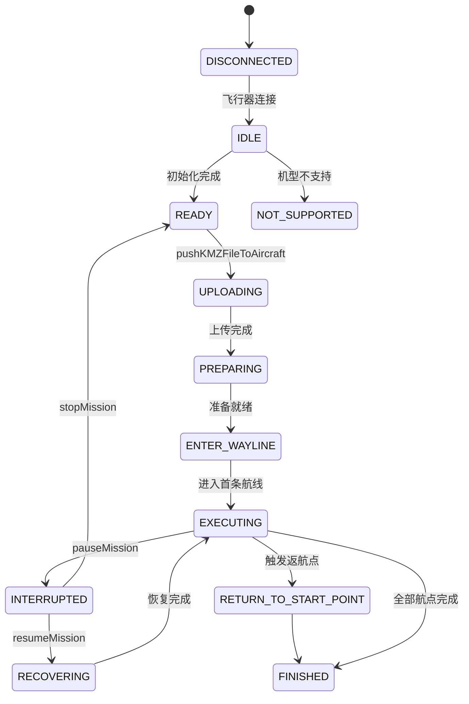
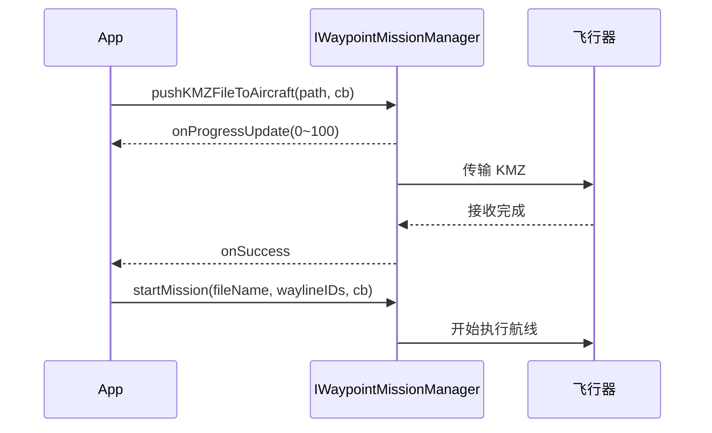
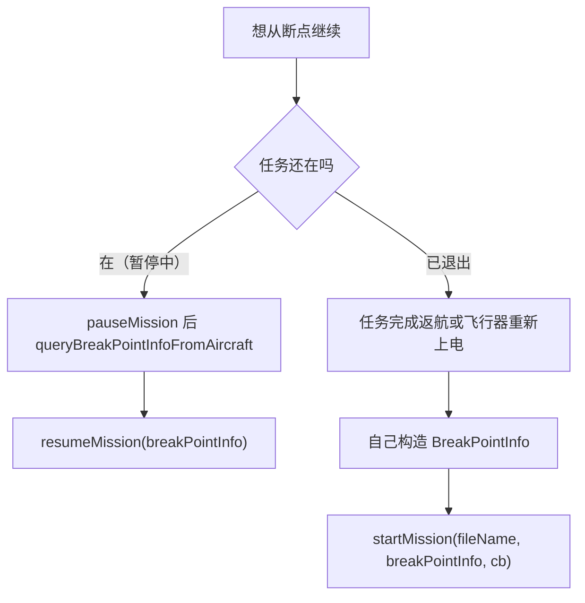

# 航点任务与智能飞行

## 一、功能说明

- **航点任务（Waypoint 3.0）**：把设计好的航线（KMZ 文件）上传到飞行器，按航点自动飞行，可暂停、续飞、监听进度。航线本身用 `WPMZManager` 生成/解析（==WPML== 格式）。
- **智能飞行**：不预先设计航线，由算法接管飞行——智能跟随、兴趣点环绕（POI）、飞向目标点（FlyTo）、探照灯（Spotlight），以及底层的==AutoSensing==。

## 二、相关 API

### 1. 航点任务

| 类 | 方法 | 说明 |
|----|------|------|
| `WaypointMissionManager` | `getInstance()` | 返回 `IWaypointMissionManager` |
| | `pushKMZFileToAircraft(path, cb)` | 上传 KMZ（同名文件会覆盖），带进度回调 |
| | `startMission(fileName, cb)` | 执行任务内所有航线 |
| | `startMission(fileName, waylineIDs, cb)` | 只执行指定航线（M300/M350 只支持 1 个 ID） |
| | `pauseMission(cb)` / `resumeMission(cb)` / `stopMission(fileName, cb)` | 暂停 / 继续 / 停止 |
| | `queryBreakPointInfoFromAircraft(fileName, cb)` | 查询断点（**必须先 pause**） |
| | `resumeMission(breakPointInfo, cb)` | 从指定断点继续 |
| | `startMission(fileName, breakPointInfo, cb)` | 暂停后已退出任务时，带断点重新开始 |
| | `getAvailableWaylineIDs(fileName)` | 任务内可用航线 ID |
| | `addWaypointMissionExecuteStateListener(l)` | 任务状态变化 |
| | `addWaylineExecutingInfoListener(l)` | 当前航线 / 当前航点 |
| | `addWaypointActionListener(l)` | 航点动作执行回调 |
| `WPMZManager` | `init(Context)` | 使用前初始化 |
| | `generateKMZFile(kmzPath, mission, config, template)` | 生成 KMZ（带 Template 才兼容 DJI Pilot） |
| | `getKMZInfo(path)` | 解析 KMZ |
| | `transKMLtoKMZ(kmlPath, kmzPath, heightMode)` | KML 转 KMZ |

> [!NOTE] WPMZManager 要单独依赖
> `WPMZManager` 不在 aircraft 包内，需要单独引入 `com.dji:wpmzsdk:1.0.5.1`，类为 `com.dji.wpmzsdk.manager.WPMZManager`。漏掉这条依赖，编译期找不到类。

`WaypointMissionExecuteState`：`DISCONNECTED`、`IDLE`、`NOT_SUPPORTED`、`READY`、`UPLOADING`、`PREPARING`、`ENTER_WAYLINE`、`EXECUTING`、`INTERRUPTED`、`RECOVERING`、`RETURN_TO_START_POINT`、`FINISHED`、`UNKNOWN`。

十三个枚举值排成一行读不出迁移关系，画成状态图：



`READY` 是唯一的合法起点：上传和启动都要等它。

### 2. 智能飞行

入口是 `IntelligentFlightManager.getInstance()`，它下面挂着四个子管理器。

| 子管理器 | 获取方法 | 目标 / 参数 |
|---------|---------|------------|
| 智能跟随 | `getSmartTrackMissionManager()` | `SmartTrackTarget` / `SmartTrackParam` |
| 兴趣点环绕 | `getPOIMissionManager()` | `POITarget` / `POIParam` |
| 飞向目标点 | `getFlyToMissionManager()` | `FlyToTarget` / `FlyToParam` |
| 探照灯 | `getSpotLightManager()` | `SpotLightTarget` / `SpotLightParam` |

四个子管理器共用一套 `IMissionManager` 方法：

```java
startMission(Target target, Param param, CompletionCallback cb);
stopMission(CompletionCallback cb);
updateMissionTarget(Target target, CompletionCallback cb);
updateMissionParam(Param param, CompletionCallback cb);
addMissionInfoListener(IMissionInfoListener<Info, Target> l);
addMissionCapabilityListener(IMissionCapabilityListener<Capability> l);
```

自动识别（所有智能功能的「眼睛」）：`startAutoSensing(cb)` / `stopAutoSensing(cb)`，通过 `addAutoSensingInfoListener` 拿到识别到的目标框。

## 三、最简实现

### 1. 上传 KMZ 并执行航线

上传和启动是两件事，启动必须在上传的 `onSuccess` 里发。顺序写错不会报错，只是任务不跑。



```java
import androidx.annotation.NonNull;

import java.util.Collections;

import dji.v5.common.callback.CommonCallbacks;
import dji.v5.common.error.IDJIError;
import dji.v5.manager.aircraft.waypoint3.WaypointMissionManager;
import dji.v5.manager.interfaces.IWaypointMissionManager;

public class WaylineRunner {

    private final IWaypointMissionManager missionManager =
            WaypointMissionManager.getInstance();

    /** missionPath：KMZ 在手机上的绝对路径 */
    public void uploadAndStart(String missionPath, String missionFileName) {
        missionManager.pushKMZFileToAircraft(missionPath,
                new CommonCallbacks.CompletionCallbackWithProgress<Double>() {
                    @Override
                    public void onProgressUpdate(Double progress) {
                        // 0~100，可做上传进度条
                    }

                    @Override
                    public void onSuccess() {
                        // 上传完成后再启动；只跑第 0 条航线
                        missionManager.startMission(missionFileName,
                                Collections.singletonList(0),
                                new CommonCallbacks.CompletionCallback() {
                                    @Override public void onSuccess() { }
                                    @Override public void onFailure(@NonNull IDJIError error) { }
                                });
                    }

                    @Override
                    public void onFailure(@NonNull IDJIError error) { }
                });
    }
}
```

> [!WARNING] 状态必须是 READY 才能上传或启动
> 上传和启动都要求任务状态停在 ==READY==。在 `IDLE`（还没初始化完）或 `EXECUTING`（正在跑别的任务）时调用，会直接失败。
>
> 稳妥的做法是先挂 `addWaypointMissionExecuteStateListener`，把当前状态记在字段里，上传和启动前都检查一遍，而不是假设"进页面就能推"。

> [!CAUTION] 起飞阶段不要发 KeyStartGoHome
> 任务刚启动、飞行器正在爬升时，如果这时发 `==KeyStartGoHome==` 触发返航，等于给正在起飞中的飞行器插了一条返航指令，动作会互相打断。
>
> 想停止航点任务就用 `==stopMission==`——它会接管当前任务并降落。`KeyStartGoHome` 是独立的返航动作，两者不是同一套流程，别拿来互相替代。

### 2. 监听执行状态与当前航点

```java
import dji.v5.manager.aircraft.waypoint3.WaylineExecutingInfoListener;
import dji.v5.manager.aircraft.waypoint3.WaypointMissionExecuteStateListener;
import dji.v5.manager.aircraft.waypoint3.model.WaylineExecutingInfo;
import dji.v5.manager.aircraft.waypoint3.model.WaypointMissionExecuteState;

public void observeMission() {
    // 状态机：READY → UPLOADING → PREPARING → ENTER_WAYLINE → EXECUTING → FINISHED
    missionManager.addWaypointMissionExecuteStateListener(
            new WaypointMissionExecuteStateListener() {
                @Override
                public void onMissionStateUpdate(WaypointMissionExecuteState state) {
                    // READY 才允许上传/启动；FINISHED 表示完成或被 stopMission 停止
                }
            });

    // 当前在第几条航线、第几个航点
    missionManager.addWaylineExecutingInfoListener(new WaylineExecutingInfoListener() {
        @Override
        public void onWaylineExecutingInfoUpdate(WaylineExecutingInfo info) {
            // info.getWaylineID() / getCurrentWaypointIndex() / getMissionFileName()
        }
    });
}

public void stopObserve() {
    missionManager.clearAllWaypointMissionExecuteStateListener();
    missionManager.clearAllWaylineExecutingInfoListener();
}
```

### 3. 暂停 + 断点续飞

断点续飞是这一章最容易混的地方，因为有两个入口。判断依据只有一个：**任务还在不在**。



```java
import dji.v5.manager.aircraft.waypoint3.model.BreakPointInfo;
import dji.v5.manager.aircraft.waypoint3.model.RecoverActionType;

/** 暂停后才能查到断点（文档明确要求） */
public void pauseAndQuery(String missionFileName) {
    missionManager.pauseMission(new CommonCallbacks.CompletionCallback() {
        @Override
        public void onSuccess() {
            missionManager.queryBreakPointInfoFromAircraft(missionFileName,
                    new CommonCallbacks.CompletionCallbackWithParam<BreakPointInfo>() {
                        @Override
                        public void onSuccess(BreakPointInfo info) {
                            // info.getWaylineID() / getWaypointID() /
                            // getSegmentProgress() / getLocation()
                        }

                        @Override public void onFailure(@NonNull IDJIError error) { }
                    });
        }

        @Override public void onFailure(@NonNull IDJIError error) { }
    });
}

/** 不退出任务，直接从断点继续 */
public void resumeFrom(BreakPointInfo info) {
    missionManager.resumeMission(info, new CommonCallbacks.CompletionCallback() {
        @Override public void onSuccess() { }
        @Override public void onFailure(@NonNull IDJIError error) { }
    });
}

/** 自己构造断点：参数依次为 航线ID、航点ID、段内进度(0~1)、位置、恢复方式 */
public void resumeFrom(int waylineId, int waypointIndex, double progress) {
    BreakPointInfo info = new BreakPointInfo(
            waylineId, waypointIndex, progress, null,
            RecoverActionType.GoBackToRecordPoint);
    missionManager.resumeMission(info, null);
}
```

> [!WARNING] 查断点前必须先 pauseMission
> `queryBreakPointInfoFromAircraft` 只在任务处于暂停状态时有效。没暂停就查，直接失败——而且失败原因不会告诉你"因为没暂停"。
>
> 顺序是：`pauseMission` → 等它的 `onSuccess` → 再 `queryBreakPointInfoFromAircraft`。

> [!WARNING] 五个位置参数没有名字
> `new BreakPointInfo(waylineId, waypointIndex, progress, null, RecoverActionType.GoBackToRecordPoint)` 的五个参数是位置传递的，写反了不会报错，只会续飞到错误的位置——比如把航点 ID 传给航线 ID，飞行器会去找一条不存在的航线。
>
> `progress` 是段内进度，范围 $p \in (0,1)$，**不是百分比**。传 `50` 会被当成远超 1 的值，位置直接算错。

段内进度与剩余距离的关系：

$$
d_{\text{rem}} = (1-p)L, \qquad T_{\text{rem}} = \frac{(1-p)L}{v}
$$

其中 $L$ 是当前航段长度、$v$ 是飞行速度。$p = 0.5$ 表示还剩半段。

### 4. 兴趣点环绕（POI）

环绕是一个匀速圆周运动，参数之间的关系可以写出来：半径 $r$、速度 $v$ 决定一圈的耗时。

$$
T = \frac{2\pi r}{v}, \qquad \omega = \frac{v}{r}
$$

半径越小、速度不变，角速度越大——视觉上转得越急，画面越容易糊。航线规划时按目标停留时长反推速度更实用。

```java
import dji.sdk.keyvalue.value.common.LocationCoordinate3D;
import dji.v5.manager.intelligent.IntelligentFlightManager;
import dji.v5.manager.intelligent.poi.IPOIMissionManager;
import dji.v5.manager.intelligent.poi.POIParam;
import dji.v5.manager.intelligent.poi.POITarget;

public void startPoi(LocationCoordinate3D center, double speed) {
    IPOIMissionManager poi = IntelligentFlightManager.getInstance().getPOIMissionManager();

    POITarget target = new POITarget();
    target.setTargetLocation(center);   // 环绕中心（行业版可直接给坐标）

    POIParam param = new POIParam();
    param.setCircleSpeed(speed);        // 环绕速度

    poi.startMission(target, param, new CommonCallbacks.CompletionCallback() {
        @Override public void onSuccess() { }
        @Override public void onFailure(@NonNull IDJIError error) { }
    });
}

public void stopPoi() {
    IntelligentFlightManager.getInstance().getPOIMissionManager().stopMission(null);
}
```

### 5. 智能跟随
```java
import dji.v5.manager.intelligent.smarttrack.ISmartTrackMissionManager;
import dji.v5.manager.intelligent.smarttrack.SmartTrackTarget;

public void startTrack() {
    ISmartTrackMissionManager track =
            IntelligentFlightManager.getInstance().getSmartTrackMissionManager();
    // 目标与参数都传 null：跟随「当前识别到的主目标」
    track.startMission(null, null, new CommonCallbacks.CompletionCallback() {
        @Override public void onSuccess() { }
        @Override public void onFailure(@NonNull IDJIError error) { }
    });
}

/** 指定跟随目标：index 来自 AutoSensingInfo.getTargets() 的 targetIndex */
public void trackTarget(int index) {
    SmartTrackTarget target = new SmartTrackTarget();
    target.setIndex(index);
    IntelligentFlightManager.getInstance().getSmartTrackMissionManager()
            .updateMissionTarget(target, null);
}
```

### 6. 飞向目标点（FlyTo）

```java
import dji.sdk.keyvalue.value.flightcontroller.FlyToMode;
import dji.v5.manager.intelligent.flyto.FlyToParam;
import dji.v5.manager.intelligent.flyto.FlyToTarget;

public void flyTo(LocationCoordinate3D destination, int height, int maxSpeed) {
    FlyToTarget target = new FlyToTarget();
    target.setTargetLocation(destination);
    target.setSecurityTakeoffHeight(height);  // 安全起飞高度
    target.setMaxSpeed(maxSpeed);             // 最大速度 m/s

    IntelligentFlightManager.getInstance().getFlyToMissionManager()
            .startMission(target, null, new CommonCallbacks.CompletionCallback() {
                @Override public void onSuccess() { }
                @Override public void onFailure(@NonNull IDJIError error) { }
            });
}

/** 改飞行模式：智能高度 / 设定高度 */
public void setFlyToHeightMode(FlyToMode mode, int height) {
    FlyToParam param = new FlyToParam();
    param.setFlyToMode(mode);   // SMART_HEIGHT / SET_HEIGHT
    param.setHeight(height);
    IntelligentFlightManager.getInstance().getFlyToMissionManager()
            .updateMissionParam(param, null);
}
```

### 7. 探照灯（Spotlight）

```java
import dji.sdk.keyvalue.value.common.DoubleRect;
import dji.v5.manager.intelligent.TargetType;
import dji.v5.manager.intelligent.spotlight.ISpotLightManager;
import dji.v5.manager.intelligent.spotlight.SpotLightTarget;

public void spotlightTarget(int targetIndex) {
    ISpotLightManager spot = IntelligentFlightManager.getInstance().getSpotLightManager();

    // 5.15.0 起：先进入聚焦模式
    spot.enterSpotLightMode(new CommonCallbacks.CompletionCallback() {
        @Override
        public void onSuccess() {
            SpotLightTarget target = new SpotLightTarget();
            target.setTargetType(TargetType.INDEX);  // 按识别索引
            target.setTargetIndex(targetIndex);
            spot.startMission(target, null, new CommonCallbacks.CompletionCallback() {
                @Override public void onSuccess() { }
                @Override public void onFailure(@NonNull IDJIError error) { }
            });
        }

        @Override public void onFailure(@NonNull IDJIError error) { }
    });
}

/** 框选目标：rect 使用归一化坐标（0~1） */
public void spotlightRect(DoubleRect rect) {
    SpotLightTarget target = new SpotLightTarget();
    target.setTargetType(TargetType.RECT);
    target.setTargetRect(rect);
    IntelligentFlightManager.getInstance().getSpotLightManager()
            .updateMissionTarget(target, null);
}
```

### 8. 自动识别（AutoSensing）

```java
import dji.v5.manager.intelligent.AutoSensingInfo;
import dji.v5.manager.intelligent.AutoSensingInfoListener;
import dji.v5.manager.intelligent.AutoSensingTarget;

public void startAutoSensing() {
    IntelligentFlightManager.getInstance().addAutoSensingInfoListener(
            new AutoSensingInfoListener() {
                @Override
                public void onAutoSensingInfoUpdate(@NonNull AutoSensingInfo info) {
                    // info.getTargets() 里每个 AutoSensingTarget 有：
                    // getTargetType()（PERSON/CAR/BOAT/CUSTOM）、getTargetIndex()、
                    // getRect()（归一化框）、getLabel()
                }

                @Override
                public void onTrackingTargetUpdate(@NonNull AutoSensingTarget target) {
                    // 当前正在跟踪的目标
                }
            });

    IntelligentFlightManager.getInstance().startAutoSensing(
            new CommonCallbacks.CompletionCallback() {
                @Override public void onSuccess() { }
                @Override public void onFailure(@NonNull IDJIError error) { }
            });
}
```

## 四、注意事项

1. **KMZ 是「任务」，航线是「任务里的多条线」**：一个 KMZ = 一个任务，可含多条航线；`startMission` 不传 waylineIDs 就跑全部。
2. **==M300 / M350== 限制**：只支持 1 个航线 ID；不支持 `queryBreakPointInfoFromAircraft`（断点要自己构造，恢复方式只有这两款支持 `RecoverActionType`）；Pilot 生成的 V2 航线切换过来拿不到航点动作回调。
3. **查断点前必须先 ==pauseMission==**，否则查不到。
4. **==resumeMission== 与 `startMission(..., breakPointInfo, ...)` 的区别**：任务还在（暂停状态）用前者；任务已退出（完成返航/重新上电）用后者。
5. **起飞阶段不要发 `KeyStartGoHome`**，要停止用 `stopMission`。
6. **`==segmentProgress==` 范围是 (0,1)**，不是百分比。
7. **智能功能先查能力**：`==getSupportedMissions()==`、`getSupportedTargetTypes()`、`getSupportedFlyModes()` 在运行时告诉你能不能用，不要按机型硬编码。
8. **智能功能依赖 AutoSensing**：按索引选目标前，先 `==startAutoSensing==` 并等 `onAutoSensingInfoUpdate` 拿到 targetIndex。
9. **探照灯 ≠ 探照灯负载**：`ISpotLightManager` 是「聚焦」功能；喊话器/探照灯这类硬件负载走 `PayloadCenter` / `==MegaphoneManager==`（见 [[09_设备维护与负载扩展]]）。

> [!IMPORTANT] M300 / M350 只支持单条航线
> 这两款机型在航点任务上有三条硬限制：只支持 ==1 个航线 ID==；不支持 `queryBreakPointInfoFromAircraft`（断点得自己在手机上构造）；只有它们支持 `RecoverActionType`。
>
> 写成"取任务里所有航线一起跑"的通用代码，在这两款上会直接失败。跨机型的产品要按 `getSupportedMissions()` 的结果分流。
