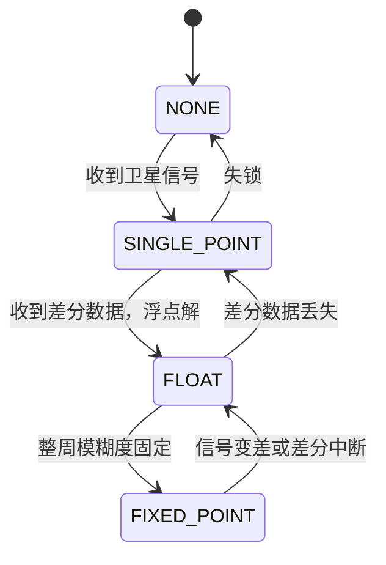
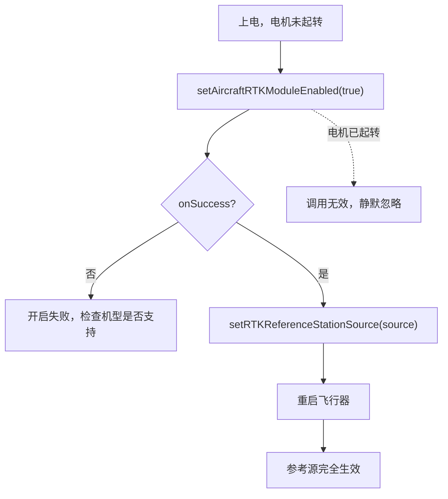
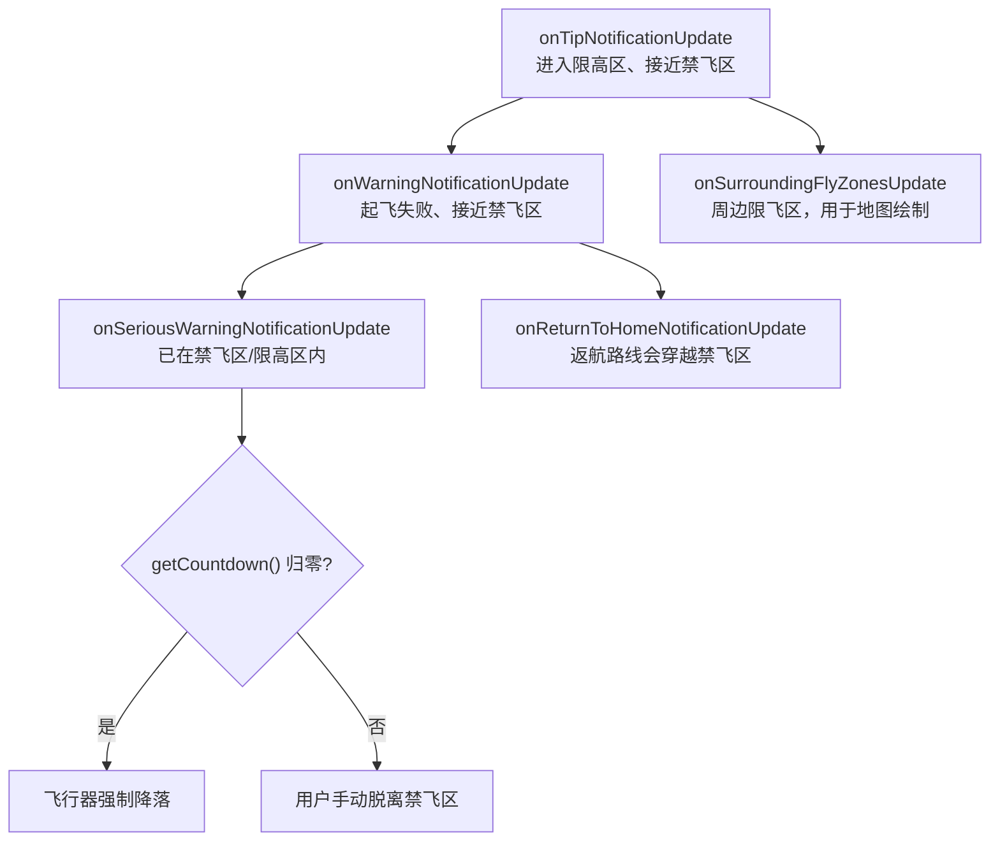

# RTK 与飞行安全

## 一、功能说明

- **RTK**：给飞行器提供==厘米级==定位。三种参考源：机载 RTK 模块 + 网络 RTK（千寻 / 移动 CMCC / 自定义 NTRIP）、D-RTK 基站。
- **飞行安全**：读取限飞区数据库、监听飞行警告（限高区、禁飞区、返航提示）、解锁授权区。

## 二、相关 API

### 1. RTK（`RTKCenter.getInstance()`）

| 方法 | 说明 |
|------|------|
| `setAircraftRTKModuleEnabled(boolean, cb)` | 开关机载 RTK 模块 |
| `setRTKReferenceStationSource(source, cb)` | 设置参考源：`QX_NETWORK_SERVICE`（千寻）/ `NTRIP_NETWORK_SERVICE`（含 CMCC）/ `CUSTOM_NETWORK_SERVICE` / `BASE_STATION` |
| `setRTKMaintainAccuracyEnabled(boolean, cb)` | 精度维持模式 |
| `getQXRTKManager()` / `getCMCCRTKManager()` / `getCustomRTKManager()` | 三个网络 RTK 管理器（`INetworkRTKManager`） |
| `getRTKStationManager()` | 基站管理器 |
| `addRTKLocationInfoListener(l)` | 定位结果（经纬度、定位解、标准差） |
| `addRTKSystemStateListener(l)` | 连接状态、健康状态、卫星数 |

`INetworkRTKManager`：`startNetworkRTKService(CoordinateSystem, cb)`、`stopNetworkRTKService(cb)`、`setCustomNetworkRTKSettings(RTKCustomNetworkSetting)`、`addNetworkRTKServiceInfoListener(l)`。

`IRTKStationManager`：`startSearchRTKStation(cb)`、`startConnectToRTKStation(stationId, cb)`、`loginRTKStation(password, cb)`、`setRTKStationReferencePosition(...)`。

`RTKLocationInfo`：`getRtkLocation()`（含 `getPositioningSolution()`：`NONE`/`SINGLE_POINT`/`FLOAT`/`FIXED_POINT`）、`getReal3DLocation()`、`getRealHeading()`。

定位解是一个逐级收敛的过程，只有走到 `FIXED_POINT` 才算拿到厘米级精度：



`FLOAT` 是米级、`FIXED_POINT` 才是厘米级。判断"RTK 到底能不能用"，看的就是这个枚举，不是看有没有连上。

### 2. 飞行安全（`FlyZoneManager.getInstance()`）

| 方法 | 说明 |
|------|------|
| `addFlySafeNotificationListener(l)` | 提示 / 警告 / 严重警告 / 返航提示 / 周边限飞区 |
| `getFlyZonesInSurroundingArea(LocationCoordinate2D, cb)` | 查询中心 50 km 内的限飞区 |
| `unlockAuthorizationFlyZone(flyZoneID, cb)` | 解锁授权区（行业机型直接解，消费机型要走 License） |
| `unlockAllEnhancedWarningFlyZone(cb)` | 解锁全部加强警告区 |
| `downloadFlyZoneLicensesFromServer(cb)` / `pushFlyZoneLicensesToAircraft(cb)` | 下载并下发解禁证书 |
| `setFlySafeDynamicDatabaseUpgradeMode(mode, cb)` / `importFlySafeDynamicDatabaseToMSDK(...)` | 欧盟地理感知数据库（JSON / ED-269） |

`FlySafeNotificationListener` 五个回调：`onTipNotificationUpdate`、`onWarningNotificationUpdate`、`onSeriousWarningNotificationUpdate`、`onReturnToHomeNotificationUpdate`、`onSurroundingFlyZonesUpdate`。

`FlyZoneInformation` 在包 `dji.v5.manager.aircraft.flysafe.info`（文档未写包名，以 SDK 实际为准）。

## 三、最简实现

### 1. 开启机载 RTK + 选择参考源

开启 RTK 有两个时序约束：模块要在电机起转前开，参考源改了要重启飞行器才完全生效。



```java
import androidx.annotation.NonNull;

import java.util.List;

import dji.sdk.keyvalue.value.rtkbasestation.RTKReferenceStationSource;
import dji.v5.common.callback.CommonCallbacks;
import dji.v5.common.error.IDJIError;
import dji.v5.manager.aircraft.rtk.RTKCenter;

public void enableRtk(RTKReferenceStationSource source) {
    // 注意：必须在电机起转前开启，起转后调用无效
    RTKCenter.getInstance().setAircraftRTKModuleEnabled(true,
            new CommonCallbacks.CompletionCallback() {
                @Override
                public void onSuccess() {
                    // 参考源切换后需要重启飞行器才完全生效
                    RTKCenter.getInstance().setRTKReferenceStationSource(source,
                            new CommonCallbacks.CompletionCallback() {
                                @Override public void onSuccess() { }
                                @Override public void onFailure(@NonNull IDJIError error) { }
                            });
                }

                @Override public void onFailure(@NonNull IDJIError error) { }
            });
}
```

> [!CAUTION] RTK 必须在电机起转前开启
> 电机一旦起转，`setAircraftRTKModuleEnabled` 会被静默忽略——不报错、不抛异常，回调还是成功，但模块没开。
>
> 后果是带着"以为开了 RTK"的状态起飞，实际只有普通 GPS 精度，航线整体偏移。而开启后若拿不到 RTK 数据，飞行器又不允许起飞——这一步错了两头都不对。
>
> 正确顺序：上电 → 开 RTK → 等 ==FIXED_POINT== → 再起转。

> [!WARNING] 换参考源要重启飞行器
> `setRTKReferenceStationSource` 调用成功只代表设置被接受，完全生效要重启飞行器。不重启的表现是"设置成功但精度没变"，很容易误判成参考源配错了。

### 2. 启动千寻网络 RTK

```java
import dji.rtk.CoordinateSystem;

public void startQianxunRtk() {
    // 千寻默认 CGCS2000；CMCC 必须显式指定坐标系
    RTKCenter.getInstance().getQXRTKManager().startNetworkRTKService(
            CoordinateSystem.CGCS2000,
            new CommonCallbacks.CompletionCallback() {
                @Override public void onSuccess() { }
                @Override public void onFailure(@NonNull IDJIError error) { }
            });
}

public void stopNetworkRtk() {
    RTKCenter.getInstance().getQXRTKManager().stopNetworkRTKService(null);
}
```

> [!WARNING] CMCC 必须显式指定坐标系
> 千寻默认 ==CGCS2000==，可以直接用；移动 CMCC 的参考站用的是另一套基准，必须显式传坐标系。
>
> 坐标系传错不会报错，结果是所有坐标系统性偏移——看起来"RTK 正常、固定解正常"，但位置差了米级。这类问题在打点作业里最难发现，因为每次偏移的方向和量都一致，容易被当成设备本身的误差。

### 3. 监听 RTK 定位与状态

```java
import dji.v5.manager.aircraft.rtk.RTKLocationInfo;
import dji.v5.manager.aircraft.rtk.RTKSystemState;

public void observeRtk() {
    // 定位结果：positioningSolution 为 FIXED_POINT 才是厘米级
    RTKCenter.getInstance().addRTKLocationInfoListener(info -> {
        if (info == null) return;
        // info.getRtkLocation().getPositioningSolution()
        // info.getRtkLocation().getMobileStationLocation()
        // info.getReal3DLocation()
    });

    // 系统状态：是否连接、是否健康、卫星信息
    RTKCenter.getInstance().addRTKSystemStateListener(state -> {
        if (state == null) return;
        // state.getRTKConnected() / getRTKHealthy() / getIsRTKEnabled()
        // state.getRtkReferenceStationSource() / getSatelliteInfo()
    });
}

public void stopObserveRtk() {
    RTKCenter.getInstance().clearAllRTKLocationInfoListener();
    RTKCenter.getInstance().clearAllRTKSystemStateListener();
}
```

> [!IMPORTANT] 只有 FIXED_POINT 才是厘米级
> 判断 RTK 能不能用，看的不是"连上了没"，而是 `getPositioningSolution()` 是否等于 `==FIXED_POINT==`。
>
> `FLOAT` 是浮点解，米级；`SINGLE_POINT` 基本等同单点定位；`NONE` 就是没有。业务代码里凡是"RTK 已就绪，可以开始作业"的判断，都应该以 `FIXED_POINT` 为准。
>
> 另外，定位精度会随基线距离衰减，固定解也不例外：

$$
\sigma_h \approx \sigma_0 + \alpha d
$$

$\sigma_0$ 是标称水平精度，$d$ 是基线距离，$\alpha$ 约 1 ppm——每远 1 km，误差增加约 1 mm。长基线作业时这个量不能忽略。

### 4. 监听飞行安全警告

五个回调按严重程度递进，从"提示"到"强制降落"，UI 的处理策略也应该逐级加重：



```java
import dji.v5.manager.aircraft.flysafe.FlySafeNotificationListener;
import dji.v5.manager.aircraft.flysafe.FlyZoneManager;
import dji.v5.manager.aircraft.flysafe.info.FlySafeReturnToHomeInformation;
import dji.v5.manager.aircraft.flysafe.info.FlySafeSeriousWarningInformation;
import dji.v5.manager.aircraft.flysafe.info.FlySafeTipInformation;
import dji.v5.manager.aircraft.flysafe.info.FlySafeWarningInformation;
import dji.v5.manager.aircraft.flysafe.info.FlyZoneInformation;

public void observeFlySafe() {
    FlyZoneManager.getInstance().addFlySafeNotificationListener(
            new FlySafeNotificationListener() {
                @Override
                public void onTipNotificationUpdate(FlySafeTipInformation info) {
                    // 进入限高区、达到最大高度、靠近禁飞区等提示
                }

                @Override
                public void onWarningNotificationUpdate(FlySafeWarningInformation info) {
                    // 起飞失败、接近禁飞区等警告
                }

                @Override
                public void onSeriousWarningNotificationUpdate(FlySafeSeriousWarningInformation info) {
                    // 已在禁飞区 / 限高区内，info.getCountdown() 结束后会强制降落
                }

                @Override
                public void onReturnToHomeNotificationUpdate(FlySafeReturnToHomeInformation info) {
                    // 返航会穿越禁飞区等
                }

                @Override
                public void onSurroundingFlyZonesUpdate(List<FlyZoneInformation> infos) {
                    // 周边限飞区，可用来在地图上画圈
                }
            });
}
```

> [!CAUTION] 倒计时结束会强制降落
> `FlySafeSeriousWarningInformation.getCountdown()` 是一个真实的倒计时，归零后飞行器==强制降落==——不受操作者控制，也不管下方是不是安全区域。
>
> UI 收到这个回调必须立刻打断当前操作：全屏提示、播报、给出"立即返航/离开"的按钮。把它当成普通 toast 弹一下就过去，是在拿设备赌。

### 5. 查询周边限飞区 / 解锁授权区

```java
import dji.sdk.keyvalue.value.common.LocationCoordinate2D;

public void queryFlyZones(LocationCoordinate2D center) {
    FlyZoneManager.getInstance().getFlyZonesInSurroundingArea(center,
            new CommonCallbacks.CompletionCallbackWithParam<List<FlyZoneInformation>>() {
                @Override
                public void onSuccess(List<FlyZoneInformation> zones) {
                    // 每个 zone：getFlyZoneID / getName / getCategory /
                    //            getShape（CIRCLE 或 MULTI_POLYGON）/ getCircleCenter / getCircleRadius
                }

                @Override public void onFailure(@NonNull IDJIError error) { }
            });
}

public void unlockZone(int flyZoneId) {
    FlyZoneManager.getInstance().unlockAuthorizationFlyZone(flyZoneId,
            new CommonCallbacks.CompletionCallback() {
                @Override public void onSuccess() { }
                @Override public void onFailure(@NonNull IDJIError error) { }
            });
}
```

## 四、注意事项

1. **RTK 必须在电机起转前开启**；开启后若没有 RTK 数据，飞行器不允许起飞。
2. **切换参考源后需重启飞行器**才完全生效。
3. **遥控器对频为 ==CHANNEL_B== 后 RTK 全部不可用**（双控 B 控）。
4. **千寻需要登录 DJI 账号**；CMCC 必须显式指定坐标系（`startNetworkRTKService(coordinateSystem, cb)`）。
5. **Mavic 3E 系列需要外接 ==RTK Dongle==**（`RtkMobileStationKey.KeyIsRTKDongleConnect`，定义在父类 `DJIRtkMobileStationKey`）才能用网络 RTK。
6. **限飞区查询范围是中心 ==50 km==**，数量多时地图绘制会卡，注意抽稀。
7. **`unlockAuthorizationFlyZone` 的机型差异**：M300/M350/M30/M3E 等行业机型可直接按 ID 解禁（重启后仍禁飞）；Mini 3 等消费机型必须走官网申请 + ==License== 下发。
8. **`downloadFlyZoneLicensesFromServer` 需要先登录 DJI 账号**。
9. **严重警告有倒计时**：`FlySafeSeriousWarningInformation.==getCountdown()==` 结束后飞行器会强制降落，UI 必须立即提示用户。

> [!WARNING] 双控 B 控会让 RTK 整体失效
> 遥控器对频成 `CHANNEL_B`（双控的从控）后，RTK 相关接口全部不可用。现象是"RTK 怎么都连不上"，而设备本身完全正常。排查 RTK 问题前先看一眼当前遥控器的通道，比翻日志快。
