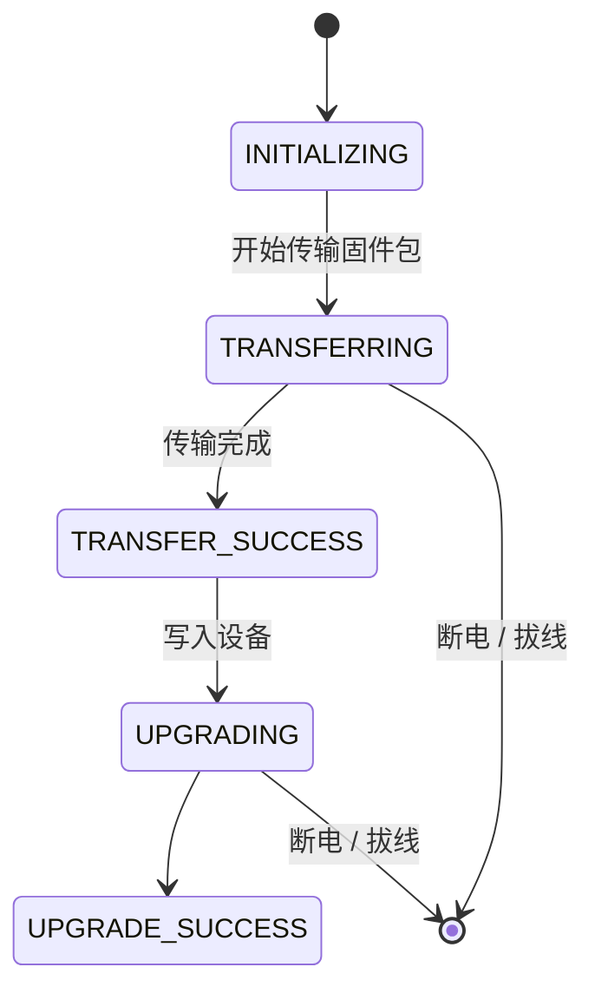
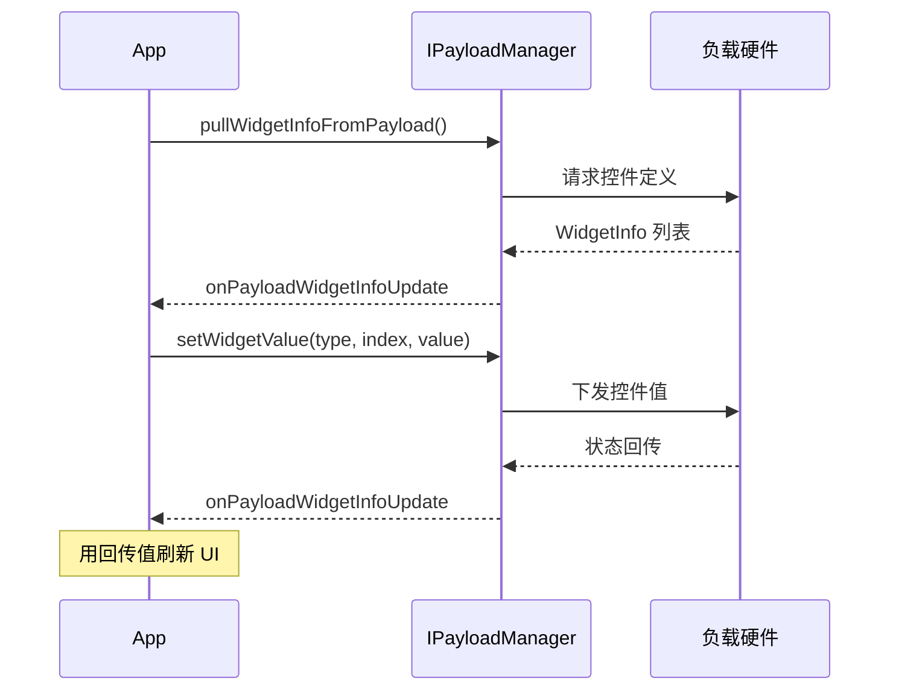

# 设备维护与负载扩展

## 一、功能说明

这一篇收拢「周边能力」：固件升级、模拟器、避障感知、第三方负载、喊话器，以及日志/设备健康等运维接口。每个小节都能独立使用。

## 二、相关 API 与最简实现

### 1. 固件升级

`UpgradeManager.getInstance()` 是入口。流程只有三步：初始化 → 检查可升级组件 → 用本地固件包升级。

| 方法 | 说明 |
|------|------|
| `init()` | 使用前初始化（示例调用，文档未列出） |
| `checkUpgradeableComponents(cb)` | 检查可升级组件，回调返回 `ComponentType` |
| `getUpgradeableComponents()` | 组件列表（飞行器 / 遥控器） |
| `startOfflineUpgrade(type, filePath, cb)` | 离线升级（固件包从 DJI 官网下载） |
| `addUpgradeInfoListener(l)` | 升级进度：`getProgress()` + `UpgradeProgressState` |
| `addUpgradeableComponentListener(l)` | 组件状态变化（`IDLE`/`CHECKING`/`UP_TO_DATE`/`UPGRADE_AVAILABLE`） |

升级状态是单向推进的，中途断电就会停在中间态：



最后两条边是"变砖"的路径——停在 `TRANSFERRING` 或 `UPGRADING` 中间，设备可能再也起不来。

```java
import androidx.annotation.NonNull;

import dji.v5.common.callback.CommonCallbacks;
import dji.v5.common.error.IDJIError;
import dji.v5.manager.aircraft.upgrade.UpgradeManager;
import dji.v5.manager.aircraft.upgrade.UpgradeInfo;
import dji.v5.manager.aircraft.upgrade.model.ComponentType;

public void checkAndUpgrade(String firmwarePath) {
    UpgradeManager.getInstance().init();

    // 1) 检查
    UpgradeManager.getInstance().checkUpgradeableComponents(
            new CommonCallbacks.CompletionCallbackWithParam<ComponentType>() {
                @Override
                public void onSuccess(ComponentType type) {
                    // 2) 有可升级组件时，用本地固件包升级
                    UpgradeManager.getInstance().startOfflineUpgrade(type, firmwarePath,
                            new CommonCallbacks.CompletionCallback() {
                                @Override public void onSuccess() { }
                                @Override public void onFailure(@NonNull IDJIError error) { }
                            });
                }

                @Override public void onFailure(@NonNull IDJIError error) { }
            });

    // 3) 进度
    UpgradeManager.getInstance().addUpgradeInfoListener(info -> {
        // info.getProgress()（0~100）
        // info.getUpgradeState()：INITIALIZING/TRANSFERRING/TRANSFER_SUCCESS/UPGRADING/UPGRADE_SUCCESS…
    });
}
```

> MSDK 只提供「检查 + ==离线升级==」；在线升级请引导用户用 DJI 官方 App。

> [!CAUTION] 升级期间断电会变砖
> 固件写入是不可中断的过程。传输或写入阶段断电、拔线、关遥控器，设备可能停在半完成状态，普通重启救不回来，只能返厂或用工厂工具刷。
>
> 同时不要在这个阶段起飞，也不要让飞行器自动休眠。离线包必须与机型、当前固件版本匹配——刷错型号的包同样会变砖。

升级进度与剩余时间的估算：

$$
t_{\text{rem}} = \frac{100 - p}{r}
$$

$p$ 是 `getProgress()` 给出的百分比（0–100），$r$ 是已观测到的进度增速（%/秒）。用它给用户一个预期，比只显示百分比更实用。

### 2. 模拟器

| 方法 | 说明 |
|------|------|
| `enableSimulator(InitializationSettings, cb)` | 开启，指定初始坐标与卫星数（0–20） |
| `disableSimulator(cb)` | 关闭 |
| `isSimulatorEnabled()` | 是否开启 |
| `addSimulatorStateListener(l)` | 姿态、位置、电机状态 |
| `setFlyZoneLimitationEnabled(boolean, cb)` | 模拟时是否受限飞区限制 |

```java
import dji.sdk.keyvalue.value.common.LocationCoordinate2D;
import dji.v5.manager.aircraft.simulator.InitializationSettings;
import dji.v5.manager.aircraft.simulator.SimulatorManager;

public void startSimulator(double lat, double lng, int satelliteCount) {
    LocationCoordinate2D location = new LocationCoordinate2D();
    location.setLatitude(lat);
    location.setLongitude(lng);

    // 卫星数 0~20，越多定位越稳
    InitializationSettings settings =
            InitializationSettings.createInstance(location, satelliteCount);

    SimulatorManager.getInstance().enableSimulator(settings,
            new CommonCallbacks.CompletionCallback() {
                @Override public void onSuccess() { }
                @Override public void onFailure(@NonNull IDJIError error) { }
            });
}

public void stopSimulator() {
    SimulatorManager.getInstance().disableSimulator(null);
}
```

### 3. 避障与感知

`PerceptionManager.getInstance()` 是入口。总策略用 `setObstacleAvoidanceType`，分方向开关用 `setObstacleAvoidanceEnabled`。

| 方法 | 说明 |
|------|------|
| `setObstacleAvoidanceType(type, cb)` | `BRAKE` 刹停 / `BYPASS` 绕行 / `CLOSE` 关闭（替代已废弃的总开关） |
| `setObstacleAvoidanceEnabled(boolean, direction, cb)` | 分方向开关：`UPWARD`/`DOWNWARD`/`HORIZONTAL` |
| `setObstacleAvoidanceWarningDistance(double, direction, cb)` | 告警距离 |
| `setObstacleAvoidanceBrakingDistance(double, direction, cb)` | 刹停距离 |
| `setVisionPositioningEnabled` / `setPrecisionLandingEnabled` | 视觉定位 / 精准降落 |
| `addPerceptionInformationListener(l)` | 各方向工作状态与阈值 |
| `addObstacleDataListener(l)` | 障碍物距离数据（可画雷达图） |
| `getRadarManager()` | 毫米波雷达（需硬件） |

```java
import dji.v5.manager.aircraft.perception.PerceptionManager;
import dji.v5.manager.aircraft.perception.data.ObstacleAvoidanceType;
import dji.v5.manager.aircraft.perception.data.PerceptionDirection;

public void configureAvoidance() {
    // 1) 总策略：刹停
    PerceptionManager.getInstance().setObstacleAvoidanceType(
            ObstacleAvoidanceType.BRAKE, null);

    // 2) 打开水平方向避障
    PerceptionManager.getInstance().setObstacleAvoidanceEnabled(
            true, PerceptionDirection.HORIZONTAL, null);

    // 3) 障碍物距离（画雷达用）
    PerceptionManager.getInstance().addObstacleDataListener(data -> {
        // data.getHorizontalAngleInterval()   角度间隔（1 表示 360 个点）
        // data.getHorizontalObstacleDistance() List<Integer>，单位毫米
        // data.getUpwardObstacleDistance() / getDownwardObstacleDistance()
    });
}
```

雷达点阵的角分辨率由点数决定，360 个点就是每度一个：

$$
\Delta\theta = \frac{360^{\circ}}{N}
$$

$N$ 是 `getHorizontalObstacleDistance()` 返回的列表长度。画雷达图时按这个间隔铺点，图形才不会歪。

> [!CAUTION] 关下视避障会同时关掉降落保护
> `setObstacleAvoidanceEnabled(false, PerceptionDirection.DOWNWARD, cb)` 不只是关掉"向下避障"，它连带把==降落保护==一起关了——落地时不再检测下方障碍物，砸到人或物的概率直接上升。
>
> 这个联动没有单独的开关，也没有 API 能只关避障保留降落保护。为了调试方便临时关闭时，务必在 UI 上留下明显标记，并在起飞前恢复。

### 4. 第三方负载

| 方法                                               | 说明                                               |
| ------------------------------------------------ | ------------------------------------------------ |
| `getPayloadManager()`                            | `Map<PayloadIndexType, IPayloadManager>`，每个挂载位一个 |
| `IPayloadManager.addPayloadBasicInfoListener(l)` | 负载是否连接、型号、SN、固件                                  |
| `pullWidgetInfoFromPayload(cb)`                  | 拉取负载的控件定义                                        |
| `setWidgetValue(WidgetValue, cb)`                | 操作负载控件（开关/滑块/列表）                                 |
| `sendDataToPayload(byte[], cb)`                  | 透传数据（PSDK 负载）                                    |
| `addPayloadDataListener(l)`                      | 接收负载上报数据                                         |

写值和读值不是一次调用，而是一次往返：设值之后要等负载把新状态回传，才能刷新 UI。

```java
import java.util.Map;

import dji.sdk.keyvalue.value.payload.WidgetValue;
import dji.sdk.keyvalue.value.payload.WidgetType;
import dji.v5.manager.aircraft.payload.PayloadCenter;
import dji.v5.manager.aircraft.payload.PayloadIndexType;
import dji.v5.manager.interfaces.IPayloadManager;

public void controlPayload() {
    // 1) 找到左/主挂载位的负载
    Map<PayloadIndexType, IPayloadManager> managers =
            PayloadCenter.getInstance().getPayloadManager();
    IPayloadManager payload = managers.get(PayloadIndexType.LEFT_OR_MAIN);
    if (payload == null) return;

    // 2) 拉取控件定义（之后会通过 PayloadWidgetInfoListener 回调）
    payload.pullWidgetInfoFromPayload(null);

    // 3) 操作某个控件：类型 + 索引 + 值
    WidgetValue value = new WidgetValue();
    value.setType(WidgetType.SWITCH);  // BUTTON / SWITCH / RANGE / LIST / INPUT
    value.setIndex(0);                 // 控件索引
    value.setValue(1);                 // SWITCH：1 开、0 关
    payload.setWidgetValue(value, new CommonCallbacks.CompletionCallback() {
        @Override public void onSuccess() { }
        @Override public void onFailure(@NonNull IDJIError error) { }
    });
}
```

一次完整的控件交互是这样的：先拉控件定义，再设值，最后等回传刷新 UI。



> [!WARNING] 不要本地改值
> `setWidgetValue` 成功只代表指令下发成功，硬件状态要等 `==onPayloadWidgetInfoUpdate==` 回传才知道。如果点开关时直接把 UI 上的值翻转，会出现"界面显示已开、硬件其实没动"的不一致——而且之后所有基于 UI 状态的判断都是错的。
>
> 正确做法：点击 → 只发指令 → 等回传 → 用回传值渲染。中间可以显示 loading，但不要乐观更新。

### 5. 喊话器

`MegaphoneManager.getInstance()` 是入口，三种工作模式：TTS 文字转语音、VOICE 音频文件、REAL_TIME 实时喊话。

| 方法 | 说明 |
|------|------|
| `setMegaphoneIndex(index, cb)` | 选哪个喊话器（`PORTSIDE`/`STARBOARD`/`UPSIDE`/`OSDK`/`PORT_x`） |
| `setWorkMode(mode, cb)` | `TTS` 文字转语音 / `VOICE` 音频文件 / `REAL_TIME` 实时喊话 |
| `startPushingFileToMegaphone(FileInfo, cb)` | 上传要播放的内容 |
| `startPlay(cb)` / `stopPlay(cb)` | 播放 / 停止 |
| `setVolume(volume, cb)` / `setPlayMode(mode, cb)` | 音量 / `SINGLE` 或 `LOOP` |
| `startRealTimeTransmission` / `sendRealTimeDataToMegaphone` / `appendEOFToRealTimeData` | 实时喊话（需 OPUS 编码） |

```java
import java.nio.charset.StandardCharsets;

import dji.v5.manager.aircraft.megaphone.FileInfo;
import dji.v5.manager.aircraft.megaphone.MegaphoneManager;
import dji.v5.manager.aircraft.megaphone.UploadType;
import dji.v5.manager.aircraft.megaphone.WorkMode;

/** TTS：把一段文字转成语音播出去 */
public void speak(String text) {
    MegaphoneManager.getInstance().setWorkMode(WorkMode.TTS, null);

    FileInfo fileInfo = new FileInfo(
            UploadType.TTS_DATA,          // TTS 文本
            null,                          // 文件（VOICE_FILE 时才用）
            text.getBytes(StandardCharsets.UTF_8));

    MegaphoneManager.getInstance().startPushingFileToMegaphone(fileInfo,
            new CommonCallbacks.CompletionCallbackWithProgress<Integer>() {
                @Override
                public void onProgressUpdate(Integer progress) { }

                @Override
                public void onSuccess() {
                    MegaphoneManager.getInstance().startPlay(null);
                }

                @Override public void onFailure(@NonNull IDJIError error) { }
            });
}
```

> [!WARNING] 播放前必须先上传内容
> 喊话器不缓存文本或音频：`startPlay` 播放的是上一步 `startPushingFileToMegaphone` 传过去的内容。跳过上传直接播，什么都不会响，也不报错。
>
> 实时喊话（`REAL_TIME` 模式）另有编码要求：必须是 ==OPUS==。5.14.0 起不再支持 DJI 自己转换的 OPUS，需要应用侧自己编码。传 PCM 或 MP3 会静默失败。

### 6. RemoteID 与实名登记

| 方法 | 说明 |
|------|------|
| `setUASRemoteIDAreaStrategy(strategy)` | 按国家/地区选择策略（`CHINA_STRATEGY`、`EUROPEAN_STRATEGY`、`US_STRATEGY`…） |
| `addUASRemoteIDStatusListener(l)` | 广播开关 + 工作状态（`WORKING`/`NO_BROADCAST`/`NOT_SUPPORTED`…） |
| `setOperatorRegistrationNumber(number, cb)` | 欧盟操作者注册码 |
| `setUARegistrationNumber(number, cb)` | 日本无人机注册码 |
| `updateRealNameRegistrationStateFromUOM(cb)` / `setRealNameTag(tag, cb)` | 中国实名制（UOM）状态与标签 |

```java
import dji.v5.manager.aircraft.uas.UASRemoteIDManager;
import dji.v5.manager.aircraft.uas.AreaStrategy;

public void setupChinaRemoteId(String realNameTag) {
    // 1) 选地区策略（中国大陆）
    UASRemoteIDManager.getInstance().setUASRemoteIDAreaStrategy(AreaStrategy.CHINA_STRATEGY);

    // 2) 从 UOM 拉取实名登记状态（需要联网）
    UASRemoteIDManager.getInstance().updateRealNameRegistrationStateFromUOM(
            new CommonCallbacks.CompletionCallback() {
                @Override public void onSuccess() { }
                @Override public void onFailure(@NonNull IDJIError error) { }
            });

    // 3) 写入实名登记标志（民航登记号后 8 位）
    UASRemoteIDManager.getInstance().setRealNameTag(realNameTag, null);

    // 4) 观察广播状态
    UASRemoteIDManager.getInstance().addUASRemoteIDStatusListener(status -> {
        // status.isBroadcastRemoteIdEnabled() / getRemoteIdWorkingState()
    });
}
```

> [!IMPORTANT] 2024-01-01 起必须完成 UOM 实名登记
> 在中国大陆新激活的飞行器，必须先完成 ==UOM 实名登记==并联网更新状态，否则无法起飞。这是法规门槛，不是可选项。
>
> 判断是否已登记：`updateRealNameRegistrationStateFromUOM` 拉回来的状态；没联网时拉不到，所以这一步要求设备在线。

### 7. LTE 增强图传

`LTEManager.getInstance()` 是入口。认证有效期默认 ==30 天==，过期要重新走一遍手机号验证。

| 方法 | 说明 |
|------|------|
| `startLTEAuthentication(areaCode, phone, code, cb)` | 手机号 + 验证码认证（默认有效期 30 天） |
| `getLTEAuthenticationVerificationCode(areaCode, phone, cb)` | 请求验证码 |
| `setLTEEnhancedTransmissionType(type, cb)` | `OCU_SYNC`（纯 OcuSync）/ `OCU_SYNC_LTE`（增强） |
| `addLTELinkInfoListener(l)` | 链路类型与质量 |
| `setLTEAircraftPrivatizationServerInfo(info, cb)` | 私有化服务器（5.6.0） |

```java
import dji.v5.manager.aircraft.lte.LTEManager;
import dji.v5.manager.aircraft.lte.LTELinkType;

public void enableLte(String phone, String verificationCode) {
    // 区号目前只支持中国大陆 "86"
    LTEManager.getInstance().startLTEAuthentication("86", phone, verificationCode,
            new CommonCallbacks.CompletionCallback() {
                @Override
                public void onSuccess() {
                    LTEManager.getInstance().setLTEEnhancedTransmissionType(
                            LTELinkType.OCU_SYNC_LTE, null);
                }

                @Override public void onFailure(@NonNull IDJIError error) { }
            });
}
```

### 8. 日志与设备健康

```java
import dji.v5.manager.aircraft.flightrecord.FlightLogManager;
import dji.v5.manager.dataprotect.DataProtectionManager;
import dji.v5.manager.diagnostic.DeviceHealthManager;

// 飞行记录路径（换遥控器/重装 App 后需重启飞行器才会生成新日志）
String flightRecordPath = FlightLogManager.getInstance().getFlightRecordPath();
String flyClogPath      = FlightLogManager.getInstance().getFlyClogPath();

// MSDK 自身日志
DataProtectionManager.getInstance().enableMSDKLog(true);
String msdkLogPath = DataProtectionManager.getInstance().getMSDKLogPath();

// 设备健康提示（IMU、指南针、电池异常等）
DeviceHealthManager.getInstance().addDJIDeviceHealthInfoChangeListener(infos -> {
    // 每条：informationCode() / title() / description() / warningLevel()
});
```

三个来源各管一件事：`FlightLogManager` 是飞行记录（黑匣子），`DataProtectionManager` 是 MSDK 自身日志，`DeviceHealthManager` 是设备健康告警。排查问题时先分清要找哪一类，否则会在几个目录之间来回翻。

换遥控器或重装 App 后，飞行记录不会立刻生成新文件——要重启飞行器。这条容易漏，现象是"日志目录里没有今天的记录"。

## 三、注意事项

1. **模拟器只能在地面开启**，开启后飞行数据全部来自模拟，适合无飞机调试 UI。
2. **避障总开关已废弃**（==5.1.0== 起）：用 `setObstacleAvoidanceType` 的 `BRAKE`/`CLOSE` 代替。
3. **雷达避障需要先打开总开关**，且毫米波雷达不支持下视。
4. **MSDK 日志默认开启**，上线前确认隐私合规。

> [!IMPORTANT] 负载透传有硬性速率上限
> 透传通道约 ==3 KB/s==，单次长度 M300 上限 ==100 字节==，其他机型 ==255 字节==。超长会被截断或直接失败，设计协议时按最严格的那个值切包。

按帧发送时的总耗时：

$$
T = \frac{N \cdot L}{R}, \qquad R = 3\ \text{KB/s}
$$

$N$ 是帧数、$L$ 是单帧字节数。传一张 100 KB 的图，即使按上限切片也要 30 秒以上——所以负载协议要设计成小包、可断点，不要指望大块传输。
