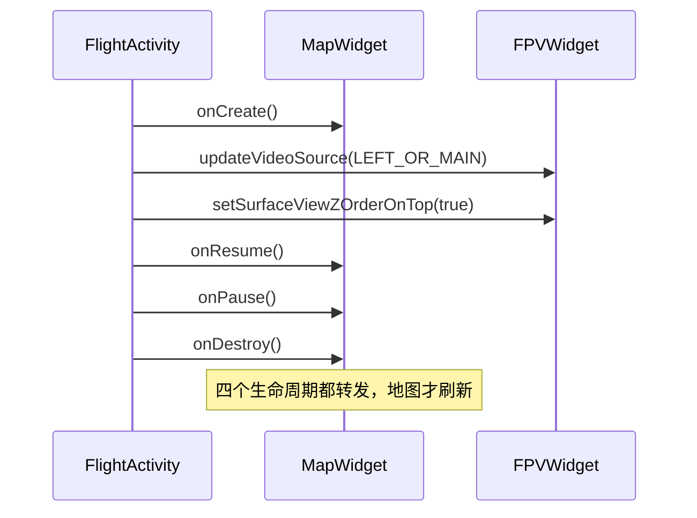

# 用 uxsdk 搭建完整飞行界面

## 一、功能说明

`android-sdk-v5-uxsdk` 是 DJI 提供的**==UI 组件库==**：图传画面、相机控制、云台控制、姿态仪、小地图、系统状态面板、设置面板…… 全部是封装好的 View。它把「界面 + MSDK 调用」一起做好了，你只负责摆位置和联动。

适用场景：

- 想快速做出「DJI Pilot 风格」的 App
- 不想自己处理相机参数、曝光、对焦这些琐碎交互
- 需要地图、姿态仪、状态栏等标准组件

> [!NOTE] uxsdk 的代价是定制自由度
> Widget 内部逻辑封装得比较死，改样式容易、改行为难。好在它是==本地 module==——可以直接改源码，不需要等官方发版。

## 二、相关组件

| Widget | 包 | 作用 |
|--------|-----|------|
| `FPVWidget` | `dji.v5.ux.core.widget.fpv` | 图传画面（主/副画面） |
| `FPVInteractionWidget` | `dji.v5.ux.cameracore.widget.fpvinteraction` | 画面手势层（点按对焦、拖动云台、双指缩放） |
| `CameraControlsWidget` | `dji.v5.ux.cameracore.widget.cameracontrols` | 拍照/录像总控件 |
| `LensControlWidget` | `dji.v5.ux.cameracore.widget.cameracontrols.lenscontrol` | 镜头切换（广角/变焦/红外） |
| `FocalZoomWidget` | `dji.v5.ux.visualcamera.zoom` | 变焦滑杆 |
| `AutoExposureLockWidget` | `dji.v5.ux.cameracore.widget.autoexposurelock` | 曝光锁定 |
| `FocusModeWidget` / `FocusExposureSwitchWidget` | `dji.v5.ux.cameracore.widget.focusmode` 等 | 对焦模式、对焦/曝光切换 |
| `GimbalFineTuneWidget` | `dji.v5.ux.gimbal` | 云台微调 |
| `HorizontalSituationIndicatorWidget` | `dji.v5.ux.core.widget.hsi` | 水平姿态仪 |
| `PrimaryFlightDisplayWidget` | `dji.v5.ux.core.widget.hsi` | 飞行数据（速度/高度/距离） |
| `MapWidget` | `dji.v5.ux.map` | 小地图（MapLibre / Google） |
| `TopBarPanelWidget` | `dji.v5.ux.core.panel.topbar` | 顶部状态条（含系统状态、设置入口） |
| `SystemStatusListPanelWidget` | `dji.v5.ux.core.panel.systemstatus` | 系统状态列表 |
| `SettingWidget` | `dji.v5.ux.core.widget.setting` | 设置抽屉 |
| `SimulatorControlWidget` / `SimulatorIndicatorWidget` | `dji.v5.ux.training.simulatorcontrol` 等 | 模拟器面板与指示 |

## 三、最简实现

### 1. 引入模块

示例工程把 uxsdk 作为**==本地 module==**引入，不是从 Maven 拉依赖：

```groovy
// settings.gradle
include ':uxsdk'
project(':uxsdk').projectDir = new File(rootProject.projectDir, '../android-sdk-v5-uxsdk')

// app/build.gradle
implementation project(':uxsdk')
```

uxsdk 依赖 ==RxJava3==、MapLibre、Lottie 等，按它自己的 `build.gradle` 补齐即可。漏一个的表现是编译期报 `ClassNotFound` 或运行期 `NoClassDefFoundError`。

> [!TIP] 引入失败先看依赖树
> uxsdk 的传递依赖不会自动全给到你，报错往往指向一个你没直接引用的类。执行 `./gradlew :app:dependencies` 看依赖树，按 uxsdk 自己的 `build.gradle` 补上缺的那几个，比逐个试快。

### 2. 最小布局：一路画面

```xml
<androidx.constraintlayout.widget.ConstraintLayout
    xmlns:android="http://schemas.android.com/apk/res/android"
    android:layout_width="match_parent"
    android:layout_height="match_parent">

    <!-- 主画面：占满 -->
    <dji.v5.ux.core.widget.fpv.FPVWidget
        android:id="@+id/widget_primary_fpv"
        android:layout_width="0dp"
        android:layout_height="0dp"
        app:layout_constraintTop_toTopOf="parent"
        app:layout_constraintBottom_toBottomOf="parent"
        app:layout_constraintStart_toStartOf="parent"
        app:layout_constraintEnd_toEndOf="parent" />

    <!-- 相机控制条（拍照/录像） -->
    <dji.v5.ux.cameracore.widget.cameracontrols.CameraControlsWidget
        android:id="@+id/widget_camera_controls"
        android:layout_width="wrap_content"
        android:layout_height="wrap_content"
        app:layout_constraintBottom_toBottomOf="parent"
        app:layout_constraintStart_toStartOf="parent" />
</androidx.constraintlayout.widget.ConstraintLayout>
```

### 3. Java 初始化与联动

Widget 自己完成与 MSDK 的通信，你只负责绑定、指定画面源、转发生命周期。



```java
import android.os.Bundle;

import androidx.appcompat.app.AppCompatActivity;

import dji.sdk.keyvalue.value.common.ComponentIndexType;
import dji.v5.ux.cameracore.widget.cameracontrols.CameraControlsWidget;
import dji.v5.ux.core.widget.fpv.FPVWidget;

public class FlightActivity extends AppCompatActivity {

    private FPVWidget primaryFpvWidget;
    private FPVWidget secondaryFpvWidget;
    private CameraControlsWidget cameraControlsWidget;

    @Override
    protected void onCreate(Bundle savedInstanceState) {
        super.onCreate(savedInstanceState);
        setContentView(R.layout.activity_flight);

        // 1) 绑定控件（Widget 自己完成与 MSDK 的通信）
        primaryFpvWidget = findViewById(R.id.widget_primary_fpv);
        secondaryFpvWidget = findViewById(R.id.widget_secondary_fpv);
        cameraControlsWidget = findViewById(R.id.widget_camera_controls);

        // 2) 指定主画面显示哪一路相机
        primaryFpvWidget.updateVideoSource(ComponentIndexType.LEFT_OR_MAIN);

        // 3) 画中画要置顶，否则会被主画面盖住
        secondaryFpvWidget.setSurfaceViewZOrderOnTop(true);
        secondaryFpvWidget.setSurfaceViewZOrderMediaOverlay(true);

        // 4) 点小画面 → 两路互换
        secondaryFpvWidget.setOnClickListener(v -> {
            ComponentIndexType main = primaryFpvWidget.getWidgetModel().getCameraIndex();
            ComponentIndexType sub = secondaryFpvWidget.getWidgetModel().getCameraIndex();
            primaryFpvWidget.updateVideoSource(sub);
            secondaryFpvWidget.updateVideoSource(main);
        });

        // 5) 画面源变化（例如负载自动切镜头）时同步给其它控件
        primaryFpvWidget.setOnFPVStreamSourceListener((devicePosition, lensType) -> {
            // 可把当前镜头告诉 LensControlWidget / 自己的 UI
        });
    }
}
```

### 4. 直接抄官方完整页面

官方给了一份完整页面可以直接抄：==DefaultLayoutActivity==（约 450 行，**纯 Java**），实现了「主画面 + 画中画 + 顶部状态条 + 相机控制 + 云台微调 + 小地图 + 模拟器面板」，配套布局在同目录 `res/layout` 下。

示例工程里还有一份「抄到 sample 模块再改」的版本：`DroneViewActivity.java`，带中文注释，更适合当模板。

> [!TIP] 先跑通官方页面，再删不需要的部分
> 自己从零搭一套 Widget 组合，最容易卡在"某个控件不显示"这种问题上。更快的路径是把 `DefaultLayoutActivity` 整个跑通，确认环境没问题之后，再逐个删掉用不到的面板。

## 四、注意事项

1. **主题与屏幕方向**：Activity 用 `Theme.NoTitleBar.Fullscreen` + 横屏 + `==configChanges==="orientation|screenSize|keyboardHidden"`，否则旋转时页面重建、画面闪。
2. **Widget 依赖 Activity 生命周期**：`MapWidget` 必须在 `onCreate/onResume/onPause/onDestroy` 里调用对应方法，否则地图不刷新或泄漏。
3. **画面源切换只调 `updateVideoSource`**，不要自己去操作 Surface。
4. **uxsdk 的 Widget 是 Kotlin 写的**（少数是 Java），Java 调用时注意 getter 是 `getXxx()` 形式；`FPVWidget.==getWidgetModel()==` 返回 `FPVWidgetModel`（Kotlin 的 `val widgetModel` 在 Java 侧就是 getter）。
5. **想改样式**：uxsdk 资源都带 `==uxsdk_==` 前缀，可在自己工程里覆盖同名资源。
6. **不建议同时手写 Surface 显示和 FPVWidget**：两者抢同一路相机容易==黑屏==，选一种即可。

> [!WARNING] 旋转屏幕会重建 Activity
> 少了 `configChanges` 里的 `orientation|screenSize|keyboardHidden`，横竖屏切换时 Activity 会销毁重建：画面黑一下、Widget 重新初始化、正在录的像可能中断。
>
> 三个值缺一不可——`orientation` 管方向，`screenSize` 管 Android 13+ 的尺寸变化，`keyboardHidden` 管外接键盘收起。

> [!WARNING] 生命周期不转发，地图不刷新
> `MapWidget` 依赖宿主 Activity 的生命周期方法。四个回调少转一个，表现是地图不刷新、或者退出后仍然持有资源造成泄漏。
>
> 这不是"建议"，是硬依赖：Widget 内部没有别的方式感知页面状态。

> [!WARNING] 两种画面方案不要混用
> 同时手写 `SurfaceView` 贴图和用 `FPVWidget`，两者会抢同一路相机的输出。结果通常是==黑屏==，而且两边单独看都没问题，很难定位。
>
> 选一种：要完全自绘就用 `ICameraStreamManager`（见 [[05_图传画面显示]]），要现成界面就用 uxsdk。
