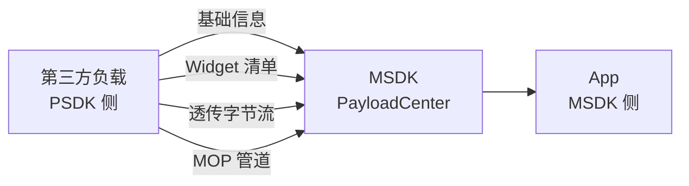
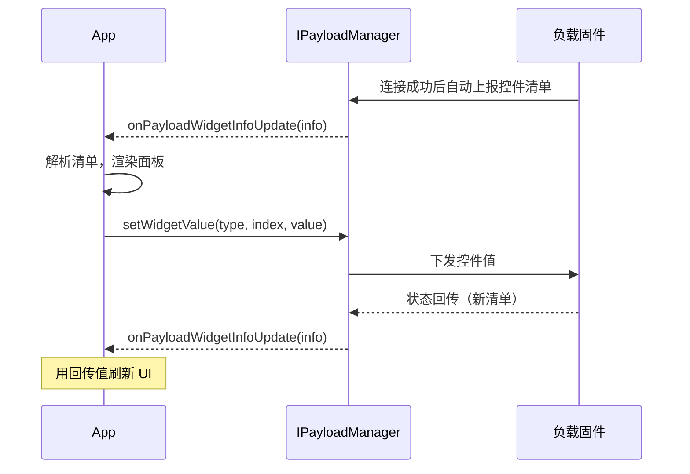
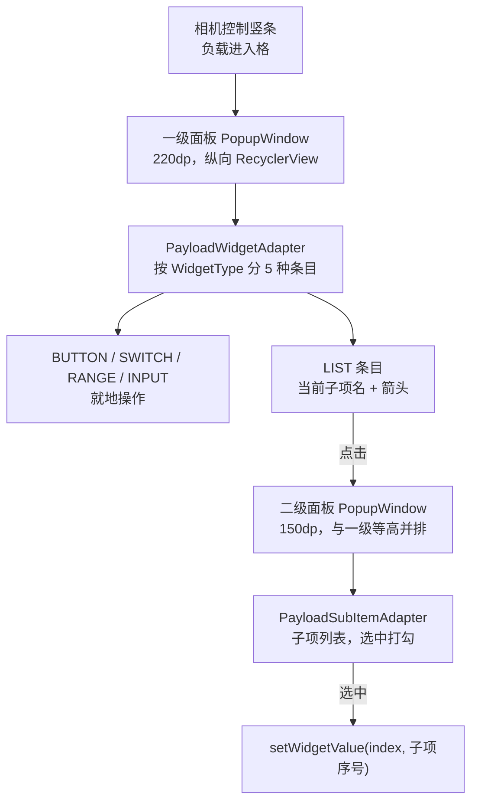
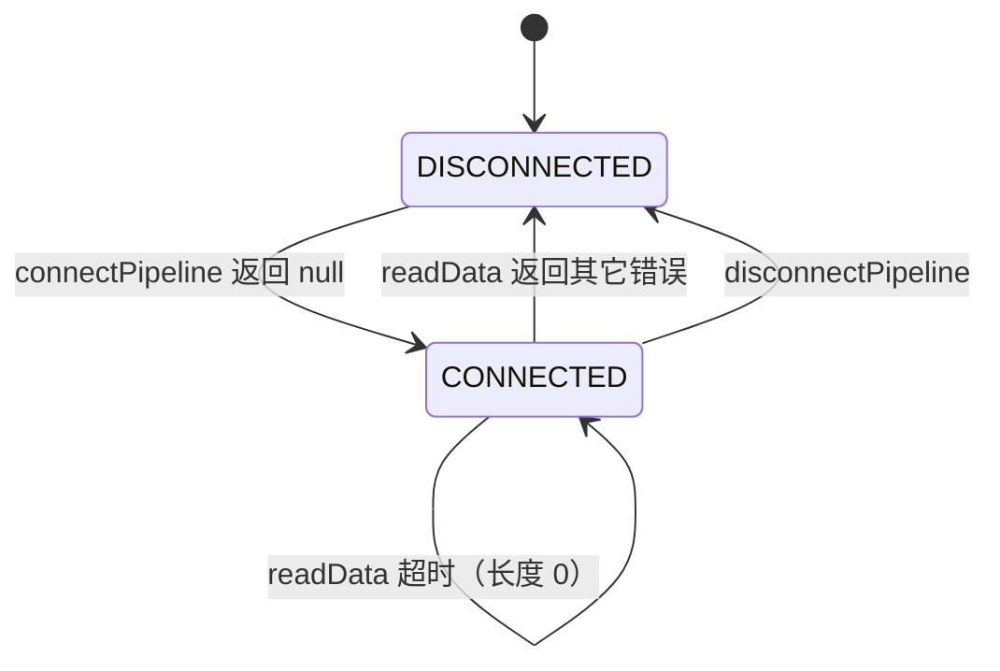

# 第三方负载开发

## 一、第三方负载是什么

第三方负载是挂到飞行器挂载位上的外部硬件，通过 **SkyPort 1.0 / SkyPort 2.0 / E-Port（X-Port）** 接入。飞行器负责供电、通信、图传，负载自己决定「有什么功能」。

一句话划清职责：**负载侧用 PSDK 开发，App 侧用 MSDK 开发，两边通过挂载位这条链路对话**。MSDK 不替负载定义功能，只负责把负载的能力「翻译」成 App 能用的形式。

机型决定挂载位，挂载位决定能拿到什么。M300 RTK 的扩展位是 OSDK 口，M350 RTK 的扩展位是 E-Port 口；多挂载位机型还额外提供 `PORT_1` … `PORT_7`。同一套代码在不同机型上拿到的 `PayloadIndexType` 集合不同。

## 二、能力地图：四类通道

拿到一个负载后，App 能做的事只有四类，先想清楚要用哪一类，再往下看对应的章节。

| 通道 | 方向 | 关键 API | 用在什么场景 | 起始版本 |
|------|------|---------|-------------|---------|
| 基础信息 | 负载 → App | `PayloadBasicInfoListener` | 判断插没插、型号、固件、功能是否开启 | 5.2.0 |
| 控件（Widget） | 双向 | `PayloadWidgetInfoListener`、`pullWidgetInfoFromPayload`、`setWidgetValue` | 让负载把自己的操作界面「投影」到 App | 5.2.0 |
| 透传数据 | 双向 | `sendDataToPayload`、`PayloadDataListener` | 走私有协议的原始字节流 | 5.2.0 |
| 管道（Pipeline / MOP） | 双向 | `PipelineManager.connectPipeline`、`Pipeline.readData/writeData` | 与 PSDK 设备建立可协商的双向数据管道 | 5.3.0 |

四类通道的关系是「能力递增、代价递增」：基础信息零成本；控件通道免写界面但受负载固件的清单约束；透传简单但带宽只有 3 KB/s；管道灵活、支持可靠传输，代价是要和 PSDK 开发者协商管道 ID 与协议。

> [!IMPORTANT] 控件通道的界面由负载决定，App 只能渲染
> App ==不能自定义控件==，只能把负载上报的清单原样画出来。有几个按钮、滑块量程多少，全部由负载固件决定；App 的工作是「解析 + 渲染 + 转发」。
>
> 所以选型顺序是：**能上控件就不写透传，能用透传就不上管道**。反过来说，如果负载固件没实现 Widget 协议，MSDK 这边再怎么写也拉不到控件——只能退到透传自己画界面。



## 三、入口：PayloadCenter 与挂载位

`PayloadCenter.getInstance().getPayloadManager()` 返回 `Map<PayloadIndexType, IPayloadManager>`，每个挂载位一个管理器。

| `PayloadIndexType` | 含义 |
|--------------------|------|
| `LEFT_OR_MAIN` | 左弦（主）挂载位 |
| `RIGHT` | 右弦挂载位 |
| `UP` | 上方挂载位 |
| `EXTERNAL` | 扩展位；M300 RTK 上是 OSDK 口，M350 RTK 上是 E-Port 口 |
| `PORT_1` … `PORT_7` | 多挂载位机型的各 Port |

取到 map 之后必须过滤：==有 key 不等于有负载==。这张表给的是「飞行器**支持**负载的挂载位」，不是「**已插上**负载的挂载位」——没插时 key 照样在，value 是 `null`。对 `null` 调监听注册就是空指针闪退。

```java
import java.util.Collections;
import java.util.HashMap;
import java.util.Map;

import dji.v5.manager.aircraft.payload.PayloadCenter;
import dji.v5.manager.aircraft.payload.PayloadIndexType;
import dji.v5.manager.aircraft.payload.listener.PayloadBasicInfoListener;
import dji.v5.manager.aircraft.payload.listener.PayloadWidgetInfoListener;
import dji.v5.manager.interfaces.IPayloadCenter;
import dji.v5.manager.interfaces.IPayloadManager;

// 每个挂载位记住自己的监听器，注销时按位退订
private final Map<PayloadIndexType, PayloadBasicInfoListener> basicListenerMap = new HashMap<>();
private final Map<PayloadIndexType, PayloadWidgetInfoListener> widgetListenerMap = new HashMap<>();

/** 取出所有挂载位的负载管理器；取不到返回空 map，别让调用方层层判空 */
private Map<PayloadIndexType, IPayloadManager> getPayloadManagerMap() {
    IPayloadCenter center = PayloadCenter.getInstance();
    if (center == null) {
        return Collections.emptyMap();
    }
    Map<PayloadIndexType, IPayloadManager> map = center.getPayloadManager();
    return map == null ? Collections.emptyMap() : map;
}
```

## 四、基础信息：先确认负载是什么

`PayloadBasicInfo` 是排查一切的起点——尤其当负载「插着却不工作」时，这一位能省掉大量猜测。

| 方法 | 说明 |
|------|------|
| `isConnected()` | 是否已连接 |
| `getPayloadProductName()` | 制造商自定义的产品名（如 `DJI Zenmuse H30T`），可能为空 |
| `getPayloadType()` | 接入形态：`SKYPORT_1` / `SKYPORT_2` / `X_PORT` |
| `getPayloadProductPhaseType()` | 产品阶段：`PHASE_DEVELOPMENT` / `PHASE_RELEASE` |
| `getSerialNumber()` / `getFirmwareVersion()` | 序列号、固件版本 |
| `isFeatureOpened()` | 产品功能是否完全打开 |

`getPayloadType()` 给的是**接入形态**而不是型号，型号只在 `getPayloadProductName()` 这个自由字符串里。两者不要混用。

`isFeatureOpened()` 返回 `false` 时，文档列出四种可能：PSDK 未绑定、负载应用自身异常、加密芯片异常、飞行器不支持该负载。这四种现象在 App 侧长得完全一样，只能靠这一位区分——所以日志里一定要打印它。

## 五、控件通道（Widget）

### 5.1 数据类族

六个类分工明确，记住「谁包着谁」就不会混。

| 类 | 包 | 作用 | 关键成员 |
|----|----|------|---------|
| `PayloadWidgetInfo` | `...payload.data` | 一次上报的完整快照 | `getMainInterfaceWidgetList()`、`getConfigInterfaceWidgetList()`、`getTextInputBoxWidget()`、`getFloatingWindowWidget()`、`getSpeakerWidget()` |
| `PayloadWidget` | `...payload.widget` | 单个控件 | `getWidgetName()`、`getWidgetType()`、`getWidgetIndex()`、`getWidgetValue()`、`getIconFilePath()`、`getHintMessage()`、`getSubItemsList()` |
| `IconFilePath` | `...payload.data.bean` | 两套图标路径 | `getSelectedIconPath()`、`getUnSelectedIconPath()` |
| `SubItems` | `...payload.data.bean` | LIST 的子项 | `getSubItemsName()`、`getSubItemsIconFilePath()` |
| `WidgetValue` | `dji.sdk.keyvalue.value.payload` | 下发用的三元组 | `getType()`、`getIndex()`、`getValue()` |
| `WidgetType` | `dji.sdk.keyvalue.value.payload` | 控件类型枚举 | `BUTTON`、`SWITCH`、`RANGE`、`LIST`、`INPUT` |

`PayloadWidgetInfo` 除了两个控件列表，还挂着三类特殊控件：文本输入框、浮窗、喊话器。它们各有独立的能力查询（`isEnabled()`、`isTTSEnabled()`、`isVoiceEnabled()`），内容不靠 `PayloadWidget` 描述，做完整复刻时不能漏。

两份清单的用法见 5.5：主界面控件为空时要退回配置界面控件。

### 5.2 五种控件类型

| 类型 | 界面形态 | 值域 | 什么时候下发 |
|------|---------|------|-------------|
| `BUTTON` | 图标 + 名称，整行可点 | 1 | 点一下发 1；负载收到后自己复位成 0 |
| `SWITCH` | 图标 + 名称 + 开关 | 0 / 1 | 切换即发，开 1、关 0 |
| `RANGE` | 图标 + 名称 + 滑块 + 数值 | 0–100 | 只在松手时发，拖动过程中不发 |
| `LIST` | 图标 + 名称 + 当前项名 + 箭头 | 0–N | 选中子项后发子项序号 |
| `INPUT` | 图标 + 名称 + 输入框 + 发送 | 任意 int | 点发送时发输入值 |

`LIST` 的 $N$ 由负载固件决定，子项个数比值的上限多一个：

$$
\text{子项个数} = N + 1, \qquad \text{合法控件值} \in [0, N]
$$

所以 `getSubItemsList().size()` 拿到的是 $N+1$，`getWidgetValue()` 最大只能是 $N$。铺列表按 `size()`，定位选中项按 `value()`，两者不要互相换算。

`BUTTON` 的值语义最容易误解：它 ==按下变 1、读数复位 0==，是瞬时脉冲而不是状态。要画「开/关」请用 `SWITCH`。

`RANGE` 只在松手下发是硬约束：拖动中每帧都发会把控件通道打成拥塞，滑动条自己也会卡。拖动时只更新旁边的数字，`onStopTrackingTouch` 里再发。

### 5.3 拉取控件清单

「拉取」在 MSDK 里有三层含义，别混用：

1. **默认拉取**：飞行器成功连接负载后，MSDK 自动拉一次，App 什么都不用做。
2. **监听获取**：`addPayloadWidgetInfoListener` 注册后，负载每次上报（含初始那次）都会回调 `onPayloadWidgetInfoUpdate`。绝大多数场景只需要这一层。
3. **主动重拉**：`pullWidgetInfoFromPayload(callback)` 是补救手段。



> [!TIP] 什么时候才需要主动拉
> 判定条件很干脆：**监听器注册后一次回调都没有**。只要收到过 `onPayloadWidgetInfoUpdate`，就说明默认拉取已生效，再调 `pullWidgetInfoFromPayload` 纯属浪费——而且大概率触发下一次全量上报，只会让链路更忙。
>
> 例外是「进页面时补一次」：负载的控件清单是变化才上报，页面重建时缓存可能已失效，此时主动拉一次是合理的，其余时间全靠回传。

注册监听要遍历整张 map 逐个挂，单个挂载位失败不能影响其它：

```java
private boolean payloadListenerRegistered = false;

private void ensurePayloadListeners() {
    if (payloadListenerRegistered) {
        return;
    }
    payloadListenerRegistered = true;

    for (Map.Entry<PayloadIndexType, IPayloadManager> entry : getPayloadManagerMap().entrySet()) {
        final PayloadIndexType index = entry.getKey();
        final IPayloadManager manager = entry.getValue();
        // 飞行器支持该挂载位但没插负载 —— 这里必须判空
        if (index == null || manager == null) {
            continue;
        }
        try {
            PayloadBasicInfoListener basicListener = info -> {
                if (info == null) {
                    return;
                }
                Log.i(TAG, "负载[" + index + "] " + info.getPayloadProductName()
                        + " 类型=" + info.getPayloadType()
                        + " 阶段=" + info.getPayloadProductPhaseType()
                        + " 功能已开启=" + info.isFeatureOpened()
                        + " SN=" + info.getSerialNumber()
                        + " 固件=" + info.getFirmwareVersion());
            };
            PayloadWidgetInfoListener widgetListener = info -> onWidgetInfoUpdated(index, info);

            basicListenerMap.put(index, basicListener);
            widgetListenerMap.put(index, widgetListener);

            manager.addPayloadBasicInfoListener(basicListener);
            manager.addPayloadWidgetInfoListener(widgetListener);
        } catch (Throwable t) {
            // 单个挂载位注册失败不影响其它挂载位
            Log.w(TAG, "注册负载监听失败: " + index, t);
        }
    }
}

/** 主动重拉：仅在监听器完全没回调、或页面刚重建时用 */
private void pullWidgetInfo(IPayloadManager manager) {
    if (manager == null) {
        return;
    }
    manager.pullWidgetInfoFromPayload(new CommonCallbacks.CompletionCallback() {
        @Override public void onSuccess() { Log.i(TAG, "已请求负载控件清单"); }

        @Override public void onFailure(@NonNull IDJIError error) {
            Log.w(TAG, "请求负载控件清单失败: " + error.errorCode());
        }
    });
}
```

### 5.4 下发控件值

下发只有一条 API：`setWidgetValue(WidgetValue, CompletionCallback)`。

```java
/** 把控件值下发给负载；类型与索引都必须取该控件自己上报的值 */
private void sendWidgetValue(IPayloadManager manager, PayloadWidget widget, int newValue) {
    if (widget == null || manager == null) {
        return;
    }
    WidgetValue value = new WidgetValue(widget.getWidgetType(), widget.getWidgetIndex(), newValue);
    manager.setWidgetValue(value, new CommonCallbacks.CompletionCallback() {
        @Override public void onSuccess() {
            // 只代表指令被接受了，硬件状态还没变
        }

        @Override public void onFailure(@NonNull IDJIError error) {
            Log.w(TAG, "控件下发失败: " + error.errorCode());
        }
    });
}
```

> [!IMPORTANT] 类型和索引不能自己猜
> `WidgetValue` 的 `type` 必须来自该控件的 `getWidgetType()`，`index` 必须来自 `getWidgetIndex()`。==传错类型负载会直接返回 `SYSTEM_ERROR`==，而错误码里不会告诉你「是类型错了」。
>
> 尤其不要把「列表里的第几个」当索引——控件索引由负载固件分配，跟 UI 顺序、跟 `RecyclerView` 的 position 都不是一回事。UI 位置会随清单变化，索引不会。

下发的三条铁律：

1. **类型与索引取上报值**，不自己拼。
2. **不做乐观更新**：控件值的唯一真相是 ==回传值==。`onSuccess` 只表示指令被接受；点开关就翻转本地 UI，会出现「界面显示已开、硬件其实没动」，之后所有基于 UI 状态的判断全部失真。正确链路是「点击 → 只发指令 → 等回传 → 用回传值重绘」。
3. **一次操作只发一次**，滑块等松手、按钮等 click，不为「手感」补发。

### 5.5 解析清单：两个必踩的坑

**① 优先用主界面清单，为空退回配置清单**

```java
private void onWidgetInfoUpdated(PayloadIndexType index, PayloadWidgetInfo info) {
    if (info == null) {
        return;
    }
    List<PayloadWidget> list = info.getMainInterfaceWidgetList();
    if (list == null || list.isEmpty()) {
        // 主界面清单为空 → 退回配置界面清单，保证至少有一组能操作
        list = info.getConfigInterfaceWidgetList();
    }
    final List<PayloadWidget> widgets = (list == null)
            ? new ArrayList<>() : new ArrayList<>(list);

    // 谁上报了控件，谁就是活动负载
    if (!widgets.isEmpty() && activePayloadIndex != index) {
        activePayloadIndex = index;
    }

    runOnUiThread(() -> {
        if (activePayloadIndex == index) {
            latestWidgets.clear();
            latestWidgets.addAll(widgets);
            refreshPanel();
        }
    });
}
```

**② 回传是「风暴」，必须去重**

负载约 1 Hz 心跳重复上报同一份清单；每次下发状态类命令（`LIST`、`SWITCH`）后，还会在几十毫秒内连发十几遍**完全相同**的清单——实测 20 ms 内 18 次。每次都 `notifyDataSetChanged()` 的话，用户正在拖的滑块会被重建、正在输入的 `EditText` 会丢焦点。

去重键取每个控件的「索引:类型:值」：

```java
/** 清单签名：只关心会影响 UI 的三项 */
private static String buildSignature(List<PayloadWidget> widgets) {
    StringBuilder sb = new StringBuilder();
    if (widgets != null) {
        for (PayloadWidget w : widgets) {
            if (w == null) {
                continue;
            }
            sb.append(w.getWidgetIndex()).append(':')
              .append(w.getWidgetType()).append(':')
              .append(w.getWidgetValue()).append(';');
        }
    }
    return sb.toString();
}

private String lastSignature = "";

public void submitWidgets(List<PayloadWidget> widgets) {
    String signature = buildSignature(widgets);
    if (signature.equals(lastSignature)) {
        return;
    }
    lastSignature = signature;

    widgetList.clear();
    if (widgets != null) {
        widgetList.addAll(widgets);
    }
    notifyDataSetChanged();
}
```

名称、图标路径、提示文本不进签名——它们运行期不变，放进去反而让「改了个名字」被当成需要重绘。

### 5.6 渲染成两级面板

Pilot 2 的形态是「点图标 → 弹窄面板 → `LIST` 再弹二级列表」。



界面层有三个必守的点：

**① 程序设值会触发监听，必须摘挂**

```java
// ① 先摘掉监听器 —— 否则下面 setChecked 会触发回调，把值又发回负载
switchView.setOnCheckedChangeListener(null);
// ② 按负载回传的当前值设置开关状态
switchView.setChecked(widget.getWidgetValue() == 1);
// ③ 再把监听器挂回去，这次才是「用户在操作」
switchView.setOnCheckedChangeListener((buttonView, isChecked) ->
        dispatch(widget, isChecked ? 1 : 0));
```

滑块同理，`setProgress` 会走 `onProgressChanged`。==程序设值也会触发监听==，在「回传驱动 UI」的模式下，它直接把回传又变回下发。去重只能挡住「内容没变」，摘挂监听才是从源头断掉回环。

**② 整行可点，别只让开关本体可点**。`SwitchCompat` 的触摸区只有 `minWidth` 那几十 dp，点在图标或名称上毫无反应，现象是「有时能触发、有时没效果」。做法是整行 `setOnClickListener` 转发成 `toggle()`。

**③ 图标与文本都要判空**。图标是负载给的**本地文件路径**，`LIST` 型控件常常整个返回 `null`，子项在第三方负载上常只有名字没图标。图标为空要清成 `null` drawable（否则复用条目残留上一个控件的图），子项没图标就退化成文字标签。`getHintMessage()` 也可能为空，可以塞进 `contentDescription`。加载图标时关掉淡入动画，两套图标切换才不会看起来在闪。

> [!WARNING] 在「回传 → 刷新」链路里再拉一次会自激
> 上面的 `refreshPanel()` 由 `onPayloadWidgetInfoUpdate` 驱动。**千万不要在这个方法里调 `pullWidgetInfoFromPayload`**：拉取让负载再上报，上报又触发刷新，刷新又调拉取——==面板会以 1 Hz 无限重拉==，链路被打满，日志刷屏。
>
> 需要主动拉取时，只在「面板打开」这一刻拉一次。

> [!CAUTION] 一级面板关掉后开二级面板会闪退
> 二级面板是独立 `PopupWindow`，若用一级面板内部的 View 当锚点，`showAtLocation` 会取该 View 的 `windowToken` 当父窗口。一级浮窗一消失，token 在 WindowManager 里就不存在了，直接抛 `WindowManager$BadTokenException`。
>
> 稳妥做法：锚点传 Activity 的 `getWindow().getDecorView()`，坐标自己算成屏幕绝对坐标；给 `showAtLocation` 套 `try-catch`；并在一级面板的 `setOnDismissListener` 里把二级面板一起收起。

## 六、数据透传

不依赖控件协议，直接收发字节。适合负载已有私有协议、或需要传二进制数据的场景。

| 方法 | 方向 | 说明 |
|------|------|------|
| `sendDataToPayload(byte[], cb)` | App → 负载 | 发送命令数据 |
| `addPayloadDataListener(l)` | 负载 → App | 回调 `onDataFromPayloadUpdate(byte[])` |

```java
manager.addPayloadDataListener(data -> {
    // data 为 null 或空数组都出现过，先判再解析
    if (data == null || data.length == 0) {
        return;
    }
    Log.i(TAG, "收到负载数据 " + data.length + " 字节");
});

manager.sendDataToPayload(bytes, new CommonCallbacks.CompletionCallback() {
    @Override public void onSuccess() { }
    @Override public void onFailure(@NonNull IDJIError error) { }
});
```

> [!WARNING] 透传有硬性速率上限
> 通道约 ==3 KB/s==；单次长度 M300 RTK 上限 ==100 字节==，其他机型 ==255 字节==。超长会被截断或直接失败。
>
> 设计协议时按最严格的那个值切包，并假设带宽随时可能被图传抢占。

按帧发送的总耗时：

$$
T = \frac{N \cdot L}{R}, \qquad R = 3\ \text{KB/s}
$$

$N$ 是帧数、$L$ 是单帧字节数。传一张 100 KB 的图，即使按上限切片也要 30 秒以上——负载协议要设计成小包、可断点，不要指望大块传输。

## 七、管道：与 PSDK 设备的双向通道

管道（Pipeline，底层是 MOP）比透传更规整：有连接状态、有可靠/非可靠两种传输模式、有独立的管道 ID。它要求**负载侧 PSDK 与 App 侧协商同一个管道 ID**，所以只适用于自己可控的负载。

| 方法 | 说明 |
|------|------|
| `PipelineManager.getInstance().connectPipeline(id, deviceType, controlType)` | 建立连接，同步返回 `IDJIError`（成功为 `null`） |
| `disconnectPipeline(...)` | 断开，参数与连接时一致 |
| `addPipelineConnectionListener(l)` | 管道表变化回调，参数是 `Map<Integer, Pipeline>` |
| `getPipelines()` | 同步取已连接管道表，键是管道 ID |
| `Pipeline.readData(byte[])` / `writeData(byte[])` | 读写，返回 `DataResult` |
| `DataResult.getLength()` / `getError()` | 本次读写长度与错误 |

两个枚举决定行为：

| 枚举 | 取值 | 含义 |
|------|------|------|
| `PipelineDeviceType` | `ONBOARD` / `PAYLOAD` | 对端是机载计算机还是负载 |
| `TransmissionControlType` | `STABLE` / `UNRELIABLE` | 可靠传输（类 TCP，保序）/ 非可靠（类 UDP，可能丢包） |

读写模型是**主动轮询**，不是回调推：`readData` 由 App 循环调用，超时返回长度为 0。示例代码的写法是递归调用 `readData`，并把 `TIMEOUT` 错误码排除在「断开」判定之外——超时是正常的，其它错误才该断开。



> [!NOTE] 文档签名与示例签名不一致
> 官方 API 文档里 `connectPipeline` 是 3 个参数 `(int pipelineId, PipelineDeviceType, TransmissionControlType)`；官方示例 `MopVM.kt` 实际调的是 4 个参数，第一个是 `ComponentIndexType`（挂载位）。
>
> 以==实际 jar 的签名为准==（`javap` 或 IDE 补全），文档滞后是常态。这也解释了为什么断开时必须把连接时的参数原样传回——它需要靠挂载位 + ID 一起定位管道。

## 八、负载相机与图传

第三方负载可以自带相机，MSDK 侧通过**挂载位（`ComponentIndexType`）**统一寻址，不区分是 DJI 相机还是负载相机。

```java
// 可用画面源变化（插入/拔出负载都会触发）
ICameraStreamManager.AvailableCameraUpdatedListener listener =
        new ICameraStreamManager.AvailableCameraUpdatedListener() {
            @Override
            public void onAvailableCameraUpdated(@NonNull List<ComponentIndexType> list) {
                // 回调可能在子线程，刷新界面要用 postValue / runOnUiThread
                // 顺带在这里注册负载监听：此时链路一定是通的
                ensurePayloadListeners();
            }

            @Override
            public void onCameraStreamEnableUpdate(@NonNull Map<ComponentIndexType, Boolean> map) {
                // 必须实现，留空即可 —— 见下方注意事项
            }
        };
```

挑「负载那一路」时按优先级试：`LEFT_OR_MAIN` → `RIGHT` → `UP` → `PORT_1..4`，都不匹配就取第一个既不是 `FPV` 也不是 `VISION_ASSIST` 的。

能不能切镜头（例如切红外），看两个 Key：`KeyCameraVideoStreamSourceRange`（支持哪几种镜头源，有几项就能切几路）和 `KeyCameraVideoStreamSource`（当前生效的那一路）。范围只有 0~1 项就是单镜头相机，别给用户画切换按钮。

> [!NOTE] 注册监听的最佳时机与一个诡异的崩溃
> 负载管理器依赖图传链路，**在 `onAvailableCameraUpdated` 里注册负载监听最稳**，此时负载链路一定是通的。
>
> 另外 `onCameraStreamEnableUpdate` 看着没用（只是告诉你哪几路码流被使能），但**绝对不能删**。它在 5.18.0 的 jar 里带默认实现，所以少写也能编译通过；运行时的实现却把它当抽象方法回调，于是抛 `java.lang.AbstractMethodError` —— 现象是「点进页面直接闪退」，堆栈里只有一行 `abstract method ... onCameraStreamEnableUpdate`。留空实现即可。

负载相机与 DJI 原生相机的能力差异：负载相机**不走 `CameraKey`** 那一套变焦/曝光接口，能控制什么完全看负载暴露了什么（`Widget` 或私有协议）。负载若提供媒体文件，`IMediaManager` 也未必拿得到——TZ130 这类设备的媒体协议常是桩实现，存储信息不随拔卡变化、文件列表与下载全部超时，此时可用的往往只有图传链路，要存图只能截帧。

DJI 原生相机的变焦、曝光、对焦见 [[04_云台与相机控制]]。

## 九、妙算（IntelligentBox）

妙算是一类特殊的负载：自带算力，能跑 App。MSDK 5.15.0 起提供独立管理器，与 `IPayloadManager` 分开取。

```java
Map<PayloadIndexType, IIntelligentBoxManager> boxes =
        PayloadCenter.getInstance().getIntelligentBoxManager();
```

| 方法 | 说明 |
|------|------|
| `addBoxInfoListener(l)` | 回调 `onBoxInfoUpdate(IntelligentBoxInfo)` 与 `onBoxAppInfoUpdate(List<IntelligentBoxAppInfo>)` |
| `getBoxSerialNumber(cb)` | 读序列号 |
| `enableApp(appID, cb)` / `disableApp(appID, cb)` | 开启 / 关闭妙算上某个应用模型 |
| `uninstallApp(appID, cb)` | 卸载应用 |

`IntelligentBoxInfo` 给的是算力侧健康度：CPU/GPU 负载与频率、总/已用内存、总/已用 SSD、电量。`IntelligentBoxAppInfo` 给的是应用清单：`getAppID()`、`getAppName()`、`getAppVersion()`、`getAppSize()`、`getAppDescription()`、`isEnabled()`。

只做「识别负载」的话不需要碰这一层；要遥控妙算上的算法启停，就必须走它。

## 十、坑清单

| 现象 | 原因 | 处理 |
|------|------|------|
| 一进页面闪退 | 对 `null` manager 注册监听 | 遍历 map 时判 `index`/`manager` 非空 |
| 控件面板永远空白 | 负载没实现 Widget 协议 | 看 `onPayloadWidgetInfoUpdate` 是否 0 次回调；0 次就只能走透传 |
| 面板标题空白 | 负载未给产品名 | 空值给占位文案 |
| 控件点了没反应 | 点在图标/名称区，只有开关本体可点 | 整行可点，转发到开关 |
| 开关闪烁、界面与硬件不一致 | 程序设值触发监听又下发 | 摘监听 → 设值 → 挂回 |
| 日志像死循环 | 1 Hz 心跳 + 下发后连发十余次相同清单 | 索引:类型:值 签名去重 |
| 控件下发返回 `SYSTEM_ERROR` | 类型或索引取错 | 一律用控件自己上报的值 |
| 面板里什么都没有 | 主界面清单为空 | 退回配置界面清单 |
| 负载插着但什么都不工作 | `isFeatureOpened()` 为 `false` | 看 PSDK 绑定 / 负载日志 / 加密芯片 / 机型支持 |
| 退出页面后仍收到回调 | 没注销监听 | 逐个挂载位 `removeXxxListener`，并复位注册标志 |
| 二级面板偶尔闪退 | `BadTokenException` | 锚点用 `decorView` + `try-catch` |
| 点进负载页就崩，堆栈只有 `AbstractMethodError` | `onCameraStreamEnableUpdate` 未实现 | 补上空实现 |

注销要按挂载位逐个退订，退完清空缓存 map 并复位标志——否则页面重建时标志还是 `true`，监听再也注册不上。

```java
private void unregisterPayloadListeners() {
    if (!payloadListenerRegistered) {
        return;
    }
    for (Map.Entry<PayloadIndexType, IPayloadManager> entry : getPayloadManagerMap().entrySet()) {
        IPayloadManager manager = entry.getValue();
        if (manager == null) {
            continue;
        }
        try {
            PayloadBasicInfoListener basic = basicListenerMap.get(entry.getKey());
            if (basic != null) {
                manager.removePayloadBasicInfoListener(basic);
            }
            PayloadWidgetInfoListener widget = widgetListenerMap.get(entry.getKey());
            if (widget != null) {
                manager.removePayloadWidgetInfoListener(widget);
            }
        } catch (Throwable t) {
            Log.w(TAG, "注销负载监听失败: " + entry.getKey(), t);
        }
    }
    basicListenerMap.clear();
    widgetListenerMap.clear();
    payloadListenerRegistered = false;
}
```

## 十一、边界

- **负载侧不是 MSDK 的范围**。Widget 清单长什么样、按键按下后做什么，全部写在 PSDK 侧；App 侧只能渲染与转发。
- **固件升级、模拟器、避障、喊话器、日志**等周边能力不在这里，见 [[09_设备维护与负载扩展]]。其中喊话器若以第三方负载形态出现，走的是 `SpeakerWidget`（见 5.1），与 `MegaphoneManager` 是两条路。
- **负载热插拔**：拔掉后可用画面源列表变化，此时要重新挑相机、重新注册监听、重新拉控件清单。不要假设挂载位在页面生命周期内不变。
- **多负载同时在线**时一次只展示一个负载的控件，需要「活动负载」概念。判据取最简单的那个：谁上报了主界面控件，谁就是活动负载。
